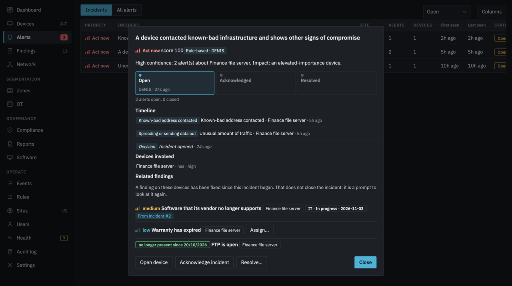
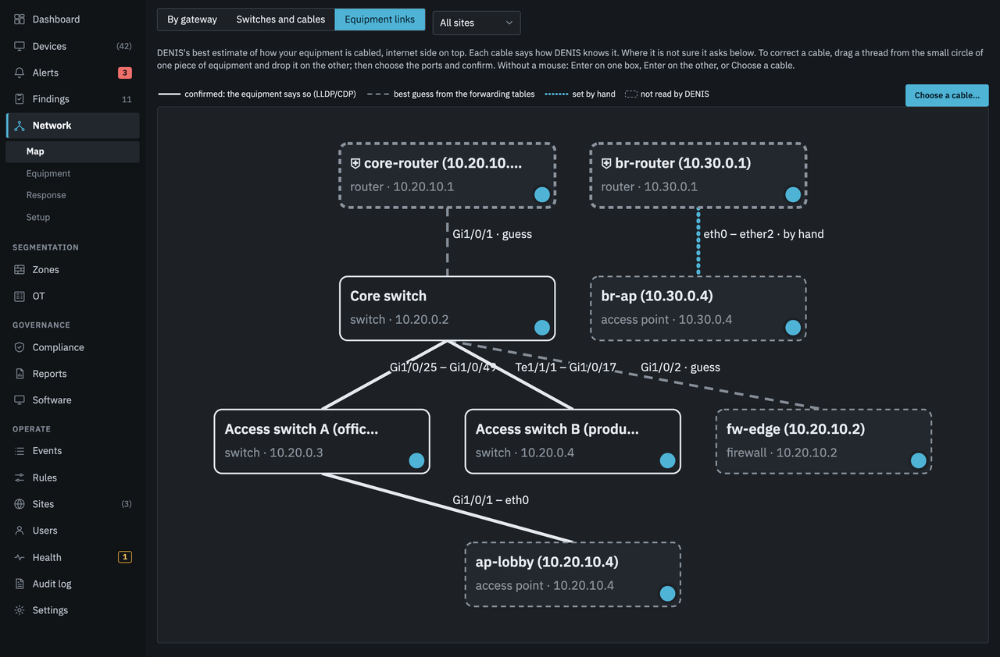
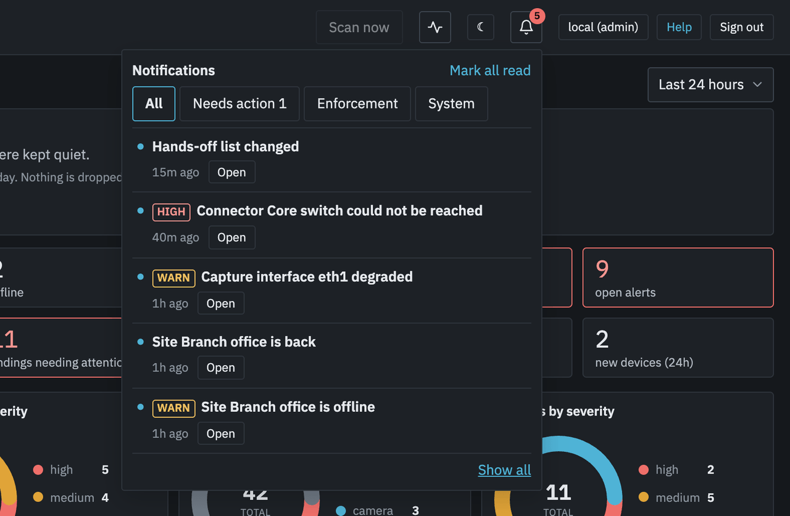
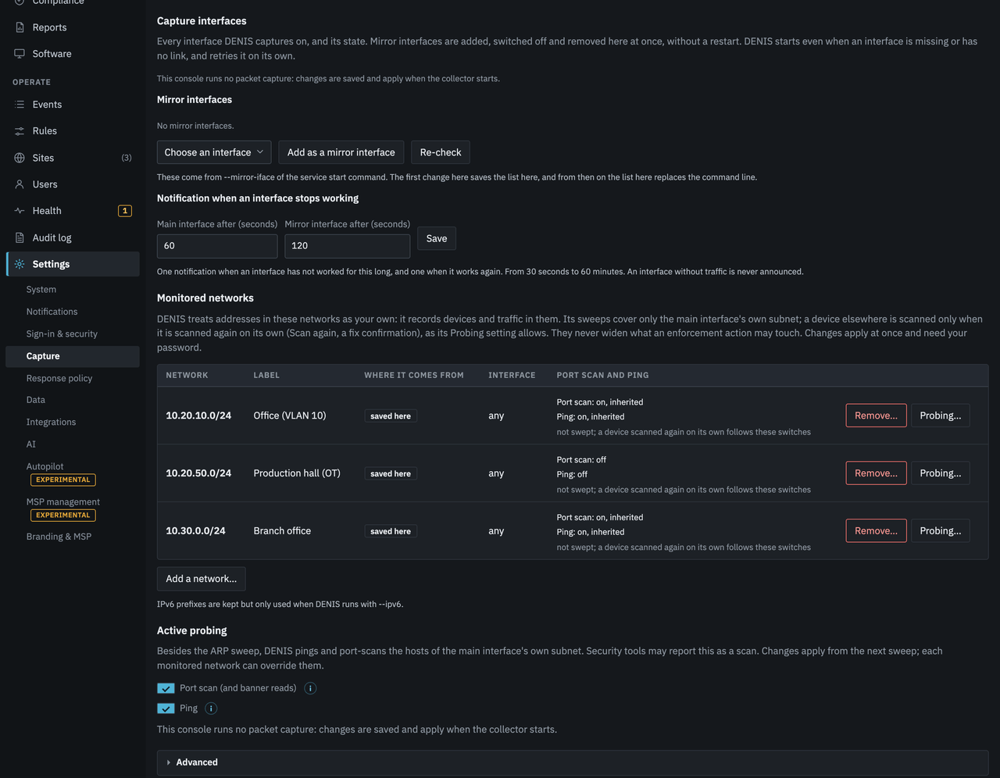
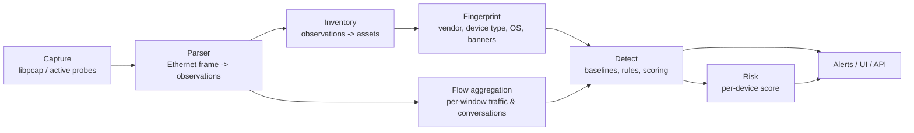

# DENIS

**Know every device. Understand every connection.**

**NDR and NAC, and still a network visibility and security monitoring platform**; for small businesses, mid-size businesses, MSPs, **OT and IT** — passive-first, self-hosted, one Rust binary. Detection is the main product; response and access control work through equipment you already own, are off by default and, apart from Cisco Catalyst switch control, are experimental or only partly tested.

[](https://github.com/stefanmesaros/denis/actions/workflows/ci.yml)
[](https://github.com/stefanmesaros/denis/releases/latest)
[](LICENSE)

DENIS is **not** a SIEM, an AI security platform, a SOC replacement or a UTM/firewall appliance. It does not sit
inline and, by default, it does not block anything on its own. Enforcement is off by default; when an administrator
switches it on, DENIS can act through 20 kinds of connectors (SNMP switch ports, firewalls, controllers, cloud and
hypervisors): block or quarantine a device, block a flow, end its sessions or switch a port off, each one confirmed by
an administrator (see [Enforcement](docs/enforcement.md)). Automatic enforcement by rules (level (b)) and letting
Autopilot block (level (c)) are experimental and off by default. Otherwise it is a passive, out-of-band layer underneath
those things: an always-current inventory of what is actually on your network, who each device talks to, and an
explainable alert the moment that changes. A UTM controls what crosses your perimeter; DENIS shows what is happening *inside* it,
including the east-west and OT/industrial traffic a perimeter box was never in a position to see.


**[See DENIS in action →](#demo-try-denis-without-installing-a-sensor)** no capture, no login, a fictional company already loaded.

---

## The problem

Most small IT teams know their laptops and servers. They usually do **not** have a current answer for:

* What is actually on my network — every printer, camera, smart-plug, PLC, someone's personal router?
* What *is* this device, and how sure are we?
* Who is it talking to, and is that normal?
* What changed since yesterday?
* Of everything flagged, what should I look at first?

Spreadsheets go stale the day after you write them. DENIS answers these questions continuously, by watching the
network itself rather than trusting whatever was last typed into a CMDB.

## What DENIS does

1. **Discover.** Passive listening (ARP, DHCP, mDNS, SSDP, LLDP/CDP, PROFINET, TCP/IP stack fingerprints) plus
   polite active discovery (ARP sweep, ping, port scan). Industrial devices are only ever listened to, never
   probed. A security tool on the same network may report the sweep as a port scan:
   [what to do](docs/security-tools.md); the port scan and the ping can each be switched off.
2. **Identify.** Manufacturer from the IEEE OUI registry; device type and operating system from weighted evidence
   (DHCP option lists, mDNS, SSDP, open ports, names…) — every guess lists the rules behind it, and your correction
   always wins. Where a service reveals it, DENIS reads the product and version from nine banners (SSH, FTP, SMTP,
   HTTP, Telnet, MySQL/MariaDB, SMB, MSSQL).
3. **Understand.** A per-device traffic baseline (destinations, ports, volume, active hours — needs `--flows`), an
   industrial communications matrix (who talks to whom, over which protocol, reads vs. writes vs. control), "Top
   talkers" leaderboards for who is moving the most data, and — for any public IP address mentioned anywhere —
   country (flag included), ASN, AS organisation and reverse-DNS hostname from a local GeoIP database (DB-IP Lite
   by default, auto-updated monthly, or your own licensed MaxMind file), never a live lookup that sends your
   traffic's addresses to a third party.
4. **Detect, with a score you can read.** New device, rogue DHCP server, ARP hijack / gateway takeover, a new
   destination or port, unusual volume or hour, a device gone silent, a burst of newcomers, contact with a
   known-bad address — each scored 0–100 with the factors behind the score and what to do about it. No black-box
   number: every point is attributed to a named reason.
5. **Protect OT.** Passive decoding of Modbus, S7comm and S7comm-plus, EtherNet/IP-CIP, DNP3, BACnet, OPC UA, IEC 60870-5-104,
   IEC 61850 (MMS, GOOSE, Sampled Values) and PROFINET IO (CODESYS is recognised only);
   alerts for control commands DENIS can see on the wire (a PLC stop, a program download; not S7comm-plus stop or download,
   and a command sent over an encrypted channel can be missed; messages split across TCP
   segments or IP fragments are followed: see the OT guide), traffic crossing the network boundary, Purdue-level skipping, and writes from a device that
   should only ever read.
6. **Manage the register.** Owner, location, serial number, asset tag, warranty, criticality, tags, custom fields,
   120+ icons, 120+ device types, full change history, a review queue for new devices, CSV import/export.
   Optionally cross-referenced against **Microsoft Entra ID, Intune, on-premises Active Directory, Jamf Pro, and
   Azure / AWS / GCP virtual machines** (CMDB import, Settings → Integrations): read-only, matched by exact
   hostname, shown as extra context on the device's own panel (OS, compliance state, power state) — never used
   to override a device's own fingerprinted identity. A Nessus / Tenable.io scanner's findings can be imported
   the same way, matched by IP then hostname.
7. **Report.** *Findings* (known-exploited vulnerabilities and end-of-support software matched against what a
   device's banner actually revealed, Telnet/RDP exposed, a lost device still online, no owner, an expiring
   warranty…) with **Verify fix** and **Accept risk**; a *Compliance* view showing where your register and
   detections already give you evidence for CIS Controls v8, NIST CSF 2.0, IEC 62443-3-3, NIST SP 800-82,
   ISO/IEC 27001 Annex A, NIS2, DORA, PCI DSS v4.0, HIPAA, SOC 2 and CMMC 2.0; and *Reports* kept on the server to
   view, download or print.

## Why DENIS

* **Visibility first.** You cannot secure a device you do not know exists. Everything else follows from a
  complete, current register.
* **Passive-first, safe for OT.** Discovery leans on listening, not probing; industrial devices are never
  actively scanned. Detections there require a mirror/SPAN port, by design.
* **Explainable, not a black box.** Every score names the rules that produced it. Every device-type or OS guess
  lists its evidence. If DENIS is wrong, your correction always wins over its guess.
* **Self-hosted, one binary.** No agents on end devices to deploy, no external service to trust with your network
  data, no database server to run. `denis run` is the whole install.
* **IT, IoT and OT in one place**, instead of a separate tool (and a separate learning curve) for each.

## Real example

*(what this looks like in the console, from the actual detection logic — not a hypothetical)*

1. A device DENIS has never seen answers a DHCP request. It gets added to the register immediately, flagged
   **needs review**, and its manufacturer/type guess appears with the evidence behind it (say, a DHCP option list
   and an mDNS name pointing to "Espressif" — an IoT module).
2. For the next **learning period**, DENIS builds a baseline for it: which destinations it talks to, which ports,
   how much data, at what hours. Nothing about this device is alerted on yet — only logged — so the baseline is
   not poisoned by an alert storm on day one.
3. Once the baseline exists, the device is judged against it. If it suddenly talks to a destination it has never
   used, opens a port it never had, or moves far more data than usual, that raises a scored alert — e.g. `new
   destination +40`, `unusual volume for this device +25` — with the exact factors listed.
4. You open the alert, see *why* it fired and *what to do about it*, and either **Acknowledge** it (handled) or, if
   it is a known-good pattern for this device, add an **exception** so it never fires for that device/type/network
   again.

Every step above is real DENIS behaviour (`src/detect.rs`); you can watch it happen yourself in the bundled demo.

## Quick start

### Try DENIS in 2 minutes — no sensor, no real traffic

```bash
./denis demo --db demo.db load && ./denis serve --db demo.db --insecure-no-auth
```

Loads a fictional mid-size company (routers, servers, printers, cameras, laptops, an OT production line — 40+
devices, open alerts, findings, an OT communications matrix already populated) and serves the console with no
login, capturing nothing, on this machine only. The console header shows a *Demo data* chip while demo data is loaded;
remove it under *Settings → Data → Demo data and reset* when you are ready for your own network.
Everything is explorable: the register, alert scoring, findings (including known-exploited CVEs and
end-of-support software matched against fictional banners), the OT communications matrix, compliance mapping and
reports — nothing you do here touches a real network. More: [Demo](#demo-try-denis-without-installing-a-sensor).

### Monitor a real network

```bash
./denis run          # prints a one-time admin password; open https://localhost:8080 (self-signed by default)
```

`denis run` needs to see the traffic it should watch. On a normal switch, that means the interface it captures on
(auto-detected, or `--iface`) sees at least ARP/broadcast/multicast traffic for the segment — enough for passive
discovery and the active sweep. **Per-device traffic baselines and OT communications** need more: a **mirror/SPAN
port** (or a network tap) so DENIS actually sees device-to-device traffic, not just what reaches its own NIC — set
one up under *Settings → Capture → Network interface* and start with `--flows` (or `--profile ot` for an industrial network).

**Install as a permanent service on Linux** (downloads a signed release, creates a `systemd` service, picks a free
port, prints the address and the one-time admin password):

```bash
curl -fLO https://github.com/stefanmesaros/denis/releases/latest/download/install.sh
sudo bash install.sh
```

Details, uninstalling and upgrading: [Deployment](docs/deployment.md). Prefer to read a script before running it as
root? See [Manual installation](docs/deployment.md#without-the-installer) — `less install.sh` first works too, it
just isn't the default above.

**Or with Docker** (a demo, no real capture; see [docs/docker.md](docs/docker.md) for monitoring a real network,
which needs host networking and two Linux capabilities — spelled out there, not hidden in a flag):

```bash
docker compose up demo
```

## Demo: try DENIS without installing a sensor

Covered above in [Quick start](#quick-start) — the same one command loads a fictional company and serves the
console with no login and no capture. Use it to see what DENIS actually looks like before you point it at a real
network, or whenever you just want to look around without touching anything real.

**Documentation** (also inside the console, with screenshots): [Quick start](docs/quickstart.md) ·
[Console tour](docs/tour.md) · [Concepts](docs/concepts.md) · [Asset management](docs/asset-management.md) ·
[Detection rules](docs/detection-rules.md) · [Alerting](docs/alerting.md) · [OT guide](docs/ot-guide.md) ·
[Branding](docs/branding.md) · [Export & SIEM](docs/export.md) · [Deployment](docs/deployment.md) ·
[Docker](docs/docker.md) · [Operations](docs/operations.md) · [Security](docs/security.md) ·
[Security tools that may flag DENIS](docs/security-tools.md) · [API](docs/api.md) ·
[Troubleshooting](docs/troubleshooting.md)

**Compliance:** [Software bill of materials (SBOM)](docs/compliance/SBOM.md) ·
[Cyber Resilience Act readiness](docs/compliance/CRA.md) (a preparation document: DENIS is not certified and makes no
claim of conformity)

An incident with the alerts behind it, how your equipment is cabled and how DENIS knows each cable, and the
notifications in the bell; below them the industrial communications matrix, compliance mapped against your actual
register and the monitored networks under Settings, Capture: six of the console's 20-odd pages
([more screenshots in the console tour](docs/tour.md)):

<p>



</p>
<p>



</p>

## Features

| Area | DENIS |
|---|---|
| Discovery | Passive (ARP, DHCP, mDNS, SSDP, LLDP/CDP, PROFINET) + active (ARP sweep, ping, port scan) |
| Asset inventory | Owner, location, serial, tag, warranty, criticality, tags, custom fields, history, CSV import/export; the devices list shows each device's actual 0-100 risk number next to its priority word |
| Fingerprinting | Vendor (IEEE OUI), device type & OS with weighted, listed evidence; product/version from 9 service banners; JA3/JA3S TLS client & server fingerprints; a fleet-wide *Software* page (product × version × devices) |
| Anomaly detection | New device, rogue DHCP, ARP hijack/gateway takeover, new destination/port, unusual volume/hour, silent device, internal host sweep / port scan, known-bad addresses, your own network watches, a device switching to a never-before-used DNS resolver, a connection opened from the internet to one of your devices (a port forward to a solar inverter or a camera) — each with an explainable 0–100 score. IPv6 (new destination, NDP mismatch, rogue router advertisement) is opt-in, see IPV6.md |
| Quieter alerts | A routine event (a provider a device already uses, random peer-to-peer ports, a phone that is away) is kept in the console and in a **daily digest** instead of being pushed, with the reason it was kept quiet; known providers are learned per device. Threat-list matches, rogue DHCP, industrial control commands and the like are never kept quiet |
| Autopilot (experimental) | Off by default and **experimental**: it triages alerts, explains each in plain language and asks one specific question at a time, in the console or on a phone through Telegram, ntfy or web push. It starts in shadow mode (it records what it would have done, for at least 7 days). By default it does not block anything and its proposals have no block action (the only exception is a separate, off-by-default, highly experimental option that you must switch on yourself: Autopilot may block); it can file away low-importance alerts only if you allow it, with an undo. It can miss real threats ([Autopilot](docs/autopilot.md)) |
| Passive DNS | Opt-in, off by default: remembers which name each device looked up (not just the address it connected to), shown next to addresses in alerts and on the device page, searchable in Ask DENIS ("which devices looked up evil.example?") — see [docs/passive-dns.md](docs/passive-dns.md) |
| OT protocols | Modbus, S7comm, S7comm-plus, EtherNet/IP-CIP, DNP3, BACnet, OPC UA, IEC 60870-5-104, IEC 61850 MMS (and ICCP), GOOSE and Sampled Values, PROFINET IO (passive decode; CODESYS recognised only), over IPv4 and, with `--ipv6`, IPv6. Messages split across TCP segments are followed, and IP fragments are put back together within fixed limits |
| Mirror tunnels | Opt-in, off by default: a mirror delivered inside ERSPAN, GRE, VXLAN (AWS Traffic Mirroring, Azure vTAP) or Geneve is unwrapped and read like a normal one. Verified on hand-built frames and public sample captures only, not yet on real switches or cloud mirrors ([tunnel mirroring](docs/tunnel-mirroring.md)) |
| VLAN-aware identity | VLAN tags (and the ERSPAN header) are read and shown per device; an address claimed from two VLANs is annotated as such, and the same MAC on several VLANs is one device, flagged and never merged |
| Communications matrix | Who talks to whom, which protocol, reads/writes/control commands |
| Zones & segmentation policies | Group devices into zones (by subnet, type, tag or a pin), write allow-list and zone-boundary policies, and a live `segmentation_violation` rule that judges every observed flow against them — a zone × zone matrix shows what's actually covered, honestly separating "nothing seen" from "not covered" when east-west recording is off. A new policy starts in a silent record-only mode; "freeze this device's behaviour" turns its own observed traffic into a reviewable draft, never saved until confirmed |
| Control coverage | Which devices your directory, device-management, scanning and endpoint-protection tools do and do not reach, shown per device as managed / scanned / protected, with "no match" and "not managed" kept separate, tracked over time against goals you set — see [docs/coverage.md](docs/coverage.md) |
| One workflow for alerts, incidents and findings | Acknowledge, resolve or reopen an alert, incident or finding with a required reason, every decision written to a log; an incident's decision reaches its own alerts only, never findings or other incidents — see ALERT_INCIDENT_FINDING.md |
| Dashboard | 12 clickable KPI tiles, trend charts, risk/severity/type breakdowns, recent alerts, most at-risk devices — the home screen |
| SNMP topology | Switch ports, LLDP neighbours, MAC-to-port physical map, over SNMPv2c or SNMPv3 (a read-only user; Cisco switches are read per VLAN). Tried on one real switch so far, not per vendor ([switches](docs/switches.md)) |
| IP enrichment | Country (flag), city, ASN, AS organisation, reverse-DNS hostname for any public IP (Alerts, Events, Recent destinations, IP history) — local GeoIP (DB-IP Lite, auto-updated, or your own MMDB), never sent to a third party |
| Vulnerability & EOL findings | Live CISA/NVD known-exploited feed (+ EPSS score) and end-of-support dates, matched per device — both refreshed weekly by default; your own custom CVEs |
| Threat intelligence | abuse.ch Feodo Tracker, ThreatFox and URLhaus, Spamhaus DROP and ASN-DROP, the Tor exit-node list — each an opt-in, named source on a match; your own list too |
| Certificates & web pages | Opt-in: TLS certificate (expiry, self-signed, weak protocol/cipher) and HTTP page title on already-open ports of your own devices — findings for an expired, expiring, self-signed or weak-TLS certificate |
| Remediation tracking | Assign a finding or exposure to a person, a due date, a linked Jira/ServiceNow ticket; DENIS confirms the fix itself (rescan, or no further contact while the device stays online) and watches for 30 days in case it comes back |
| Connection stability test | One-click, 10-20s test of packet loss, jitter and latency over this browser's link to DENIS and DENIS's own link to your gateway or the internet — rated for browsing, a video call, and 1080p/4K streaming, with a note on whether DENIS's own activity was the cause |
| CMDB / cloud import | Entra ID, Intune, Active Directory (LDAP/LDAPS), Jamf Pro, Azure VMs, AWS EC2, GCP Compute Engine — read-only, matched by hostname, each on its own schedule (CMDB.md) |
| Vulnerability-scanner import | Nessus / Tenable.io findings, matched by IP then hostname, read-only (Qualys not yet) |
| AI assistant (optional) | Bring your own key (Claude, ChatGPT, Gemini, Grok, or a local OpenAI-compatible model): alert explanation, triage, recommended actions, behaviour-change explanation, a background dashboard summary, "Ask DENIS", a rule-drafting assistant, a report summary — every feature off by default, never in the detection path (AI.md) |
| Alerts | Slack, Teams, Discord, PagerDuty, Pushover, ntfy, e-mail, Jira, ServiceNow, signed webhook — per-channel threshold, digests, maintenance mode |
| Compliance | CIS v8, NIST CSF 2.0, IEC 62443-3-3, NIST SP 800-82, ISO 27001 Annex A, NIS2, DORA, PCI DSS v4.0, HIPAA, SOC 2, CMMC 2.0 (evidence, not certification) |
| Reports | Saved, scheduled (optionally e-mailed as a share link), shareable by link, viewable/downloadable/printable |
| SIEM export | CEF, LEEF or JSON over UDP/TCP/TLS; ECS over Elasticsearch/OpenSearch's Bulk API |
| OpenObserve | Cursor-based, at-least-once export |
| Prometheus | `/metrics` exposition |
| REST API | Read the register and alerts, manage assets, API tokens |
| Multi-site agents | Outbound-only agents report to one master; per-user, per-site access. An agent installs with one command (`install.sh --agent`, the *Add agent* dialog on the Sites page, or Docker), and can be updated from the console: by hand (the default), automatically, or through the master for sites without internet |
| Multi-tenancy | Separate customers on one installation — own database, detector and console each, nothing reachable across them; MSP operator accounts; export/import a customer as a standalone database |
| Port control (NAC) | Optional, administrator-confirmed: disable one switch access port at a time on a switch DENIS already monitors over SNMP (v2c or v3), with a preview, a reason, a password and one-click undo. Trunk, EtherChannel, management and CDP-neighbour ports are refused. DENIS does not act on its own unless you switch on automatic enforcement (experimental, off by default) |
| Enforcement connectors | Settings → Response policy: 20 connector kinds in the code, all wired (SNMP, FortiGate, Palo Alto, UniFi, Meraki, Check Point, SonicWall, WatchGuard, Juniper, Proxmox, Hyper-V, VMware NSX, OPNsense, RADIUS CoA, AWS, Azure, MikroTik, Cisco ASA, Cisco FTD through FDM and through FMC). Any number of instances per kind. Block a device, block one flow, quarantine, switch a port off or end sessions, where the device can, through the **Respond…** menu of a device, an incident or a flow: a plan dialog shows the action in full before it runs, with a duration, and every action can be released. Every action goes through one safety path with a kill switch, an hourly limit, a preview, per-action permissions and a ledger of what DENIS changed. **Experimental:** apart from switching a port off over SNMP, no connector has been tried on real equipment (simulator only); each is labelled *Experimental* and cannot act until an administrator switches on the lab setting, and the actions new in 4.1 sit behind a second lab switch. By default a person decides every action; automatic enforcement by marked policies, and on top of it Autopilot blocking, are separate, off-by-default, experimental switches ([enforcement](docs/enforcement.md)) |
| Console looks | Three selectable looks — Triage (the default), Scope and Clipboard — each in light and dark, chosen under My account; new in 4.1: a refreshed palette, corner radius and fonts, the fonts shipped inside the program |
| Documentation | Built into the console and served by the program itself, with a search box |
| Language | Per-account, not per-browser: your chosen language follows you to any device you sign in from |
| PostgreSQL & high availability | PostgreSQL as a complete, selectable backend (every store method ported) in addition to the default SQLite; with it, two DENIS nodes can share one database and fail over leadership in under two seconds if the active one goes down. Off by default, for installations that specifically need it |
| White-label | Your logo, colour, default theme |
| Authentication | Roles, per-site access, passkeys (WebAuthn, optionally passkey-only), authenticator apps (TOTP), OIDC single sign-on, Argon2id, lock-outs, audit log, built-in HTTPS |
| Data retention | Events, alerts and trend samples pruned after a period you set (Settings → Data); the register itself is never pruned |
| Self-update | One click; signed release, backup first, automatic rollback if the new version fails to start. Falls back to usedenis.com only if GitHub cannot be reached (same release key, same checks). Remote agents are updated from the console, by default only when you press Update |
| Update channels | Stable releases only by default. Testers can opt in (Settings → System → Updates) to pre-releases (release candidates), which carry a warning; the same signature and backup checks apply |

Only what is actually implemented is listed above — see [ROADMAP.md](ROADMAP.md) for what is not (yet).

## Who it's for

* **Small IT teams** who need a real device inventory without buying an enterprise platform.
* **Small and medium-sized businesses** who want to know what is on their network without hiring a security team.
* **MSPs** managing several customer sites from one place (per-site access, white-label), and, **experimental in 4.1**, opening a customer's own console remotely at the level the customer allows ([MSP management](docs/msp-management.md)).
* **Manufacturing / building automation** that needs OT visibility without touching production traffic.
* **Security-conscious teams** who want explainable detection they can audit, not a black box.
* **Homelabs and researchers** — free for personal, non-commercial use.

## Security and limitations

DENIS is security software; its own trustworthiness matters. Here is the honest state, not a marketing gloss.

**Verified today:** more than 4,000 unit and integration tests and an end-to-end replay of a simulated industrial network
through the whole pipeline; fuzz tests of every parser; `cargo audit` clean; a master and agent talking over HTTP;
the UI exercised in a browser (sign-in, forced password change, editing, users, OT, topology, trends, reports); a
real Linux server running DENIS as a permanent `systemd` service, including a real one-click self-update (backup,
verified signature, atomic swap, automatic rollback on failure); ARP-conflict detection on a real, live network
(confirmed in production, not only against hand-built frames and replay); agent ↔ master **across a real network**
(a genuine agent, built from source, run on a VPS in a different country over Tailscale, reporting real devices
back to a home master); a `denis.exe` built from source on a real Windows 11 machine, both reporting as an agent
and capturing real traffic locally (42 devices, port scans, OS fingerprints, a real ARP-conflict alert — see
WINDOWS.md); the AI features against real cloud provider accounts (two real bugs found live with ChatGPT and
Gemini, see AI.md) and a real local Ollama instance.

**Not yet independently verified:**

* Agent ↔ master with TLS from a **public** certificate authority (verified so far only with the built-in
  self-signed one, over Tailscale) or behind a reverse proxy.
* Industrial (OT) detections on **real** industrial traffic (tested with hand-built frames and replay; no real
  OT traffic generated on a live network yet — ARP-conflict detection itself is confirmed in production, see above).
* The OpenObserve, SIEM (syslog: CEF/LEEF/JSON; ECS over Elasticsearch/OpenSearch's Bulk API) and Jira/ServiceNow
  ticketing exports against a real endpoint, not a simulated one.
* The SMB and MSSQL banner readers against a real Windows Server or SQL Server (fuzz-tested and verified against
  hand-built packets matching each protocol's specification only).
* German, French and Spanish translations (complete — a test fails if a string is missing — but only Slovak has
  been reviewed by a native-speaking security professional).
* SSO (OIDC) against a real identity provider, not a mock (see SSO.md for exactly what is and is
  not verified) — signature verification end to end is the specific gap.
* The CMDB and cloud imports (Entra ID, Intune, Active Directory, Jamf Pro, Azure, AWS, GCP) and the
  Nessus import against a **real** tenant, directory, instance, subscription, account or project —
  verified so far against hand-written fixtures matching each API's documented shape, and (for the
  cloud sources) a deliberately wrong credential reaching the real endpoint and being refused. See
  CMDB.md for the itemised accounting.
* The SNMP switch reader against real switches from any vendor (tested against two stand-in
  switches and hostile input only; see docs/switches.md).
* IPv6 (opt-in, `--ipv6`/`--ipv6-subnet`: passive discovery, flow accounting, decoded OT,
  address-conflict and router detection, NAT64 threat matching, east-west accounting, remote-agent
  reporting, active discovery of new addresses) on a genuine dual-stack network — verified so far
  only with hand-built frames and integration tests, not real ICMPv6/NDP traffic or a real raw-socket
  send. Real IPv6 alert-noise data may also show the scoring wants IPv6-specific tuning (see IPV6.md
  for the complete, itemised accounting).
* PostgreSQL and high availability: built and measured, but only across five real `kill -9` runs
  on one machine against one shared PostgreSQL — not yet measured across two real machines with a
  real network between node and database. No per-tenant PostgreSQL (each tenant is still its own
  separate store; a Postgres-backed multi-tenant install is not yet built).
* The enforcement connectors. All 20 connector kinds are wired and can be configured, tested against
  a local simulation of their documented API and used for a block, but only SNMP port control has been tried on
  real equipment (one D-Link switch). The other 19 are labelled Experimental and are off until an administrator
  switches on the lab setting. The new actions (flow block, quarantine, session ending, port actions) are simulator
  only and sit behind a second lab switch, and every connector runs on the same action path. By default every action
  is an administrator's decision; automatic enforcement by policies and Autopilot blocking are experimental, off by
  default and each switched on separately (see docs/enforcement.md).
* Autopilot (experimental): not yet run for a shadow week on a real network, not yet through real phone round
  trips on Android and iOS or real delivery to Telegram, ntfy and web push, not yet reviewed by an external
  security reviewer (docs/autopilot.md lists what is verified and what is not).
* Mirrors in ERSPAN, GRE, VXLAN and Geneve tunnels (docs/tunnel-mirroring.md) and SNMPv3 switch access
  (docs/switches.md) are tested with hand-built frames, public sample captures and stand-in switches, not on
  real switches or cloud mirrors.
* Connections from the internet (`inbound_from_public`) are judged from the TCP handshake the capture sees; a
  capture that misses the handshake cannot confirm the direction and does not alert.
* Agent installation (`install.sh --agent`, the Add agent dialog, Docker) and agent self-update: tested in
  containers and against a test master, not yet across a real remote site on every platform.
* No **packaged** Windows build: `denis.exe` compiles and has been verified capturing
  on a real Windows 11 machine when built from source with the Npcap SDK. A service wrapper and installer
  script exist but are unverified — neither has run on a real Windows machine yet — and there is still no
  signed release for Windows or a CI job that links it (WINDOWS.md).
* Two collectors on the same network segment (say the master's own capture plus an agent on the same
  LAN) list every device twice; joining them into one site fixes it (`PUT /api/agents/{id}/join`,
  shipped in v2.57.0), but only through the API so far — there is still no UI for it, no preview of
  what a join will affect, and no drift detection (MULTI_AGENT_DEDUP.md). Run one collector per
  segment, or join via the API, until the UI lands.
* **An independent penetration test.** Required, and not yet done, before relying on DENIS in a commercial
  production setting. If you are able to run one, please [get in touch](SECURITY.md).

Full detail: [docs/security.md](docs/security.md) (what DENIS does *not* protect against) and
[SECURITY.md](SECURITY.md) (how to report a problem).

## Architecture



One process, one SQLite database. An **agent** runs the same capture → detect pipeline at a remote site and reports
deltas to a **master** over outbound HTTP(S); the master never opens a connection into the agent's network. See
[docs/operations.md](docs/operations.md) for the deployment topology and [docs/concepts.md](docs/concepts.md) for
how the pieces fit together.

## Industrial (OT)

Passively decoded: **Modbus, S7comm, S7comm-plus, EtherNet/IP-CIP, DNP3, BACnet, OPC UA, IEC 60870-5-104, IEC 61850 (MMS, GOOSE, Sampled Values), PROFINET IO** (CODESYS is recognised only). DENIS builds a
communications matrix (who talks to whom, which functions, reads vs. writes vs. control) and raises alerts for
control commands it can see on the wire (decoding works on what the capture shows: messages split across TCP segments or IP fragments and several in one segment are followed;
see the OT guide for what can still be missed: fragments past the reassembly limits, encrypted messages, and S7comm-plus stop/download), boundary crossings and Purdue-level violations — all from **listening only**; industrial devices
are never sent probes, port scans or credentials. This is a deliberate safety boundary, not an oversight: a probe
that a fragile PLC mishandles is a production incident. See the [OT guide](docs/ot-guide.md) for what "safe" means
here in more detail, and the **Not yet independently verified** section above for what real-traffic testing is
still owed before you rely on this in a live industrial environment.

## Compliance

DENIS maps what your register and detections already show to controls in CIS Controls v8, NIST CSF 2.0,
IEC 62443-3-3, NIST SP 800-82, ISO/IEC 27001:2022 Annex A, NIS2 Article 21, DORA, PCI DSS v4.0, the HIPAA Security
Rule, SOC 2 (Trust Services Criteria) and CMMC 2.0.

**This is evidence for your own assessment, not a certification.** DENIS does not make you compliant with anything;
it shows which controls your current visibility and findings already support, which are partial, and which are
not addressed at all — so you and your auditor can decide. Print the Compliance page to keep a dated copy.

## Integrations

**Notifications:** Slack, Microsoft Teams, Discord, PagerDuty, Pushover, ntfy, e-mail (SMTP), Jira, ServiceNow, a
signed generic webhook.
**Export:** SIEM in CEF, LEEF or JSON over UDP/TCP/TLS; Elasticsearch/OpenSearch (ECS over the Bulk API);
OpenObserve; Prometheus `/metrics`; a REST API; `denis backup` for the database itself.
**Import (read-only, into the register as context):** Entra ID, Intune, Active Directory, Jamf Pro, Azure, AWS,
GCP (CMDB.md); Nessus / Tenable.io scan findings.
**Sign-in:** OpenID Connect (Entra ID, Okta, Google Workspace, Keycloak, …; SSO.md), passkeys, authenticator apps.
**AI providers (optional, your own key):** Claude, ChatGPT, Gemini, Grok, or any local OpenAI-compatible server
(Ollama, LM Studio, llama.cpp) — AI.md.

Only integrations that exist today are listed; see [docs/export.md](docs/export.md) and
[docs/alerting.md](docs/alerting.md) for how to set each one up. None of the imports has yet been run against
the real service it targets (only against fixtures and, for the cloud ones, a refused wrong credential) — see
[Security and limitations](#security-and-limitations).

## License

DENIS is **not** OSI-approved open source. The Community edition is distributed as pre-built, signed binaries —
the source code itself is maintained privately — under the terms of the **DENIS Community License**.

* **Free** for personal, non-commercial use, on a single installation monitoring up to **100 devices**.
* **Any organisational use** (a business, non-profit, government body or other organisation, regardless of size)
  **— or more than 100 devices —** needs a commercial license.

See [LICENSE](LICENSE) for the exact terms and [LICENSE-COMMERCIAL.md](LICENSE-COMMERCIAL.md) for how to get a
commercial license (there is no self-service purchase yet — open a GitHub issue). List of
[third-party software](THIRD-PARTY-LICENSES.md) DENIS depends on, each under its own permissive license.

## Roadmap

A single priority-ordered list of what's missing and planned: see [ROADMAP.md](ROADMAP.md). 4.1.0 brought the
enforcement actions on all 20 connector kinds, the automation levels and Autopilot (all experimental), and remote
management of customers' installations from an MSP console (experimental, off until a customer pairs; see
docs/msp-management.md). Multi-tenancy shipped in 3.3.0; PostgreSQL and high availability, and the first 16
enforcement connectors, in 4.0.0. 4.1.1 added a static Linux program for Alpine and any Linux, OpenRC support and fixes;
4.1.2 added IP fragment reassembly for industrial protocols; 4.1.3 the fixes of the next code review; 4.1.4 the Network
page, gateway detection, the new Respond menu and the first validation on real equipment (Cisco). Next (4.1.5): more tests
on real equipment. Still owed before a
commercial launch: an independent penetration test and verification on real equipment, listed in ROADMAP.md. A
packaged Windows collector, Qualys import and SAML are also open. OIDC single sign-on is built, but its exchange with an
identity provider has not been verified against a real provider yet.

## Contributing

Contributions are welcome: [CONTRIBUTING.md](CONTRIBUTING.md), [CODE_OF_CONDUCT.md](CODE_OF_CONDUCT.md). See
[Development](#development) below for the module map.

## Security reporting

Found a vulnerability? Please report it privately through GitHub's private vulnerability reporting, not a public
issue: [SECURITY.md](SECURITY.md).

## Try DENIS

* **[Run the demo](#demo-try-denis-without-installing-a-sensor)** — a fictional company, no capture, no login, one command.
* **[Install it](#quick-start)** — one script for a permanent Linux service, or a single binary anywhere else.
* **[Read the docs](docs/quickstart.md)** — a guided tour of every page, with screenshots.
* **[Open an issue](https://github.com/stefanmesaros/denis/issues)** — bugs, questions, or "how would I use this for…".

---

## Development

```
src/parse.rs        Ethernet frame -> observations (pure, fuzzed)
                    (module root; the decoders are in src/parse/: dns, industrial, flows, discovery)
src/ipv6.rs         IPv6 header + Neighbor Discovery/echo-reply parser; opt-in (--ipv6/--ipv6-subnet, see IPV6.md)
src/ot.rs           industrial protocol + LLDP/CDP/PROFINET decoders (pure, tested from the specs)
src/flow.rs         per-window aggregation of flows and conversations (capture thread)
src/capture.rs      libpcap thread, kernel filter, throttling
src/active.rs       ARP sweep, ICMP, TCP scan (polite; never used on industrial devices)
src/inventory.rs    observations -> assets, ARP-conflict signals, deltas for agents
                    (module root; the code is in src/inventory/: table, evidence, claims, persistence, merge)
src/fingerprint.rs  vendor lookup and the explainable device-type/OS guesser
src/detect.rs       baselines, all rules, scoring, learning periods, communications matrix
src/risk.rs         per-device risk score
src/rules.rs        the rules as the console shows and tunes them
src/demo.rs         built-in demo data (a fictional company)
src/compliance.rs   coverage and standards mapping (CIS / NIST CSF / IEC 62443 / NIST 800-82 / ISO 27001 / NIS2 / DORA / PCI DSS / HIPAA / SOC 2 / CMMC)
src/reports.rs      saved reports and their schedule
src/snmp.rs         SNMP v2c client (BER, GET/GETBULK walks)
src/topology.rs     switches over SNMP: ports, LLDP neighbours, MAC-to-port; the physical map
src/banners.rs      service banners (SSH/FTP/SMTP/HTTP, Telnet/MySQL/MariaDB/SMB/MSSQL) and the product and version in them
src/vulndata.rs     end-of-support dates and known-exploited ranges (bundled, live CISA/NVD/EPSS refresh, custom CVEs)
src/trends.rs       historical trend samples and the Top talkers leaderboard (pure functions)
src/docs.rs         the documentation served inside the console
ui/i18n.js          language handling; texts in tools/i18n/*.tsv -> ui/i18n/*.json (python3 tools/i18n/build.py)
src/metrics.rs      Prometheus exposition
src/threat.rs       blocklist for the threat_list_match rule
src/findings.rs     standing weaknesses and housekeeping problems, with fixes
src/tracking.rs     validated asset edits, CSV import, warranty arithmetic, icons
src/passkey.rs      WebAuthn/passkey verification (ES256, strict)
src/auth.rs         users, sessions, per-agent tokens (Argon2id, hashed tokens, lock-out)
src/web/            API + embedded UI, auth middleware, security headers (mod.rs routes/reads, common.rs shared with web_*)
src/web_admin.rs    state-changing handlers (session, users, tokens, asset edits, import)
                    (module root; the code is in src/web_admin/: session, users, system, rules, tokens, assets, risk)
src/web_*.rs        one handler module per settings area (health, reports, retention, setup, topology, vuln, …)
src/web_siem.rs     SIEM / log export settings (GET/PUT, a test-send endpoint)
src/cmdb.rs         CMDB import: Entra ID device objects and Intune managed devices via Microsoft Graph, matched to the register by hostname (see CMDB.md)
src/web_cmdb.rs     CMDB import settings, on-demand sync, imported device list (GET/PUT/POST)
src/ad.rs           CMDB import, third source: on-premises Active Directory computer objects over LDAP/LDAPS (see CMDB.md)
src/web_ad.rs       Active Directory import settings, on-demand sync (GET/PUT/POST)
src/jamf.rs         CMDB import, fourth source: Jamf Pro computer inventory (see CMDB.md)
src/web_jamf.rs     Jamf Pro import settings, on-demand sync (GET/PUT/POST)
src/azure_cloud.rs  CMDB import, cloud: Azure VMs via Resource Graph (see CMDB.md); web_azure_cloud.rs its settings/sync
src/aws_cloud.rs    CMDB import, cloud: EC2 instances, hand-rolled SigV4 signing; web_aws_cloud.rs
src/gcp_cloud.rs    CMDB import, cloud: Compute Engine instances, RFC 7523 JWT-bearer auth; web_gcp_cloud.rs
src/vulnscan.rs     Nessus / Tenable.io scan-finding import (its own table, matched by IP then hostname); web_vulnscan.rs
src/sso.rs          single sign-on: OIDC authorization-code flow with PKCE (see SSO.md)
src/web_sso.rs      SSO settings, the redirect/callback endpoints
src/totp.rs         authenticator-app (TOTP) second step and recovery codes; web_totp.rs
src/access.rs       per-user, per-site read/write/none grants
src/ai.rs           the optional AI layer: providers, prompts, strict response parsing (see AI.md); web_ai.rs its endpoints
src/ai_summary.rs   the dashboard AI summary's background job (never triggered by a page load)
src/ai_usage.rs     per-provider call/token counters for Settings → AI → Usage
src/rule_suggest.rs the Rules page's proactive "a rule would suit your traffic" nudge (no AI call)
src/ipenrich/       GeoIP / ASN / reverse-DNS enrichment: cache, DB-IP auto-update, classification (see IP_ENRICHMENT.md)
src/retention.rs    the Settings → Data retention pruning period
src/license.rs      Community-edition cap and commercial license verification (license_key.rs, license_alerts.rs)
src/msp_relay.rs    `denis run --report-to`: a customer master relaying devices and alerts to an MSP master
src/msp_*.rs        experimental remote management: channel protocol, hub, proxy, customer gate and client (docs/msp-management.md)
src/backups.rs      scheduled database backups, MSP upload of backups
src/health.rs       the Health page's own checks (capture drops, disk, sweep lag, backup age)
src/ingest.rs       master side of the agent protocol (per-agent tokens, idempotent batches)
                    (module root; the code is in src/ingest/: apply, validate, msp, backup, http)
src/agent.rs        agent reporter
src/tls.rs          built-in HTTPS (rustls) for the console and the agent port; certs.rs the local CA
src/update.rs       one-click self-update: signed release check, download, verify, backup, atomic swap, rollback
                    (module root; the code is in src/update/: verify, download, install, guard, ...)
src/update_mirror.rs the fallback download host: signed manifest, restricted fetch
src/agent_update.rs updating remote agents: modes, requests, the agent's side
src/agent_builds.rs the master hands a verified build to its own agents (per tenant)
src/engine.rs       collector + detector + web wiring (`run`, `run_agent`)
                    (module root; the code is in src/engine/: shared, collector, tenants, run, agent_run)
src/store/          `Store` trait (split into focused sub-traits) + SQLite (schema v19, transactional migrations)
src/branding.rs     white-label settings and safe logo handling
src/channels.rs     notification channels (Slack/Teams/Discord/PagerDuty/Pushover/ntfy/e-mail/Jira/ServiceNow/webhook)
src/syslog.rs       log export: syslog (CEF/LEEF/JSON) or Elasticsearch/OpenSearch (ECS over the Bulk API)
src/ja3.rs          JA3/JA3S TLS client & server fingerprinting
src/sink.rs         OpenObserve exporter (cursor-based, at-least-once)
src/report.rs       CSV / printable HTML (escaping, formula-injection guard)
ui/                 the web UI (plain JS, no build step, strict CSP)
docs/               user documentation
tests/              end-to-end replay tests
```

```bash
cargo test && cargo clippy --all-targets && cargo audit
```

Code is commented for maintainers: module headers state each module's purpose and invariants (what is trusted,
what is bounded), and non-obvious decisions say *why*.

aa
