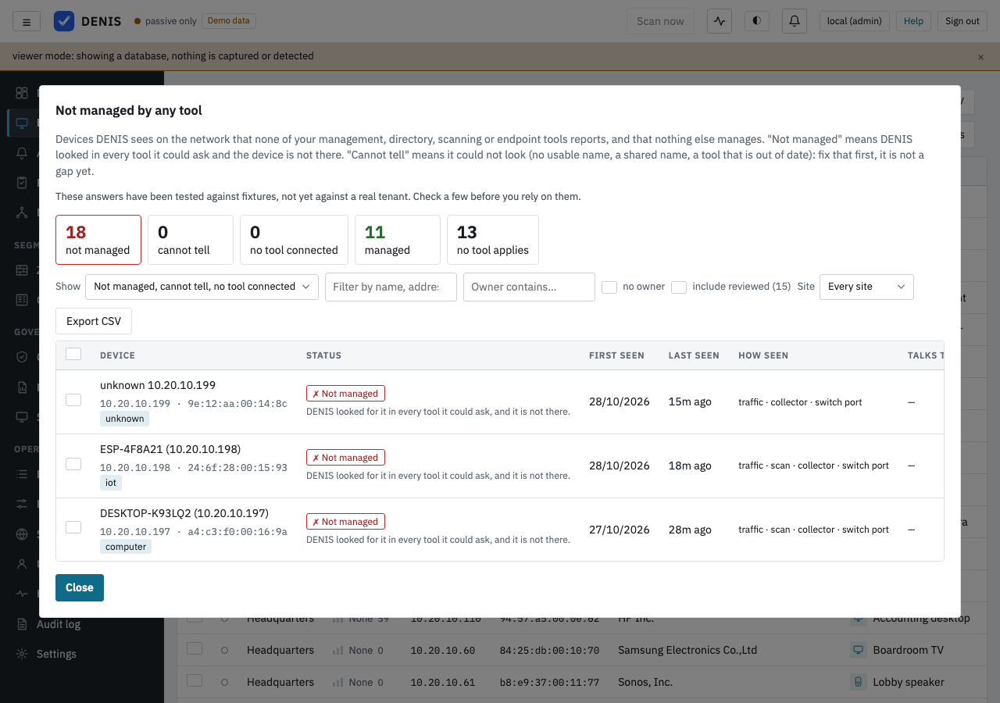

# Control coverage and posture history

**Findings → Coverage** shows which of your devices your management, directory, scanning and
endpoint-protection tools know about, matched by name or address. **Findings → Posture** keeps the
numbers DENIS already shows elsewhere once a day, so you can see whether things are getting better,
and lets an administrator set a target for any of them.

DENIS does not install agents, does not check whether an endpoint-protection product actually works,
and does not decide your policy. It shows where the tools you already pay for do not reach, and it
is explicit about the cases where it cannot tell. That distinction is the point of the whole page:

* **Not managed** means DENIS looked for this device in that tool and did not find it. The cell
  always says what was looked up: "No device called reception-pc in Intune (synced 3 hours ago)".
* **No match** means DENIS had nothing to look the device up by (no usable name, no address). It is
  *not* a gap and never raises a finding about a missing control; it is something to fix in your
  records.

Every integration this page rests on is **Experimental** (see the *Experimental* tag on every
source card). What was checked, and against what, is in [what was verified](nac/validation.md).

## Controls and sources

| Control | Answered by | Covered when the matched record… | Failing when… | Applies to |
|---|---|---|---|---|
| **MDM** | Intune, Jamf Pro | exists and is fresh | Intune reports it as not compliant | computers, laptops, mini PCs, thin clients, phones, tablets |
| **Directory** | Entra ID, Active Directory | exists and is fresh | the Entra record is only *registered*, not joined | computers, laptops, mini PCs, thin clients, servers, virtual machines, database servers, hypervisors |
| **Vulnerability scanning** | Nessus / Tenable.io | the scanner has a recent scan of the device's address | the newest scan is older than the limit (30 days by default) | every device with an address, except industrial devices (below) |
| **Endpoint protection (EDR)** | Microsoft Defender for Endpoint | exists, fresh and onboarded | the sensor is not active | computers, laptops, mini PCs, thin clients, servers, virtual machines, database servers |

Cloud inventory (Azure, AWS, GCP) is shown as context on a device but is not a control. A device's
owner and review state stay findings (`critical_no_owner`, `unreviewed`), not matrix columns.

**How the imports run (4.5.0).** Each import (Active Directory, Jamf Pro, Defender for Endpoint, Azure, AWS, GCP)
keeps the record of its last run: when it was last tried, when it last succeeded, its last error and how many runs in a
row failed. The import's settings API returns it (`last_run`, see [API](api.md)), so a sync that keeps failing can
be seen and not only in the server log. Only one sync of a source runs at a time; a *Sync now* while the scheduled one runs answers
"A sync of this source is already running". The scheduled sync is due one interval after the last good run, also when
that run found nothing (it used to start again every hour), and is tried again at the next hourly check after a
failure. It runs on the HA leader only. A listing that stops early is not taken as complete: a page with no rows that
still names a next page is followed, a listing longer than the page cap, an empty Jamf page before the reported total,
and a next-page link to another address than the configured one end the sync with an error, and nothing of that source
is imported or removed. The Jamf server address must be `https://`, and a GCP key file must name Google's own
`https://…googleapis.com` token endpoint.

A source manages only some platforms: Jamf, Apple; Active Directory, Windows; Defender, everything but
Android. DENIS reads the platform from its guess of the operating system (or the one you entered).
When the platform is known and no tool switched on for the control manages it, the cell reads
**Off**, not Not managed. When the platform is unknown, every tool counts.

The out-of-matrix devices are DENIS's own host, merged duplicates, and devices whose status is
*retired*, *lost* or *stolen*.

## The nine states of a cell

Judged in this order; the first that applies wins.

| State | Meaning |
|---|---|
| **n/a** | the control does not apply to this kind of device (a camera has no MDM) |
| **Off** | no tool for this control is switched on, or none of them manages this device's platform |
| **Unknown** | every switched-on tool for the control is out of date (nothing synced for twice its interval plus an hour) or has never synced. The cell says since when |
| **Covered** | a fresh tool has a record that matches the device |
| **Failing** | covered, but the tool says something is wrong (see the table above). Where several tools match (Intune and Jamf), any Covered wins |
| **Exempt** | an administrator accepted the risk of the finding this cell would raise, so the cell is shown as such and counted on its own |
| **Ambiguous** | the name the device is known by fits more than one device or record in at least one fresh tool, so it was matched to none of them |
| **No match** | the device has no usable name (only an automatic one, a UUID, `localhost`, a vendor default) and no address to look it up by |
| **Not managed** | DENIS could look the device up, and no record matched |

The **coverage percentage** of a control is covered ÷ (covered + failing + not managed). No match,
ambiguous, unknown, exempt and n/a are outside it and shown next to it, never hidden: the number is
about what could be checked.

Industrial (OT) devices read **n/a** for scanning unless an administrator ticks *Count industrial
(OT) devices toward vulnerability scanning* under *Coverage settings* on the Coverage page: active
scanning can upset fragile controllers. The same box sets how old a scan may be (1 to 365 days).

## How a device is matched to a record

One matcher serves the coverage view and every import, so the CMDB page, the device panel and the
matrix agree. The first rule that decides wins:

1. **Address** (for records that carry one, such as a scanner host): exactly one device currently has it.
2. **Full name**, exactly (case and a trailing dot ignored): exactly one device and exactly one record in that tool.
3. **Short name**: the first label of a name (`reception-pc` of `reception-pc.contoso.local`), when it
   is held by exactly one device and one record. A match this way is labelled "matched by short name".
   Active Directory stores fully qualified names while DHCP usually announces the short one, so
   without this rule an AD source would almost never match.
4. A name held by several devices or records is **ambiguous**, and the record matches none of them.
5. Otherwise, no match.

Nothing is fuzzy: no edit distance, no substring, no prefix beyond the first label. A device's names
are what it announces (DHCP, mDNS) and, last of all, the name entered in the register. A name typed
into the register is never the only basis for "Not managed": a device that announces no name of its
own reads No match. Records that match no device are listed under **In your tools, not seen by DENIS**
(for users who may see every site); they are often legitimate (a laptop that is away, a network DENIS
does not watch) and are never counted as gaps.

## Not managed by any tool

The question a security person asks first: *what is on my network that nothing manages?* Under Devices, the
button **Not managed by any tool** (and a tile on the Dashboard, and the first step of the setup guide) answers it
from what DENIS already knows. Nothing new is asked of the network or of your tools.

Every device gets one of five answers, worked out from its cells and from what else manages it:

| Answer | What it means |
|---|---|
| **Managed** | A control has the device (covered, or a tool reports a problem with it), or someone entered it by hand, or DENIS reads it itself through a switch or connector that answered within the last 7 days. |
| **Not managed** | Every control that could be asked was asked and the device is not there. At least one control looked it up and did not find it, and none of the others could not look. |
| **Cannot tell** | At least one control could not look (no usable name, a name shared with another device, a source that is out of date), or a switch or connector tied to the device has not been read lately. DENIS never calls this managed, and never "not managed". It is shown as large as "not managed": fixing a name is usually the next step. |
| **No tool connected** | No tool is switched on for any control that applies to the device. The honest answer for an installation without integrations. |
| **No tool applies** | None of the four controls applies to this kind of device (a PLC, for example). |

An accepted risk (an *Exempt* cell) is judged by what it hid: an accepted "not managed" stays "not managed" and is
counted as *risk accepted*; an accepted problem report still means a tool has the device. A device a person marked
**reviewed** (Devices, "Mark all shown as known") leaves the list and is counted apart; "include reviewed" brings it back.

Each device has an evidence card (in the list, and at the top of the device panel): since when and how DENIS saw it
(DHCP, mDNS, address, switch port with how long ago, VLAN, active scan), what it looks like and why, who it talks to
(or that DENIS has no record, which is not the same as "nobody"), one line per control saying what was looked up
and when, what could manage it (which tools to connect, and whether the device can be read as network equipment),
and its owner. Assign an owner to the selected devices from the list; it is the ordinary owner field. The list can be
filtered by answer, text, owner (or no owner), site and reviewed, and exported to CSV for a ticket.

Like every source here, this is Experimental: check a few of the answers before you rely on them.

## Findings

| Finding | Severity | Raised for |
|---|---|---|
| `critical_unmanaged` | medium | a device rated high or critical that is *not managed* or *failing* in MDM or EDR |
| `not_vulnerability_scanned` | low | a device that is *not managed* or *failing* in scanning |
| `coverage_unmatched` | info | a device with *no match* or *ambiguous* anywhere: names to fix |

None is raised from Unknown, Off or n/a, and a missing name never creates a gap. Like every finding,
they get an instance per device, can carry a work item, and can have their risk accepted: the matrix
cell then reads **Exempt**. They create no exposure.

An open one of these stays open while the cell is **Unknown**: a tool that has not synced is not a
fix, so the finding is not resolved (and a work item on it is not verified) until a fresh sync says so.
Likewise, any finding a work item is waiting on stays open while its device is not seen for a week: a
device that was switched off is not a fixed device. (Without a work item, a finding of a device not
seen for a week resolves as before.) Since 4.5 also: a work item checked against the register is verified only while its device is online
(an offline device stays *pending*, as the behaviour check already did); a banner read that brings nothing back while
the banner port is still open (a timeout) keeps the banners read before, so `eol_software`, `kev_software` and the
like do not resolve on a failed read; and a device with several known-exploited CVEs has one `kev_software` instance
per CVE (each opens and is fixed on its own; the instances of 4.4 and earlier, one per device, resolve once and the
per-CVE ones open in their place). The Findings page's "since" is the start of the oldest open instance of that
kind on the devices listed.

The Entra ID / Intune import is due by its own last sync: Active Directory, Jamf, Defender and the
clouds keep their rows in the same table but sync on their own intervals and do not delay it. The
vulnerability scanner import fetches everything first and stores it only when the whole download
worked, so a sync that fails part-way keeps the previous rows (and is tried again at the next hourly
check); for each host it keeps the findings of the newest completed scan that lists the host, so a
plugin fixed in the newest scan is gone even while an older scan still lists it.

## Posture history

Once a day, shortly after midnight (after 00:15 console-local time), DENIS writes one row per site
that has devices, plus one for all sites together, each computed from its own devices (a median or a
percentage is not a sum). If the console was down at midnight it samples at its first opportunity
that day; a day it was down for entirely has no row and the chart shows a gap. History starts when
the feature does and is never reconstructed. Rows are kept for 1,100 days. Administrators can press
*Take a sample now* to replace today's rows, for example after a big clean-up. When the findings job
has not completed for more than an hour (the Health page names it), the daily sample waits for it
rather than storing the counts of the day it broke. Demo data counts only in the demo sites' own
rows (see [demo data](operations.md#demo-data-and-starting-clean-erase-all-data)).

A number that does not apply on a day is **absent**, never 0: no verified fix in 30 days, or a
control that nothing is switched on for. There is no composite score and no number is weighted
against another.

| Metric | Meaning | Better |
|---|---|---|
| Devices | devices in the register (not this host, not merged, not retired) | – |
| Devices that could not be identified / nobody has reviewed / critical with no owner | open findings of that kind, risk not accepted | lower |
| Devices with a high-severity finding | devices with an open high or critical finding | lower |
| Devices with a known-exploited vulnerability | devices on the exposure list for a known-exploited vulnerability | lower |
| Devices running unsupported software | open `eol_software` findings | lower |
| Devices on the exposure list | see the Dashboard | lower |
| Open incidents | not yet acknowledged | lower |
| Segmentation violations in the last 7 days | alerts above info | lower |
| Open / overdue work items | everything but verified / past the due date | lower |
| Median days to a verified fix | over items verified in the last 30 days | lower |
| Coverage per control (MDM, directory, scanning, EDR) | the coverage percentage | higher |
| Not managed / could not be looked up, per control | the cells in those states (no match and ambiguous together) | lower |

When the definition of a number changes (or one is added) DENIS raises its metrics version, and the
charts mark the first day counted the new way, so a change of definition is never mistaken for a trend.

## Goals

An administrator can set a target for one metric at one site (or all sites), optionally by a date.
A goal is **met** when the value is at or below the target (for a lower-is-better number) or at or
above it (higher-is-better). Beside every goal DENIS shows today's value, whether it is met, the
change over 7 and 30 days, and, when there is a due date, a plain pace sentence from the straight line
fitted to the last 30 samples (at least 7 are needed): "At the current pace (−0.4 a day) this reaches 5
around 12 November, after the due date of 1 November.", or "Moving away from the target.", or "Not
enough history yet". There are no probabilities. Goals are display only: nothing is notified when
one stops being met. A number that measures a size (the device count) cannot have a goal.

Goals and the all-sites row are visible only to people who may see every site; everyone else sees the
sites they may read.

## API

The endpoints are listed in [the API reference](api.md): `GET /api/coverage`,
`GET /api/coverage/unmatched`, `GET /api/assets/{id}/coverage`, `GET /api/unmanaged`, `GET /api/export/unmanaged.csv`, `GET /api/assets?management=`, `GET`/`PUT /api/coverage/settings`,
`GET /api/posture`, `POST /api/posture/sample` and the goal endpoints under `/api/posture/goals`.
The detection findings are listed in [Detection rules](detection-rules.md).
