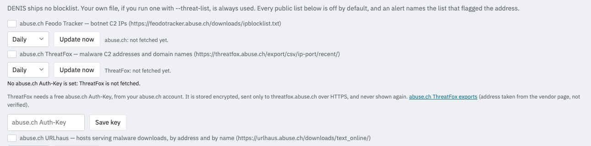
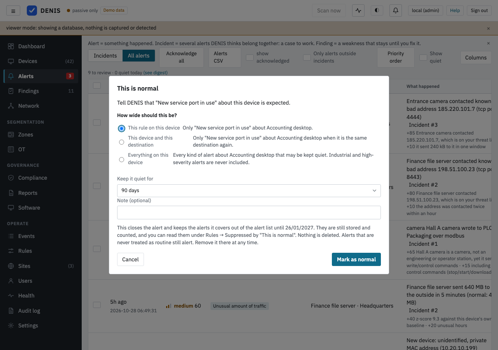
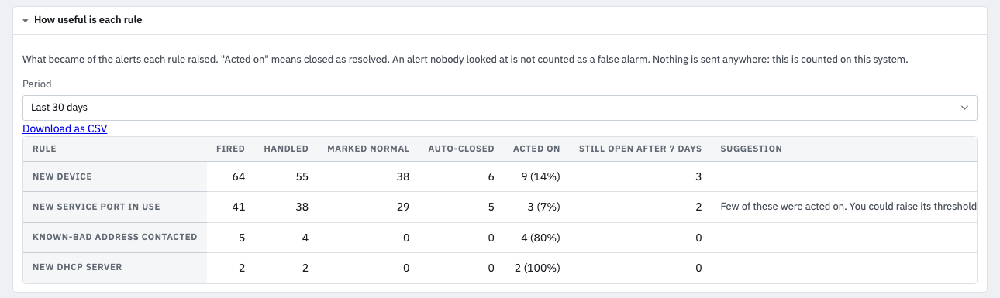

# Detection rules

**See and change them in the console:** the **Rules** tab shows **IT · network** first and **OT · industrial**
after it. In each, **Your IT rules** (or **Your OT rules**) come first, with their own **+ New** button, then the
built-in rules in themed groups (*Devices and presence*, *Traffic to the outside*, *Inside the network*, *DHCP and
DNS*, *Switches*; *Commands to controllers*, *Paths and boundaries*). A group is closed unless one of its rules raised
an alert in the last 7 days; its heading counts the rules, how many are on, the alerts, the changed ones and those
that need data. The bar at the top counts the same for the whole page, finds a rule by name, id or words (the `/`
key), filters (*All*, *On*, *Off*, *Alerted in 7 days*, *Changed*, *Needs data*) and has one **+ New rule** menu
(IT rule or OT rule). The global settings (minimum score, learning mode, noise profiles) are folded into one line.

Each rule is one row: its switch, name, id, tags (*changed*, *noisy*, *needs traffic analysis*, exceptions), a
one-line description, **Quieter / Normal / Louder** (half, once and twice its default weight; any other weight shows
as `×1.5`) and **n alerts / 7 d**, which opens those alerts on the Alerts page. The arrow opens the details: what the
rule needs, the weight (`0` = off, `0.5` = half as loud, `2` = twice, scores are capped at 100), *Alert only from
score*, the thresholds (for example how many standard deviations count as an unusual transfer, or how long a device
must be silent) and the exceptions. **The switch saves at once** (since 4.1.2; one audit log entry each, with Undo
in the notice; on again goes back to the default weight). Weights and thresholds collect in a bar at the bottom,
"n unsaved changes · Discard · Save changes". When traffic analysis (`--flows`) is off, one strip at the top says how
many rules cannot fire. Changes apply within seconds, survive restarts, are limited to sane ranges on the server and
are written to the audit log; *Reset everything* returns to the defaults. Command-line options (`--min-score`, `--rule-weight`,
`--silent-minutes`, …) set the starting values; a value saved in the console wins over them. The console tunes the reviewed rules below and adds three things of your own, described in
[Making the rules fit your network](#making-the-rules-fit-your-network). API: `GET/PUT/DELETE /api/rules`.

All rules are **rule-based and explainable**: each alert shows the factors that produced its score. Scores are
0–100; below `--min-score` (default 30) an event is only logged. Each rule can be scaled or disabled:
`--rule-weight <rule>=<weight>` (`0` disables, `0.5` halves, up to `5`).

Rule names for `--rule-weight`: `new_device`, `new_destination`, `volume_anomaly`, `new_port`,
`unusual_hours`, `arp_conflict`, `device_silent`, `rogue_dhcp`, `new_device_burst`, `threat_list_match`,
`lan_scan`, `lan_sweep`, `outbound_fanout`, `dhcp_options_changed`, `dhcp_starvation`, `new_destination_v6`, `ot_new_conversation`, `ot_control_command`, `ot_internet_exposure`,
`ot_purdue_skip`, `ot_unexpected_writer`, `ot_command_watch`, `ot_write_escalation`, `ot_goose_conflict`, `it_watch`, `segmentation_violation`, `inbound_from_public`,
`dns_resolver_changed`, `port_move`, `new_on_port`, `vlan_change`, `fingerprint_changed`, `ot_new_function`, `ot_program_upload`,
`ot_concurrent_masters`, `ot_identity_changed`, `iot_initiates_admin`, `admin_into_critical`, `dns_threat_domain`,
`remote_access_tool`, `ot_recon`, `ot_cross_cell`, `ot_new_protocol`, `ot_remote_access_path`,
`ot_write_rate`, `ot_offhours_command`, `ot_exception_burst`, `inbound_bruteforce`, `inbound_then_fetch`,
`dns_nxdomain_burst`, `mining_pool`, `vpn_tunnel_start`, `anonymizer_contact`, `admin_spread`, `new_admin_listener`,
`daily_upload_new_owner`, `gateway_changed`, `rogue_dhcpv6`, `lifecycle_device_seen`, `mac_flood`, `hostname_clone`, `rogue_network_device`, `dynamic_dns_first_use`, `new_domain_for_server`, `upload_to_file_share`, `inbound_new_country`, `slow_scan`, `cleartext_admin_use`, `llmnr_nbns_responder`, `ot_time_source_changed`, `ot_register_range`, `custom_rule`.

Every alert carries **advice**: click an alert (Alerts or Events tab) to see its summary, *why* it scored what
it did, and *what to do next*. The same advice is in `GET /api/meta/options` (`advice`).

## The rules added in 4.3, at a glance

DENIS 4.3 adds more than 40 detections. Each has its own section below with what it needs, how it scores and what makes
it a false alarm; this is the plain version, one sentence each. They are off only if you set their weight to `0`.

**Industrial networks** (see the [OT guide](ot-guide.md)):

* `ot_new_function`: a device uses a function on a controller that it never used before.
* `ot_program_upload`: someone copies the program out of a controller. Never kept quiet.
* `ot_concurrent_masters`: two different machines write to the same controller within ten minutes. Never kept quiet.
* `ot_identity_changed`: a controller announces another firmware, serial number, product or vendor. Never kept quiet.
* `ot_recon`: a device asks many industrial devices who they are, the way a scanner does.
* `ot_cross_cell`: a write or command goes between two devices whose "Zone / cell" in the register differ, and no zone policy decides it.
* `ot_new_protocol`: an industrial device starts using a protocol or service it never used.
* `ot_remote_access_path`: a remote-desktop or remote-support tool reaches a device in a control cell.
* `ot_write_rate`: a path writes far more often than it ever did in the last 14 days.
* `ot_offhours_command`: a write or command arrives outside the working hours you declared for the site. It does nothing
  until a schedule is set.
* `ot_exception_burst`: a device refuses many requests in a few minutes, as under register probing.

**Office and IT networks:**

* `inbound_bruteforce`: one outside network tries a login port of one device again and again.
* `inbound_then_fetch`: a device that was reached from the internet then fetches from somewhere it never used. Never
  kept quiet.
* `dns_threat_domain`: a device looks up a domain that a threat list names as malware infrastructure. Never kept quiet.
  The list needs a free abuse.ch key (see [`threat_list_match`](#threat_list_match-contact-with-a-known-bad-address-needs---flows-and-a-threat-list)).
* `dns_nxdomain_burst`: a device gets failed answers for many random-looking domains, as malware does that hunts for its server.
* `mining_pool`: a device contacts a cryptocurrency mining pool.
* `vpn_tunnel_start`: a device opens a VPN tunnel to the internet for the first time.
* `anonymizer_contact`: a device contacts a Tor exit relay.
* `remote_access_tool`: a device uses a remote-access tool (AnyDesk, TeamViewer and others) for the first time.
* `iot_initiates_admin`: a camera, printer or other IoT device opens an administration session to another device.
* `admin_into_critical`: a device that never did so opens an administration session to a device you rated high or critical.
* `admin_spread`: one device opens administration sessions to many devices in a day.
* `new_admin_listener`: an IoT or field device starts offering remote administration.
* `daily_upload_new_owner`: a device that is not a server sends 500 MB or more in a day to a provider it had not used before.
* `gateway_changed`: the default gateway's hardware address changed for good. Never kept quiet.
* `rogue_dhcpv6`: a new device answers as a DHCPv6 server (needs `--ipv6`). Never kept quiet.
* `lifecycle_device_seen`: a device you marked lost, stolen or retired is on the network. Never kept quiet for a lost or stolen one.

A few of these need something besides the rule itself: traffic accounting (`--flows`), passive DNS, a mirror port or
east-west accounting. The section of each rule says which, and the Rules page says how many rules cannot fire for want of
traffic analysis. The list of remote-access tools and of mining pools ships with DENIS and is reviewed with each release;
the port list of the remote-access tools has not been checked against the vendors' documentation.

## The rules added in 4.4, at a glance

DENIS 4.4 adds twelve detections. Each has its own section below. **On an installation that already existed they all arrive
switched off**: nothing judges and nothing costs anything until you decide, on the Rules page under *New rules in this
version* ([how that panel works](#new-rules-in-a-release)). A new installation gets the **Recommended** ones switched on.
*Cost* is the detection cost class of the rule (*low*: at most 1 ms per unit of work, *medium*: at most 5 ms; the measured
figures are in [Operations](operations.md#when-a-rule-is-paused-or-detection-is-overloaded)). *Noise* is how often a rule
is expected to alert on a calm, ordinary network.

| Rule | What it detects | Recommended? | Needs | Noise | Cost | Never quiet |
|---|---|---|---|---|---|---|
| [`mac_flood`](#mac_flood-a-flood-of-new-hardware-addresses-nothing-extra-needed) | more than 200 new hardware addresses on one capture source in a minute (a switch address table being flooded) | Recommended | nothing extra | low | low | **yes** |
| [`hostname_clone`](#hostname_clone-two-devices-claim-one-name-nothing-extra-needed) | two devices with vendor hardware addresses claim one name at the same time | Optional | nothing extra | medium | low | no |
| [`rogue_network_device`](#rogue_network_device-a-new-switch-router-or-access-point-nothing-extra-needed-switches-added-for-snmp-show-the-port) | a switch, router or access point appears where an end device was expected | Optional | nothing extra; polled switches show the port | medium | low | no |
| [`dynamic_dns_first_use`](#dynamic_dns_first_use-a-dynamic-dns-name-used-for-the-first-time-needs-passive-dns) | a server, NAS, industrial device or workstation looks up a dynamic-DNS name for the first time | Optional | passive DNS | medium | low | no |
| [`new_domain_for_server`](#new_domain_for_server-a-quiet-device-looks-up-a-new-domain-needs-passive-dns) | a quiet device looks up a domain nobody on the site has looked up | Optional | passive DNS | medium | medium | no |
| [`upload_to_file_share`](#upload_to_file_share-a-large-upload-to-a-file-sharing-service-needs---flows-and-passive-dns) | 50 MB or more in a day to a public file-sharing service | Optional | `--flows`, passive DNS | medium | medium | no |
| [`inbound_new_country`](#inbound_new_country-an-administration-port-reached-from-a-new-country-needs---flows-on-the-link-to-the-internet) | an administration or VPN port reached from a country that never connected | Optional | `--flows` on the internet link | medium | medium | no |
| [`slow_scan`](#slow_scan-a-slow-scan-of-the-internal-network-needs-east-west-accounting-or-a-mirror-port) | one device reaches 50 or more others in a day, where it never reached more than 10 | Optional | east-west accounting or a mirror port | higher on servers (they are left out) | medium | no |
| [`cleartext_admin_use`](#cleartext_admin_use-an-unencrypted-administration-protocol-used-needs-east-west-accounting-or-a-mirror-port) | Telnet, FTP, rlogin or plain VNC used for the first time | Optional | east-west accounting or a mirror port | medium (old equipment) | low | no |
| [`llmnr_nbns_responder`](#llmnr_nbns_responder-a-device-answers-name-queries-for-other-names-needs---flows-ipv4-only-experimental) | one device answers name queries for five or more names that are not its own (a password-stealing tool) | Recommended | `--flows` on a link that carries the queries | low | low | **yes** |
| [`ot_time_source_changed`](#ot_time_source_changed-an-industrial-device-takes-its-time-from-a-new-source-needs-east-west-accounting---flows-or-the-iec-104-decoder-experimental) | an industrial device takes its time from a new source | Optional | east-west accounting, `--flows` or the IEC 104 decoder | low to medium | low | no |
| [`ot_register_range`](#ot_register_range-a-modbus-write-outside-the-usual-registers-needs-the-industrial-decoders-experimental) | a Modbus write to registers the path never wrote to | Optional | the industrial decoders | medium | medium | no |

**Never quiet** means that no "This is normal" decision, noise profile or trial hides the rule's alerts and that the
overload protection never pauses it. Only the two rules whose evidence has no everyday cause are on the list: a flooded
switch address table and a poisoning responder. The other ten are the ones a site has ordinary reasons to see (a desk
switch, a cloned virtual machine, a traveller, an old Telnet device), so you can tell DENIS that they are normal for a
device. `llmnr_nbns_responder`, `ot_time_source_changed` and `ot_register_range` are **Experimental**. The data the three
industrial ones need is listed in the [OT guide](ot-guide.md#the-44-rules-and-the-data-each-one-needs).

## Network rules

### `new_device`: a device joined
Fires when an asset first appears **after** the learning period (~60 seconds later, once fingerprinting had
time to work). Score 50, +15 if the type is unidentified, +10 if the manufacturer is unknown, −15 for a private
(randomised) MAC, **+20 when it joins an industrial cell**: a subnet (IPv4 /24 or IPv6 /64, link-local addresses
excluded) where, leaving the newcomer out, at least two devices are industrial and they are at least half of the
subnet's devices, or where you placed a device at Purdue level 2 or below. A laptop plugged into a control cell is the
first step of most plant incidents; a flat office or home network with one PLC or solar inverter in it is not a cell
and gets no extra points. The subnets are read from the register at most once a minute. Devices you registered by
hand never trigger it.
*Typical false positive:* a visitor's phone. Tune: lower the weight, or use a guest VLAN.

### `new_destination`: first contact with an address *(needs `--flows`)*
A device that has been observed long enough contacts an IP it never used. Score 35, +15 if no other device
uses that address, −10 if it is in the same /24 as one the device already uses (CDN neighbours), +15 for an
unusual port, +10/+20 for ≥1 MB/≥50 MB sent in the first window, −10/−20 for devices that already talk to
≥100/≥500 hosts (laptops and phones naturally do), **+20 for an engineering workstation** (4.3): a device that
sent an industrial control command (stop/start, program download) in the last 30 days, because an engineering
station's contacts with the outside matter most. The same +20 applies to `new_destination_v6` and `new_port`. The
list of such stations is rebuilt from the stored industrial conversations after a restart. One alert per device per
window.
*Best for:* NAS, cameras, printers, servers. *Noisy for:* laptops and phones; give it a lower weight.

*Rotation suppression:* three new destinations on the same port within an hour promote that port to
"rotating" for that device (a CDN edge handing out a fresh address per session, not several genuinely
separate services), and further contacts on it go quiet. The suppression only swallows low-signal contacts,
though: a new destination on a rotating port still alerts when nobody else on the network has contacted it
*and* at least 1 MB was sent, or the port is one of the remote-administration/file-sharing/database ports
`new_port` also flags (22, 23, 25, 445, 3389, …) — those are never auto-promoted to rotating at all, since a
burst of new destinations there is the signal itself (SSH/SMB/RDP worm propagation, spam fan-out), not noise.
A promoted port currently has no expiry (a follow-up, not yet built).

### `new_port`: a service port never used before *(needs `--flows`)*
Shown as **New service port in use**. A device with an established set of ports uses a **new TCP or UDP service
port** (below 32768, not 53/80/123/443) towards a known destination ("First time this device uses UDP port 137
towards …"). This is observed communication, not proof that a service is open. Score 40, +15 for
remote-administration/file-sharing/database ports (22, 23, 445, 3389, 3306, …), +10 for ≥1 MB; a UDP port that got an
answer says so in the reasons. Protocols without ports (ICMP, ICMPv6, GRE, ESP, …) are never judged here: a first ping
to a new address is `new_destination`'s.

*Owners, not addresses (what DENIS keeps quiet):* the unit of novelty for `new_destination` and `new_port` is the
**owner** of the remote address: its network operator (ASN) when the ASN database is installed, otherwise the
domain name the device resolved it from, otherwise the /24. Large cloud and hosting operators are narrowed to
the /16, because "this device already talks to a cloud" must not excuse every address in it. A new address of an
owner the device has used for at least six hours (or during its learning period) in the last 30 days is **not
news**; so is a random high UDP port (1024 and up, not a known service port: peer-to-peer and relay traffic
picks a fresh one per session) towards a destination the device already knows. DENIS does not drop these: they are
stored as `info` events with a reason code (`known_owner`, `p2p_udp`, `learning_digest`, `off_scope_private`),
counted, and shown under "Show quiet". An owner the device has never used still raises one alert per device and
day; further addresses of it that day are quiet. The `new_port` churn budget (3) is now per owner, not per
address. Nothing in these never-quiet kinds is ever quieted: threat-list hits, rogue DHCP/RA, DHCP option
changes and starvation, resolver changes, outbound fan-out, ARP sweeps, industrial control and write commands,
segmentation violations, watched-port arrivals, fingerprint changes, gateway ARP/NDP conflicts, a flood of new hardware
addresses (`mac_flood`), a device answering name queries for other names (`llmnr_nbns_responder`) and a new device
(except a recognised private-MAC rejoin). A flow that uses a remote-administration/database port, hits the
threat list, or sends ≥10 MB in its first window to an owner the device never used stays raised whatever the
owner. One switch turns all of it off: "Quiet routine alerts" (setting `noise`, `enabled`, on by default).

*Noise profiles:* every device has a profile that says how much routine noise its role makes, suggested from its
type and changeable per device: **IoT cloud device** (cameras, TVs, speakers, gadgets: a low-scored new contact,
MQTT/CoAP and volumes under 25 MB are recorded quietly), **personal device** (phones, tablets, wearables, and a
laptop or computer with a private MAC: contacts scoring under 50, unusual hours, being away and volumes under
50 MB are recorded quietly), **infrastructure** (routers, NAS, servers, printers: nothing extra is quieted, a NAS
reaching a new provider is news), **industrial** (never quiets an industrial rule) and **standard**. A profile only
moves events into the recorded, counted quiet stream: the never-quiet kinds and the escape hatches do not depend on
it. A private-MAC newcomer whose hostname matches a device with a private MAC seen in the last 30 days is scored 25
as "probably <name> with a new private address", and is quiet for a personal device; a vendor-MAC newcomer is
never treated this way.

### `volume_anomaly`: unusual outbound volume *(needs `--flows`)*
Bytes sent outside in a 5-minute window exceed the device's own average by ≥3 standard deviations (the
deviation is floored so very regular devices do not alert on trivial changes; buckets under 5 MB are ignored).
Score 40 + 10 per extra deviation. An incident is not learned as the new normal. One alert per device per hour.

*Memory and floors:* the average only remembers about a day, so after a quiet day an ordinary upload looked
huge. DENIS therefore also keeps the device's own **peak per day for 14 days**: once it knows three days, a transfer
up to 1.5 times that peak is recorded quietly (`within_peak`, "within this device's own 14-day peak (119 MB)")
instead of raised. A device that moves almost nothing (fewer than 24 buckets of 100 kB in the last day, and a mean
under 1 MB) has no baseline to compare with: only the size counts, 40 at the floor and +10 per doubling. The
floor is 5 MB, 25 MB for an IoT cloud device towards a provider it uses (5 MB towards one it never used) and 50 MB
for a personal device; smaller transfers that would have alerted are recorded quietly (`profile_floor`). Never
quiet: most of the bytes going to a provider the device never used (+15), and 200 MB or more in one bucket from a
device that is not a server or NAS.

### `unusual_hours`: active when it never is *(needs `--flows`)*
After a week of history, activity (≥ 50 kB) in an hour of the day that holds less than 2% of the device's
history. Local time. Score 30–60. Six-hour cooldown.

### `arp_conflict` / `arp_mismatch`: address hijacking
Two devices claim one IP address within 5 minutes of each other, or an ARP message has an inconsistent sender
address. Score 70 (mismatch 45), +25 if the contested address is the **default gateway**, +15 if the claimant
takes ≥3 addresses in 10 minutes. Not subject to learning. At most 5 alerts per claimant per 10 minutes.
*Investigate:* the claimant MAC, which switch port it is on, whether a DHCP server hands out duplicates.

*Sibling interfaces:* one router or access point often answers for the same IP from several radios or
interfaces whose hardware addresses differ only in the last byte (seen on ASUS mesh gear). Such a pair scores 50
lower, so it is only logged, unless the contested address is the gateway. (A forger who picks a sibling
address is therefore only caught when the target is the gateway.)

*Same device and known pairs:* when both claimants share a hostname or your register name, the two addresses
belong to one device (a second network interface, or a new private address): −40, and the event is kept quiet
(`same_device`). A (claimant, holder, address) pair that you acknowledged as expected behaviour or a false positive,
or that recurred at least three times over a day while both devices stayed in service (typical of a host with two
interfaces on one network), is quiet from then on (`known_pair`); the first occurrence is always raised. A device
using a private (locally administered) MAC that takes over an address once is a hand-over, not a conflict; it
only becomes one if the previous holder claims the address straight back. The gateway, and a claimant that
takes three or more addresses, are never quieted.

*Routed traffic and forged hand-overs (4.0.3):* a router, firewall or layer-3 switch carries other hosts' packets, so
its Ethernet address is seen next to many IP addresses that are not its own. A device that is the gateway, sent a
Router Advertisement, is typed router or firewall, or has been seen on three or more /24 networks is not blamed
for the addresses of the hosts behind it (its own known addresses still count), so two routers carrying one remote
host no longer raise a conflict. Only inferred sightings are excused this way: an ARP, DHCP, mDNS or LLDP claim, which
is what a poisoner has to make, is judged as before. The established gateway also keeps its address for an hour after it
was last seen, so an ARP spoofer who waits out the five-minute window can no longer take the address and turn the real
router into the blamed claimant. A DHCP lease for an address whose holder was seen on it in the last minute raises
`arp_conflict` and leaves the address with the holder, so a forged DHCP acknowledgement cannot move a busy device's
address silently. Switch management addresses announced by LLDP are not claimed by the per-port source address.

*IPv6 (opt-in, `--ipv6`):* two devices claiming one IPv6 address raise the very same `arp_conflict` alert (same
weight, cooldown, exceptions and gateway handling; the alert's details say `family: ipv6`). IPv6 is quieter by
design, because SLAAC's own duplicate-address detection already prevents most clashes, so only a clear
contest is reported: an exclusive Neighbor Advertisement (Override flag set; anycast and proxy advertisements are
never a claim) for an address another device was just using, and only when the two devices swap it back and forth
within 5 minutes. One hand-over is not a conflict, so a privacy-address device that changed its hardware address
and never returns stays quiet. A challenger to the **IPv6 router's** address (a device that sends Router
Advertisements with a non-zero lifetime; held for an hour, like the IPv4 gateway) is reported at once, with the
+25 gateway bonus, and never takes the address over. A router answering for a host (proxy ND) and the same
`fe80::1` reused on several VLANs of a mirrored trunk are not conflicts. An address built from a hardware
address (EUI-64) scores 20 lower for the device it was built from and 10 higher against any other claimant.

### `lan_scan`: internal network scan *(needs traffic analysis on a mirror port)*
An **already-known** device suddenly touches many different local hosts, or many different ports on one local
host, within a short rolling window — the signature of a compromised device scanning the LAN, which `new_device_burst`
(many *new* devices at once) does not cover. Breadth-based, not connection-state-based, like the rest of the rule
engine: by default 8 distinct local addresses, or 8 distinct ports on one local address, within 2 minutes. Score 55,
+3 per address or port beyond the threshold. One alert per device per hour (adjustable), then the window starts
fresh. Because it judges device-to-device traffic, it only sees what crosses a mirror/SPAN port; on an ordinary
port it sees only traffic to and from the collector itself. With IPv6 flows on (`--ipv6`), unique-local IPv6
addresses (`fc00::/7`) count as local hosts too, judged by the same thresholds in the same window — a sweep spread
over both address families is still one sweep. Once the count of addresses looks like a sweep, the addresses are
collapsed to devices first (the IPv4, link-local, unique-local and global addresses of one device are one host), so
a dual-stack device talking to its neighbours is not counted several times; the alert's details list the `addresses`.
Only addresses that are really local count towards those thresholds: the networks the site monitors (the
device's own /24 where none is known) and every address the register knows as a device of the site. Other private
addresses, including carrier-grade NAT (`100.64.0.0/10`, for example a mesh VPN's `100.100.100.100`) and the LAN
addresses a peer-to-peer partner exposes, are judged in a separate window with **doubled** thresholds, so a
real sweep of a routed network still fires and a stranger's network does not (the alert says so). On one host, the
Windows file-sharing set (ports 135, 137, 138, 139, 445) counts as one port, and UDP ports from 1024 up count only
when there are at least 20 of them. The two thresholds cannot be set below 5; a saved lower value is raised to 5
once, with an audit entry and a Health note.
*Typical false positive:* a vulnerability scanner or monitoring server that legitimately sweeps the LAN — add it
as an exception.

### `lan_sweep`: internal ARP sweep
One sender requests at least 20 distinct local addresses by ARP within two minutes: the signature of `nmap -sn`,
`arp-scan`, Metasploit or a worm mapping the subnet before it spreads. Unlike `lan_scan`, this needs no mirror
port — ARP requests are broadcast, so it is visible from any switch port. Score 70, +1 per address beyond the
threshold (capped at +20). The gateway is exempt outright (it routinely re-ARPs its whole client table); a
discovery tool (Fing, a router's own "network map" feature, Home Assistant, a UniFi controller) seen sweeping
during the learning period is remembered and never judged again.

### `iot_initiates_admin`: an IoT device opens an admin session *(needs east-west accounting or a mirror port)*
A camera, printer, TV, smart-home gadget, phone, tablet or industrial field device (PLC, RTU, drive, sensor, building
controller; not an HMI, SCADA server, historian or engineering workstation) **opens** SSH (22), Telnet (23), SMB
(445, 139), RDP (3389), VNC (5900-5903), WinRM (5985, 5986) or ADB (5555) to another device on your network. Such
devices almost never administer others; a compromised camera spreading inward (Mirai-style) does. Only connections
whose opener the capture proved by the TCP handshake count (east-west records with a confirmed initiator), never one
guessed from port numbers; UDP never counts. The type is the register's, with your correction applied: a PC typed as a
camera is fixed by correcting its type. IPv4 and IPv6.

*Learning:* the pairs a device opens admin sessions to are learned while the site is in its learning period **and**
for the first learning period after this rule first saw east-west data from the site (so turning east-west accounting
on later starts with a day of learning, not a burst of alerts); the learning clock is saved and survives a restart.
After that a new pair is reported and learned; at most 8 peers are kept per device and direction (the least recently seen goes; a baseline saved with more is cut to the eight most recent when it is read).

*Score:* 70 (high); +10 for an industrial field device; +10 when it reached three or more devices in one window; 20
less for a phone or tablet that only opened file shares (SMB), which file-manager apps do, and 20 less for a printer or
scanner that only opened file shares (SMB), which scan-to-folder does. *Cooldown:* one alert per
device per hour, naming every new peer of the window; a new peer seen during that hour is not learned and is reported
once the hour is over. Not on the never-quiet list. Use `--rule-weight iot_initiates_admin=<weight>`.

### `admin_into_critical`: new admin access to a critical device *(needs east-west accounting or a mirror port)*
A device that never did so before opens a remote-administration session (RDP, SSH, WinRM, VNC or Telnet) to a device
you rated **high** or **critical** in the register (the device panel's criticality): lateral movement towards a
domain controller, file server or SCADA server. File sharing (SMB) is not judged: most clients map file shares, and an
admin share cannot be told from a file share without reading the payload. Same handshake evidence as
`iot_initiates_admin`; IPv4 and IPv6.

*Learning:* the sources of admin sessions are learned for **every** device, rated or not, so rating a server critical
later does not report its usual administrators. Learning as `iot_initiates_admin` (site learning period plus the first
learning period of east-west data); after it, a new source into a high or critical device is reported and learned,
and into any other device only learned. A source tagged **admin-workstation** (device panel, tags) is learned without
an alert. At most 8 sources are kept per device (see the learning note of `iot_initiates_admin`).

*Score:* 60 (medium); +10 when the target is rated critical; +10 when the source is not a computer, laptop, server,
virtual machine, thin client, hypervisor or engineering workstation. *Cooldown:* once per source and target per 24
hours. Not on the never-quiet list. The alert is filed under the critical device; incidents name the source as the
actor. Use `--rule-weight admin_into_critical=<weight>`.

### `outbound_fanout`: worm/spam fan-out *(needs `--flows`)*
An already-known device contacts at least 10 distinct **public** addresses on one remote-administration,
file-sharing, database or worm/spam-signature port (the same ports `new_port` flags, plus 2323/5555/7547 —
Mirai's alternate Telnet port, ADB, TR-069) within five minutes: the Mirai-family botnet propagation and
spam-bot signature. Unlike `lan_scan` (which ignores public addresses by design) and `new_destination` (whose
rotation-burst suppression actively hides a fan-out after the first few), this is judged fresh every time — the
port is never learned as normal and never promoted to "rotating". Score 75, +1 per address beyond the
threshold. Devices typed `server`, or whose type contains "mail", are exempt (a mail server legitimately fans
out on 25). Public IPv6 addresses count too when IPv6 flows are on, in the same per-port window as IPv4 ones.

### `new_destination_v6` / `ndp_mismatch`: the IPv6 counterparts
*Opt-in (`--ipv6`); see [IPv6](concepts.md#ipv6-optional).*
`new_destination_v6` is `new_destination`'s IPv6 twin *(needs `--flows`, `--ipv6-subnet`)*: a device contacts an
outside IPv6 address it has never used. It is scored exactly like `new_destination` (35 for a first contact,
+15 when no other device here has contacted the address, +15 for a port the device has never used, +10/+20 for
1 MB/50 MB sent, -10/-20 for a device that already talks to 100/500 IPv6 hosts), with one adaptation: an address
in the same /64 as one the device already uses is the "neighbour" (-10), where IPv4 uses the same /24. It has
its own weight, and the same rotation suppression: NTP/STUN, and any port
on which a burst of new IPv6 addresses shows a rotating service, stop repeating after a few alerts unless the
contact is a strong signal (a risky port, or 1 MB or more sent to an address nobody else uses). That state is
kept apart from IPv4's, so an IPv6 burst never quiets IPv4 alerts on the same port, and IPv6 destinations are
learned in their own list, so they never count towards IPv4's "already talks to many hosts" discount. With
IPv6 flows on, the threat list, `lan_scan`, `outbound_fanout`, `ot_internet_exposure` and
`segmentation_violation` judge IPv6 traffic exactly like IPv4 traffic, and every IPv6 conversation is recorded
as a relationship. IT rules (`it_watch`, which accept IPv6 networks), `new_port` (one learned set of
ports for both families) and `dns_resolver_changed` (an IPv6 resolver judged against the device's own IPv6
resolvers, learned on their own clock) cover IPv6 too. Industrial conversations between two IPv6 devices are
decoded like IPv4 ones (all the OT rules below apply), the threat list also matches an IPv4 entry reached through a
NAT64 address (`64:ff9b::/96`, `64:ff9b:1::/48`), and, when east-west accounting is on, IPv6 traffic between two
local devices becomes relationships and is judged by `segmentation_violation` like IPv4. `ndp_mismatch` is
`arp_mismatch`'s IPv6 twin: a Neighbor Advertisement (IPv6's ARP reply) carries a hardware address that disagrees
with its own Ethernet source. Score 45, folded into `arp_conflict`'s own weight — its IPv4 twin, not
`new_destination_v6` (no `--rule-weight` entry of its own, the same shortcut `arp_mismatch` takes with
`arp_conflict`'s weight, so turning down IPv6 rotation noise never silently disables this L2 spoofing signal too).
At most one alert per claimant/address pair per cooldown window. A hypervisor, a laptop docking a virtual machine
or a Wi-Fi repeater that translates its guests' addresses sends such advertisements for many addresses under its
own hardware address: from the **third** different address one hardware address mismatches for within an hour, it is
treated as a bridge, the score drops from 45 to 15 (the alert explains why) and there is one alert per hardware
address per cooldown instead of one per guest. The first two stay at full strength, and a mismatch on the IPv6
router's address is never lowered.

### `rogue_ra`: an unrecognised IPv6 router
*Opt-in (`--ipv6`); see [IPv6](concepts.md#ipv6-optional).*
`rogue_dhcp`'s IPv6 twin, same shape: a device that was not sending IPv6 Router Advertisements during the
learning period starts sending them — a rogue router can redirect every IPv6-capable device's traffic through
itself. Score 70, folded into `rogue_dhcp`'s own weight. Reported once per new router, remembered across
restarts (`router_advertisers_v6`). A challenger to the router's address is `arp_conflict`'s job, see above.

### `device_silent` / `agent_offline`: a reliable device disappeared
A device that was online in ≥90% of hours over the last week (and observed ≥48 h) has not been seen for
`--silent-minutes` (default 120). Score 45, +15 for routers/NAS/servers/cameras, +10 if it was essentially
never offline, −10 for private-MAC devices. One alert per outage; an info event when it returns. If a remote
agent stops reporting, **one** `agent_offline` alert is raised instead of one per device.
*Needs active sweeps:* disabled under `--passive-only`.

### `rogue_dhcp`: a new DHCP server
A device that has not answered DHCP requests before starts handing out addresses (OFFER/ACK seen on the wire).
Servers seen during the learning period are the normal ones and are remembered across restarts. Score 70; 40 if it
is the default gateway (a router newly switching DHCP on). Reported once per device. A rogue DHCP server can give
every client a wrong gateway or DNS server, so this is worth knowing about on the first day.
*Investigate:* the MAC and switch port in the alert; enable DHCP snooping on managed switches.

### `dhcp_options_changed`: a known server's router or DNS drifted
A DHCP server DENIS already knows starts handing out a different router (option 3) or DNS server (option 6) than
it did before — the DNSChanger/GhostDNS pattern, invisible to `rogue_dhcp` since the server's MAC never changes.
Score 60, or 75 when the new DNS server is a public address no device on the network already uses. Learned fresh
per server, learning period or not, and persisted across restarts; one alert per server every six hours.
*Typical false positive:* none really — an administrator switching DNS providers or replacing a router is exactly
what this is meant to surface, and it is a single acknowledgeable alert.

### `dns_resolver_changed`: a device started using a resolver it never has before *(needs passive DNS — see [Passive DNS](passive-dns.md))*
A device gets a DNS answer from a resolver address it has not received one from before, after its own resolver set
has had time to settle (learned silently for the usual learning period once passive DNS first sees the device, so
switching the feature on does not instantly judge every device's pre-existing resolver). This judges only the
*change*, never which resolver a device uses on its own — a Chromecast that always asks `8.8.8.8` learns `8.8.8.8`
once and never alerts for it again. Base score 40, +25 if the new resolver is a public address no other device on
this network uses, +15 if it is a local device that is neither the gateway nor a DNS server your DHCP hands out,
−10 for a well-known public resolver (Google, Cloudflare, Quad9, OpenDNS, …), −30 if it is the DNS server your own
DHCP server currently hands out (a lease renewal, most likely), −20 if at least 3 other devices here already use
it (an established resolver). One alert per device every six hours; three or more devices switching to the *same*
new resolver within an hour are recorded but only the first three raise an alert, with a note that this looks like
a deliberate network-wide change. Firing here suppresses the matching `new_destination` on port 53 for ten minutes,
so one resolver change is one alert, not two. *IPv6 prefix rotation:* a new global IPv6 resolver with the same
interface identifier (the last 64 bits, not zero) as one the device already has, under a different prefix, is the
same resolver after an internet provider changed the prefix: its history moves to the new address, no alert is
raised, and one informational note (score 0, `prefix_rotation`) is kept per site and identifier per day.
*Typical false positive:* you changed DNS provider, turned on a VPN client, or replaced the router — the alert
says so plainly, and no action is needed when that is what happened.
*Investigate:* the device's network settings and installed software; if many devices changed at once, check the
router and the DHCP server first. The looked-up names themselves are never included in this alert — only the
resolver address — since they would export browsing data for no detection value.

### `port_move`: a device moved to another switch port *(needs switches read over SNMP — see [Switches](switches.md))*
A registered device that had been plugged into one port for **at least 7 days** (and seen there on at least 3 polls)
turns up on another port, confirmed by two consecutive polls. Base score 30, +25 for a device that normally stays put
(industrial equipment, a server, printer, camera, access point, firewall, point of sale, …), +15 if you rated its
criticality high or critical, +15 if the new port or VLAN is one you watch, +10 if it moved to a different switch, −40
for a mobile device (laptop, phone, tablet or a randomised address), −10 if the new port's name is a guess because the
switch gave no bridge-port map. So a PLC that moves after months is **high**, an office PC **low**, and a laptop docking
at another desk **info**. Five or more devices moving together between the same two ports in one poll are one alert
(a desk switch or an uplink was re-cabled, not five devices). One alert per device every 24 hours. A move on its own
never opens an incident.
*Typical false positive:* someone moved a desk or re-patched a cable. *Investigate:* ask whoever works there; for a
stationary or critical device, check whether the machine now on the port is really the same one (a trusted address on a
new port with a different machine behind it is the classic MAC-clone pattern — `fingerprint_changed` below looks for
exactly that). DENIS only reports this; nothing on the switch is changed. Not judged until a switch has been tracked
for the learning period, and an unregistered MAC is never judged.

### `new_on_port`: a new device on a port or VLAN you watch *(needs switches read over SNMP)*
Fires only on ports and VLANs you chose to watch (the *Watch* box on a port's card in *Network* → *Equipment*;
nothing watched means this rule never fires). A MAC that has not been on that port in the last 30 days appears there:
base 55, +20 if the address is not in the register (a minimal entry is created for it, the one place a switch rule does
that, so the alert has a device to be about), +10 if the device type is unknown, −20 if it was seen there before more
than 30 days ago, +5 if it moved here from another port within the hour. Its severity is the *watch* severity: watching
a port is an explicit request, so it is never downgraded below your minimum. It is exempt from the switch learning
period, so a port watched before any history exists reports every first MAC once. More than 10 new MACs on one watched
port in a single poll (a hub, an access point or a loop) are one alert. It joins the *arrival* step of the
`hostile_newcomer` incident, next to `new_device`.
*Investigate:* who or what this is. If it is not expected, treat it like a new device on a sensitive part of the network.

### `vlan_change`: a device changed VLAN *(needs switches read over SNMP)*
A registered device whose VLAN had been stable for at least 7 days shows up in another VLAN (confirmed by two polls).
Base 40, +20 if the new VLAN is watched, +15 for a stationary or critical device, −15 if the port's own access VLAN
changed in the same poll (the port was reconfigured), −10 if the VLAN number came from the switch's forwarding-table
numbering rather than a confirmed mapping, −25 for a mobile device. One alert per device every 24 hours; no incident
pattern. A port's own configuration change is logged and shown on the port's card, but raises no alert in itself.
*Typical false positive:* you reconfigured a port on purpose. *Investigate:* the switch configuration; a device moved
into a more (or less) trusted VLAN without anyone planning it is a misconfiguration or an intrusion.

### `fingerprint_changed`: a device now looks like a different machine *(nothing extra needed)*
DENIS remembers, per device, what it passively learns about the operating system on three separate bases: the initial
TTL of its ICMP replies, the initial TTL of its TCP SYNs, and its DHCP vendor class (Windows, Android, Linux, Apple,
or the first word of anything else). The bases are never compared with each other: ICMP 255 and TCP 64 on one device
never count as a change. When a basis shows a different family on a device that has been in the register for at least 7
days, and the family it replaces had been stable for at least 7 days, that is a flip: base 55, +15 if a second basis
flipped in the same batch, +20 if the address also moved switch port within the hour (the MAC-clone pattern), −20 for
virtual machines, hypervisors and single-board computers, which get re-imaged often. A younger memory is just replaced,
silently. One alert per device every 24 hours, and it joins the *arrival* step of the `hostile_newcomer` incident: a
cloned identity that then probes is the same story as a stranger that probes. JA3 and the DHCP parameter list are
deliberately not used (too volatile).
*Typical false positive:* a re-installed machine, a dual-boot, a device behind a different NAT or VPN. *Investigate:*
what changed on that device, and whether it also moved port.

### `inbound_from_public`: a public address connected in *(needs `--flows`)*
A public (non-private, non-reserved) address opens a TCP connection to a local device, for example through a port
forward or a UPnP mapping to a solar inverter, a camera or a NAS, and the device accepts it. The capture follows the TCP
handshake (the source's SYN, the device's SYN+ACK, the source's ACK), so the direction is **confirmed**, never guessed
from port numbers, and a lone SYN, a connection the router refused with a reset, UDP and ICMP never count. The device's
own calls out to its vendor cloud are not inbound and never alert. IPv6 sources count when `--ipv6` is on.

*What is normal:* during its learning period a device learns the ports on which it accepts connections from the
internet. After it, a completed connection on a port it never served to the internet alerts; one on a learned port does
not. The rule has its own learning clock per site, started the first time it runs, so an update does not turn every
existing port forward into an alert (the first 24 hours only learn).

*Score:* 50 for a device that never served the internet (35 when it serves other ports), +20 for a remote-administration,
database or file-sharing port, +25 for an industrial port, +10 / +20 for a source network that reached 5 / 20 devices in
ten minutes. Use `--rule-weight inbound_from_public=<weight>`, or the weight and minimum score on the Rules page.

*The alert says who:* source address, the cached GeoIP country, network (ASN) and reverse-DNS name when the existing
address enrichment already has them (otherwise "unknown"; nothing is looked up for the alert), whether the address is on
your threat list, the destination device, protocol and port (with the service name for well-known ports), first and last
seen, connection attempts and handshakes completed, bytes in and out, and the other devices the same source network
reached (a scan indicator). The summary, which is also the notification text, names the source and the port. In the
alert dialog the same facts have their own **Connection from the internet** section (one block per source: address,
name, country, network, threat list, service and port, attempts, handshakes completed, first and last seen, bytes each
way, the devices it reached, plus the handshake evidence), not only the raw details.

*Who opened it:* the alert dialog's **Investigate** arrows and the device panel's **Recent destinations** carry an
**Initiated by** label: *this device*, *the other side* or *unknown*, each *confirmed* (a seen TCP handshake or a decoded
request) or *guessed* (from the port numbers), with a tooltip. An address that completed a handshake into the device is
*the other side (confirmed)* for the port it connected to; every other internet flow says *unknown*, because traffic
accounting keeps the bytes each way but not who started the connection, and its arrow points both ways instead of out.

*Noise control:* hits from one source network (IPv4 /24, IPv6 /48) are one alert per hour across all devices (a
scanner that hits 50 devices gives one alert listing them; further hits are counted in the quiet counters as
`grouped_source`), and one alert per device every 6 hours. A source the device already talks to, or one you marked with
**Allow this provider** in the alert dialog, is stored quietly (`known_owner`) unless the port is a risky or industrial
one. The quiet stream's kill switch, rule exceptions and the per-rule minimum score apply as for every rule.

*Marking things as expected:* a source with **Source <address> is expected for <device>** in the alert's own section
(administrators; it is the same action as **Allow this provider** with the source's own owner key, `POST /api/owners/allow`,
so it is scoped to the sites you may change, audited, and keeps that owner's later contacts quiet instead of silencing
them), the source network with **Allow this provider** (for this device or for all devices of a
noise profile); a port with **tcp/<port> on <device> is expected** in the alert's own section (administrators; it
records the port as one the device normally serves to the internet, `POST /api/assets/{id}/public-inbound/allow`, and is
written to the audit log). **Never alert on this again** still adds a permanent exception for the device. To judge one
device strictly, with no learning at all (every completed inbound connection alerts, whatever it did during learning),
switch on **Alert on every connection from the internet** in the device panel's Overview (it adds the tag
`alert-on-inbound`; editors).

*Health:* if a burst of scanning fills the capture's per-window limits (`flow::MAX_INBOUND_KEYS` sources per window,
`flow::MAX_INBOUND_TRACK` handshakes followed at once), the skipped packets are counted on the Health page
(**Internet connection watch**, and an advisory warning for an hour after a limit was hit). This counts this console's
own capture and, since 4.1.0, the skips a remote agent reports in its own reports (`inbound_dropped`, left out when 0, so
an older master or agent is unaffected): a second card, **Internet connection watch, remote sites**, names the busiest
sites. **UDP is out of scope:** the rule follows TCP handshakes only, so there is no UDP source to mark as expected.

*Where the capture sits matters:* the rule needs the LAN side of the router (a mirror port on the LAN switch, or a
collector in the LAN), where the public source address is still visible. On the WAN side the device is not visible at
all. Behind double NAT or a reverse proxy the source is the proxy's address.
*Typical false positive:* the vendor's cloud connecting in through a port forward you opened on purpose: mark its
network as expected. *Investigate:* the port forward or UPnP rule on the router, and the device's passwords.

### `inbound_bruteforce`: password guessing from the internet *(needs `--flows` on the link to the internet)*
One source network (an IPv4 /24 or an IPv6 /48) completes **30 or more TCP handshakes within ten minutes** to one
login or remote-administration port of one device: FTP 21, SSH 22, Telnet 23, SMB 445, OpenVPN over TCP 1194, MS SQL
1433, PPTP 1723, MySQL 3306, RDP 3389, Synology DSM 5000/5001, PostgreSQL 5432, VNC 5900-5903, MikroTik Winbox 8291
and RouterOS API 8728/8729. That is password guessing on a port forward, the classic way into a small network.

*Evidence:* the same inbound handshake records as `inbound_from_public`: only completed handshakes count (a lone SYN,
a reset, UDP never). Web ports (80, 443, 8080) are not judged: a browser opens many short connections.
*Learning:* while the site learns (its learning period, and one learning period after this rule first saw the site's
inbound handshakes), a port and source network that reach the threshold are learned on the device (one per
device): a backup or monitoring job that reconnects all day. Afterwards only unlearned pairs are judged.
*Exempt:* a source whose provider you allowed for the device's profile (**Allow this provider**); exceptions and
"This is normal" apply as for every rule.
*Score:* 70 (high). *Cooldown:* one alert per source network per hour on a site, naming the other devices and ports it
hit in the same window. Not on the never-quiet list; may be paused under overload. Use
`--rule-weight inbound_bruteforce=<weight>`.
*Typical false positive:* a remote office or script that reconnects for every request: allow its provider or add an
exception. *Investigate:* the device's login log for a success after the failures; close the port forward if nobody
needs it, or limit it to known addresses and turn on lockout.

### `inbound_then_fetch`: an exposed device fetches from somewhere new *(needs `--flows` on the link to the internet)*
A device **accepted a connection from the internet** (an `inbound_from_public` or `inbound_bruteforce` alert that was
raised, not quieted) and **within 60 minutes contacted a provider it never used** (`new_destination`,
`new_destination_v6`, unless it was only a new address of a provider it knows), **an address on a threat list**
(`threat_list_match`, `anonymizer_contact`) **or a listed name** (`dns_threat_domain`). That is how an exposed service is
exploited: the attacker gets in, then the device downloads the payload.

It correlates two rare alerts: it reads the alerts the other rules built, never the traffic itself. A fetch judged a
moment before the inbound alert of the same window (DNS and flows are judged before inbound handshakes) counts too.
*Learning:* none of its own: both alerts it needs already follow their rules' learning. *Score:* 80 (high); it can
open an incident on its own. *Cooldown:* one alert per device per six hours. **Never quiet and never paused** under
overload (a compromise sign, and cheap); the rules it is built from are never paused either. Use `--rule-weight inbound_then_fetch=<weight>`.
*Typical false positive:* a remote user connects and an update runs in the same hour. *Investigate:* the inbound
connection and the new destination in the alert; if neither is explained, isolate the device and close the port
forward.

### `dhcp_starvation`: DHCP pool exhaustion
One real sender floods DHCP DISCOVER/REQUEST messages claiming at least 20 distinct, almost certainly made-up
client hardware addresses within five minutes — the Yersinia/dhcpstarv class of attack, and the textbook first
half of "starve the real server, then answer as a rogue" (pairs naturally with `rogue_dhcp`). Not subject to
learning or the gateway exemption. Score 85, +1 per identity beyond the threshold. The claimed (fake) addresses
are never turned into assets — only the real sender is looked up and judged.
*Typical false positive:* a MAC-NAT Wi-Fi extender relaying DHCP for its own handful of clients never reaches the
20-identity threshold in five minutes.

### `new_device_burst`: many devices at once
Five or more new devices within ten minutes (after the learning period). Score 50, +4 per extra device, up to 80.
One alert per half hour; each device still gets its own `new_device` entry. Fits a scan, an ARP flood or a bridged
network, but also a meeting or a delivery of new equipment.

### `threat_list_match`: contact with a known-bad address *(needs `--flows` and a threat list)*
```bash
denis run --flows --threat-list /var/lib/denis/bad-ips.txt
```
Checks every outside address a device contacts against a list of known-bad IPv4 and IPv6 addresses and networks
(IPv6 destinations are checked when IPv6 flows are on, `--ipv6`). Two sources, unioned together — a hit on either
counts:

* **Your own file**, named with `--threat-list`: one entry per line (`203.0.113.9`, `198.51.100.0/24`,
  `2001:db8::9`, `2001:db8:bad::/48`; `#` comments allowed) — the format of the free lists from abuse.ch (Feodo
  Tracker), Spamhaus DROP and similar. DENIS never
  downloads this one itself: refresh the file yourself (for example with cron, writing to a temporary name and
  renaming it so DENIS never reads a half-written file); DENIS notices when it changes and reloads it, and keeps the
  old list if the new file is broken.
* **Auto-fetched sources**, under *Settings* → **Data** → **Threat list sources**, each off by default and
  switched on independently, each with its own refresh schedule (Daily / Weekly / Monthly):
  * **abuse.ch Feodo Tracker** — botnet command-and-control addresses.
  * **abuse.ch ThreatFox** — malware command-and-control addresses (`ip:port` indicators from the last 48 hours;
    the port is dropped). Since 4.3 its **domain indicators** of the last 48 hours come with them (since 4.4 in the
    same answer of the ThreatFox API, `threatfox-api.abuse.ch/api/v1/`, `get_iocs`, under the same switch) and are
    matched by
    [`dns_threat_domain`](#dns_threat_domain-a-known-bad-domain-looked-up-needs-passive-dns) against the names
    devices look up, each name with its subdomains. **ThreatFox needs a free abuse.ch Auth-Key** (from the abuse.ch
    Authentication portal, <https://auth.abuse.ch/>; abuse.ch documents the API at <https://threatfox.abuse.ch/api/>).
    abuse.ch switched its old CSV export addresses off in 2026 (they answer "410 gone"); a DENIS before 4.4 shows
    that as a failed refresh, and the fix is to update DENIS. Since 4.3.0 an administrator enters it right there, under the ThreatFox line: **Save key**, **Replace key**
    and **Clear key**. It is stored encrypted like every other secret, never shown again (the console and the API say
    only whether a key is set), not settable with an API token or over the MSP channel, and its audit entry
    (`threat.abusech_key`) says only that it was set, replaced or cleared. The environment variable
    `DENIS_ABUSECH_AUTH_KEY` of the DENIS service still works as the fallback when no key is saved in the console (the
    installation's own console only: on a server with tenants, each tenant enters its own key). The key is sent only to
    `threatfox-api.abuse.ch` and `urlhaus-api.abuse.ch` (exactly these two names) over HTTPS, as the `Auth-Key`
    header, never along a redirect, and never logged, audited or shown.
    Without a key, or when the server refuses it, nothing is fetched, the previous lists stay, Health says which of
    the two it is (and when the kept list gets old), a ThreatFox list fetched more than 7 days ago is no longer
    matched at all until the next successful refresh (Health says so), and `dns_threat_domain`
    keeps judging with the other lists (URLhaus hosts, your own list). A refused or changed address shows as a
    failed refresh, never as an empty list. *Experimental:* the 4.4 request and answer follow abuse.ch's published
    API description; it could not be tried with a real key before release.
  * **abuse.ch URLhaus** — addresses currently serving malware downloads (URLs whose host is an IP address); since
    4.3 the host names of the other URLs feed `dns_threat_domain` (that exact host only). Since 4.4 it comes from the
    URLhaus API (`urlhaus-api.abuse.ch/v1/urls/recent/`: the newest 1000 URLs of the last 3 days, only the ones abuse.ch
    marks `online`) and **needs the same free abuse.ch Auth-Key** as ThreatFox (one key for both); the old plain-text
    download lists are gone ("410 gone"). The list is therefore shorter than the old "all online URLs" list. Without
    a key, or when it is refused, the same Health warnings and the same 7-day rule apply as for ThreatFox.
  * **Spamhaus DROP** — hijacked and spammer networks.
  * **Spamhaus ASN-DROP** — whole autonomous systems run by or for criminals. The list names AS numbers, not
    addresses, so DENIS turns it into networks with the GeoIP ASN database already used for IP enrichment (*Settings*
    → **IP enrichment**), offline — nothing is looked up online. Without an ASN database installed this source
    cannot be fetched (the refresh says so); the networks are as current as the older of the two downloads.
  * **The Tor Project's exit-node list** — current Tor exit relays. Not malware: a hit means a device talked to a Tor
    exit, which most networks treat as a policy question. **Since 4.3 a hit on this list alone is
    [`anonymizer_contact`](#anonymizer_contact-a-tor-exit-relay-contacted-needs---flows-and-the-tor-exit-list)
    (50, medium), no longer a `threat_list_match`** (85, high, never quiet); an address that is also on another list
    stays a `threat_list_match`.

  A domain indicator is checked when it is fetched: it must be a valid DNS name of at least two labels, not an
  address, not a public suffix (`co.uk`, `duckdns.org`, `github.io`, ...: they would match every name under them) and
  not a shared platform anyone can host a file on (`raw.githubusercontent.com`, `docs.google.com`,
  `cdn.discordapp.com`, ...: URLhaus lists them because one malware file sat there once). At most 50,000 domain
  indicators are kept per source; the stored list says how many were refused or over the cap.

  Every hit names the list that flagged it, the most specific first (your own file, then the abuse.ch lists, then
  Spamhaus, then Tor). **Refresh now** fetches
  one immediately; the provider, entry count and last-fetched time are shown live. A response that does not parse as
  a real list (a captive portal, a broken download) is refused and the previous fetch, if any, stays in force —
  exactly like a broken local file.

Turning on a fetched source can only ever add coverage: it is unioned with your own file, never a replacement for it,
and a source you turn back off stops being used immediately even if its last fetch is still cached. A device
contacting a listed address scores 85 (+10 if it sent ≥100 kB), from the first day (no learning period), once per
device and address per six hours. A hit only on the Tor exit list is `anonymizer_contact` since 4.3 (below); the
weight, minimum score and exceptions you saved for `threat_list_match` keep applying to every other hit. Traffic is only seen when it crosses the interface DENIS listens on (see
[Concepts](concepts.md#visibility-what-can-be-seen-from-where)).

### `dns_threat_domain`: a known-bad domain looked up *(needs passive DNS)*
A device looks up a name that a threat feed lists as malware infrastructure (abuse.ch ThreatFox domain indicators,
the hosts of URLhaus malware URLs, see above) or a name on **your own domain list**. Malware finds its control server
by name, so a name keeps matching when the address behind it changes. The question name and the last CNAME target of
every passive-DNS answer are checked, over IPv4 and IPv6.

*Your own domain list:* on the Rules page, in this rule's details (administrators): one name per line, each matched
with everything under it (`evil.example` also matches `cdn.evil.example`; a leading `*.` is accepted and means the
same). At most 5,000 names. The list is checked as a whole when you save it: an entry that is not a valid DNS name of
at least two labels, an address, or a public suffix such as `co.uk` is refused with its reason and nothing is saved.
Your list may name a shared platform on purpose (a policy, for example a paste site). It is part of the rules export.

*Matching:* exact names and parents at label boundaries only (`notevil.example` never matches `evil.example`), from
sets compiled when a feed is fetched or your list is saved; no regular expressions.

The key is entered in the console, under *Settings → Data → Threat list sources*; the box shows no key until you save one:



*Learning:* none. Like `threat_list_match`, it judges from the first lookup, during the learning period too: the
lists are curated, and a device infected before DENIS was installed must not be learned as normal. A learning period
restarted by hand holds it below the alert threshold like every rule.

*Score:* 80 (high); 20 less when the device resolves names for other devices (a local DNS server or forwarder: the
device that asked is behind it). *Cooldown:* once per device and listed entry per six hours. **Never quiet and never
paused**, like `threat_list_match`: "This is normal" cannot hide it. Use `--rule-weight dns_threat_domain=<weight>`.

*Typical false positive:* a feed listing a host you use on purpose (a compromised but legitimate site): report it to
the publisher (the next fetch drops it), add a rule exception for the devices that use it, switch that feed off, or
lower the rule's weight. There is no allow list per domain, and it cannot be marked as normal. *Investigate:* the device named in the alert and what it runs; the
alert lists each listed name, the list, whether it came through a CNAME and the addresses that answered.

### `remote_access_tool`: a remote-access tool used for the first time *(needs passive DNS or `--flows`)*
A device uses a remote-access service for the first time: AnyDesk, TeamViewer, ConnectWise ScreenConnect, Splashtop,
RustDesk, Atera, LogMeIn, GoTo Assist, BeyondTrust (Bomgar), NinjaOne, Kaseya VSA, Zoho Assist, RemotePC, Supremo,
NetSupport Manager, Ammyy Admin, UltraViewer, Remote Utilities, Action1, MeshCentral (public server), Chrome Remote
Desktop, Parsec, DWService, Pulseway and AeroAdmin. Scammers talk users into installing these, and ransomware crews
keep their way back in with them.

*Evidence:* the names it looks up (passive DNS: `anydesk.com` and anything under it), or the service's own protocol
port to a public address (TeamViewer tcp/udp 5938, AnyDesk tcp/6568, ScreenConnect's relay tcp/8041, RustDesk
tcp/21115-21117 and udp/21116, NetSupport tcp/5405, Remote Utilities tcp/5650). Services that only use HTTPS are
seen by name only. A device that resolves names for others is not judged by name (the lookups are its clients'). The
catalogue ships with DENIS and is reviewed with every release; nothing is fetched for it.

*Allowed tools:* on the Rules page, in this rule's details (administrators), tick the tools your organisation
uses: their use is never reported, on any site. Part of the rules export.

*Learning:* each device learns the tools it uses. While the site is in its learning period, and for the first
learning period after this rule first saw the site's passive DNS (for names) or flows (for ports), every use is
learned without an alert, so an update or turning passive DNS on does not report every existing helpdesk tool.
After that the first use of a tool by a device is reported once and learned.

*Score:* 45 (low) for a workstation, phone or other device; 70 (high) for a server, NAS, industrial device or a device
you placed at Purdue level 3 or below. *Cooldown:* one alert per device per hour; a tool first seen during that hour
is not learned and is reported once the hour is over. Not on the never-quiet list. Use
`--rule-weight remote_access_tool=<weight>`.

*Typical false positive:* your helpdesk's own tool on a new laptop: allow the tool. *Investigate:* ask the device's
user; if nobody installed it, remove it and end its sessions.

### `dns_nxdomain_burst`: a burst of failed random lookups *(needs passive DNS)*
A device gets failed answers for **50 or more distinct random-looking domains within ten minutes**: malware with a
domain generation algorithm (DGA) tries name after name until one answers.

*What counts:* only lookups that failed and returned no address. The domain's registrable label (`kq3hd8fjs` in
`a.kq3hd8fjs.com`, the label left of `co.uk` and the like) must look machine-made: 8 to 63 letters and digits, no
hyphen, a high character entropy (at least 0.8 x log2 of its length, capped at 3.2 bits), and few vowels (at most
30 % of the letters) or letters mixed with at least two digits. Each registrable domain counts once, so one antivirus or
telemetry service asking hash-like names under its own domain is one domain; a search-suffix lookup
(`wpad.corp.example.com`) is judged by `example`. Single labels (Chrome's random intranet probes), `.arpa`, `.local`
and other local-only suffixes are never judged, and neither is a device that resolves names for others.
*Learning:* while the site learns, each device learns its own peak; afterwards its threshold is twice that peak when
that is above 50 (at most 56). *Score:* 55 (medium). *Cooldown:* one alert per device per six hours. Not on the
never-quiet list; may be paused under overload. Use `--rule-weight dns_nxdomain_burst=<weight>`.
*Typical false positive:* a security product that checks reputations by DNS under many domains. *Investigate:* the
examples in the alert, and what runs on the device.

### `mining_pool`: cryptocurrency mining *(needs passive DNS, or `--flows` for the ports)*
A device **looks up a known mining pool** or miner download site (2Miners, Nanopool, F2Pool, Ethermine, SupportXMR,
MoneroOcean, NiceHash, unMineable, MineXMR, HeroMiners and about thirty others, each with its subdomains; the list
ships with DENIS and is reviewed with every release, nothing is fetched for it), or **speaks the Stratum mining
protocol** on TCP 3333, 14433 or 14444 to a provider it never used (4444 is shared with too much else). Cryptojacking
on servers, NAS and office computers usually follows a break-in.

*Names:* the question name or the last CNAME, matched on label boundaries; judged from the first lookup, during the
learning period too (a device mining before DENIS was installed must not be learned as normal). A device that resolves
names for others is not judged by name. Score 70 (high).
*Ports:* judged once the site's flows have been seen by these rules for one learning period; a provider the device
already uses is not reported. Score 55 (medium): a port is weaker evidence than a name.
*Cooldown:* one alert per device per six hours. Not on the never-quiet list; may be paused under overload. Use
`--rule-weight mining_pool=<weight>`. *Typical false positive:* you mine on purpose: mark it normal for that device.
*Investigate:* the process that made the connection, and how it got there.

### `vpn_tunnel_start`: a new VPN tunnel to the internet *(needs `--flows`)*
A device opens a VPN tunnel to a public address **for the first time**: WireGuard (UDP 51820), OpenVPN (UDP or TCP
1194), IPsec (IKE UDP 500, NAT-T UDP 4500, ESP), L2TP (UDP 1701) or PPTP (TCP 1723, GRE). Traffic inside the tunnel is
hidden from DENIS and from your firewall. A flow records the lower of its two ports, so WireGuard is seen when the
device's own port is above 51820 or both sides use it.

*Learning:* each device learns the tunnel kinds it uses: silently while the site learns and for one learning period
after these rules first saw the site's flows. Afterwards the first use of a kind by a device is reported once and
learned. *Score:* 55 (medium); 70 (high) for a server, NAS, IoT gadget, industrial device or a device you placed at
Purdue level 3 or below. A device with the **personal** noise profile (phones open IPsec for Wi-Fi calling) is recorded
in the quiet stream instead. *Cooldown:* one alert per device per hour; a kind first seen during that hour is reported
after it. Not on the never-quiet list; may be paused under overload. Use `--rule-weight vpn_tunnel_start=<weight>`.
*Typical false positive:* a laptop with a new company VPN. *Investigate:* ask who looks after the device; remove the
program or configuration that opened the tunnel if nobody did it on purpose.

### `anonymizer_contact`: a Tor exit relay contacted *(needs `--flows` and the Tor exit list)*
A device talks to an address on **the Tor Project's exit-node list** (*Settings* → **Data** → **Threat list
sources**). Tor is a policy question, not proof of malware: someone may be getting around web filtering, or software
may be hiding where it talks to. **Until 4.3 these hits were `threat_list_match` alerts (85, high, never quiet).**

*Score:* 50 (medium), +10 if the device sent 100 kB or more in one window; judged from the first day, like the threat
list. An address that is also on another list stays a `threat_list_match`. *Cooldown:* one alert per device per six
hours, naming up to five relays (a Tor client, and a public service visited over Tor, touch many). Not on the
never-quiet list; may be paused under overload. Use `--rule-weight anonymizer_contact=<weight>` (`1.7` gives back the
old 85).
*Upgrading:* until you give this rule a weight, a minimum score or an exception of its own, the ones you saved for
`threat_list_match` apply to it, so an installation that had turned Tor hits down or excepted a device keeps that.
*Typical false positive:* a device that runs a public service which Tor users visit. *Investigate:* whether Tor is
allowed on the device; if not, remove it and block Tor at the firewall.

### `admin_spread`: admin sessions spreading to many devices *(needs east-west accounting or a mirror port)*
One device opens remote-administration sessions (SSH, Telnet, RDP, VNC, WinRM, ADB and SMB) to many different devices in
one day, more than it ever did before. `lan_scan` judges two minutes; ransomware operators and PsExec-style waves move
slowly enough to slip under it and are visible over a day. Same handshake evidence as `iot_initiates_admin` (only
connections whose opener the capture proved); IPv4 and IPv6.

*When it fires:* the day's count (UTC day) of **different devices on protocols other than SMB reaches 5**, or **10 counting
SMB** (file sharing is ordinary for clients; an SMB wave touches many devices fast), **and** it is more than a quarter
above the largest count of the previous 13 days (a device that always administers 20 others needs more than 25).
*Learning:* the daily counts are recorded silently while the site learns and for one learning period after these rules
first saw east-west data from the site, and always afterwards; nothing is judged before. A day that fired is recorded
like any other: tomorrow the same behaviour is the new normal. Only days that reached 5 are stored (one byte a day, 14
days, in the device's baseline); the day's peers are kept in memory only (at most 40 per device, 10,000 devices).
*Score:* 60 (medium); +10 at 20 devices or more; 20 less for a server, hypervisor, NAS, storage array or virtual machine,
or a device tagged `admin-workstation`, `monitoring` or `backup` (deployment, backup and monitoring tools do this by
design). *Cooldown:* one alert per device per 24 hours. Not on the never-quiet list; may be paused under overload. Use
`--rule-weight admin_spread=<weight>`. *Typical false positive:* a software rollout from a workstation. *Investigate:*
ask whoever uses the device; if nobody can explain it, isolate it and check the devices it reached (named in the alert).

### `new_admin_listener`: a device starts offering remote administration *(needs east-west accounting or a mirror port)*
A camera, printer, TV, smart-home gadget or industrial field device (PLC, RTU, drive, sensor, building controller)
starts **serving** SSH, Telnet, SMB, RDP, VNC, WinRM or ADB to other devices: a backdoor, or remote access somebody
switched on. The device must have answered with data on a connection whose opener the handshake proved, so a connection to
a closed port that only drew a reset never counts. Phones and tablets (file-manager apps share files) and computers,
servers and NAS (serving is their job) are not judged. IPv4 and IPv6.

*Learning:* the protocols a device serves are learned (one bit each, in its baseline) silently while the site learns and
for one learning period after east-west data was first seen; afterwards the first sighting of a protocol is reported
and learned (taken back when the alert is lost). *Score:* 55 (medium); +10 for an industrial field device; +10 for Telnet
(clear-text passwords). *Cooldown:* one alert per device per 24 hours, filed under the device that serves. Not on the
never-quiet list; may be paused under overload. Use `--rule-weight new_admin_listener=<weight>`. *Typical false
positive:* a printer whose scan-to-folder or web admin was turned on on purpose. *Investigate:* who opened the connection
(named in the alert) and whether the device's settings or firmware were changed.

### `daily_upload_new_owner`: a large daily upload to a new provider *(needs `--flows`)*
A device that is not a server sends **500 MB or more in a day** to a provider (the owner of the address: its autonomous
system, else its domain, else its network) it had not used before. The 5-minute `volume_anomaly` never sees data that
trickles out in small windows; the sum of all of them over a day does. The provider is the one the flow pass already
resolved (it is not looked up twice). IPv4 and IPv6.

*Which providers:* a public one the device has not established (first contact less than six hours ago, or unused for 30
days, and not allowed for the device's profile or by *Allow this provider*). A day total starts at the first window of at
least 8 kB to such a provider and runs for 24 hours; it keeps counting when the provider becomes established meanwhile. A
device still inside its own learning period is not judged. *Which devices:* all but servers, hypervisors, storage, NAS,
network infrastructure (router, firewall, access point, VPN gateway and the like), the DENIS host and the default gateway.
*Score:* 60 (medium); +10 at 2 GB or more; +10 for an IoT or industrial device; 10 less for a device of the personal
noise profile. *Cooldown:* one alert per device and provider per 24 hours. The day totals are in memory (at most 20,000
(device, provider) pairs; a restart forgets the day so far). Not on the never-quiet list; may be paused under overload.
Use `--rule-weight daily_upload_new_owner=<weight>`. *Typical false positive:* a new cloud backup or sync; *Allow this
provider* on the alert settles it. *Investigate:* ask the device's user; find the program doing it.

### `gateway_changed`: the default gateway changed *(nothing extra needed)*
The default gateway's hardware address changed, for good and without a contest. `arp_conflict` and the inventory's
one-hour hold stop a spoofer from taking the gateway's address while the real router is alive; a router that is **gone for
more than an hour** hands the address over silently, and so does an attacker who waited it out or knocked the router off
the network first. Until 4.3 nothing told anybody.

*Evidence and what is left out:* the inventory raises a `gateway_changed` signal when an uncontested claim of the gateway
address takes the gateway flag from a device that had it, the previous holder having been seen within the last 14 days
and silent for more than an hour. Nothing is reported when either hardware address is a virtual router address (VRRP,
HSRP, GLBP), when either device is not in the register or they are on different sites, or when DHCP tells clients to use
another router address altogether (the address the collector routes through may then not be the network's gateway). The
flag moves as it always did; this only says it happened. *Score:* 65 (medium); +10 when DHCP offers name this address as
the router (at least 3 offers); +10 when the new device is not a network device; 15 less for the same manufacturer prefix
as the old one (a like-for-like replacement). *Cooldown:* one alert per new device per 7 days, filed under the new
device. **Never quiet and never paused.** Use `--rule-weight gateway_changed=<weight>`. *IPv6:* this is the IPv4 default
gateway; the IPv6 router is covered by `rogue_ra` (a new router) and the IPv6 address conflict (a challenger to its
address). *Typical false positive:* you
replaced the router. *Investigate:* find the new device's switch port or access point; disconnect it if it is not yours.

### `rogue_dhcpv6`: a new DHCPv6 server *(opt-in `--ipv6`)*
`rogue_dhcp`'s DHCPv6 twin, for the **mitm6** attack: a device answers DHCPv6 requests (Advertise or Reply from UDP port 547)
and hands every Windows computer an attacker's DNS server, then relays the logins. A device that was not a DHCPv6 server
during the learning period starts doing it. *Learning:* the servers seen while the site learns are the normal ones, saved
per site (`dhcpv6_servers`) and remembered across restarts; a new one afterwards is reported once and learned (taken back
when the alert is lost). A site with no DHCPv6 server at all is where it is best: the first one that appears is reported.
Only the fact that the sender acts as a server is read from the packet; nothing it says about a client is ever learned (a
forged Reply would plant an address on a victim). *Score:* 75 (high); 30 less for the default gateway (a router newly
switching DHCPv6 on). **Never quiet and never paused.** Use `--rule-weight rogue_dhcpv6=<weight>`. *Investigate:* the MAC
and switch port in the alert; block DHCPv6 replies from ports that must not have a server (DHCPv6 guard on managed
switches), or turn IPv6 off on the computers that do not need it.

### `lifecycle_device_seen`: a lost, stolen or retired device is on the network *(nothing extra needed)*
A device you marked **lost**, **stolen** or **retired** in the register (the device panel's status) is seen on the
network. Until 4.3 that was only a *finding* (`lost_device_online`, `retired_device_online`, found when someone opened
the page); a stolen laptop joining the Wi-Fi is the moment to act, so it is an alert now. The findings stay: they list
the state until it is resolved. *Evidence:* the register and presence, no traffic needed. The detector keeps the small set
of flagged devices (rebuilt from the register at most once a minute: an edit is seen within a minute) and, on its 5-second
tick, looks at the flagged devices among those the register log says were written (a device the inventory flushed because
it was seen), and at once at a device that was just flagged. A device is **seen** when its last-seen time is within 15
minutes; a console edit of a flagged device is not a sighting. A merged interface of a device is not judged; the device it
belongs to is, by its own status. *Learning:* none, judged from the first minute. *Score:* 70 (high) for lost and stolen,
45 for retired. *Cooldown:* one alert per device per 24 hours (lost, stolen) or 7 days (retired), carrying the owner and
location from the register. A lost or stolen device is **never quiet** and the rule is **never paused**; an alert for a
retired device can be turned down or quieted like any other. Use `--rule-weight lifecycle_device_seen=<weight>`.
*Investigate:* for lost or stolen, find where it is connected, block it at the switch or access point and change the
passwords and keys it held; for retired, disconnect and wipe it or change its status.

### `mac_flood`: a flood of new hardware addresses *(nothing extra needed)*
*Added in 4.4. Recommended: on for a new installation; on an upgraded installation it arrives switched off until you turn it on (Rules page, "New rules in this version").*

**What it detects.** More than 200 new hardware (MAC) addresses appearing on one capture source within a minute. A tool
such as macof does this to fill a switch's address table: the switch then sends every frame out of every port, and the
attacker can read traffic that was never meant for it. **What it needs.** Nothing beyond the capture itself: the inventory
already creates a device for each new address (at most 2,000 a minute). **What it does not do.** It does not see the switch
port (the capture does not know which port a frame came in on): the count is per capture source, so on a mirror port that
carries a whole switch it counts the whole switch. Fewer than 200 in a minute is not a flood: 150 phones joining a venue's
Wi-Fi in ten minutes is not reported by this rule (`new_device_burst` tells that story). It is silent while the site learns,
so a first sync of hundreds of devices raises nothing, and only devices created in the last two minutes count.
*Score:* 70 (high). *Cooldown:* one alert per site and capture source per hour, filed under the device that crossed the
limit; the alert says how many new addresses had appeared. **Never quiet and never paused**: no "This is normal" decision, noise profile or trial hides it, and the overload protection never pauses it (switching the rule off, or lowering its weight, is still your choice; a lab that starts hundreds of virtual machines at once should do that).
Use `--rule-weight mac_flood=<weight>`. *Typical false positive:* a large group of devices joining at once (a lab or a
site switched on, a virtual-machine host starting hundreds of guests). *Investigate:* find the port with the most learned
addresses on your switch, unplug the device behind it, and switch on port security (a limit of learned addresses per port).

### `hostname_clone`: two devices claim one name *(nothing extra needed)*
*Added in 4.4. Not recommended by default (it can raise on a computer with two network adapters): on an upgraded installation it arrives switched off, and on a new one it waits in "New rules in this version".*

**What it detects.** A new device announces, over DHCP, DHCPv6 or mDNS, the same hostname as a device that is already on the
network, and both have vendor (globally administered) hardware addresses. Someone copying a machine's name to pass for it
(to catch connections meant for a file server or a printer), or a machine cloned and not renamed, looks like this.
**What it needs.** Nothing beyond the capture: the inventory notes the names devices announce and queues one whenever a
device's name changes. **What it does not do.** It does not judge private (randomised) addresses, virtual machines (a
hypervisor's address range, or the types virtual machine and hypervisor, where clones are normal), network equipment (a
switch uses one name on every port), a default name many devices ship with (`localhost`, `raspberrypi`, `android`, ...) or a
pair of devices that has existed for more than three days or from the learning period: a pair the network learned stays
learned, also after a restart. The name is compared by its first label, so `PC-01.corp.example` and `pc-01.local` are one name.
The established device must have been seen in the last hour, and the two devices' last sightings must lie within 15 minutes of each other (the two claims are at the same time: two adapters used in windows that did not overlap do not count). It does not see the
claims of devices whose name never changes after a restart until they announce it again (the next lease renewal).
*Score:* 45; 15 more when the established device is a server, a NAS, a printer or rated high or critical. *Cooldown:* one
alert per newer device and name per 7 days, filed under the newer device. Not never-quiet; the breaker may pause it. Use
`--rule-weight hostname_clone=<weight>`. *Known false alarm:* a laptop on a dock (cable) and Wi-Fi at the same time announces one name from two
vendor hardware addresses and looks exactly like a clone when the second adapter joined the register in the last three days:
mark it "This is normal". *Investigate:* compare the two hardware addresses and
switch ports; ask whoever owns the original name.

### `rogue_network_device`: a new switch, router or access point *(nothing extra needed; switches added for SNMP show the port)*
*Added in 4.4. Not recommended by default (desk switches and access points are common): on an upgraded installation it arrives switched off, and on a new one it waits in "New rules in this version".*

**What it detects.** A device that announces bridge, router or wireless access-point capability (LLDP or CDP) appears where an
end device was expected: somebody plugged in a desk switch or a cheap router, or an access point, which can bridge your network
to an unmanaged or outside one. **What it needs.** Nothing extra for the first kind of evidence: the capture itself, where
LLDP and CDP frames are visible (a mirror port or the segment of the DENIS computer). For the second kind, switches added
for SNMP polling (Settings, Switches): a new LLDP neighbour on a port of a polled switch. **What it does not do.** It does
not judge a switch that has always been there (the capture evidence applies only to a device that joined the register after
the learning period and in the last three days), an uplink to another of your switches, a port toward the spanning-tree
root, a link-aggregation member, a trunk or a management port, a telephone (a PC is usually plugged into it; a desk phone that announces bridge together with telephone, as Cisco and Polycom phones do, is a phone with a PC port, not a switch, unless it also announces router or access-point capability) or an end host.
A switch tracked for less than the learning period is not judged (its first poll lists every neighbour). **Raised or only
recorded.** It is raised on a port you marked **watched** (Switches page) or when the device announces **router** capability;
otherwise the alert is stored with severity *info* and shows in the event log, not in the alert list. *Score:* 55; 15 more on a
watched port; 10 more for router capability; 10 more when end devices were learned on that port before. *Cooldown:* one alert
per device (capture) or chassis (switch) per 7 days. Not never-quiet; the breaker may pause it. Use
`--rule-weight rogue_network_device=<weight>`. *Typical false positive:* an approved desk switch or access point.
*Investigate:* the port in the alert; what is plugged in; unplug it if it is not yours.

### `dynamic_dns_first_use`: a dynamic-DNS name used for the first time *(needs passive DNS)*
*Added in 4.4. Not recommended by default: on an upgraded installation it arrives switched off, and on a new one it waits in "New rules in this version".*

**What it detects.** A server, NAS, hypervisor, virtual machine, industrial device or workstation looks up a name under a
dynamic-DNS service (`my-box.duckdns.org`) for the first time. Dynamic DNS lets anyone give a changing address a free name; it
is a common home for malware control servers and for remote-access back doors, and a business server rarely needs it.
**What it needs.** Passive DNS (Settings, Network interfaces). **The list.** The providers come from a list that ships with
DENIS (`data/ddns_suffixes.json`: a small versioned file with `version`, `updated` and `suffixes`; about 120 well-known
providers, refreshed with each release and, only if you switch it on, automatically in between: see [Updating the shipped lists](#updating-the-shipped-lists); evidence: *best guess*, it is not complete). A name *under* a listed suffix matches; the
provider's own site does not. The names a NAS maker gives its own devices (`synology.me`, `myqnapcloud.com`) are not on the
list. **What it does not do.** It does not judge cameras, printers, TVs and other IoT devices, phones, computers with a private
address, or a device that resolves names for others (a local DNS server: its lookups are its clients'). A device that used
dynamic DNS while the network learned (the first `learning_secs` after passive DNS first reached DENIS) has learned it: the
first use after that is reported once and learned. At most 16 devices are judged per 10-second window (a device that resolves
such a name does so again within minutes, so the others follow); a device that is not judged by type is remembered for an hour
so that it costs nothing. *Score:* 45; 15 more on a server, a NAS or an industrial device.
*Cooldown:* one alert per device (the first use is the only one). Not never-quiet; the breaker may pause it. Use
`--rule-weight dynamic_dns_first_use=<weight>`. *Typical false positive:* a remote-access name somebody set up on purpose.
*Investigate:* what on the device asked for the name; block it at your DNS server if it is not wanted.

### `new_domain_for_server`: a quiet device looks up a new domain *(needs passive DNS)*
*Added in 4.4. Not recommended by default: on an upgraded installation it arrives switched off, and on a new one it waits in "New rules in this version".*

**What it detects.** A quiet device (a server, NAS, hypervisor, virtual machine, storage or database server, or an industrial
device) looks up a registered domain (`vendor.co.uk`, not `update.vendor.co.uk`) that no device on the site has looked up
before. Such devices talk to the same few services for years; a name that is new to the whole site is how the first call of
malware, or the first step of a data transfer, looks from DNS. **What it needs.** Passive DNS. **How it knows what is new.** DENIS
keeps a bounded set (40,000) of the registered domains any device looked up; everything looked up while the network learned
is in it. The set lives in memory, so after a restart a candidate is first checked against the recorded passive-DNS names in the
database (a few checks per window): a domain the site resolved before is never reported. **What it does not do.** It does not
judge a device that looked up many new domains while the network learned (more than 24: a mail server, a crawler: it is "chatty"
and never judged), a device newer in the register than the learning period, a device that resolves names for others, local-only
names (`.local`, `.lan`, `.arpa`), dynamic-DNS names (their own rule) or failed lookups. *Score:* 45; 10 more on an industrial
device. *Cooldown:* one alert per device per 24 hours; the domain is known from then on. Not never-quiet; the breaker may pause
it. Use `--rule-weight new_domain_for_server=<weight>`. *Typical false positive:* a software vendor or cloud service added to a
server. *Investigate:* what runs on the device that could have asked; look the domain up (who registered it, when).

### `upload_to_file_share`: a large upload to a file-sharing service *(needs `--flows` and passive DNS)*
*Added in 4.4. Not recommended by default: on an upgraded installation it arrives switched off, and on a new one it waits in "New rules in this version".*

**What it detects.** A device sends 50 MB or more in one day to a public file-sharing service (Dropbox, WeTransfer, Mega and
others): the way data is copied out by hand or by malware. **What it needs.** Traffic analysis (`--flows`) for the volume and
passive DNS for the service. **How it finds the service.** The device's own DNS answers name the address (the last three names
it was told for each address), and the name is checked against a list that ships with DENIS (`data/file_share_domains.json`: a
small versioned file with `version`, `updated` and `domains`; about 45 services, refreshed with each release and, if you switch it on, automatically in between; evidence: *best
guess*, it is not complete; the large office suites are not on it). A flow to an address the device never looked up has no name
and is not judged; nothing new is stored for the join. **What it does not do.** It does not judge servers, hypervisors, storage,
NAS and network equipment, the DENIS host or the default gateway, nor a device that sent 50 MB or more in a day to such a
service while the network learned (a regular user), nor anything while the site learns. The day total (24 hours from the first
record) lives in the same bounded table as `daily_upload_new_owner`. *Score:* 45; 10 more at 500 MB; 15 more on an IoT or
industrial device. *Cooldown:* one alert per device and service per 24 hours. Not never-quiet; the breaker may pause it. Use
`--rule-weight upload_to_file_share=<weight>`. *Typical false positive:* a large file shared with a customer. *Investigate:* ask
the device's user what was shared.

### `inbound_new_country`: an administration port reached from a new country *(needs `--flows` on the link to the internet)*
*Added in 4.4. Not recommended by default: on an upgraded installation it arrives switched off, and on a new one it waits in "New rules in this version".*

**What it detects.** A computer from a country that has not connected to the device for 180 days (the 30-day list shows the usual countries) completes a handshake to a login,
remote-administration or VPN port that a device offers to the internet (the ports of `inbound_bruteforce`): what stolen VPN or
remote-desktop credentials look like when used from abroad. **Where the country comes from.** The address enrichment cache the
console already fills; the rule only reads that cache and makes **no lookup of its own**. An address the cache cannot place (or
no cache) is not judged and not learned. At most 64 distinct (device, address) pairs are read per window. **Learning.** Each
device keeps up to 6 countries with the day last seen (in its baseline, so a restart forgets nothing); every sighting refreshes
the day and a country not seen for 30 days leaves that list. A longer memory of up to 8 country codes with the day last seen (180 days) sits behind it: a country that fell out of the six (scanner noise from many countries) or comes back after a pause is not new while it is in the longer memory, and a device whose six-country list has expired is not treated as a new exposure while the longer memory holds something. A network whose country is already known costs no further address-cache read, so known scanner addresses cannot use up the 64 reads a window allows. They are learned silently while the site learns, and always for a
device that holds no country yet (a new exposure is `inbound_from_public`'s business). After that the first sighting of a
country is reported and learned (taken back when the alert is lost). Ports allowed with "Allow this provider" are exempt. *Score:*
60. *Cooldown:* one alert per device and country per 24 hours. Not never-quiet; the breaker may pause it. Use
`--rule-weight inbound_new_country=<weight>`. *Typical false positive:* a colleague travelling. *Investigate:* who is meant to use
the service; the account's login log.

### `slow_scan`: a slow scan of the internal network *(needs east-west accounting or a mirror port)*
*Added in 4.4. Not recommended by default: on an upgraded installation it arrives switched off, and on a new one it waits in "New rules in this version".*

**What it detects.** One device opens TCP connections to 50 or more different devices within a UTC day, where it never reached
more than 10 in the last 14 days: the slow version of a scan that `lan_scan` (two minutes) misses. **What it needs.** East-west
accounting or a mirror port; only connections whose opener the TCP handshake proved count. **How it counts.** Per source and
day, a set of up to 64 sixteen-bit fingerprints of the peers (exact below 64, "64 or more" beyond), in memory, at most 4,000
sources. The first day a device reaches 11 peers is written to its baseline (two bytes); a device with such a day among the previous
14 is busy by nature and not judged, so a discovery tool that ran while the network learned is learned, and a device that
scans every day is reported once. **What it does not do.** It does not judge servers, hypervisors, storage, NAS, virtual
machines, network equipment, the DENIS host, the default gateway or devices tagged `admin-workstation`, `monitoring` or `backup`
(each skip is recorded in "why it did not alert" as an excluded type), and nothing while the site learns. *Score:* 55; 10 more at
64 devices or more; 10 more on an IoT or industrial device. *Cooldown:* one alert per device per 24 hours. Not never-quiet; the
breaker may pause it. Use `--rule-weight slow_scan=<weight>`. *Typical false positive:* a new inventory or backup tool.
*Investigate:* what runs on the device.

### `cleartext_admin_use`: an unencrypted administration protocol used *(needs east-west accounting or a mirror port)*
*Added in 4.4. Not recommended by default: on an upgraded installation it arrives switched off, and on a new one it waits in "New rules in this version".*

**What it detects.** A device opens a Telnet (23), FTP (21), rlogin/rsh/rexec (512 to 514) or VNC (5900 to 5903) session to
another device, and the server answers with data, for the first time since the network was learned. These protocols send
passwords and data unencrypted. The ports cannot tell plain VNC from VNC over an encrypted channel, so the rule says "VNC" and
never claims that a password was seen. **Learning.** Which of the four a device used as the client is learned per device
(one bit each, in its baseline), silently while the site learns; after that the first use of a protocol is reported and learned
(taken back when the alert is lost). A connection the server did not answer, or whose client the handshake did not prove, is not a
use. *Score:* 40; 10 less when the client is a server or an IoT or industrial device, or the server is industrial (old equipment
is managed this way: scored lower, not skipped). *Cooldown:* one alert per device and protocol per 24 hours. Not never-quiet; the
breaker may pause it. Use `--rule-weight cleartext_admin_use=<weight>`. *Typical false positive:* an old device that only speaks
Telnet. *Investigate:* the program that opened the connection; move to SSH, SFTP or an encrypted VNC where possible.

### `llmnr_nbns_responder`: a device answers name queries for other names *(needs `--flows`; IPv4 only; Experimental)*
*Added in 4.4. Recommended: on an upgraded installation it waits in "New rules in this version" and can be turned on from there; a new installation has it on.*

**What it detects.** One device answers LLMNR (UDP 5355) or NetBIOS name service (UDP 137) name queries for five or more different
names within five minutes, none of them its own. Windows computers that cannot resolve a name through DNS ask the whole link and
believe the first answer; a tool such as Responder answers every question with its own address, so the asking computer sends its
user name and password hash to it. A real computer answers only for itself. **What it needs.** Traffic analysis (`--flows`) on a
link that carries the queries (a mirror port, or the segment itself); a plain discovery capture does not see these ports. IPv4 only:
the IPv6 form of LLMNR (`ff02::1:3`) is not read. **How it works.** The capture thread reads only the *answer* of a name query and
the name it answers for (no address, no payload is kept) and keeps at most 32 names per device per 5 seconds; the inventory
queues it as a claim when the name changes. The detector keeps, per answering device, up to 8 fingerprints of the names answered in
the 5-minute window, at most 4,000 devices. Names the device is registered under do not count. **What it does not do.** It does not
judge the DENIS host, devices typed domain controller, DNS server, DHCP server or WINS server (a name server answers by design),
a device that already answered for that many names while the site learned (recorded in its baseline), and nothing while the site
learns (each skip is recorded in "why it did not alert"). *Score:* 75; 10 more when the names include `wpad` or `isatap`.
*Cooldown:* one alert per device per 24 hours. **Never quiet and never paused**: nothing but switching the rule off hides it, and a device that must answer for many names (a WINS server) is handled by giving it the type "WINS server". Use `--rule-weight llmnr_nbns_responder=<weight>`.
*Typical false positive:* a WINS or old file server that answers for many names and was not on the network while DENIS learned;
give it the type "WINS server" or use "This is normal". *Investigate:* the device in the alert: disconnect it, find the program, then
change the passwords of users active in the last hours and switch off LLMNR and NetBIOS name resolution on your computers (group
policy). *Evidence:* the message formats are documented (RFC 4795, RFC 1002); the packets of the Responder tool were reproduced from its
published behaviour, not captured from a running tool (best guess).

### `ot_time_source_changed`: an industrial device takes its time from a new source *(needs east-west accounting, `--flows` or the IEC 104 decoder; Experimental)*
*Added in 4.4. Not recommended by default: on an upgraded installation it arrives switched off, and on a new one it waits in "New rules in this version".*

**What it detects.** An industrial device (typed as such, or recognised by its vendor and protocols) takes its time from a source it
did not use before. A moved clock breaks the correlation of logs and the meaning of sequence-of-events records. **Evidence.** Three
kinds: an NTP exchange (UDP port 123) between the device and another device in the east-west records (the source is the other
device; which side asked is a guess from the ports, because UDP has no handshake, so the rule judges the record's client side
when that side is industrial: best guess); an NTP flow from the device to an address outside your network (IPv4, one source per /24, so a pooled NTP name that answers with a new address each time is one source; from the flow
records); and an IEC 60870-5-104 clock synchronisation command (type 103) towards an outstation (the controlling station that sent
it is the source). **Learning.** Per device, up to four source fingerprints (4 bytes each) in its baseline, learned silently while
the site learns and for the protocol's decoder grace period; a device with no learned source learns its first one silently after
that too, because there is nothing to compare with. After that a source not on the list is reported and learned (taken back when
the alert is lost); a fifth source pushes the oldest out. *Score:* 45; 15 more for a source outside your network; 10 more for a
device rated high or critical. *Cooldown:* one alert per device per 24 hours. Not never-quiet; the breaker may pause it with the
industrial opt-in. Use `--rule-weight ot_time_source_changed=<weight>`. *Typical false positive:* a replaced time server or a
new SCADA master. *Investigate:* who changed the time server; keep the time source on your own network.

### `ot_register_range`: a Modbus write outside the usual registers *(needs the industrial decoders; Experimental)*
*Added in 4.4. Not recommended by default: on an upgraded installation it arrives switched off, and on a new one it waits in "New rules in this version".*

**What it detects.** A Modbus/TCP write request addresses registers that the path (client, server, port) never wrote to while DENIS
learned it. **What changed in the decoder.** The Modbus decoder now reads the start address and the count of a write request
(functions 5, 6, 15, 16, 22 and 23) and the conversation window carries them as at most four merged intervals (a classification field
of the conversation record; nothing else of the request is kept, and a read carries none). **Learning.** Per path, up to four
intervals (16 bytes) in memory and in the settings store (up to 10,000 paths; the path idle longest goes after a day when the map is
full, else a new path is not tracked and the refusal is counted), merged silently while the path is not mature. A path that never
wrote while the site learned learns its first interval silently (a read-only path that starts writing is `ot_write_escalation`'s). A
write that overlaps a learned interval is inside, even when it reaches past it; an interval that did not fit was merged with its
nearest neighbour, which can only hide a write. The interval is learned when the alert is raised (taken back when the alert is
lost). *Score:* 55; 10 more when the write is 100 registers or more beyond the nearest learned one; 10 more when the writer is not
an engineering or operator station. *Cooldown:* one alert per path per 24 hours. Not never-quiet; the breaker may pause it with the
industrial opt-in. Use `--rule-weight ot_register_range=<weight>`. Modbus only: coils and registers share one number space here, and
other protocols address memory in ways that need their own readers. *Typical false positive:* a new setpoint after a program change.
*Investigate:* ask the integrator; look at the controller's values.

### Your own rules: IT rules and OT rules

Besides the built-in rules, administrators write **their own rules** on the Rules page, under **Your IT rules** and
**Your OT rules** (each first in its part of the page; with none yet, the section offers the common templates). There
are two kinds. An **IT rule** (id `it_watch`) watches when a device talks to an address outside your networks. An
**OT rule** (id `ot_command_watch`) watches for industrial commands such as stop, start or write. (Before 4.1 they were
called network watches and OT command watches. Only the words changed: the ids, the settings, the API fields and
what is sent to other tools are the same, and an alert raised before the update keeps its old wording.)

**+ New IT rule**, **+ New OT rule** and the **+ New rule** menu open one dialog, which also edits a saved rule. It reads as a sentence:

* **Templates first.** A new rule starts on a screen with the five most common templates (a link shows the rest),
  *Start from scratch* and, for IT rules when the AI rule assistant is on, *Describe it, let AI draft it*. A template
  only fills in the sentence; every part of it can be changed before saving.
* **A sentence that rewrites itself.** "Alert when every device talks to the internet on port 3389, 22 over any
  protocol, scored 60, at most once per device and address every 30 min." It stays in view while you scroll, and what is
  still missing is marked in red.
* **Three numbered sections:** which devices (or which target), what happens (or which command), then the score, how
  often to repeat and the name. The name is suggested from the sentence. Fields most rules do not need (devices the rule
  never applies to, an amount of data, starting paused) are behind *more*. On a phone one section is open at a time.
* **What this rule would have done.** The devices the rule covers right now, and what it would have raised over the
  last 7 days. For an IT rule that number is an **estimate**: DENIS keeps no history of every flow, only the destinations
  and ports each device has learned, so a destination the device talked to counts once. For an OT rule it is counted
  from the industrial paths DENIS has decoded, the commands as recorded. A rule saved today only counts from now on.
* **Mistakes next to the field.** A port that is not a number from 1 to 65535, an address that is not an address or a
  network, an empty name, a rule that would match every flow: each is marked where it is, and *Save rule* stays off
  (its tooltip says why) until they are fixed.
* **Undo.** After saving, a message with **Undo** stays for 20 seconds: a new rule is removed, an edited rule goes back
  to what it was.

The two kinds are described below, with their ids.

<a id="it_watch-your-own-network-watches-needs---flows"></a>
### `it_watch`: your IT rules *(needs `--flows`)*

*Rules* → **Your IT rules** (administrators): be told when devices you choose talk to addresses or ports
you did not allow. An IT rule is a set of conditions; traffic matches when it passes **all** the conditions that are set:

* **Devices**: for these devices (a device, a device type, a tag, a network, a Purdue level, a register "Zone / cell"
  value or a site; empty means any device), and **never for** the ones you list (a recorder that legitimately talks to
  everything). The same choices a zone's members offer, with the same meaning. A *network* here is the address the
  device has **now** (IPv4 only): if the device is re-addressed, the rule follows the device, not the old address.
  Exceptions ("mute") offer only a device, a type, a tag or a network.
  A device list may also name a **zone** (one you created on the Zones tab). That is a different kind of subject from
  the others: the rule **follows the zone**, so a device that joins the zone (its tag, register field, Purdue level,
  address or detected type changes) is covered from then on, and one that leaves it is no longer, with no edit to the
  rule. Devices that are in the zone only by their address or by a detected device type count too; the preview marks
  how many. Because an IT rule only sees a device's traffic to addresses **outside** your networks, a zone here
  means "these devices' traffic to the outside", never traffic inside the zone (use a zone policy for that). If the
  zone is deleted (the console refuses to delete one a rule follows, but a restored backup or an edited database can
  still do it) the rule is **suspended**: it matches nothing, not even the devices it names another way, and its card
  says so, until you remove the zone from it or restore the zone. An IT rule is never widened by a missing zone. See
  [Zones and policies](segmentation.md#a-zone-as-a-rules-subject).
* **Protocol**: any, TCP, UDP or ICMP.
* **Ports**: any, *only these*, or *any except these*.
* **Addresses**: any, *only these*, or *any except these*. An entry is a network like `10.0.5.0/24`, a single address,
  or one of two words: `public` (the internet) and `private` (the local network: 10/8, 172.16/12, 192.168/16, link-local
  and 100.64/10). Multicast and broadcast are neither.
* **Amount of data**: only when at least this many kB moved in one 10-second window.

*Only* makes a block-list ("alert on RDP or SSH to the internet"), *except* makes an allow-list for traffic to
addresses **outside** the networks DENIS monitors ("a device may only reach the internet on port 443, anything else
alerts"). An IT rule only ever sees a flow — a device talking to an address outside the monitored subnets — so "cameras
may talk to the recorder, nothing else" is **not** this; when the recorder is also one of DENIS's own devices, that
traffic is local-to-local and an IT rule never sees it at all. For that case use a **zone or policy** instead
(Zones tab → *allow-list policy*), which is judged over all observed traffic, including between your own devices. The
Zones tab's **Policies** view lists your IT and OT rules next to those policies (read-only, with a link back to this page).
Ready-made starting points are in the form (devices talking to the internet,
remote access crossing the boundary, anything but DNS/web/time to the internet, mail sent straight from a device,
large transfers, devices reaching the local network). The alert names the rule, the device, the destination, the port
and the amount, and carries the score you chose (1–100). One alert per device, address and port per cooldown (1–1440
minutes). Like OT rules, IT rules **also fire during the learning period** (you asked for them), and the
rule's **weight** scales or, at 0, switches off all of them. Only what leaves or enters through the monitored interface
is seen, so place the collector where the traffic is. Up to 500 IT rules.

**Who does this rule cover?** The rule form's **Show who this covers** button, and **Who does this cover?** on each
saved rule (administrators), list the devices the rule is about *right now*, split into those covered by a zone and
those covered by the other subjects, with the zones it names and how many devices each holds; nothing is written. It
uses the same matching as the alert path, so it cannot disagree with what will alert. It is a snapshot: look again
after changing a zone. The alert of a rule that matched through a zone records how the zone resolved at that moment
(zone, revision, how the device was placed, the segmentation snapshot), shown in the alert as **Zone at the time**.

#### Five worked examples

Each of these is one IT rule, added from *Rules* → **Your IT rules** → **New IT rule**. All of them need `--flows`
(traffic analysis) actually running — the page tells you plainly when it is not.

1. **"Does this device talk to other devices on the network when it shouldn't?"** — an IoT gadget, a smart TV, a badge
   reader: give it a device or tag, set **Addresses** to *any except these* and list `private` (the local network).
   Anything it says to the internet is ignored; any local device it reaches — a laptop, a server, another gadget it has
   no business with — alerts. To also flag it reaching the internet, add a second IT rule with **Addresses** set to
   *only these* → `public`.
2. **A printer or NAS that should only ever talk to one thing** — set **Devices** to the printer, **Addresses** to
   *any except these* and list the one server it legitimately talks to (`10.0.5.10`, say) plus `private` if it also
   needs the local network for discovery. Anything else it reaches alerts: exactly the "allow-list" pattern, tightened
   to a single address instead of the whole LAN.
3. **Cameras must never reach the internet** — **Devices**: the `camera` type (or a tag if you use one instead).
   **Addresses**: *only these* → `public`. This is one of the ready-made presets, unchanged.
4. **The guest network must not reach internal servers** — **Devices**: the guest subnet as a network
   (`10.30.0.0/24`). **Addresses**: *only these* → `private`. Pair it with a **Ports** *only these* of `139, 445, 3389`
   (SMB/RDP) if "reaching the internal network at all" is too broad and you only care about specific services.
5. **An admin workstation should not itself be doing remote administration outward** — **Devices**: that one
   workstation (or a tag like `no-outbound-admin`). **Ports**: *only these* → `22, 3389, 5900`. **Addresses**: leave as
   *any* (or restrict to `public` if internal RDP/SSH from it is expected and only outbound matters). Catches the
   workstation itself being used to reach out somewhere it normally wouldn't, not just being reached.

The **except**-style rules (1, 2) are the ones worth learning first: instead of listing every bad destination (which
you cannot know in advance), you list the *few good ones* and let the rule catch everything else.

<a id="custom_rule-your-rules-with-several-conditions"></a>
### `custom_rule`: your rules with several conditions

An IT rule looks at traffic to the internet and an OT rule at industrial commands, and each is a flat list of
conditions that must all hold. A **rule** in the second model (format `denis.rule/1`) can say more, on five kinds of
evidence, and is judged the same way as every built-in rule: it can be tried first (a trial), its effect on past alerts
can be calculated before it is changed (*What would this change*), and *Why it alerted, and why it did not* explains it.
Rules of this kind are written on the Rules page (**+ New rule**, then **Rule with several conditions**, administrators) or
through the API and the rules file (below); their alerts appear like any other alert.
The editor is a sentence that is also the form: you choose what to watch, add conditions (each valid only for that kind of
evidence) in groups of *all of*, *any of*, *none of* or *not all of* (one group level inside the rule, at most 12
conditions), and say how serious a match is, how often it may repeat and whether it counts only the first time. While you
write, DENIS checks the rule, shows its cost (cheap, moderate or expensive, in words) and what it would have done in the
last 7 days (counted for industrial, east-west and name rules, estimated for flows; for connections coming in and for
rules with a count or a sequence the preview is unavailable and the editor offers a trial instead, which gives exact
numbers). Save stays off until the rule is valid, and a refusal is said in a sentence. A new rule can start in a trial.
The older IT and OT rules appear on the same page in the new form, read only, with a button to their own forms.
Alerts of all such rules are the one kind `custom_rule`; each alert names its rule, and counts, trials and judgements are
kept per rule as `custom_rule:<id>`. The IT and OT rules above are unchanged and keep running as they were; they can be
read in the same model (`GET /api/rules/v2` shows them, read only), and their conversion is exact.

**What a rule reads (`source`):**

| Source | Evidence | The device the alert is about (`subject`) | The other side (`peer`) |
| --- | --- | --- | --- |
| `flow` | traffic of a monitored device to an address outside your networks (`--flows`) | the device | the remote address |
| `edge` | a connection between two monitored devices whose client the handshake proved (east-west accounting or a mirror port) | the device that opened it | the device that answered |
| `ot` | decoded industrial conversations | the device that receives the commands | the sender |
| `dns` | names a device looked up (passive DNS) | the device that asked | (none) |
| `inbound` | completed connections from a public address to a monitored device (`--flows` on the link to the internet) | the device that answered | the remote address |

**Conditions** are grouped as *all of* / *any of* with *not*, one level of nesting, at most 12 conditions and 200 entries
in a list. A condition is a field and its values:

* the device: `subject` (devices, types, tags, networks, zones, Purdue levels), `subject_type`, `subject_vendor`, `criticality`; and for `edge` and `ot`
  the other device: `peer`, `peer_type`, `peer_vendor`, `peer_criticality`;
* the traffic: `proto` (tcp, udp, icmp), `port`, `bytes_kb` (at least), and for `flow` and `inbound` the address: `remote`
  (`private`, `public`, an address or a network), `peer_country`, `peer_asn`;
* the name: `name_suffix` (a domain and its subdomains);
* the time, on the site's clock: `days` (0 is Monday) and `hours` (ranges like `08:00-17:00`, which may pass midnight);
* industrial: `ot_proto`, `ot_writes`, `ot_controls`, `ot_any_traffic`, `ot_command` (words in a function name).

`first_seen` makes a rule raise only the first time for each device (`device`), device and peer (`peer`), device and port
(`port`) or device and name (`name`). The memory is in the running program: after a restart each can raise once more.
A country or network is read from the address cache the console already fills; an address the cache does not know is not
judged (a miss never raises, also not under *not*), and no lookup is ever sent for a rule. A rule that names a zone that
no longer exists is suspended, not widened. At most 25 alerts per rule and 200 in all are raised from one window of
evidence; the rest are noted as held back.

A rule has a score (1 to 100, scaled by the weight of `custom_rule` on the Rules page) and a gap (1 to 1440 minutes: at
most one alert per device, peer, port and name in that time). Its cost is reported as cheap, moderate or expensive from what
it asks for; all such rules together are one row of the detection meter, budgeted like the IT and OT rules (50 ms per
window), and paused by the setting *Your own IT rules* when they overload detection. Like those, an alert of an own rule
cannot be hidden with *This is normal*, and an incident opens on it.

**What a rule remembers.** A rule with *only the first time* remembers what it raised for (90 days); the gap is remembered
too. A hit that was held back after it was raised (a rule in a trial, an exception, a minimum score) does **not** use up
the first time, so the rule still raises when it is On; the gap stays, so a trial does not store a record for every match.
What a rule remembers is tied to the rule and its revision: editing, deleting and re-creating a rule, or ending its trial,
starts it with a clean memory. A *follows* rule is only fed by alerts that were really raised.

**Exceptions of your own rules.** All rules of this kind share the alert kind `custom_rule`, so an exception is made for **one**
rule as `custom_rule:<id>` (the alert's *Add exception* and the Rules page do this): it silences that rule and no other. An
exception made before on the kind `custom_rule` itself keeps working and covers **all your own rules** (the Exceptions list
names it by the kind).

**Counts and sequences (Experimental, off by default, use more memory).** A rule can wait for more than one match:

* a **count** (`count: {what, min, window_minutes}`): raise only when the device matched the rule with at least `min`
  different peers, ports or names (`what` is `peers`, `ports`, `names` for name rules, or `events` to count matches
  themselves; 2 to 50 different ones, up to 1,000 events) within `window_minutes` (1 to 1440). The window starts at the
  first match; the count starts over after the rule raises and when a window ends. Different items are told apart by a
  16-bit fingerprint, so two items can be taken for one (a count can be one short, never one too many);
* a **sequence** (`follows: {alert, within_minutes}`): raise only when the same device already had the alert named by
  `alert` (a built-in kind such as `lan_scan`, or one of your rules as `custom_rule:<id>`, `it_watch:<id>` or
  `ot_command_watch:<id>`) at most `within_minutes` (1 to 1440) before. Only alerts raised by the detector are
  remembered, and only ones that some sequence names; an alert is remembered from the end of the processing step that
  raised it, so the matching evidence has to come in a later step.

Both are **Experimental** and need the setting **Sequences and counts (Experimental)** (`rule_sequences` in
`PUT /api/rules`, administrators; off by default and not part of an exported rules file). Why a setting: they keep a small
record in memory for every device they follow. With the setting **off** nothing is allocated and the rules that use them do
nothing (*Why it did not alert* says "Needs Sequences and counts (Experimental), which is not switched on"); the rules are
still saved and exported. With it **on** DENIS holds at most about 4.4 MB more: 896 devices per counting rule, 25 such rules
at most, and 1,792 remembered alerts; when a table is full the entries that end soonest are dropped, so a flood of
different devices can neither grow it nor fill another rule's table. Switching the setting off frees the memory at once.
A rule with a count or a sequence cannot be previewed (a trial gives exact numbers) and costs more points in the cost light.

**Storage and the API.** Each rule is one saved item with a revision and a history. `GET /api/rules/v2` (everybody signed
in) lists the rules with their state, cost and alerts of the last 7 days, and describes the fields and limits;
`POST /api/rules/v2/validate` checks a rule and returns its canonical form, its cost and warnings; `POST /api/rules/v2/preview`
says what a rule would have done over the last 7 days of stored data (counted for `ot`, `edge` and `dns`, estimated for
`flow`, not available for `inbound`, whose connections are not stored; a trial gives exact numbers); `PUT` and `DELETE`
`/api/rules/v2/{id}` (administrators) create, replace and delete. The rules are also in the rules file (`rules_v2`), and
importing a file checks every rule and refuses a newer format. A rule saved while *Start new rules in a trial* is on starts
in one. An id is one name across IT rules, OT rules and these.

**Export, import and templates.** The unit is one rule. *Export rules* (or *Export* on a row) writes a file `denis.rules/1` that holds
the rules and nothing else: no settings, no trial state, no exceptions, no token or password; a zone a rule names travels with its
name. *Import rules* reads such a file (or a whole rules file of an earlier version, from which only the rules are read) and first
shows a **plan** with one row per rule: *New*, *Already here, the same*, *Already here, different* (with the revision it would
replace), *Conflict* (the id belongs to one of your IT or OT rules) or *Cannot be imported*, each refusal with its reason: more than 12
conditions, a list with more than 200 entries, a zone or a device that does not exist here (or a zone number that is another zone
here), more than 25 rules with a count or a sequence, more than 500 rules. Nothing is changed until you choose Import. A rule that is
already here is **never replaced unless you choose it** (replace it, import it as a copy, or leave it out); an import never switches an
existing rule on or off and never switches *Sequences and counts (Experimental)* on (a rule that needs it is imported and says so).
Every rule that is on starts in a **trial** of 14 days (you can change the days): it is judged as usual and counted, nothing is sent
and nothing turns on by itself. Replacing a rule that is on puts it into a trial too, so its alerts are only counted meanwhile; the
plan says so. Device conditions name a device by its number, which is different in another installation, so the plan warns about them
and refuses a number that does not exist here. *Templates* is a library of ready rules (versioned `name@n`, for example *Remote
desktop to the internet*, *Controller talks to the internet*, *Industrial write at night*, and, Experimental, *Admin sessions spread,
then a big upload*): each opens the editor filled in, with a draft that has conditions and no name of its own yet. Imports and
exports are audited (`rules.import`, `rules.export`, ids only), and over a management link they are the same class as the other
rule changes (Configure; a dry run too).

**Rules your MSP sends.** An MSP that manages this installation can send a `denis.rules/1` file (4.4; see [MSP management](msp-management.md#sending-rules-to-customers)).
It is **off by default**: under Settings, MSP management you choose *Not allowed*, *Ask me* (every set waits for an administrator
here, with the plan of the import) or *New rules go straight into a trial* (new rules only; anything that would replace a rule or
is in conflict still waits). The rules arrive in their **own category on the Rules page, "Managed by <MSP>"**, apart from your own,
each tagged with who sent it. They start in a trial of the number of days you chose and never turn themselves on. You can switch each
one on or off, look at it and delete it, and **Take back all** deletes everything of one delivery; the history of each rule is kept.
They cannot be edited in place (export one and import it as a copy to make your own). A delivered rule never carries a response or an
enforcement action, never names a device or a site by number, and names its zones by name (the zone of that name here is used;
none or two of that name is a refusal). The audit trail names the technician (`rules.import` by `msp:<MSP>:<technician>`, or the
administrator who accepted an offer).

### `segmentation_violation`: traffic your zones and policies do not allow

Full detail, including how a device is placed into a zone, is in [Zones and policies](segmentation.md); in short:

* Needs **zones and policies** set up on the *Zones* tab, and (for traffic between your own devices)
  **east-west accounting** on, since that is where most of this rule's traffic comes from. Judges every
  observed edge: east-west records, flows (local ↔ outside) and decoded industrial conversations alike —
  unlike `it_watch`, which only ever sees the last of those.
* Three causes, each its own score: an explicit **deny** zone policy matched (+70); an **allow-list** policy did
  not allow the traffic (+ the policy's own score, 60 by default); a zone's boundary default of **deny** was
  crossed with nothing approving it (+55). +15 more when the traffic was a decoded write or control command;
  +10 when the far side's zone is rated *restricted*; +10 when the near side's zone is rated *untrusted*.
* A policy or zone boundary in **record mode** produces the same event at `info` severity: stored, visible in
  Events and in the policy's own violation counts, never notified — how a newly frozen policy is tried out
  before it can page anyone.
* Not suppressed by learning (the judgement is about the pair's zones, not its history, the same reasoning as
  `ot_purdue_skip`). Cooldown six hours per (client, peer, protocol, port, cause); a burst against the same
  client and cause in one batch becomes one alert ("and N more"); after six in an hour for one client, further
  ones that hour are stored at `info`.
* Joins the `ot_intrusion` incident pattern, and starts its own `lateral_movement` pattern together with a
  network scan (`lan_scan`/`lan_sweep`) on the same device — see [Incidents](incidents.md).
* `ot_purdue_skip` is left exactly as it is: once Purdue-level zones exist, an out-of-level OT conversation can
  raise both rules. That is expected, not a duplicate bug.

## Industrial (OT) rules
Details and examples are in the [OT guide](ot-guide.md). In short:

* `ot_new_conversation`: a communication path that did not exist during learning.
* `ot_control_command`: stop/start, program download, restart. Never suppressed by learning.
* `ot_internet_exposure`: a **port normally used by an industrial protocol** crossing the network boundary. This is a
  port-number check (some of those ports have no way to confirm the payload from the outside), so the wording says
  "port X (normally Y)" rather than asserting the traffic is that protocol. "Crossing the boundary" means leaving the
  monitored subnets, not necessarily the public internet: a public remote scores 90 ("must never cross the network
  boundary"), another private network (a routed VLAN not covered by `--mirror-subnet`, say) scores 50 ("crosses into
  another internal network"). MQTT and CoAP are cloud IoT protocols by design and score 45 with their own wording
  ("a cloud IoT protocol, often unencrypted"), not treated as industrial control. A UDP flow on a TCP-only
  industrial port (Modbus, S7, OPC UA, IEC 104, MQTT) is ignored, since it is far more likely BitTorrent DHT/peer
  traffic landing on that port number by chance than the protocol itself. CoAP (UDP 5683) to a non-public IPv6
  address is ignored, since Matter and Thread devices talk it locally; a public peer is judged as before. IPv6 flows (`--ipv6`) are judged the
  same way — a public IPv6 remote scores 90, a unique-local one 50 — and share the same six-hour cooldown per
  device.
  *Confirmation tiers:* a UDP flow on an industrial port number is only a **coincidence** (a camera's random
  peer-to-peer port landing on 3671 or 5007) unless the device is an industrial one (PLC, HMI, RTU, an ICS vendor,
  or typed so by you) or the decoder has seen that protocol for it. Such a flow scores 35 (low) and is recorded as a
  quiet event (`port_coincidence`) for a random high port or a provider the device uses; a large first transfer, a
  threat-list hit or a risky port keeps it raised. TCP flows and industrial devices keep 90 / 50. Reserved
  addresses used by VPN and proxy software (`240.0.0.0/4`, `198.18.0.0/15`, `192.0.0.0/24`) are never "the internet":
  they are judged like another internal network (50). GE-SRTP (18245), PC Worx (1962) and Niagara Fox (1911) are
  TCP only, like Modbus and S7.
  *Ports added in 4.3:* Unitronics PCOM (TCP 20256: the PLCs defaced in water utilities in 2023), Red Lion Crimson
  (TCP 789), Niagara Fox over TLS (TCP 4911), MELSEC (TCP 5006) and EtherNet/IP I/O messaging (**UDP** 2222 only:
  TCP 2222 is a common alternative SSH port and is not judged). Each is judged only on its own transport, and only
  for this finding and the industrial factor of `inbound_from_public` (+25): DENIS does not decode these protocols
  and never names a local conversation after them. PROFINET's UDP 34962-34964 are not listed: they lie in the Linux
  range of random client ports, so a port-only finding would mostly be wrong.
* `ot_purdue_skip`: two industrial devices talk across **more than one Purdue level** (a controller straight to an
  office PC; L1 ↔ L4, L2 ↔ L4, L3.5 ↔ L1…). Needs the Purdue level on both devices in the register. Score 50, +15 with
  write/control commands. Adjacent levels and the DMZ (3.5) next to 3 or 4 are fine. Once per pair per six hours.
* `ot_unexpected_writer`: a **phone, printer, camera, IoT gadget or similar** (by device type, including your
  correction) sends write or control commands to an industrial device. Score 65, +15 for control commands.
  Engineering laptops typed as *computer* are deliberately not judged by this rule.
* `ot_write_escalation`: a path that **only ever read** from an industrial device starts **writing** to it: how a
  monitoring connection turns into a controlling one. Score 60, +10 for an industrial target, +15 with control
  commands. Never during the learning period; once per pair per six hours (adjustable).
* `ot_goose_conflict`: the same IEC 61850 **GOOSE control block** (its `gocbRef` name) is published from **two
  different source MAC addresses** at the same time: a spoofed or injected publisher (GOOSE has no authentication
  without IEC 62351) or a duplicated device. Score 60, +15 when one address is a locally administered (made-up) one,
  +10 when the two belong to different manufacturers, +10 when the newer publisher appeared within the last hour. The
  alert is filed under the **newer** publisher and shows both addresses, their manufacturers, both APPIDs and the
  control block. The identity is the control block's *name*, not the APPID: APPIDs such as 0x0000 or 0x0001 are
  vendor defaults that many IEDs share. A **PRP duplicate** (the same frame over two LANs) carries one source address
  and is one publisher; HSR frames are not decoded. Both publishers must have been heard in the last ~50 minutes, so
  an IED replaced by new hardware does not conflict once the old one is off. A block that both addresses already
  published during the learning period (and the decoder's upgrade grace period) is the site's baseline and never
  alerts; a restart of DENIS forgets that baseline, so a standing duplicate can alert once more (an exception on the
  alert, or a lower weight, silences it). The configuration revision and the simulation flag are shown as evidence
  and are not scored. Once per newer publisher per six hours (adjustable, shared with `ot_write_escalation`). Needs
  GOOSE frames on the mirror (see the [OT guide](ot-guide.md#layer-2-traffic-goose-sampled-values-profinet)).
* `ot_new_function` *(4.3)*: a path DENIS has **learned** (client, controller, protocol) uses an industrial
  **function it never used** before: a Modbus "write multiple registers" on a path that only read and wrote single
  registers, a new S7 or CIP service. Score 30 (low), +25 when the window that brought it also carried writes or
  control commands (55, medium). *Learning:* a path is judged only once the site is past its learning period, the
  protocol's decoder is past its upgrade grace period, **and the path itself is at least one learning period old**
  (24 h by default): a path that appears later learns its own functions for its first day, in silence. A path that has
  recorded no function yet, an encrypted path, and a path whose list of functions is full (32 names) are not judged.
  A control command and a program upload on a path are left to `ot_control_command` and `ot_program_upload`. At most
  one alert per path per hour; a function first used in that hour is learned. *False positives:* rare maintenance
  functions (a yearly recipe download as register writes). Each function alerts once, then it is learned.
* `ot_program_upload` *(4.3, never quiet)*: a client **copies the program out of a controller**: S7comm upload
  (functions 0x1d-0x1f) or IEC 61850 MMS domain upload (29-31). Logic theft, or the first step of "upload, change,
  download again". Score 70 (high) the first time this client uploads from this controller, 45 when it has before or
  during the learning period. Once per client, controller and protocol per hour. *False positives:* engineering
  software comparing the online and offline program ("compare", "upload to project") or a backup tool; after the
  first alert such a station scores 45. S7comm-plus (S7-1200/1500 with TIA Portal) uploads are not seen: that
  protocol's upload is not told apart from reads.
* `ot_concurrent_masters` *(4.3, never quiet)*: **two different clients write to (or control) the same industrial
  device within ten minutes**, and at least one of them is not an **established writer** of it (a client whose path to
  the device wrote before and is at least one learning period old). A rogue master writing beside the real SCADA
  looks exactly like this. Score 65, +15 with control commands. Two established writers (a redundant SCADA pair, two
  operator stations) never alert; nothing is raised while the site is learning. Once per device and pair of writers
  per six hours. At most 20,000 devices and 4 recent writers per device are remembered. *False positives:* a second
  operator station or engineering laptop added on purpose: it alerts during its first day, then it is established.
* `ot_identity_changed` *(4.3, never quiet)*: an industrial device **announces a different firmware revision,
  serial number, product or vendor** than before, in its own identification answer: EtherNet/IP ListIdentity,
  IEC 61850 MMS Identify, PROFINET I&M0, Modbus device identification (function 43/14, kept per unit id so a gateway
  answering for several serial devices is never "one device changing"). Score 65 for a new revision, 75 for another
  serial number, product, order number or vendor (another physical device answers), +10 when more than one field
  changed. Only an answer in a frame that did not cross a router counts (a routed frame carries the router's MAC).
  The first answer a device gives is learned, not judged; nothing is raised while the site is learning or the
  decoder is in its grace period. Once per device and field per day; a device answering with two values in turn is
  reported at most once every five minutes by the collector. *False positives:* planned firmware updates and device
  replacements. S7comm (SZL) and BACnet identities are not judged.
* `ot_recon` *(4.3)*: a device **asks industrial devices who they are**: Modbus read device identification (43) or
  report server id (17), the EtherNet/IP ListIdentity request, BACnet Who-Is or Who-Has, the MMS Identify request,
  OPC UA discovery, or a Siemens S7 system status list (SZL) read. Score 65 when it asks **five or more industrial
  devices within ten minutes**, +10 when it started identifying devices within the last hour; 45 for the **first
  identification request** of a device that never sent one. *Learning:* the devices that identified others during
  the learning period (and a device that started doing so while its protocol's decoder was in its grace period) are
  learned discoverers for their first learning period, with the largest number of devices they asked within ten
  minutes; afterwards a learned discoverer alerts only when it asks more devices than that (a SCADA server or an
  asset-inventory tool keeps its routine sweeps quiet). A device that starts identifying after the learning period
  is judged at once. Filed on the asking device. Once per device per hour. *Limits:* a broadcast request (BACnet
  Who-Is to the whole segment, a ListIdentity broadcast) is no conversation and is not seen; at most 16 devices per
  client and ten minutes, 10,000 clients and 10,000 discoverers are remembered. *False positives:* an inventory tool
  or a new SCADA server: add a rule exception for it.
* `ot_cross_cell` *(4.3)*: a **write or control command between two devices whose register "Zone / cell" values
  differ** (compared trimmed and case-insensitive), when no zone policy decides the pair: a pair a zone rule allows
  or denies is left to `segmentation_violation`. Score 55, +15 with control commands. *Learning:* nothing is raised
  while the site is learning, and a path that wrote before and is at least one learning period old is learned (a
  central HMI that serves two lines), so only a new cross-cell writer alerts. Needs the cell filled in for both
  devices. Once per pair per six hours.
* `ot_new_protocol` *(4.3)*: an industrial device **serves or speaks a protocol it never did**: a new industrial
  protocol in its decoded conversations (a PLC that starts answering Modbus beside S7), or an IT service in
  east-west traffic (FTP, SSH, Telnet, HTTP(S), SMB, RDP, VNC, SNMP, TFTP, WinRM, MS-RPC, TeamViewer, AnyDesk,
  RustDesk; needs east-west accounting or a mirror). Score 50, +15 when the new service it serves is a
  remote-administration one. *Learning:* per device, the industrial protocols are learned for one learning period
  from the first conversation this rule sees (the conversations stored before an upgrade count as learned), the IT
  services for one learning period from the first east-west record; the site and the protocol's decoder must be past
  their learning and grace periods. Each (device, served or spoken, protocol) alerts once and is then learned. Filed
  on the device. *False positives:* a firmware update that adds a web interface. At most 20,000 devices.
* `ot_remote_access_path` *(4.3)*: **RDP, VNC, TeamViewer, AnyDesk or RustDesk reaches a device in a control cell**:
  east-west from a device at Purdue level 4 or above to one at level 2 or below (score 70; both levels must be in the
  register), or a connection from the internet whose handshake completed to a device at level 2 or below, or to an
  industrial device without a level (score 80). Either address family. No learning (it is about the pair and the
  levels, like `ot_purdue_skip`); once per target, source (an IPv4 /24, an IPv6 /48 or the client) and port per six
  hours. *False positives:* a vendor's support session through an approved path: add a rule exception.
* `ot_write_rate` *(4.3)*: a path **writes more than five times its largest hour of the last 14 days**, and at least
  100 times in the clock hour. Score 55, +10 at more than 20 times (and at least 500). *Learning:* per path, the
  largest number of writes in one clock hour of each of the last 14 days; a path is judged once this rule has known it
  for one learning period, the site and decoder are mature and the path wrote before. The hour that alerted is
  learned as well: a new steady rate (a recipe change that stays) alerts once. The learned rates are saved every ten
  minutes and read back after a restart. Once per path per six hours. At most 20,000 paths.
* `ot_offhours_command` *(4.3)*: a **write or control command to an industrial device outside the operating schedule
  declared for its site** (Rules page, the rule's details: days, start and end in site time; an end before the start
  runs past midnight, the same start and end mean the whole day). Site time is the site's time zone (Sites page), else
  this server's. Score 60, +15 with control commands. **Does nothing for a site without a schedule.** Nothing to
  learn, so it also fires during the learning period. Once per pair per hour. *False positives:* planned night work or
  an automatic night job: add a rule exception for the sender. Holidays are not known.
* `ot_exception_burst` *(4.3)*: a device **refuses 20 or more requests on one path within ten minutes** (Modbus
  exception responses), more than three times the most that path produced in a ten-minute bucket of the last 14 days.
  Score 45, +10 at 200 or more. Register probing and fuzzing look like this; so does a misconfigured HMI, which is
  learned after its first alert. Judged once this rule has known the path for one learning period. Once per path per
  hour. Needs a collector of 4.3 or later (older agents do not report refused requests).
* **Omron FINS program-area write or clear** *(4.3)* is a control command: it reaches `ot_control_command` like an S7
  program download.
* `ot_command_watch`: **your own OT rules** for specific commands, or for **any communication** from a device that is not allowed to talk to a controller (also when it is encrypted): see the [OT guide](ot-guide.md#ot-rules) and [Encrypted traffic](ot-guide.md#encrypted-traffic-who-talks-to-whom-is-still-visible).

## Findings: standing problems, with a fix

Alerts are events; **findings** (the *Findings* tab, `GET /api/findings`) are conditions that stay true until
you fix them, so they vanish by themselves once fixed. Devices with the same problem are grouped into one
finding, each with why it matters and what to do.

| Finding | Severity | Meaning |
|---|---|---|
| `lost_device_online` | high | a device you marked *lost* or *stolen* was seen in the last 7 days (the moment it appears is also the alert `lifecycle_device_seen`) |
| `kev_software` | high | a service announces a software version that is in the range of a vulnerability on CISA's known-exploited list ([below](#software-versions-end-of-support-and-known-exploits)) |
| `telnet_open` | high | Telnet open |
| `rdp_open`, `vnc_open`, `ftp_open`, `mysql_open`, `winbox_open` | medium | risky remote-access / data services reachable |
| `eol_software` | medium | a service announces a version whose support has ended |
| `retired_device_online` | medium | a *retired* device is still on the network |
| `critical_no_owner` | medium | criticality high/critical but no owner entered |
| `smb_open`, `mqtt_open` | low | file sharing on a non-computer; open MQTT broker |
| `eol_soon` | low | a service announces a version whose support ends within 90 days |
| `ot_no_purdue_level` | low | industrial device without a Purdue level |
| `unidentified` | low | type unknown and no name entered |
| `warranty_expired` / `warranty_expiring` | low / info | from the warranty date you entered |
| `cert_expired` / `cert_expiring` | medium / low | a TLS certificate has expired, or expires within 30 days ([service probe](#certificates-and-web-pages-opt-in), off by default) |
| `weak_tls` | medium | a TLS port still accepts TLS 1.0/1.1, or RC4, 3DES, NULL, export-grade or anonymous ciphers (service probe) |
| `cert_self_signed` | info | a TLS port presents a self-signed certificate (service probe) |
| `critical_unmanaged` | medium | a device rated high or critical is *not managed* or *failing* in your MDM or endpoint-protection tool (control coverage; never from *no match*, *ambiguous*, *unknown* or *off*) |
| `not_vulnerability_scanned` | low | the vulnerability scanner has no scan of the device, or its last scan is older than the limit (control coverage) |
| `coverage_unmatched` | info | DENIS cannot look the device up in your tools: no usable name, or a name shared with another device or record. Housekeeping, not a gap |

Only devices seen in the last 7 days are considered, and devices whose status is *spare*, *retired*, *lost*
or *stolen* are not nagged about exposed services. Exposure findings come from the port scan, so they appear
only for devices that have been scanned (never industrial devices).

## Certificates and web pages (opt-in)

Under *Settings* → **Network** → **Certificates and web pages** an administrator can switch on the **service probe**
(off by default; daily or weekly). It connects only to ports the port scan **already found open** — it never looks for
new ones — on local devices the scan is allowed to touch: never an industrial device, an excluded range, a device seen
only through a remote agent, or anything at all when DENIS runs `--passive-only`.

* **TLS ports** (443, 465, 636, 993, 995, 2376, 5001, 5986, 6443, 8006, 8443, 9443, 10250): one ordinary TLS 1.2/1.3
  handshake reads the certificate (subject, issuer, expiry, whether it signed itself) and the protocol and cipher; two
  short extra handshakes ask whether the service would still agree to TLS 1.0/1.1, or to RC4, 3DES, NULL, export-grade
  or anonymous ciphers, and are closed as soon as it answers. A device that only speaks TLS 1.0 still has its
  certificate read (it is sent unencrypted before TLS 1.3).
* **Web ports** (80, 3000, 8000, 8080, 8888, and 443, 5001, 8006, 8443, 9443 over TLS): one `GET /`, at most 64 kB
  read, and the page's `<title>` kept. Redirects are never followed.

Every connection has a short timeout, at most eight devices are probed at once with a pause between one device's
connections, and at most 1,024 devices per run. What comes back is kept as plain text in the device's panel
(*Certificates and web pages*) and feeds the four findings above. Switching the probe off removes what it found, and a
port that closes loses its result at the next run. The certificate is only read, never trusted: nothing is sent over
these connections except the `GET /`.

## Software versions: end of support and known exploits

When DENIS port-scans a device it also reads what the services say about themselves: the **banner** an SSH (22), FTP (21)
or SMTP (25) server sends when you connect, and the **`Server` / `X-Powered-By` headers** of a web server on 80, 8000,
8080 or 8888. That is one extra, ordinary connection per open port of those kinds (a `HEAD /` request for web servers); it
never happens for industrial devices or excluded ranges, which are not scanned at all. The banners are kept as plain text
(control characters removed, 200 characters at most) and shown in the device's panel.

**Extended banners** (Telnet 23, MySQL/MariaDB 3306, SMB 445, MSSQL 1433) read the same way, one or two more connections
each, only for a port the scan already found open — on by default, `--no-extended-banners` turns them off for an
administrator who would rather not connect to those specific ports at all. Telnet's banner and SMB's Windows build (read
from an SMB2 Session Setup's NTLMSSP challenge, same technique as `smbclient`/nmap's `smb-os-discovery`) and MSSQL's SQL
Server build (from a TDS PRELOGIN exchange) are kept as evidence in the device panel; MySQL/MariaDB's greeting gives a real
product and version like the others below. Windows/SQL Server build numbers are not (yet) matched against support-date or
CVE data — that needs a different kind of mapping than the semantic-version products below use.

From a banner DENIS takes a **product and a version** (OpenSSH, Dropbear, nginx, Apache HTTP Server, PHP, OpenSSL, lighttpd,
IIS, Exim, ProFTPD, vsftpd, MySQL, MariaDB) and asks two questions of it. **No version in the banner means no claim at all.**

* **Is this version still supported?** (`eol_software`, `eol_soon`.) From [endoflife.date](https://endoflife.date): support
  dates for nginx, Apache HTTP Server, PHP, OpenSSL, Exim and ProFTPD, refreshed weekly by default (Settings → Data →
  Software versions).
  A release whose date has passed is a finding; one that ends within 90 days is a low one. OpenSSH, lighttpd, vsftpd, Dropbear,
  MySQL and MariaDB have no published support dates built in, so they are never judged this way.
* **Is it in the range of a vulnerability that is being exploited?** (`kev_software`.) From the CISA *Known Exploited
  Vulnerabilities* catalog, with the affected version ranges from NVD and an exploitation-probability score from FIRST.org
  EPSS where known; only CVEs whose NVD ranges are clean and single-product are included. This ships as a **short,
  high-confidence** list, not a scanner's thousand CVEs, and can be extended two ways from Settings → Data → Software
  versions:
  * **Update now** fetches the current CISA catalog live, looks up ranges on NVD and scores on EPSS, for the same
    recognised products above; a weekly auto-refresh sits beside it, on by default like the support-date refresh
    (it can take a minute or two, since NVD is rate-limited per CVE; switch it off there if you would rather not
    contact those three sites).
  * **Custom CVEs**: add one by hand (CVE id, product, name, date, an exact version or a range) for software DENIS does not
    ship data for yet, or one you want flagged sooner than the next release. Matched exactly like the list above.

Each finding lists, per device, what was read and what it means (product, version, the release series and its end date, or the
CVE and its name; "used in ransomware campaigns" where CISA says so).

**Read a match as "check this", not as a verdict.** A distribution (Ubuntu, Debian, Red Hat…) often fixes a flaw without changing
the upstream version number, so a banner that names a distribution is worded accordingly ("may have been fixed"). A service can
also announce a version that is not what is really installed. *Verify fix* scans the device again, reads the banner again and
says whether it still announces that version; *Accept risk* works as for any finding.

**Where the data comes from and how it is kept.** `data/vulndata.json` ships inside DENIS (its date is shown under *Settings* →
*Data* → **Software versions**). It is built by `tools/build-vulndata.py` (needs `curl`), which you can run yourself: it fetches the three
sources, keeps a CVE only when its version ranges are unambiguous, and writes the file for you to read and commit. The support
dates can also be **refreshed by the console** from endoflife.date, weekly (on by default; an administrator can turn it
off) or on demand: that contacts one public site and sends nothing about your network. The known-exploited list arrives
with new DENIS releases.
DENIS never sends a version or a device name anywhere to look it up.

## Making the rules fit your network

On the **Rules** page (administrators):

* **Weight, minimum score and thresholds**, as before. Every rule also has **Alert only from score**: below it that
  rule is only logged, whatever the global minimum is. New settings include the burst size and window of
  `new_device_burst`, the repeat gaps of the OT rules and how many Purdue levels apart count as skipping.
* **Exceptions**, per rule: see [Exceptions](#exceptions) below.
* **Add exception**, on an alert itself (its row on the *Alerts* page, or its own detail dialog; administrators):
  one click adds the right exception for that exact alert, without a trip to the Rules page, and acknowledges the
  alert in the same step. What it adds depends on the rule: a device-scope exception for an ordinary rule; the
  alerting device added to that IT rule's own exceptions (`it_watch`); or the **sender** (who sent the
  command, found by MAC — not necessarily the device the alert is filed under) added to that OT rule's
  allowed senders (`ot_command_watch`). It is a full exception: the reason is the alert itself and it ends in 90 days.
* **OT rules** ([OT guide](ot-guide.md#ot-rules)): tell DENIS which commands to alert on, for
  which targets, and from which senders never.

*Reset everything to defaults* returns weights, thresholds and minimum scores to their defaults and **keeps** your
exceptions and rules (they are your content, not tuning).

## Exceptions

An exception tells one rule to stay quiet about something. Since 4.4 every exception has an expiry, a reason, a scope and a
"last matched" figure, and all of them are in one list (**Rules → Exceptions**, with filters).

* **Scope.** A **device** (by name), a **device type**, a **tag**, a **network** (`10.0.5.0/24`) or a **site** (every device
  of one site; the local network counts as a site). Any of the first four can also be **limited to a site**, so "cameras" can
  mean the cameras of one branch. For industrial alerts the **sending** device counts too, so excepting the engineering
  station silences its control commands. An excepted alert is not stored at all.
* **Reason.** Required for every new exception, up to 200 characters (what makes this normal?). The quick way from an alert
  fills it with the alert itself.
* **Expiry.** The form offers **30 days**, **90 days** (the default), **1 year** or **no expiry**. An exception stops
  applying **at** its expiry second. It is then **shown, greyed, as "expired on ..."**, and **never deleted by DENIS**:
  you renew it (a new expiry counted from now, one audit entry) or delete it (the only way it goes, one audit entry).
  While it is expired, an alert it would have covered is raised as usual and the judgements say **exception expired**,
  naming it, instead of saying nothing. The Rules page shows a small line when exceptions end within 14 days or have ended.
* **Who and when.** The exception records who made it and when. Creating one keeps the authorization it always had (the
  administrator; a remote link needs the Configure class); the expiry choices add no extra step. An administrator limited
  to some sites can add, renew and delete only exceptions of the sites they may change (a site exception, or a device on
  such a site) and sees only those of the sites they may read; one that names no site is for a reader of every site.
* **Last matched.** Each exception shows when it last silenced an alert and how many it has silenced. DENIS counts in memory
  and writes the figures to the database **at most once a minute**, in one row for all exceptions (never one write per
  alert and never the rules themselves), so a restart can lose at most the last minute of counting.
* **What an exception does not change.** An administrator's exception still drops the alerts of its rule as it always did.
  "This is normal" ([below](#this-is-normal-and-how-useful-each-rule-is)) can still never quiet the rules that must never be quiet, whatever the scope
  or the expiry. Those decisions are listed beside the exceptions, read only.
* **Old files.** A rules file, an export or a stored setting from before 4.4 imports unchanged: its exceptions have no
  expiry and no reason, are shown as **no expiry**, and apply exactly as before. Importing does not ask for a reason of an
  exception of the old shape (a file that carries a `format_version` this DENIS reads is an import, and an exception in it
  with only a kind, a value and a note, or with a reason of its own, is kept as it is); any other *new* exception sent to
  `PUT /api/rules` without a reason is refused, and without an `expires_at` it gets the 90 days. An export carries every new field, the last-matched figures included, and
  they come back on import.
* **API.** `GET /api/rules/exceptions?rule=&kind=&site=&state=&text=` (`state` is `active`, `expiring` for the next 14 days,
  `expired` or `no_expiry`; `site=local` is the local network; an exception that names no site applies to every site and is listed for each) lists every exception the caller may read, with `id`, `rule`,
  `kind`, `value`, `site`, `reason`, `expires_at`, `state`, `created_by`, `created_at`, `last_matched_at` and `match_count`,
  and a `summary` of how many are ending or expired. `POST /api/rules/exceptions` creates one (`rule`, `kind`, `value`, optional
  `site` and `note`, required `reason`, and `expires_in_days`, `expires_at` or `no_expiry: true`);
  `POST /api/rules/exceptions/{id}/renew` renews; `DELETE /api/rules/exceptions/{id}` deletes. Each writes the audit entry
  `rules.exception_add`, `rules.exception_renew` or `rules.exception_delete`.

## Verifying a fix and accepting a risk

Each finding on the **Findings** page has two buttons.

**Verify fix** (editors and administrators) looks again and answers per device:

| Answer | Meaning |
|---|---|
| **Fixed** | for an open port: DENIS just scanned the device and the port is closed. For a register finding (no owner, not reviewed, warranty…): the register no longer shows it. |
| **Still present** | scanned just now and the port is still open, or the register still shows it |
| **Did not answer** | the device did not respond to the scan (it may be off), so *nothing is confirmed*: a silent device is not treated as "fixed" |
| **Excluded from scans** | the address is inside an `--exclude` range: DENIS never probes it |
| **Not scanned** | industrial devices are **never** scanned (check the device and update its ports by hand); or this DENIS cannot probe (`denis serve` viewer mode, or `--passive-only`), in which case it says so |

The fresh port list is also written to the register. You can verify one device (the *Verify* button in the accepted
list) or every device of a finding.

A finding also shows **Seen in incident #12** for each [incident](incidents.md#related-findings) one of its devices
appeared in (still open, or active in the past 30 days). It is a link, not a state: resolving the incident does not close
the finding, and fixing the finding does not close the incident.

**Accept risk…** (administrators only, because it is a decision about risk) removes chosen devices from a finding and
records who accepted it, when, **why** (required: it is what an auditor reads) and for how long (30, 90, 180 days, a
year, or until withdrawn). Accepted risks are listed under the findings with their end date (highlighted when it is
within two weeks) and can be **withdrawn** at any time. When the time is up the finding counts again by itself. A
decision only exists while the problem exists: if the device is fixed the entry says *the problem is gone*.

**Accepted risks are watched** (once an hour, in the background):

* **Warnings before the end**: an event `risk_expiring` (severity low, so it can go to your notification channels) 14 days
  and again 3 days before a decision ends, and `risk_expired` when it has ended and counts again.
* **Rechecks**: once a day, DENIS scans the accepted *open-port* findings again (only those devices, never industrial
  ones, and only when the console can scan), so a fix is noticed without anyone pressing *Verify*.
* **Problem gone**: an `info` event `risk_gone` and an audit entry (`risk.gone`, by *system*) when the problem is no
  longer there. The decision is never withdrawn automatically: that stays a person's call. If the problem comes back
  and goes again, it is noted again.
Accepting is written to the [audit log](tour.md#audit-log-administrators) (`risk.accept` / `risk.revoke`, with the
reason) and accepted risks appear in the **saved reports** and as `denis_accepted_risks` in `/metrics`. API:
`GET/POST /api/risk-acceptances`, `DELETE /api/risk-acceptances/{id}`, `POST /api/findings/{id}/verify` (see the
[API reference](api.md)). Deleting a device, or *erase all data*, removes its accepted risks.

## When detection is overloaded

Every rule is timed. When one rule is much slower than its budget (more than four times, in three of its last six
runs), it makes all detection late, and after that the capture can drop packets. What DENIS does then is **your choice**
(Rules page, **Performance protection**; administrators change it and it is audited):

* **Pause the rule that overloads detection** (the default for the newer built-in IT rules and for your own IT rules): the
  one slow rule is skipped, every other rule keeps running, and nothing is silent: Health says which rule was paused and
  why, the Rules page marks it **paused**, the administrators get a notice (at most one per rule every six hours), and the
  audit log records it. After 30 minutes DENIS tries the rule again on a little work, and when three runs in a row are fast
  enough it **resumes by itself** (audited too); a rule that is slow again waits longer. An administrator can re-enable it
  at any time under Health, Detection rules.
* **Keep every rule running and accept that packets may be dropped:** nothing is paused, the rule is only warned about,
  and packet loss is reported on Health and by a notice.

**Industrial rules** have their own setting and default to *warn only*: a paused industrial rule stops watching your
industrial network, so DENIS pauses one only if you choose that, after a strong warning.

**Some rules are never paused**, whatever you choose, only warned about: every rule that is never kept quiet (threat list,
rogue DHCP and router advertisements, DHCP changes, sweeps, segmentation, fingerprint changes, a changed gateway,
and the industrial command and write rules), the safety-critical industrial rules (`ot_program_upload`,
`ot_concurrent_masters`, `ot_identity_changed`), `dns_threat_domain`, `inbound_then_fetch`, `mac_flood`, `llmnr_nbns_responder` and the rules they are built
from, and every built-in rule of 4.2 and earlier. The complete list, the numbers and the metrics are in
[Operations](operations.md#when-a-rule-is-paused-or-detection-is-overloaded). Packet loss from overload is reported:
Health shows it, and a high notice is sent when traffic was lost while detection was far behind.

## Acknowledging and false positives

**Acknowledge** an alert once handled, optionally with a reason (*resolved*, *false positive*, *expected
behaviour*). It stops counting toward the device's risk (and you can *Undo*). Choosing *false positive* or
*expected behaviour* offers to add the matching exception in the same step. Several alerts can be ticked and
acknowledged together, and the same alert kind repeating for the same device is folded into one row you can expand.
For a recurring harmless pattern, prefer lowering that rule's weight or raising `--min-score` over ignoring
alerts. Repeats are suppressed by cooldowns, so an alert is not a flood.

## This is normal, and how useful each rule is

In an alert's dialog, **This is normal…** (editors and administrators) closes the alert as expected behaviour and keeps
later alerts like it out of the list. You choose how wide (*this rule on this device*; *this device and this destination*;
*everything ordinary on this device*) and for how long (90 days by default, 1 to 365), with an optional note. Nothing is
deleted: the covered alerts are stored as quiet entries with the reason and who made the exception, **Show quiet** lists
them, and the daily digest and the counters count them. It never covers what must always be seen: address-claim and
new-device alerts, a risky port, a threat-list address, a large transfer, your own rules (they have their own exceptions)
and industrial alerts of high severity; the whole-device choice never covers any industrial or high-severity alert. An
administrator removes an exception under *Rules → Suppressed by "This is normal"*, and an expired one stops by itself.



DENIS also counts, per rule and per day, what became of each alert: how many were raised, kept quiet, handled
(*resolved*, *false positive*, *expected*), closed automatically or put in an incident, and how many nobody reviewed after a
week. **Rules → How useful is each rule** shows the last 30 or 90 days with a CSV link. Only counts are kept (no
addresses), for 400 days, on this system; nothing is sent anywhere. A rule of which at least 20 alerts were raised and fewer than
a tenth were acted on gets a suggestion: raise its threshold, limit it to a profile or move it to the digest. "Acted on" means closed
as resolved; an alert nobody looked at is not counted as a false alarm.



API: `POST /api/alerts/{id}/normal`, `GET /api/rules/normal/suppressed`, `GET /api/rules/outcomes` (and `.csv`); see the
[API reference](api.md). The settings that keep routine alerts quiet on their own are in
[Alerting](alerting.md#what-denis-keeps-quiet).

## Trying a rule first (trial)

A new or changed rule can be tried before it speaks up. A rule in a **trial** is judged exactly as usual (the same
checks, the same cost counters, the same overload protection), but what it raises is only counted: it is stored as an
ordinary record marked *would have raised*, and nothing else happens. No notification and no channel message, no
incident, no Autopilot decision, no prepared response, no enforcement action, and the alert does not appear in the Alerts
list. A trial alert is not counted among the raised alerts of the rule either; it has its own number.

A trial is an **option and a recommendation, and it is off by default**. A new rule, a rule you change and a rule you
switch on all start live, as before, unless you choose a trial:

* **For one rule**: in the rule's details, *Try it first* (7, 14 or 30 days; the server accepts 1 to 90), or the box *Try it
  first* in the rule dialog when you save your own rule. Nothing else changes.
* **For every new rule**: *Rules → Global settings → Start new rules in a 14-day trial*. Off by default. When it is on, an
  own rule you create, or a rule you switch from off to on, starts in a trial of the days you set. Switching the setting on
  starts nothing by itself, and rules you merely edit are not put in a trial.

The rule's row and details show its **state**: *Off*, *Trial · day 3 of 14 · would have raised 5*, or *On*. *Show what it
would have raised* lists the newest would-have-raised alerts with the device, the score and severity they would have had,
and the count per day. A person ends the trial with *Turn on now*, or gives it *7 more days*; when the planned days are
over the row says so, and **nothing changes by itself**. Only if you ticked *Turn on by itself when the days are over*
for that rule (or in the global setting) does the rule go on at the end of the days, once, with a notice in the
notification centre. A rule that is switched off cannot be tried (turn it on first), and deleting your own rule ends its
trial. A rule you mark off while it is in a trial is Off.

A trial hides an alert from everyone, including alerts that are never kept quiet: that is the point of an explicit trial,
so use it for rules whose noise you want to see first. The per-day counts are kept 400 days with the other rule counts
(*How useful is each rule*, the column `trial` of the CSV). The trial list reads the stored events, so it reaches back as
far as event retention. The trial of a rule is this installation's live state and is not part of a rules export.

API: `GET /api/rules/trial?rule=` (viewer), `PUT /api/rules/trial/{rule}` and `PUT /api/rules/trial-default`
(administrator); also `trial` and `trial_default` in `PUT /api/rules`. See the [API reference](api.md).

## New rules in a release

A release can bring new rules. On an installation that already existed, **a rule that is new in a release arrives
switched off**: it does not judge anything and it is not counted as an enabled detection until you decide. This is on
purpose: a new rule never starts raising alerts, or taking cost, by surprise.

* **The panel.** *Rules → New rules in this version* lists every new rule with a one-line description, whether it is
  **Recommended** (a low-noise rule) or **Optional**, a **cost light** (*Cost: low*, *medium* or *high*, from the
  detection cost table, shown when the rule has a row there) and its state: *Waiting for you*, *On*, *In a trial, day 3 of
  14* or *Off*. *Turn on all* switches every waiting rule on; *Turn on all as a 14-day trial* starts each one in a
  [trial](#trying-a-rule-first-trial) (judged, only counted, nothing sent); on each rule *Turn on*, *Try 14 days first* or
  *Keep off* decide one by one. A rule you keep off stops counting as waiting and stays off until you turn it on on the
  Rules page. Under each waiting rule the panel says *Would have raised about N alerts in the last 7 days*, counted from
  the stored events of the rule's kind (see [What would this change](#what-would-this-change)); a rule whose kind has left
  nothing in the history yet says *No history yet*, never 0.
* **The notice.** The overview shows *N new rules are waiting* with a link to the panel, and the daily digest says it too.
  Both disappear when nothing waits.
* **A new installation** gets the *Recommended* new rules switched on; the *Optional* ones wait in the panel like on an
  upgrade. A database counts as new when it was created by a build that knows this rule set (its install record carries
  `rule_set` 4.4 or newer, also in a pre-release build that is still versioned 4.3.0); every other database is an upgrade.
  The first start writes that decision once (setting `rules.intake`), so it cannot change later.
* **Turn on new low-noise rules automatically** (*Rules → New rules in this version*, **off by default**). When it is on,
  the *Recommended* rules a version brings are switched on by themselves, once, with an audit entry (`rules.new_auto`);
  the *Optional* ones always wait. Without this setting **nothing is switched on for you**.
* **In a trial a rule raises no alerts, also not for serious findings.** A trial stores a rule's alerts as
  *would have raised* records, including the kinds that are never kept quiet; the console says so in plain words next to
  the trial choices of such a rule.

Under the hood a waiting rule has the weight 0 (the same as switching it off), and the rule is not run at all when it has a
detection cost row of its own (it is not metered, not skipped by the overload protection and not shown as running in
Health). Accepting a rule only records the decision (setting `rules.intake`, and `rules.accepted_version` once nothing
waits); the rule starts at the next refresh of the rules, within seconds. A rule you had already set to weight 0 yourself
stays off. Rules that are not new are not touched in any way.

API: `GET /api/rules/new` (any signed-in reader), `POST /api/rules/new/accept` with
`{mode: all|trial|ids|off, ids?}` and `PUT /api/rules/new/auto` with `{enabled}` (administrator; Configure class on a
remote master). Audited as `rules.new_accept` and `rules.new_auto_setting`. See the [API reference](api.md).

## What would this change

Before you save a **weight**, a **minimum score**, an **exception** or a rule's **state** (on, trial, off), DENIS can say
what the same change would have done to the alerts of the last 30 days, for example: *Over the last 30 days this would have
raised 12 alerts instead of 40 alerts (28 fewer, 2 of them ones you acted on).* It is a read: it changes nothing and never
blocks saving.

* **Where it appears.** A small *What would this change?* box under the weight and *Alert only from score* of a rule (also
  when you use the *Quieter / Normal / Louder* buttons), under the general minimum score, under the form that adds an
  exception (as soon as you have picked what to except, before you press *Add*), and in the rule dialog of a saved rule of
  yours when you pause it or tick *Try it first*. It waits a moment after the last keystroke, asks one question at a time,
  shows *Checking the last 30 days…* while it works, and says *Could not check what this would change* if it fails.
* **What it counts.** The alerts raised in the window and the alerts there would have been, the difference, how many of the
  removed ones **you acted on** (acknowledged by a person, part of an incident, or part of an incident that got a response;
  an alert closed by the clock is not counted as acted on), the three devices that change most, and a figure per day.
* **Why it is exact.** An alert is stored with its rule, its device, its time and its score after the rule's weight, and the
  minimum scores and exceptions are applied at the one place where an alert is stored. So the stored score, scaled by the
  new weight over the weight in force, and judged against the new minimum or exception exactly as the alert path does it,
  gives what would have been raised. Two caveats, said in the console: the weight in force at the time of an old alert is
  taken to be the weight saved today (the settings keep no history), so a score can be off by one point at a boundary; and a
  stored event that today's settings do not explain (for example the general minimum was changed since) is **counted as it
  was** and reported as *do not fit today's settings*, so a change that changes nothing always gives the stored counts.
* **What it does not claim.** It cannot see what was never stored. A change that **raises** alerts (a higher weight, a lower
  minimum, taking an exception away, turning a rule on) can only count events that were stored, so it says *at least* and
  that it is a lower bound. **Removing an exception** cannot be simulated at all (what it hid was never stored), and
  neither can a **parameter** of a detector (a threshold, a window): that depends on what DENIS has learned about each
  device, which is not kept with each alert. For those the answer says so plainly and gives **no number**. A rule that is off
  and has nothing in the history says so instead of showing 0.
* **Bounds.** At most 30 days and 50,000 stored events are read, newest first, in pages; if the cap stops the scan the box
  says how far back the numbers reach. Only the alerts of the sites you may read are counted (a viewer limited to some sites
  sees only those), and the call writes nothing (a test runs it on a database opened read only).

API: `POST /api/rules/what-if` with `{change, days?, site?}` where `change` is one of
`{kind: "weight", rule, value}`, `{kind: "min_score", rule?, value}` (no `rule`: the general minimum; `value: null` removes a
rule's own minimum), `{kind: "exception", rule, scope: {kind, value}}`, `{kind: "exception_remove", rule}`,
`{kind: "mode", rule, state: "on"|"trial"|"off"}` or `{kind: "param"}`. Any signed-in reader may call it (viewer role;
API tokens in the *alerts* area; the Configure class on a remote master, like the dry run). See the
[API reference](api.md).

## Why it alerted, and why it did not

Two questions people ask about a rule: *why did I get this?* and *why did this not alert?* DENIS answers both from what it
decided, without adding work for every packet. The work is done where a decision is made, never per packet or per record.

* **Why you got this.** An alert raised in 4.4 or later carries, in its details, the settings that applied to it: the weight
  of the rule, the minimum score and where it came from (the rule's own, the one for all rules, or the standard one), whether
  quiet alerts were on and the noise profile of the device, the exceptions that were checked (named, at most eight, with the
  count of the rest) and how many *This is normal* decisions were checked. The alert window shows them under **Why you got
  this**, with a link to the rule. An alert stored before 4.4 has no such block and shows nothing there. It is written where an
  alert is stored, and only for an alert that is raised; the rules themselves are not changed.
* **Why it did not alert.** When a rule decides not to raise something it was about to, DENIS notes it: the rule, the device, the
  time and the reason. The last 64 such decisions of each rule are kept, and a count per reason. The same decision about the same
  device is merged into one line with a count, so a device held by a cooldown does not push the others out. The list is **kept in
  memory only**: it starts empty after a restart, and the console says *since the last restart*. It never holds more than 64
  lines for a rule or lines for more than 96 rules at once (the rule used least recently is dropped first); its memory is declared
  in the same budget as the new rules (about 0.7 MB at most).
* **The reasons.** `learning` (the device, or the whole network after *Restart learning mode*, is still learning; with the days
  left), `below_min_score` (the score was under the minimum), `exception` (an exception you set covers the device; which one and when it ends), `expired` (an exception you set would cover the device but has expired, so the alert was raised),
  `cooldown` (the same alert was raised a short while ago), `quiet` (recorded as a quiet entry; which quiet reason),
  `normal` (you marked it as normal), `trial` (the rule is in a trial), `held` (a new rule waiting for you to turn it on),
  `paused_by_meter` (the rule took too long and the meter paused it), `needs_traffic_analysis` (the rule needs a source that is
  not switched on), `excluded_type` (the rule leaves this kind of device out) and `off` (the rule is switched off). The last
  five, and `learning` for a device, are states rather than events: they are worked out when you ask, not recorded while
  detection runs. `excluded_type` is reserved for the rules that leave a device type out; until a rule reports it, it does not appear.
* **Where it appears.** On a rule's row, a small *N not raised* tag (with the counts per reason on hover), and in its details a
  section **Why it did not raise** with the states that keep it from raising now and its last decisions. On a device, the list
  **Rules that looked at this device** (the latest decision of each rule, for example *Cooldown, 10:42, not raised*), whether
  the device is still learning, and the rules that are not judging at all (off, on hold, paused, missing a source).
* **What it does not claim.** It does not list every candidate a rule looked at: a rule that finds nothing unusual decides
  nothing, and leaves no line. A few built-in rules note a cooldown where they hold one back; the others show the reasons that
  are decided at the one place where alerts are stored (minimum score, exceptions, quiet, *This is normal*, trial, learning
  restarted by hand). Counters and lists are for the whole installation; a person limited to some sites sees only the devices of
  their sites and their share of the counts.

API: `GET /api/rules/{rule}/judgements?asset=` (the rule's last decisions, the counts, the states, and with `asset` that device's
learning) and `GET /api/assets/{id}/judgements` (the device panel). Any signed-in reader may call them (viewer role; API tokens
in the *alerts* and *inventory* areas; read class on a remote master). See the [API reference](api.md).

## Learning mode, and forgetting a baseline

Besides the initial learning period, an administrator can **continue learning mode** for the whole network for 1
to 7 days (*Rules* → *Continue learning mode*), for after a change big enough that the existing baselines no
longer make a fair comparison (a new switch, a re-addressed subnet, a batch of new devices). It only pauses
alerting; each device keeps learning underneath. **Forget all learned baseline data** (same place, typed
confirmation) is the real reset: every device's destinations, ports, volume and active hours start from nothing.
One destination at a time can be removed from a device's baseline on its panel, or under *Rules* → *Exceptions,
accepted risks & baseline*.

**A lost alert does not teach DENIS the behaviour.** When an alert could not be saved (the database was briefly
unavailable), what the rule had learned for it (the destinations and ports of `new_destination` and `new_port`, a
DHCP, DHCPv6 or router-advertisement server, a DNS resolver, an industrial conversation, an administration protocol a
device serves) is taken back, so the next sighting
alerts again. Learned state that belongs to an alert is written to disk only after the alert itself is stored, so this
also holds across a restart. The delay is a few milliseconds; if the confirmation never arrives, saving resumes after
two minutes.

Rule settings can be **exported as a file and imported** on another install (*Rules* → *Export as file* /
*Import from file…*); the file is the same shape `PUT /api/rules` takes.

## Details from the console

Explanations that used to be printed on the console screens. The console shows a short version behind the small (i) button after the label it explains; "More in the docs" in it leads here.

* Off by default. When on, traffic between two of your own devices (a laptop and the file server, an HMI and a PLC) is recorded as relationships: who talks to whom, over which service, and since when. That is internal behaviour DENIS otherwise does not see, so switch it on only where that is acceptable. Takes effect at once, no restart. Needs traffic accounting (--flows) or a mirror interface; remote agents are switched with --east-west. The limits and what they cut are on the Health page.

## Updating the shipped lists

Two rules, `dynamic_dns_first_use` and `upload_to_file_share`, read lists that ship with DENIS (`data/ddns_suffixes.json`,
`data/file_share_domains.json`). They are refreshed with each release. **Settings, Data, "Update the shipped lists automatically"**
(4.4) lets DENIS also fetch a newer copy between releases. It is **off by default, and while it is off DENIS makes no call for
this**: the lists in use are the ones that came with the version, whatever was fetched before.

* **Where from.** The place DENIS gets its own updates from: the repository's latest release (`lists.json`), and `usedenis.com`
  only when GitHub cannot be reached and you allow the fallback host under Software updates. A build started with
  `--no-update-check` never fetches. Nothing about your network is sent, and the request goes through the outbound policy like the
  program's own update.
* **When.** At once when you switch it on, once after DENIS itself was updated, and then once a week; a failed try waits six hours.
  *Update now* is available only while it is on.
* **Signed.** The file is signed with the release key, like the program; a copy whose signature does not verify is not read.
* **The previous list stays.** A copy that is older than the list in use, much smaller (less than half), has too many invalid names or
  does not read is refused whole, and the reason is shown. Only a newer, valid list is used.
* **Health** shows the last good update and the last failure, and warns when it has not worked for two weeks.
* It does not change the **threat list sources** (abuse.ch, Spamhaus, the Tor exit list), which stay off until switched on one by
  one, and it does not touch the abuse.ch Auth-Key (kept only for ThreatFox and URLhaus, shown under Settings, Data, Threat list
  sources).
