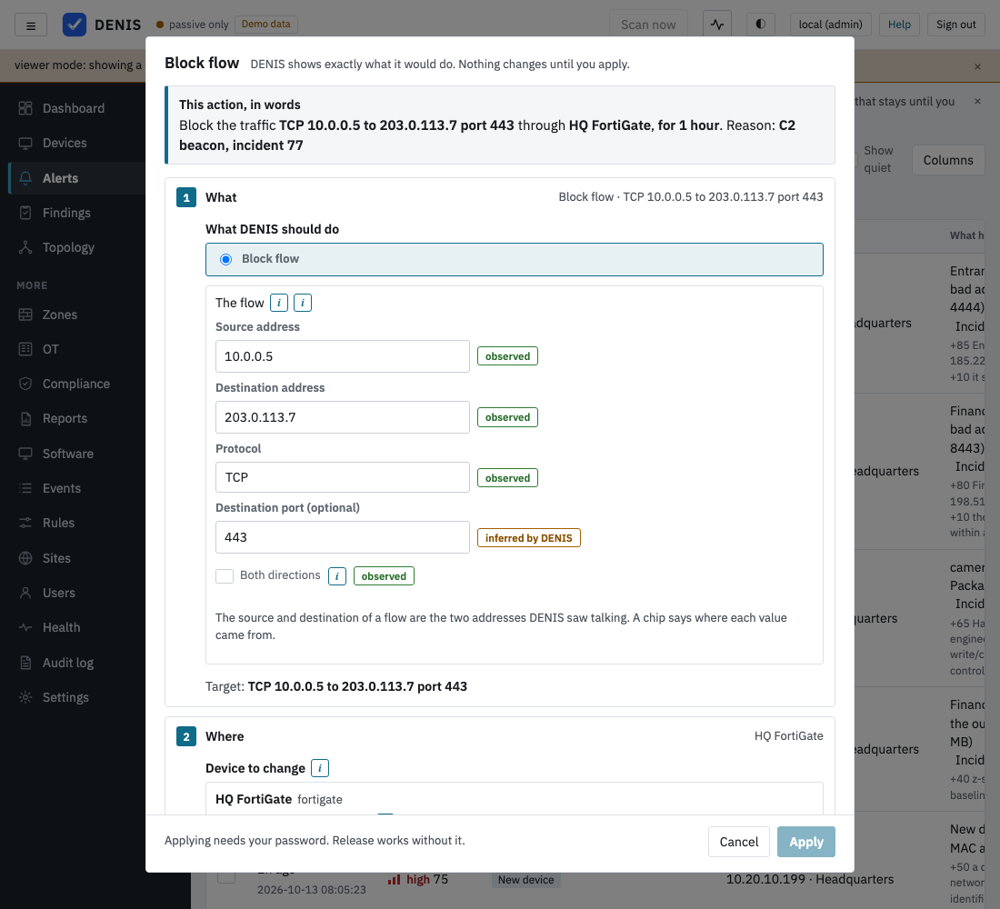
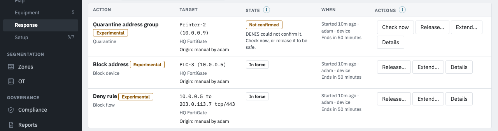
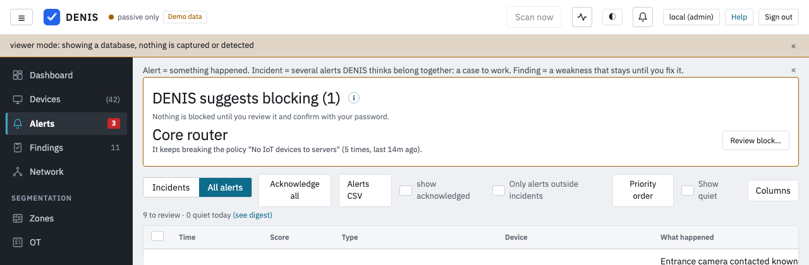

# Enforcement

<!-- enforcement-experimental -->
**Most of enforcement is experimental.** Switch port control on a Cisco Catalyst 2960-X (disable a port, move it to a
quarantine VLAN) and some actions of four connectors are validated on real equipment: UniFi on a Cloud Gateway Ultra
(block device through a firewall policy, block a flow), FortiGate on a 40F (block device, block a flow, quarantine, end sessions), Palo Alto on a
PA-220 (block device and quarantine through the dynamic address group, block a flow, end sessions) and MikroTik on an E50UG (block a flow, quarantine
by address), each with its release (see the table below). Every other action has been tested only against a local
simulation of the vendor's documented interface. An action can cut a device off from your network, and a mistake in your own quarantine setup can cut
off more than you meant. Try each connector first on a device you can afford to lose, and release it to check the way back.
<!-- /enforcement-experimental -->

Enforcement is the part of DENIS that changes something on your network: it blocks a device, quarantines it, switches a
switch port off or ends its sessions. Everything else in DENIS only looks. Enforcement is **off by default**, it works only
through equipment you have connected on purpose, and every action is one signed-in administrator's decision, shown to them
in full before it happens and recorded afterwards.

This page explains how enforcement works, what each action does and does not do, what you must prepare on your side, and
what is available today. The setup of each device type is on its own page, listed at the end.

*Checked against the code on 2026-10-13, after the last vendor package was merged.*

## What is available today

* **Switch ports over SNMP.** Disabling a port and moving a port to a quarantine VLAN are validated on a Cisco Catalyst
  2960-X (IOS 15.2(7)E4, SNMPv2c and SNMPv3). On a D-Link DGS-1100 only switching a port off and on works; that model cannot
  say which device is on which port. See [SNMP port control](nac/snmp.md) and [Switches](switches.md#disabling-a-port).
* **Blocking, quarantine and ending sessions through the connectors** (firewalls, UniFi, Meraki, AWS, Azure, NSX-T,
  Hyper-V, Proxmox, RADIUS Disconnect), each with the connector's own **Block** button under *Settings → Response policy*.
  Some actions of UniFi, FortiGate, Palo Alto and MikroTik are validated on real devices (the table below says which);
  the other connectors are simulator only.
* **The general path** with plans, durations, expiry, per-action permissions, a ledger and an API
  (`/api/nac/actions/...`) is built on the server, and **all twenty connectors are on it now** (flow blocks, quarantine,
  ending sessions and, where the device has them, port actions; validated on the Cisco switch for SNMP, validated per
  action on a UniFi, a FortiGate, a Palo Alto and a MikroTik, simulator only for the rest). In the
  console it is reached through the **Respond...** menu of a device, an incident or a flow, which opens the plan dialog
  (see [The plan dialog](#the-plan-dialog)), and through the API.

## Tested on real equipment

| Device | Tested | Status |
|---|---|---|
| Cisco Catalyst 2960-X (WS-C2960X-48TS-L, IOS 15.2(7)E4), SNMPv2c and SNMPv3 | read, disable port, quarantine VLAN, release, extend, uplink refusal (since 4.2 a warning to tick by hand, not yet tried on the switch), LLDP placement | **Validated** ([setup](nac/snmp.md#quick-setup-cisco-catalyst-2960-x)) |
| D-Link DGS-1100-08V2 (firmware 1.00.015), SNMPv2c | read, port off and on; no forwarding table, no LLDP, no VLAN over SNMP (a limit of the model, devices are placed by hand) | **Partly tested**: port off and on works; placement by hand is experimental ([setup](nac/snmp.md#quick-setup-d-link-dgs-1100)) |
| Fortinet FortiGate 40F (FortiOS 7.2.3) | block device (address group, released by hand in 3 s), flow block (effect and release at once), expiry, extend, End sessions (an open SSH session cut in 1-2 s), quarantine through the address group (in at once, web access blocked, released after 5 minutes with traffic back within 1 s), cleanup | **Validated** for these actions; not tested: IPv6, HA, VDOM mode ([setup](nac/fortigate.md#quick-setup-about-10-minutes)) |
| MikroTik E50UG (RouterOS 7.21.4) | block flow, quarantine by address, release, expiry, extend; block device (enforced, but DENIS reported its read-back as failed before 4.2) | **Validated** for block a flow and quarantine by address; not tested: block device (the 4.2 read-back fix), disabling a port, removing connections ([setup](nac/mikrotik.md#quick-setup-about-10-minutes)) |
| Palo Alto PA-220 (PAN-OS 10.1.14-h9) | test connection, block device through the dynamic address group (no commit, in effect within 10 s, released in 8 s), block a flow with the static deny rule and a commit (early release about 2.5 minutes), automatic expiry, extend, End sessions (an open SSH session dropped, Done in 3 s), quarantine through the dynamic group (in and out in about 10 s), the tag surviving a firewall restart with an active block | **Validated** for these actions; not tested: block through the static address group, quarantine through the static group, re-registering a lost tag, HA, IPv6 ([setup](nac/paloalto.md)) |
| Ubiquiti UniFi Cloud Gateway Ultra (UniFi OS 5.1.33, Network 10.6.106), API key | block device (firewall policy), block a flow, release by hand, early and at expiry | **Validated** for these actions; not tested: Wi-Fi client disconnect, client block by MAC, port actions ([setup](nac/unifi.md)) |

Every other connector in the matrix below is simulator only.

**Validation is per action** (4.2). An action validated on real equipment shows no *Experimental* mark and needs neither
*Allow connectors that are not validated on real equipment (lab use)* nor *Allow experimental actions (lab use)*, by the
owner's decision. The other actions of the same connector keep the mark and the lab settings: on UniFi, the client block
by MAC, the Wi-Fi disconnect and the port actions; FortiGate has none left; on Palo Alto, the
block through the static address group and the static quarantine group; on MikroTik, the block device, disabling a
port and removing connections. The *Experimental* mark appears once per row in the Respond menu and
only on the rows it applies to.

## Capability matrix

*Written from the capability tables in the code (`CAPS` in each `src/nac_*.rs`) by `tools/gen-enforcement-matrix.py`; a test fails when the table below differs from what the generator writes.* The states:

* **Built**: the code exists and has been validated on real equipment.
* **Experimental**: the code exists and has not been validated on real equipment. It needs the lab switches.
* **Not built**: the connector does not do this yet in this version.
* **Unsupported**: the device or its interface cannot do this honestly, so DENIS does not offer it. It is shown as
  unavailable and never faked.

Each cell also names the method, DENIS's name for how the action is done. Where a connector has two methods for one action
(for example MikroTik, Meraki and Palo Alto quarantine), both are listed with their own state. "Built" and "Experimental" mean the code exists. A
connector that has been moved onto the plan and apply path (see *What is available today*) offers its Experimental actions
through that path; for the others, a vendor's existing action is reached through the connector's own Block button.

<!-- matrix:begin -->

| Connector | Block device | Block flow | Quarantine | Disable port | End sessions |
|---|---|---|---|---|---|
| [SNMP switch ports](nac/snmp.md) | Unsupported | Unsupported | Built: `access_vlan` | Built: `if_admin_status` | Unsupported |
| [Fortinet FortiGate](nac/fortigate.md) | Built: `address_group` | Built: `deny_rule` | Built: `quarantine_group` | Unsupported | Built: `session_clear` |
| [Palo Alto PAN-OS](nac/paloalto.md) | Built: `dynamic_group`; Experimental: `address_group` | Built: `deny_rule` | Built: `quarantine_dynamic_group`; Experimental: `quarantine_group` | Unsupported | Built: `session_clear` |
| [OPNsense](nac/opnsense.md) | Experimental: `alias` | Experimental: `deny_rule` | Experimental: `quarantine_alias` | Unsupported | Experimental: `state_kill` |
| [SonicWall](nac/sonicwall.md) | Experimental: `address_group` | Unsupported | Experimental: `quarantine_group` | Unsupported | Unsupported |
| [Check Point](nac/checkpoint.md) | Experimental: `group` | Experimental: `deny_rule` | Experimental: `quarantine_group` | Unsupported | Unsupported |
| [Juniper SRX](nac/juniper.md) | Experimental: `address_set` | Experimental: `deny_rule` | Experimental: `quarantine_set` | Unsupported | Experimental: `session_clear` |
| [WatchGuard Firebox](nac/watchguard.md) | Experimental: `blocked_sites` | Unsupported | Unsupported | Unsupported | Unsupported |
| [MikroTik RouterOS](nac/mikrotik.md) | Built: `address_list` | Built: `deny_rule` | Built: `quarantine_list`; Not built: `access_vlan` | Experimental: `ethernet_disable` | Built: `conntrack_remove` |
| [Ubiquiti UniFi](nac/unifi.md) | Built: `fw_policy`; Experimental: `block_sta` | Built: `fw_flow` | Experimental: `port_profile` | Experimental: `port_disable` | Experimental: `kick_sta` |
| [Cisco Meraki](nac/meraki.md) | Experimental: `client_policy_blocked` | Unsupported | Experimental: `group_policy`; Not built: `access_vlan` | Experimental: `port_disable` | Unsupported |
| [Cisco ASA](nac/asa.md) | Experimental: `object_group` | Experimental: `deny_rule` | Experimental: `quarantine_group` | Unsupported | Experimental: `clear_conn` |
| [Cisco FTD via FDM](nac/ftd_fdm.md) | Experimental: `network_group` | Experimental: `deny_rule` | Experimental: `quarantine_group` | Unsupported | Unsupported |
| [Cisco FTD via FMC](nac/ftd_fmc.md) | Experimental: `dynamic_object`, `network_group` | Experimental: `deny_rule` | Experimental: `quarantine_dynamic_object`, `quarantine_network_group` | Unsupported | Unsupported |
| [VMware NSX-T](nac/nsx.md) | Experimental: `dfw_group` | Experimental: `deny_rule` | Experimental: `quarantine_group` | Unsupported | Unsupported |
| [AWS Security Groups](nac/aws.md) | Experimental: `isolation_sg` | Unsupported | Experimental: `security_group_swap` | Unsupported | Unsupported |
| [Azure NSGs](nac/azure.md) | Experimental: `isolation_nsg` | Experimental: `deny_rule` | Experimental: `nsg_swap` | Unsupported | Unsupported |
| [Microsoft Hyper-V](nac/hyperv.md) | Experimental: `port_acl_deny_all` | Experimental: `deny_rule` | Experimental: `access_vlan` | Experimental: `vnic_disconnect` | Unsupported |
| [Proxmox VE](nac/proxmox.md) | Experimental: `vm_firewall_drop` | Experimental: `deny_rule` | Experimental: `quarantine_ipset` | Experimental: `link_down` | Unsupported |
| [RADIUS CoA](nac/radius_coa.md) | Unsupported | Unsupported | Unsupported | Unsupported | Experimental: `radius_disconnect` |

Of the 100 cells (20 connectors, 5 actions; a cell with two methods counts by its best one): 16 are Built, 48 Experimental, 0 Not built and 36 Unsupported.
20 of the 20 connectors have code for at least one action.

<!-- matrix:end -->

Why a cell says Unsupported, in short:

* **A firewall, SRX, NSX-T or a cloud service has no access port**, so *Disable port* is not offered. A cloud instance has no
  switch port either.
* **A switch** cannot block one device on a port and exposes no traffic filtering through the standard tables DENIS uses;
  switching a port off and on does not end one device's sessions.
* **AWS** security groups only allow traffic, so they cannot hold a deny rule.
* **Meraki** replaces the whole MX firewall rule list in one call, and DENIS does not rewrite rules it does not own. Meraki
  documents no way to end a session.
* **WatchGuard** Blocked Sites works per address only, and offers no group an administrator can reference through the
  interface DENIS uses.
* **RADIUS** Disconnect ends a session and is not a block, RADIUS cannot filter traffic, and a CoA quarantine is applied
  again by the RADIUS server at the next sign-in, so real quarantine belongs in your policy server.
* Where the interface offers no session end (SonicWall, Check Point, FDM, FMC, NSX-T, Hyper-V, Proxmox, AWS, Azure), *End
  sessions* is not offered.

## Settings for flow blocks on a connector

A connector that can block one flow with a deny rule has two more settings in its form (under Safety):

* **At most this many DENIS deny rules** (`max_managed_rules`, default 50, from 1 to 1000). DENIS refuses a new flow block (code `max_rules`) when it already manages that many rules on this connector. Releasing a block frees a place.
* **Networks this firewall routes between** (`routed_networks`, a list of networks such as `10.0.0.0/24`; only on firewalls that sit in the path of the traffic: MikroTik, FortiGate, PAN-OS, OPNsense, Check Point, Juniper SRX, ASA, FDM and FMC, and since 4.2 UniFi, SonicWall and WatchGuard). When it is set, and a device of the flow is in none of the listed networks, the plan shows a warning that the rule may never see this traffic. Empty means DENIS cannot tell whether the firewall is on the path: its actions are listed under *Path not verified* in the Respond menu, never recommended and never used by automation. Hyper-V, Proxmox, Azure, AWS, NSX-T, Meraki and RADIUS do not have it: they act on the device or the group itself, and only on their own guests or clients, which DENIS does not know in 4.2, so they too are listed under *Path not verified* ("this device is not known to it").

Where the rule goes is not a setting: every connector puts its rule first (at the top of the policy, the layer or the access list you name in its form, or with the highest priority the device allows), because a deny rule below an allow rule does nothing.

## Troubleshooting

When DENIS refuses, the plan lists each refusal with a code. The common ones:

| Code | What it means and what to do |
|---|---|
| `enforcement_off` | The kill switch is off. An administrator switches it on under *Settings → Response policy*. |
| `needs_lab` | A lab switch is missing. The text names which one. |
| `needs_config` | The connector needs a setting first, for example the quarantine group or VLAN. Set it in the connector's settings. |
| `needs_rule_opt_in` | Flow blocks need *Allow DENIS to create deny rules* on this connector. |
| `paused`, `not_wired` | The connector is paused (resume it under *Settings → Response policy*) or cannot act yet in this version. |
| `not_built`, `unsupported` | See the matrix. The text of `unsupported` says why. |
| `not_orchestrated` | The connector is not on the plan and apply path. No connector in this version answers it any more; it stays for a connector added later. |
| `nac_permission` (HTTP 403) | Your account lacks the permission of this action. An administrator grants it under *Users*. |
| `unknown_capability` | The connector has no such method for this action. |
| `reason`, `duration` | The reason must be 3 to 200 characters. The duration must be 5 minutes to 365 days, in whole minutes, or permanent. |
| `target_kind`, `target` | The action does not fit the target (a device, a flow or a port), or the request names no usable address. |
| `target_pair` | The address and the hardware address of the target do not belong together. Since 4.2.1 the text says which case it is: the address is not one the device has now (the text names its current address; choose the device from the inventory), another hardware address was seen with the address after this one (the text names it), the device chosen no longer has this hardware address, or DENIS could not read the inventory. An old row of another device, or an address the device held before it moved, no longer refuses. |
| `own_session`, `protected_self`, `protected_gateway`, `protected_infra` | The target is your own address (for a switch port: the device you are using is behind it), or DENIS itself, the gateway (also one a person confirmed), or a DNS or directory server. This never changes. |
| `protected_net` | The address is in a network this connector is set never to block (its *protected networks* setting). You can change that setting. When the device is named by its hardware address (a quarantine from the device's page), the text names the address that matched and when it was last seen: its newest address, or one seen within a day of its newest sighting (seven days for IPv6). |
| `protected_net_earlier` (a warning to tick) | The device, named by its hardware address, was in a protected network earlier and has been seen since at another address, today, inside a network the connector routes (when its *routed networks* are set). The warning names both addresses and their times; tick it only if the device no longer uses the old one. Without that fresh sighting the action is refused instead. |
| `protected_earlier` (a warning to tick) | DENIS itself, a gateway or a DNS or directory server was seen with the address only more than a day before its own newest sighting, and another device of the same site has been seen with it since (4.2.1). Tick it after checking that the protected device no longer uses the address. Automation never acts on it. |
| `protected_connector` | The target is on this connector's own never-block list, or is a virtual router address. |
| `protected_list` | The target is on your hands-off list (*Network → Readiness → Hands-off devices*). Remove it from the list there, with your password, if the action is meant. |
| `site`, `egress` | The target belongs to another site than the connector, or the tenant is not allowed to reach this address. |
| `port_class` | A connector that reports its own port kinds (Meraki, UniFi, MikroTik, Proxmox, Hyper-V) acts only on an access port. It refuses a trunk, an uplink, a port-channel member, a management port, or a port whose kind it cannot tell. |
| `self`, `gateway`, `own_switch`, `management_port`, `mirror_port` | A switch port action that would cut DENIS off: the port DENIS itself, the gateway or the way to the switch is behind, the switch's management port, or a mirror (SPAN) port, which carries the copy of the traffic DENIS reads (switching it off would blind DENIS). This never changes. |
| `denis_path` | A switch port toward another switch DENIS reads, or toward the spanning-tree root, where DENIS cannot show that its own way to the switch goes through another port (its own hardware address, or the gateway's when DENIS is in another network, learned on another port of that switch). Refused, not a warning (4.2). See [Switches](switches.md#what-denis-refuses-whatever-you-confirm). |
| `snapshot_truncated`, `unreadable` | The switch's forwarding table was read only in part, or a list DENIS judges the port with could not be read. Read the switch again; see *Health* if it stays. |
| `multiple_ports`, `arp_conflict`, `already_down`, `already_disabled`, `no_fdb`, `fdb_unmapped` and the other switch codes | Since 4.2 each switch refusal has its own code (before, they came as one `observe`). The text says what to do. |
| `uplink`, `switch_behind`, `trunk`, `trunk_port`, `lag_member`, `cdp_neighbour`, `class_unknown`, `behind_port` (warnings to tick) | A switch port that is not a plain access port: an uplink to another switch DENIS reads, a trunk, an aggregation member, a CDP neighbour, a Cisco port of unknown kind, or equipment learned behind it. Since 4.2 these are no longer refused: an administrator can switch such a port off **by hand only**, after ticking each warning in the plan and again at the apply, with the reason, the password and the typed port name. Each warning says what is behind the port and what it cuts. DENIS never proposes such a port, and automation and Autopilot never act on it. See [Switches](switches.md#ports-that-are-not-plain-access-ports-by-hand-only-with-warnings-to-tick). |
| `conflict` | Another DENIS action is already active on this target. Release it or extend it. |
| `max_rules` | The connector already holds the most DENIS rules allowed (50 by default). |
| `cap_reached` | The hourly limit is used up. Wait, or raise it under *Settings → Response policy*. |
| `same_subnet`, `no_endpoint_here` | Flow refusals, explained under *Block a flow*. |
| `no_effect`, `effect`, `observe` | The connector could not say what it would change or undo with, so DENIS will not act. |

Other situations:

* **`unconfirmed`.** DENIS did not get a clear answer. Use the action's *check* (or *Check now* on a switch port) to read the
  device back. A confirmed change stays active; one that is gone becomes `restored_elsewhere`.
* **`rollback_failed`.** DENIS could not undo it, and it is still in force. DENIS retries on its own; you can retry now or,
  if you removed it on the device yourself, mark it resolved by hand (the password is needed). Look at the device and at the
  action's steps before doing either.
* **An orphan is listed.** An object named `denis-...` on a device is not accounted for. Check that it really is DENIS's,
  then remove it through the API.
* **Drift (`restored_elsewhere`).** Someone changed the device by hand, or it restarted. DENIS does not reapply. Start a new
  action if you still want it.
* **A repeated request.** A request sent twice returns the first answer with `"replayed": true` and does not touch the device
  a second time.

More general help is on the [Troubleshooting](troubleshooting.md) page.

## Automation

**Highly experimental. Off by default.** Automation means DENIS blocks or quarantines a device without asking anyone.
There are three levels:

* **Level (a), nothing.** This is how DENIS works until you change it. A person plans, confirms and applies every action.
* **Level (b), automatic enforcement by rules.** A policy that you mark for it can block or quarantine a device by itself
  when the device keeps breaking that policy. No AI is involved: the rule is the one you wrote.
* **Level (c), Autopilot may block.** Even more experimental, and a separate switch under level (b): it needs level (b) on,
  its own warning, the typed phrase **LET AUTOPILOT BLOCK**, your password, Autopilot active after its shadow period, at
  least 7 days of "would have blocked" records of which at least 10 were judged by a person and 95 % agree. Autopilot then
  may quarantine (or block) one ordinary device for at most 24 hours when a rule or detector reports a high severity
  finding. It never acts on the model's opinion alone, never on OT or infrastructure devices, and everything goes through
  the same path, limits, kill switch and audit as any action. See [Autopilot may block](autopilot.md#autopilot-may-block-experimental).

### Switching level (b) on

*Settings → Response policy → Automation (Experimental)* has one switch. Switching it on needs, all together:

* a signed-in administrator who may act on the network (not an API token, not `--insecure-no-auth`, not an account limited to
  some sites) and who holds the permissions to block a device **and** to quarantine;
* the administrator's password again;
* the typed phrase **AUTOMATIC ENFORCEMENT** (capitals do not matter, spaces around it do not matter, anything else is refused);
* both lab switches (connectors not validated on real equipment, and new actions of 4.1) and the enforcement switch on.

Switching it **off** is one click for any administrator, without a password. It also switches level (c) off. Actions that are
already running keep their end time and can be released at any time.

### Which rules take part

Switching automation on does nothing by itself. A rule takes part only when you choose **Respond automatically** under
the rule ("When this rule matches", see [Responding automatically](#responding-automatically)): the action, the
connector and its method, how long, and a trial of at least 7 days before it acts. The 4.1 button *Mark a policy...* is
gone in 4.2, and the policy API no longer sets a mark (it made a policy act at once, without the trial).
**Every edit of the policy clears the mark**, and the rule goes back to "prepare", because what you approved was the
policy as it was. A mark acts only beside the rule's own automatic setting, switched on for real, naming the same
action, connector and method.

### What DENIS does by itself, and what it never does

When a marked policy produces a block suggestion, DENIS builds the same plan a person would see and applies it through the
same path, with the rule as the actor:

* **Time-limited, always.** The action lasts the shortest of the policy's time, the longest automatic time you set and
  7 days. The default is 1 hour. An automatic action is never permanent.
* **No warnings.** If the plan has any refusal or any warning, nothing is done and the suggestion stays open for a person.
  DENIS tells you "Automatic enforcement skipped" and why.
* **Limits.** Automatic actions count against the hourly limit of all enforcement, and against their own limit (1 to 10 per
  hour, default 3). One policy can cause at most 2 per hour. A device gets at most one automatic action in 24 hours, even if
  you undid the first one. A flood of alerts cannot go beyond these limits.
* **Fresh and after the mark.** Only a violation seen in the last 15 minutes, and after the policy was marked, can trigger it.
* **Never on** DENIS itself, the gateway, industrial (OT) devices, or network and server infrastructure (routers, switches,
  firewalls, access points, servers). The guards that apply to everyone also apply here: management ports, the port DENIS or
  the gateway is behind, and the addresses on your "never block" lists. An uplink, a trunk or another port that is not a
  plain access port always carries a warning, so automation never acts on it (a person can, by hand).
* **Checked again every time.** The administrator who switched automation on must still exist, still be an enabled
  administrator without a site limit and still hold the permission. If not, automation stops itself, says so on every
  notification channel and writes `nac.automation.suspended` to the audit log. A lab switch switched off does the same. The
  enforcement switch off stops it without suspending it. The administrator who switched a rule's automatic response on
  for real is checked too: one who lost the permission or was switched off sends that rule back to "prepare", with a
  notice. A rule still in its trial only writes down what it would have done, so it never suspends automation.
* **Leader only.** On a cluster only the leader acts. DENIS cannot yet fence a leader that lost its lease, so treat
  automation on a cluster with extra care.

### Undo

Every automatic action is announced on every notification channel (high severity, never filtered) with the device, the
policy, the end time and an **Undo** link: `<public address>/#/enforcement/action/<id>?undo=1`. The link only opens the
console. Nothing changes until you press **Undo** there, signed in, so a mail or chat link preview cannot undo anything. Undo
is an ordinary release through the same path (it works with enforcement switched off, and needs the permission of the action).
A link names one action, and works once.

### Level (c): letting Autopilot block

Under "Let Autopilot block" in the same box. The switch is greyed out until every line above it says *Yes*. It is audited as
`nac.automation.autopilot` (on, off, who, the typed phrase, the agreement figures), `nac.automation.autopilot.run` for each
block, `nac.automation.autopilot.refused` for each refusal (including a refused suggestion of the model), and
`nac.automation.suspended` when it stops itself. Autopilot blocks are in the ledger as actor `autopilot`, with the decision as
the origin. They count against the hourly limit of all enforcement and against the automatic limit of level (b); on top,
Autopilot may do 2 an hour, 6 a day and one per device in 3 days, and never for more than 24 hours. Switching level (b) off
switches level (c) off in the same write.

### Audit

Switching on or off, every limit change, every skipped suggestion and every automatic action is in the audit log:
`nac.automation.rules`, `nac.automation.rules.run` (with the policy id and revision), `nac.automation.rules.skipped`,
`nac.automation.suspended`, `policies.auto_enforce`, and the action itself as `nac.<connector>.<action>` by `rule:<policy id>`.

Every change of a connector's safety options is in the audit log too, as `nac.connector.safety_options`, with who
made it and, for each option, its old and new value: *Allow DENIS to create deny rules*, the protected addresses and
networks, the routed networks, the most rules DENIS may hold, the lists, groups and VLANs it works in, TLS and host-key
verification, a pinned certificate (named by a short fingerprint), and whether the connector is in use. Passwords and
tokens are never written there. The kill switch and the hourly limit (`nac.settings`) and the lab switches (`nac.lab`)
are recorded with their previous value as well. With the deny-rule option off, or stored as anything but a real
"on", DENIS refuses a flow block at the plan and again at the apply.

## Hands-off devices

DENIS never acts on some devices, whatever you ask: its own address, the gateway, a DNS or directory server, and the switches it reads. Each connector also has its own never-block lists (addresses, networks, hardware addresses, VM names). Those stay exactly as they are.

On top of them there is one list for the whole installation, the **hands-off list**, in the section *Hands-off devices* of **Network → Readiness**: devices DENIS never acts on. A device on it is refused by every connector and by every switch port action ("never touch my safety PLC", said once). An entry is a device of the register, an IP address, a MAC address or a network. The same screen also shows, read only, DENIS's built-in rules and the lists of the connectors, so the answer to "is this device protected, and why?" is in one place.

The list can only add refusals. Adding an entry needs no password, because it makes DENIS more careful. Removing one needs your password, because it makes blocking possible again; the person who added an entry may take it back without the password in the first ten minutes. Both are audited (`nac.hands_off.add`, `nac.hands_off.remove`). The API is under `/api/network/hands-off` (see the API reference).

## The Respond menu

On a device's panel, **Respond…** opens a menu grouped by what you want: **Cut the device off** (block the device, switch off its port, end its sessions), **Contain it** (quarantine through a firewall group, move the port to the quarantine VLAN) and **Block one connection** (one item, *Block a flow…*, which lets you pick the recorded flow in the next step). Nothing is pre-selected and nothing is recommended: you choose at that moment. Each response says which connector or switch it goes through.

What is not available is folded into **Not available here (N)**, with **one row per cause**, not one per response: a chip that says in words what kind of cause it is, a plain sentence, the responses it affects, and a **Fix:** link to the exact control that changes it. The chips:

| Chip | Meaning |
|---|---|
| Hardware | The equipment cannot do it (a switch cannot block one device). Never changes. |
| Version | Not built into this version of DENIS. |
| Setup | You can change it: a paused connector, a missing setting, a switch without a write credential, enforcement switched off. |
| Lab only | A lab switch under *Settings → Response policy* is off. |
| Permission | Your account lacks the permission; another administrator grants it under *Users*. |
| Safety | DENIS refuses on purpose, for example because the device is hands-off. |
| Data | DENIS lacks information, for example it has not seen the device on a switch port. |

**The addresses a device has now (4.2.1).** One rule is used everywhere DENIS asks where a device is now: which
firewall is on its path, which address the Respond menu and automation act on, and the check that the address and the
hardware address of a target belong together. The newest sighting decides. A device's current IPv4 address is its
newest one; another IPv4 address counts as current only when it was seen within two minutes of it (one interface that
really holds two addresses is seen at both all the time). Every older address is history: a laptop moved from port to
port or from network to network is judged by where it is now. For IPv6 its newest address counts when it was seen
within a day of the device's newest sighting, and every other one seen within 15 minutes of the newest sighting.
Network equipment (a gateway, router, firewall, switch, access point or controller) keeps every address of the last
day, because its interface addresses are seen rarely and at different times. When DENIS knows the device through
several sensors of one site, all of their sightings count as one device; a sensor of another site never adds an address
(two sites can use the same private addresses). An address seen with two hardware addresses belongs to the one seen
with it last; two devices seen with it at the same time are a contradiction, and the plan refuses. A device with a
wired and a Wi-Fi interface has two hardware addresses, so two current addresses: the plan lists the other interface
under what the action does not cover. When you choose a device in the Respond menu, the action takes its newest current
address in a network the firewall routes, otherwise its newest current IPv4 address; the plan shows the address it acts
on. The plan judges the path on every current address of the device, not only on that one: a firewall that routes only
an older one is not on the path, and the plan asks you to tick its warning. When the device list cannot be read, DENIS
does not fall back to one row: the path is not known.

The refusals for DENIS itself, the gateway and DNS or directory servers still look at every address such a device
ever had. An address it was seen with only more than a day before its own newest sighting, and that another device of
the same site has been seen with since, no longer refuses: the plan carries the warning `protected_earlier` instead,
which a person ticks after checking that the protected device no longer uses it; automation never acts on it. A
link-local IPv6 address (`fe80::`) never loses its protection this way. A gateway's address DENIS found (manual,
confident or likely) always refuses, whoever was seen with it last, when something besides DHCP replies shows it (a
person confirmed it, the capturing host routes through it, it carries internet traffic, or a polled switch routes
there). An address that only DHCP replies name as the router (in the last two weeks) carries the warning
`protected_dhcp_router` instead: a person ticks it after checking that it is not the gateway; automation never acts
on it. When the gateway data cannot be read, the action is refused (4.2.2).

**The connector's own device (4.2.1).** A connector never acts on the device it manages: the address it is set up to
reach, every address its device lists itself over an authenticated connection, every hardware address of the device,
and every address any row of one of those hardware addresses (each sensor's) held within a day of that row's newest
sighting, link-local ones included. Such an address stops being the device's own only when another device of the
connector's site holds it now and was seen with it more than an hour (the largest clock difference DENIS accepts
between sensors) after the connector's device was; anything less refuses. An address the device held only briefly long
ago is not its own.

**Which connector is on the device's path (4.2).** The main groups hold only what DENIS knows acts on the device: a
firewall whose *routed networks* hold one of the device's current addresses, and the switch port DENIS knows for
certain. Where the device is **now** decides: when a
device moved from one firewall's network to another's, the firewall that routes only its older address is listed under
*Other firewalls* (an address of the other family loses only when it was last seen an hour or more before). Checks that
must not miss an address the device held lately (an open ARP conflict, a protected network the device was in earlier)
keep their longer look-back. Everything else is still listed, never hidden, each on its own line with its reason, and is
never recommended or used by automation; the plan asks you to tick its warning:

* **Other firewalls: path not verified**: another firewall routes the device ("192.168.12.10 is routed by Palo Alto
  PA-220, not by FortiGate 40F").
* **Path not verified**: DENIS cannot tell, because the firewall has no routed networks that hold the address, the
  device has no current address, or the connector acts at the device itself (a hypervisor, a cloud group, NSX, Meraki,
  RADIUS) and DENIS has nothing that says the device is one of its own ("Hyper-V: this device is not known to it").

UniFi (the gateway's zone-based firewall policy and the client block), SonicWall and WatchGuard count as firewalls
on the path, with routed networks of their own, like FortiGate or Palo Alto: set them on the connector, or they stay
under *Path not verified*. **Switch off port** and **Move the port to the quarantine VLAN** for a device go only
through the switch DENIS knows the device is plugged into: a router's, a controller's or a hypervisor's own port
action never acts on another vendor's switch, and the capabilities list marks it *not the switch of this device*.

**Location line.** The head of the menu says where the device is plugged in, how DENIS knows (*announced by the device*
over LLDP, or *learned from the switch*'s forwarding table) and how old the reading is ("switch read 3 minutes ago"). An
LLDP announcement on a port where the same switch's forwarding table no longer learns the device, while it learns it on
another port, is where the device was, not where it is: the forwarding table wins. A placement on another port in the
last two reads makes the location uncertain until the reads agree, so no port action is proposed meanwhile.

**Slow methods.** A method that needs a commit on the firewall (PAN-OS: the deny rule of *Block a flow*, the static block
and quarantine groups) says so on its row and in the plan dialog: the commit takes minutes on a PA-220. For fast
containment use *Block device* with the dynamic address group, which needs no commit and acts in seconds.

When nothing is available the list is open, under a headline that says so. A device that is **hands-off** gets one row (Safety) and nothing else. The not-available rows can be reached with the keyboard, and each one points at its reason. The menu is fixed to the screen, so no scrolling panel cuts it off; on a phone it docks to the bottom.

## Switches that cannot say where a device is

A switch that gives no forwarding table (the D-Link DGS-1100-08V2 is one) cannot tell DENIS which port a device is on, so port actions on it are refused. An administrator can place a device on a port by hand (**Experimental**, see the [D-Link quick setup](nac/snmp.md#quick-setup-d-link-dgs-1100) and the switches guide): the refusal then becomes a warning to tick, only switching the port off is possible, and the placement ends after 30 days or when the port's link changes.

## The plan dialog

Every action starts as a plan. The dialog says in one sentence what DENIS would do, lets you choose the connector and the
duration, lists what it would cut off, shows every refusal and warning, and asks for your reason and your password.
Nothing changes on a device until you press Apply.

**What this covers.** The plan says exactly what the action reaches. An action on an address (block a device on a
firewall, a quarantine address list, ending sessions by address) covers **that one address**, IPv4 or IPv6 as named:
the device's other addresses (a second interface, its IPv6 address next to the IPv4 one, an address in another
network) are not covered, and the plan lists the ones DENIS saw in the last seven days with how long ago, so you can
act on them separately. A connector that acts on the hardware address says that it covers the device by that address.
A flow block names its protocol and port, or says that it covers any protocol and any port when the flow names none,
and whether the reverse direction is covered. The same sentences are kept with the action (*Active responses* and the
action's details), in the audit log and in the notification.

Opened from the Respond menu the response and the connector are already chosen, so the dialog is one step: the plan, how long, why, the warnings to tick, and, in the footer that stays in view, your password and **Apply**. The **reason field starts empty**: you write why in your own words (5 to 200 characters), because it goes to the audit log; **Apply** stays off until you have. Each refusal in the plan carries the same chip and **Fix:** link as the menu.

## Active responses

*Settings -> Enforcement* lists what is in force, a failed removal first. Each row has **Release** (no password), **Extend**
(password) and, when DENIS could not confirm a change, **Check now**. A device's panel shows the same for that device.

**Extend** offers two ways, and shows the new end as a clock time before you give your password:

* **Add this to the remaining time** (the default): with 4 minutes left, adding 15 minutes makes it end in 19 minutes.
* **End this long from now**: the action ends 15 minutes from now. This can never make it end earlier than planned;
  DENIS says so and refuses.

Choose *Permanent* to keep it until someone releases it (tick the box). The audit log records which way was used and the
old and the new end time. The time left is kept in whole minutes (rounded up), so an action lost on the device can be
put back with it, and when two people extend the same action at the same moment only the first is written: the second
is told the action moved on and can try again on the new end.

When a plan in the dialog expires and is made again, a warning you ticked stays ticked only when it says the same words
again; *I have read the warnings* is asked again whenever the warnings changed.

## Rule actions

**New in 4.2.** "Prepare a response for me to approve" does nothing by itself. "Respond automatically" is
**Experimental**: it was tested against simulated connectors only, not on real equipment. The API is in
[API: rule actions](api.md#rule-actions).

Every rule of your own (an IT rule or an OT rule on the Rules page) and every zone policy and allow-list has one
setting, **When this rule matches**, with three choices. It appears once the rule is saved.

* **Only notify me** (the default). You get an alert. DENIS changes nothing on your network.
* **Prepare a response for me to approve.** DENIS gets a block ready; nothing happens until you approve it with your
  password.
* **Respond automatically** (*Experimental*). DENIS blocks by itself, for a limited time, and tells you; you can undo
  it.

Under the choice, **What this would do** shows how often the rule would have matched in the last 7 days, on which
devices, what would have happened to each one and through which connector, and about how many responses a day would
wait for you. For a saved rule it counts the rule's own alerts; for an IT or OT rule you are editing it is an estimate
from what DENIS has learned (the same numbers as the rule's own dry run). A device DENIS never prepares a response for
is listed as *Never*, with the reason: industrial devices (except the sender an OT rule names), DENIS itself, the
gateway, network equipment and servers, and the hands-off list. A rule that would prepare more than 20 responses a day
asks you to tick a box first.

**Which rule can do what.**

| Rule | Acts on | Prepare for approval | Automatic |
|---|---|---|---|
| Zone policy (deny) | the device that broke it | block the device, quarantine | block the device, quarantine |
| Allow-list | the device that broke it | block the device, quarantine | block the device, quarantine |
| IT rule | the device, or only its connection to that address and port | block the connection (default), block the device, quarantine | block the connection, block the device |
| OT rule | the **sender** of the command, never the target (the PLC) | block the sender's connection to the target (default), quarantine the sender | never |

Built-in rules stay "only notify" in 4.2.

**After an upgrade.** A policy that offered to block devices (the 4.1 setting) is set to "prepare", through the best
connector on the device's path. A policy marked for automatic enforcement in 4.1 stays automatic and live: an upgrade
does not undo a deliberate mark.

### Waiting for your approval

A rule set to "prepare" turns a match into a response that waits for you: in **Network → Response** (first section),
on the Alerts page, in the device's panel and behind the bell ("Laptop-17 broke 'Cameras: no internet'. A response is
ready for your approval."). A zone policy or an allow-list prepares one after 3 separate minutes within 10 minutes; an
IT or OT rule on its first match. Each row says which rule matched, how often and when last, and what is ready: the
response, how long (1 hour unless the rule says otherwise) and through which connector, with the reason DENIS chose it:

1. a firewall on the device's path (*verified*: it routes the device's network and is its gateway), the most specific
   network first;
2. a connector that *controls this device directly* (a controller or a hypervisor), only when DENIS knows the device
   is one of its own. In 4.2 DENIS keeps no list of a hypervisor's guests or a controller's clients, so such a
   connector is never chosen for you; you can still choose it when you review the response, with its warning;
3. a firewall *set up to route this network (not checked)*;
4. for a quarantine, *the switch port the device is on*, only when DENIS knows that port for certain and nothing else
   is behind it.

When DENIS cannot tell which firewall is in the device's path, the response is still prepared and you choose the
firewall when you review it; the plan dialog then asks you to tick the path warning. A connector chosen in the rule is
used when it can act, and the row says so when it cannot.

* **Review...** opens the normal plan dialog, filled in. Your own reason, every warning tick and your password stay
  mandatory: one click opens a ready dialog, it never blocks by itself.
* **Not now** hides it for 4 hours, 1 day or 3 days. It comes back only if the rule matches again after that. A rule
  set to respond automatically does not act on it meanwhile either.
* **Reject**: *This is normal for this device* or *The rule is wrong here*. No new response for this device and rule
  until the rule changes; the second offers to add an exception.

One device and rule have at most one waiting response. A rule has at most 20 waiting at once and 10 new ones an hour;
beyond that the list says the rule may be too broad and offers **Switch the rule to notify only**. No response is
prepared for a device on the hands-off list, for the device of a connector or switch, or while DENIS has an action on
the device and for an hour after it ended. DENIS checks a waiting response again every 5 minutes: it closes when the
rule is switched off, deleted or set to only notify, when the device becomes hands-off, or when the device is blocked
already. A response that is not approved expires 3 days after it was prepared, even while the device keeps matching; the
next match prepares a fresh one. One notice per rule per hour (the repeats fold into
it), and at most 6 of them an hour reach your notification channels. Nothing is approved from a notification, a link
or a phone: links only open the console.

### Responding automatically

**Experimental.** The automatic choice stays greyed out, with one line per reason and a **Fix:** link, until all of
this is true: enforcement is on, both lab switches are on, automation by rules is on (see [Automation](#automation)),
your account may use the response, one fixed connector and method is chosen (never "best on the path"), and the rule
kind allows it.

* **A trial first.** Choosing it needs your password and starts a trial of at least 7 days. During the trial DENIS
  keeps preparing responses for your approval and runs the whole automatic decision without applying it: it writes
  down what it would have done (or why it would not have acted). **Trial records...** under the choice lists them;
  judge each one *Right*, *Should not have acted* or *Wrong device*. Approving the matching response counts as right,
  rejecting it as wrong (one approval or rejection judges one record, and an approval counts as right only when you
  applied what the rule would have done: the same response, connector and device). A response that keeps matching is
  one record a day. It can act by itself only after the trial, when it would have acted at least 3 times (a device's
  records of one day count once), at least 90 % of what you judged agrees, and you marked no "wrong device" in the last
  7 days. Switching it on for real
  (in the same list) needs your password and the typed phrase **AUTOMATIC ENFORCEMENT**. The list stays readable for
  90 days after, to compare.
* **Two matches.** An IT rule acts by itself only after 2 matches at least 10 minutes apart. A connection block also
  needs the administrator who switched automation on to hold the permission to block connections.
* **Connections of an IT rule.** DENIS's flow records keep no direction (the port is the smaller of the two), so a
  connection block an IT rule prepares says the direction is DENIS's guess. The plan warns about it, so such a block
  always waits for you; block the device instead if it should happen by itself. A connection to an IPv6 address is
  blocked from the device's IPv6 address.
* **Limits.** At most 1 or 2 automatic responses per rule per hour (default 1), within the limits of
  [What DENIS does by itself](#what-denis-does-by-itself-and-what-it-never-does). Never longer than 7 days. Never when
  the plan has a warning: then the response waits for you, and the row says why DENIS did not act.
* **Every edit of the rule** or of any zone (every kind of rule can name zones) turns "automatic" back to "prepare",
  with a notice that says why. So does its connector going away. A rule edited in the last 24 hours does not act by
  itself.
* **Releasing what it did** can also pause the rule: *Also pause...* in the release dialog sends it back to "prepare"
  (the same response), without a password.
* **Turning automation off** pauses every automatic rule: they prepare responses for approval instead.
* **From an MSP console**, "prepare" is a Configure change; "automatic" and switching it on for real are Enforce
  changes. An automatic response a technician chose, or switched on for real, goes back to "prepare" when the MSP
  link ends.

Every change of the setting is in the audit log with the old and the new value (`policies.response`, by `denis` for
the automatic changes), and so are `policies.response.live`, `nac.prompt.dismissed`, `nac.prompt.reviewed`,
`nac.rule_trial.would` and `nac.rule_trial.judged`. The action itself is `nac.<connector>.<action>`, by you (approved)
or by `rule:<policy id>` (automatic), as for every other action.

## Not available yet

* **Rule actions** for the built-in rules, approval from a phone, and a line on the alert itself saying a response is
  prepared.

* **Enforcement from an MSP console** on a customer's local master is not built for actions on devices beyond what the level
  and the boxes of [MSP management](msp-management.md) allow.

## Where to find it in the console

**Network** is a group in the left menu, like Settings, with four pages:

* *Network → Map* (formerly *Topology*): the gateway DENIS knows, your switches and the cables between them, and the ports of each switch with a role and the reason for it (uplink, trunk, link aggregation, management, infrastructure, access). **Read now** is on every switch.
* *Network → Equipment*: every switch DENIS reads and every firewall, controller or cloud platform it acts through, in one table (this used to be *Settings → Switches* and *Settings → Connectors*). Add a switch or a connector, read or test one, and the **write test** of a switch. Where DENIS recognises your gateway as a firewall it offers to set up that connector.
  One row per physical device: a switch DENIS reads and a connector it acts through are one row with two roles (*Ports · SNMP*, *Enforcement · kind*) when the identity layer says they are one device, or when both are set up on the same address (the row says which: *same address*, *reported by the device*, *joined by admin*); the row takes the connector's name, settings, credentials, Edit and Delete stay per role. The row shows the state in short words (*read 2m ago*, *Tested 1d ago*, *no forwarding table*, *Simulator only*); the chevron opens the detail with the full sentences, what it can do, the last action, the site and where it is wired. *Read now*, *Test* and *Edit* stay visible, the rest (*Test write*, *Block…*, *Placed by hand…*, *Delete…*) is in the **⋯** menu. **Order:** *By wiring* (the default) follows the cables on *Network → Map* (internet side first, then by address); *Manual* keeps the order you set with the handle or **Move up** / **Move down**, saved for every administrator (`PUT /api/network/equipment-order`, audited); *Use this order* starts the manual order from the order by wiring.
* *Network → Response*: *Equipment state* (what each piece can do and the one thing to change), *Currently blocked by DENIS* (every response in force with its origin: a person, an automation policy by name, Autopilot; releasing an automatic one can also pause its policy), *Hands-off devices*, and what your account may do.
* *Network → Setup*: a seven-step guided setup (discover, gateway, equipment, uplinks and hands-off, response methods, write credentials, dry run).

*Settings → Response policy* keeps what DENIS is **allowed** to do: the kill switch and the hourly limit, the lab switches and *Automation*, under a status strip. A device's panel has the **Place & response** block and the **Respond…** menu. *Users* shows each administrator's enforcement permissions.

Old addresses keep working: `#topology` opens *Network → Map*, `#settings/switches` and `#settings/connectors` (and their `/<id>/<field>` forms) open *Network → Equipment*, and `#settings/enforcement`, `#settings/nac` and `#settings/automation` open *Settings → Response policy*.

## Details from the console

Fields every firewall connector shares. The console shows a short line under each field and a short note behind its (i); the full explanation is here. The fields that belong to one connector are explained in that connector's page.

- **At most this many DENIS deny rules**: DENIS refuses a new flow block when it already manages this many deny rules on this connector (default 50, from 1 to 1000). Releasing a block frees a place.
- **Networks this firewall routes between (CIDR, e.g. 10.0.0.0/24)**: Optional. When set, DENIS warns before blocking a flow where a device is in none of these networks, because the traffic may never pass this firewall. Leave empty if you are not sure: DENIS then says nothing about the path.

## The connector pages

[SNMP switch ports](nac/snmp.md), [Fortinet FortiGate](nac/fortigate.md), [Palo Alto PAN-OS](nac/paloalto.md),
[OPNsense](nac/opnsense.md), [SonicWall](nac/sonicwall.md), [Check Point](nac/checkpoint.md),
[Juniper SRX](nac/juniper.md), [WatchGuard Firebox](nac/watchguard.md), [MikroTik RouterOS](nac/mikrotik.md),
[Ubiquiti UniFi](nac/unifi.md), [Cisco Meraki](nac/meraki.md), [VMware NSX-T](nac/nsx.md),
[AWS Security Groups](nac/aws.md), [Azure NSGs](nac/azure.md), [Microsoft Hyper-V](nac/hyperv.md),
[Proxmox VE](nac/proxmox.md) and [RADIUS CoA](nac/radius_coa.md). The overview of the connectors is in
[Zones and policies](segmentation.md#enforcement-connectors); the actions API is in [API](api.md).
