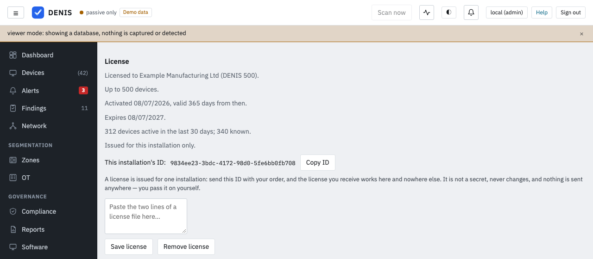

# Licensing

The Community edition is distributed as pre-built, signed binaries under the DENIS Community License.
The full terms are in `LICENSE`, in the root of the repository; this page is a summary, not a substitute for
reading it.

## Community edition

Free to use for **personal or other non-commercial purposes**, on a single installation
monitoring **up to 100 devices**. This covers a household network, or trying DENIS out.

## Evaluation by an organisation

A business, non-profit, government body or other organisation may use the Community edition **free of charge for
30 days, counted from the first installation**, to evaluate and demonstrate DENIS, on up to 100 devices. The period
does not restart if DENIS is installed again on another machine. It is for evaluation, not for running your operations
on DENIS: after the 30 days, stop using it or get a commercial license. DENIS does not switch itself off after 30
days and the license check does not count them: the condition is in the licence (`LICENSE`, clause 2A).

## Commercial use

Beyond the evaluation above, any use by or for a business, non-profit, government body or other organisation — regardless of
device count — and any installation over the 100-device cap, needs a **commercial license**. See
`LICENSE-COMMERCIAL.md`, in the root of the repository, for how to get one.

## Tiers

| Edition | Devices counted |
| --- | --- |
| Community | 100 |
| DENIS 500 | 500 |
| DENIS 5000 | 5,000 |
| DENIS 20000 | 20,000 |
| Above that | on request |

Every license can also act as an MSP license: there is no separate MSP edition or flag (see
[MSP customers](#msp-customers-covered-by-the-msp-license)).

## How devices are counted

A **device** is one physical device, not one hardware address: the rows DENIS has merged into one identity count once
(see the identity groups under Network). A device **counts while it is active**: seen within the last **30 days**. A
license may carry a different window (`count_window_days`, 7 to 365); the console shows the window in force.



* While the active devices fit the cap, the Devices list stays **complete**: devices that have not been seen for a while
  are listed too, they just do not count.
* Above the cap, the list (and its CSV, the printable report, the software inventory and the other lists built on it)
  is cut to the cap. The devices kept are chosen the same way every time: **active first**, then by class,
  **servers, then OT/ICS devices, then laptops and desktops, then phones and tablets, then everything else** (printers,
  IoT, cameras, devices of unknown type), and **network infrastructure last** (switches, access points, routers,
  firewalls: they count, but they are the first to be left out of the list); then the lowest id. The set does not change
  from hour to hour; a device leaves it only when it stops being active or a more important one appears. Set a device's
  type under its details if DENIS guessed wrong.
* **Detection, alerting and protection never stop.** Every device is monitored whether it is listed or not.

A banner shows the counts ("Showing 100 of 140 devices. 120 were active in the last 30 days ..."), and a low-severity
alert is raised once when the cap starts to be exceeded.

## What changes without a license

Nothing is crippled. Detection, alerting and everything that keeps you safe keeps working exactly
the same, on every device DENIS finds. What is limited is the **browsable list**: past the 100-device cap
the Devices page (and its CSV and printable report) shows 100 devices, chosen as described above so it is always
the same ones, not a different 100 each time. A banner explains why, with the counts, whenever
you are over the cap or a license file cannot be verified (expired, edited, or issued for a
different build).

## Installing a license

A license is a small signed text file, two lines. The easiest way: **Settings → System → License** (an
administrator), paste both lines in and save — it verifies immediately, no restart needed, and
if it does not verify the page says why. This is what most installs should use.

Alternatively, a file on disk works the same way, and takes effect at start-up:

```bash
denis serve --db denis.db --license-file /path/to/license.key
# or, for the full discovery/detection mode:
denis run --license-file /path/to/license.key
```

`DENIS_LICENSE_FILE` works the same way as an environment variable. A license pasted into
Settings → System → License always takes priority over `--license-file` if both are present. Since 4.5 a pasted
license that verifies but is not in force (expired past its grace period, or made for another installation) is
refused with the reason and nothing is changed, so pasting an old file can no longer replace a valid one.

The term of a license counts from the first time this installation verified it (its activation time, kept in the
database). Since 4.5 that time is written only once: a moment when the database cannot be read (a busy store, a
failover) or a stored value that cannot be read no longer starts the term again.

The license belongs on the top-level installation that has a console: your own instance if you are
a single business, or the MSP's master if you are an MSP. Agents reporting into a master never need
their own license; the cap and terms apply to the install as a whole, not per agent. A customer that
runs its own master and is linked to an MSP is covered by the MSP's license (below).

A license's validity is counted **from the first time it verifies on that install**, not from the
day it was issued.

**A license is issued for one installation.** Settings → System → License shows this installation's ID (a
random identifier it created once; it never changes and is not a secret). Send it with your order,
and the license you receive works on that installation only — copied to another server it is
refused there, and that server stays on the Community edition. Nothing is sent online for this:
you pass the ID on yourself, so it works fully air-gapped. The ID is kept in DENIS's database, so
restoring a backup onto a replacement server keeps it (and the license with it). Licenses issued
before installation IDs existed are not tied to one and keep working exactly as before.

Expiry is judged against a licensing clock that never runs backwards: setting the system clock back
does not extend a license. Small corrections (NTP and the like, up to 10 minutes) are tolerated.

**Devices are counted across the whole installation**: everything this console holds (its own devices, every
agent's, and the sites relayed into it from another DENIS with `denis run --report-to`) and every tenant inside the
installation (below).

## MSP customers covered by the MSP license

A customer's own master that is **linked to an MSP** (paired under Settings, MSP management) needs **no license of its
own** while the MSP's license is valid. It is shown as **Licensed through <MSP>** under Settings, License.

* **How it works.** Every 15 minutes the customer's master tells its MSP, over the already authenticated and pinned
  link, how many devices are active (a number: no device data goes along) and gets back a short **signed statement**
  that it is covered. The statement is signed with the MSP's link key, which the customer pinned at pairing, and carries
  the customer's own fresh random value, so an old answer cannot be replayed. It holds for **14 days** after the last
  successful exchange, measured on the customer's licensing clock: if the link is down, the console stays covered for
  two weeks and shows a banner after a day of silence. Coverage keeps working when the customer presses Disconnect
  (that cuts management, not licensing). Nothing needs a network connection to the vendor, so air-gapped installs work.
* **What the MSP counts.** The MSP's master adds up its own active devices, the active devices reported by its covered
  customers and those of its tenants, against its cap. A customer that holds a **valid license of its own** uses it and
  is not counted in the pool. If the customer also mirrors its devices with `--report-to`, the larger of the reported
  number and the mirror's own count is used, and the mirrored rows are not part of the MSP's own list.
* **Over the pool cap**, only the MSP master's own list is shortened (never below 100 devices); **customers are not
  affected**, and nobody pays for another. The MSP sees a banner with the numbers. Under Operator, Customers each
  customer shows its reported active devices and whether it is covered, own license or not covered (numbers only).
* **The customer** sees its own count only, never the pool total or other customers.
* An MSP on the Community edition cannot cover customers: a commercial license is needed.
* If the MSP's license ends (past its grace period), the next exchange tells the customer, and it follows the path below.

### Leaving an MSP, or losing coverage

When the customer unlinks, the MSP removes it, the MSP's license ends, or 14 days pass without contact, the console
becomes a Community edition at once, with a **30-day trial**: the device list is not shortened during the trial and a
banner counts the days down. After the trial the list is capped at 100 (active first, as above); detection continues,
your data is kept, and you can paste your own license at any time. The trial is given **once per installation per
365 days** (also when the second loss of coverage is dated before the first; the trial and its record are saved
together, 4.5). It is separate from the 30-day evaluation that starts at first installation.

## Tenants inside one installation

The devices of every tenant of one installation (`denis tenant add`) are **summed with the default console's** against
the one license of the installation, which is the license pasted or given with `--license-file` in the default console.
Tenant consoles are shown as "Included in the license of this installation" and are never shortened; only the default
console's own list is shortened if the total is over the cap (never below 100 devices). Without a commercial
license, a tenant console keeps the Community behaviour.

## Expiry, and a 7-day grace period

Nothing changes suddenly. Settings → System → License always shows when the current license expires and,
once it is getting close, how many days are left:

* **30 days before expiry**: everything stays exactly as licensed. A banner appears at the top of
  the console, and a low-severity alert is raised once (not repeated every day), so it does not
  get missed even if nobody happens to open Settings.
* **After it expires**: still nothing is hidden yet. A **7-day grace period** starts, during which
  the license keeps working in full — this is deliberately generous, so a renewal in progress (an
  invoice being processed, a file that has not been re-installed yet) never causes a surprise
  during business hours. A higher-severity alert marks the start of the grace period.
* **After the grace period also passes**, the install falls back to the Community edition (the
  100-device cap and everything described above) until a valid license is installed again.
