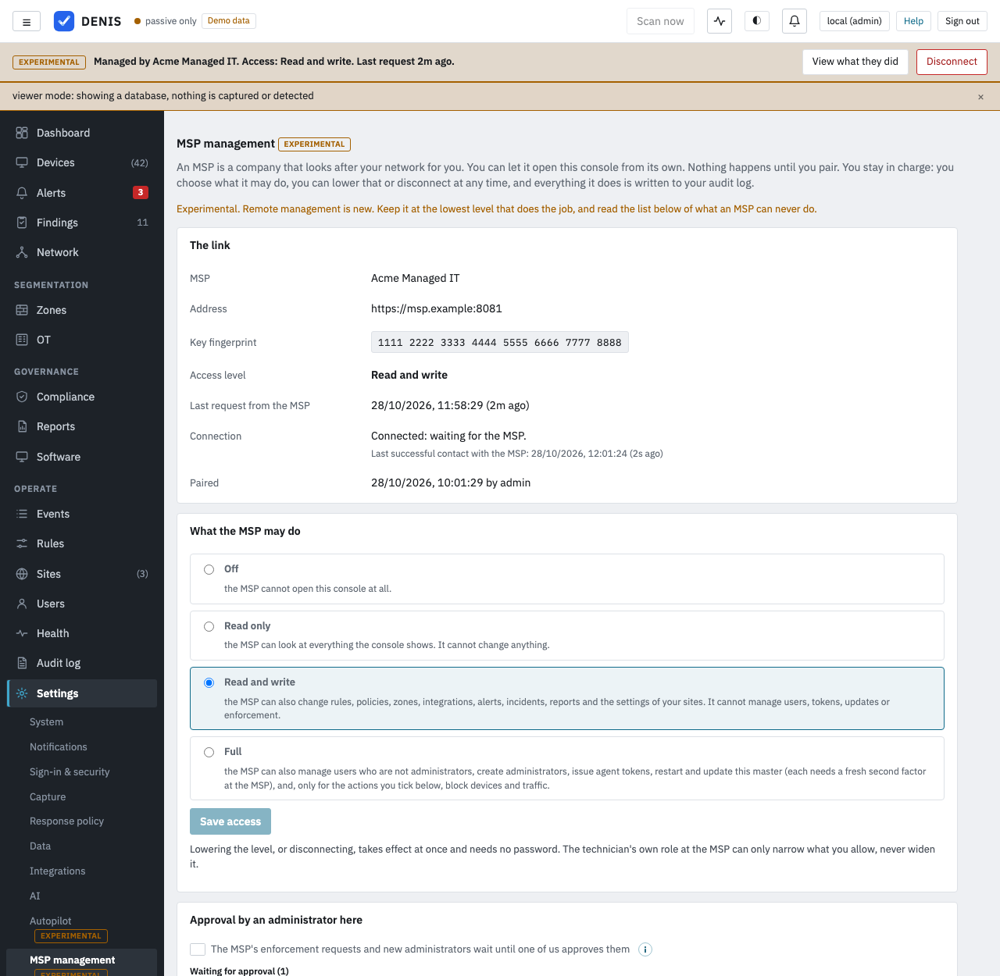

# MSP management (experimental)

> **Experimental in 4.1.** Remote management of a customer master by its MSP is new. It is off until a customer
> administrator pairs with an MSP, and it is built so that the customer stays in charge. Keep it at the lowest level
> that does the job, read [What an MSP can never do](#what-an-msp-can-never-do), and tell us what you find.

An MSP (a company that looks after networks for others) runs a master DENIS. Each of its customers runs a master of
its own, with its own agents in its own segments and zones. With MSP management a technician of the MSP opens the
customer's console from the MSP's console and works in it: the same pages, the same settings, the same
lists, as the customer sees them, in the customer's own version.

* **The customer's master is the authority.** It decides what a remote request may do, it keeps its own audit log, and
  it can cut the link at any time.
* **The customer connects out.** The customer's master dials the MSP's ingest address. Nothing listens at the customer,
  so it works behind NAT and firewalls.
* **Nothing is managed until a customer administrator says so.** They paste a link code the MSP gave them, compare the
  MSP's key fingerprint, choose a level and confirm with their password.
* **A customer that is offline cannot be changed.** The MSP still sees the mirror of devices and alerts (`--report-to`,
  read only). Nothing is queued.

## For customers



### Pairing

1. Your MSP gives you a **link code** (it starts with `dml1.`) and tells you its **key fingerprint** by phone or in
   person.
2. In your console open **Settings, MSP management**, paste the code and press *Check the code*. The page shows the MSP's
   name, its address and the key fingerprint **read from the code**.
3. Compare that fingerprint with the one the MSP told you. If they differ, stop: somebody else may have sent you the code.
4. Choose the level (see below), tick that the fingerprints are identical, type your password and press *Pair*.

The MSP's key is pinned. From then on every request must be signed with it. The relay token inside the code is stored
sealed with this installation's secret key and is never shown again.

From a shell, without the console: `DENIS_LINK_CODE=<code> denis msp-link connect` prints the fingerprint and stores
nothing; run it again with `--fingerprint "<what you compared>"` to pair (`--level read|configure|full`, `--replace` to pair
again). A running master picks the link up within a few seconds.

A new link starts at **Read and write** (`configure`). Enforcement boxes start **unticked**. Co-approval starts **off**.

### Levels

You choose what the MSP may do. The role the MSP gives a technician on its side can only narrow this, never widen it.

| Level | What the MSP may do |
| --- | --- |
| Off | Nothing. The mirror of devices and alerts (`--report-to`) is not affected. |
| Read only | Look at everything the console shows. Optionally only some of your remote sites. |
| Read and write (`configure`) | Also change rules, policies, zones, integrations, alerts, incidents, reports, retention, notification channels, the settings of your sites and the update mode of your agents. Secrets can be written but never read. |
| Full | Also manage users who are not administrators, **create administrators**, issue agent tokens, **restart and update this master**, and, only for the actions you tick, enforcement. Each of those needs a second-factor proof at the MSP from the last 10 minutes. |

**Enforcement boxes** (block device, block flow, quarantine, switch off port, end sessions) exist at Full only and are
off until you tick them. An MSP with a box ticked can cut devices and traffic off your network. Each action also needs a
connector set up under Settings, Response policy. **Site limit** (Read only only): tick the sites the MSP may see; the
master's own site is hidden while a limit is on.

Lowering the level, ticking nothing, adding a site limit or blocking a technician takes effect at once and needs no
password. **Anything that gives the MSP more asks for your administrator's password in the same request.**

### What an MSP can never do

Remotely, at any level (the request is refused before it runs, whatever the MSP sends):

1. Read or change the link itself: the level, the boxes, the site limit, the blocked technicians, the pairing, the MSP key.
2. Read or change the audit log, shorten its retention, or change where it is sent.
3. Change, disable or delete your own administrators, or reset their passwords, second factors, passkeys or sessions.
   (Creating a new administrator is allowed at Full, is loud, and can wait for your approval.)
4. Sign in as one of your users, remove or set up anybody's authenticator or passkeys, or create API tokens. An account the
   MSP creates at Full, or whose temporary password it reset, belongs to the MSP only for as long as the MSP is
   connected at Full: it is **switched off** (not deleted) and its sessions end the moment you press Disconnect, unlink
   the MSP or lower the level, and it is listed under Settings, MSP management with "Switch back on" (it asks for your password).
5. Change single sign-on or any rule for signing in.
6. Change the TLS certificate, the listen addresses, the allowed hosts, the public address or the capture interfaces.
7. Download, upload or restore backups, export a tenant, erase data or switch demo mode. It may raise how many
   backups are kept, but never lower it (lowering deletes the oldest ones at once).
8. Read stored secrets, or move a secret between installations. That includes pointing an integration at another
   address while keeping its saved key: the AI provider's local address, and a connector's address, must be sent with
   every credential again, or an administrator here does it.
9. Change where this master sends its data (`--report-to`, `--backup-upstream`).
10. Anything served to somebody without a session (shared report links, phone approval links) and the operator pages.
11. Anything that would itself be forwarded over another management channel (one hop only).
12. Ask a device on your network what it is (Network → Equipment → **Add equipment** → *Find out*, new in 4.3). That request
    starts from your network and goes to a device address, so it is made only by one of your own administrators, never
    remotely and never with an API token.

These stay with you so that you can always see what happened, take the access away and recover.

### Notifications

The MSP's acts are announced to every enabled notification channel at once (a channel's score filter does not hide
them), and written to the audit log as `msp.notified`: an account created, or a password reset, by the MSP; the level,
the boxes or the site limit changed (by either side); a request waiting for your approval; an enforcement request that was
carried out. Each kind is limited to five per ten minutes; the ones held back are counted in the next message.

Automatic enforcement that a technician switched on for a policy ends with the link too: it is removed when the MSP is
disconnected, unlinked or lowered below Full, so you have to opt in again yourself.

### Co-approval ("four eyes")

Under *Approval by an administrator here* you can make the MSP's **enforcement requests and requests to create an
administrator** wait until one of your administrators approves them with their password. The MSP's request is answered
`202 awaiting approval`; the queue shows who asked, what and until when (10 minutes). Approving runs the stored request
through your console again, as the MSP's technician, with every check repeated against the level as it is *now*. Denying
throws it away. It is off by default; switching it off asks for your password.

### Seeing and stopping it

* A **banner on every page** says *Managed by <MSP>*, the level and when the MSP last asked, with *View what they did*
  and *Disconnect*. A technician working in your console sees a banner naming themselves and the MSP.
* **What the MSP did** lists the audit entries the MSP caused: its changes (`msp.request`, one per written request,
  with the same request id as the handler's own entries, which carry the user `msp:<MSP>:<technician>`), refusals,
  blocked technicians, approvals, level changes, and one `msp.session.reads` summary per technician per five minutes with
  the number of reads (reads are summarised, not logged one by one).
* **Block this technician** stops one technician's requests. Technicians are identified by the number the MSP gives
  them, and the MSP states that number itself: blocking cannot stop an MSP that lies. Use Disconnect if you do not trust it.
* **DISCONNECT** (any administrator, one click, no password) sets the level to Off. The channel drops within seconds, the
  next request is refused. `denis msp-link off` does the same from a shell and works with the console unreachable.
  Bringing the MSP back needs an administrator's password.
* **Unlink** forgets the MSP completely (its key, the stored token, the blocked list).
* `denis run --no-msp-management` (or `DENIS_NO_MSP_MANAGEMENT=1`) switches the whole feature off for the process
  whatever the console says: this master never connects out for it, and a console that is an MSP's never serves customers.
* **Health** warns when a link is on but this node is not the active node of its pair, or when this master has not
  reached the MSP for 10 minutes.

### High availability

Only the leader of a pair dials the MSP and answers its requests; the standby never does. A request in flight during a
failover fails and is retried by the technician.

## For MSPs

### What you need

* The ingest listener of your master (`--ingest-listen`) reachable by your customers over **HTTPS** (a customer may use
  plain `http://` only with `--report-to-allow-plain-http`, for tests and trusted tunnels). The link code carries its address.
* `--public-url https://denis.msp.example`: the address of your own console, and what passkeys are bound to.
* A **portal domain** with a wildcard certificate and a wildcard DNS record, one address per customer
  (`acme.portal.example`), pointing to your console's listener. See the next section.
* Operators (`denis operator add`) with a **second factor** (an authenticator app or a passkey) for **every** operator who
  opens a customer, viewers included: opening a customer and every request after it need an enrolled factor and a proof in
  the current session.

### Where customer consoles are served: the portal domain

A customer console runs pages served by the customer's own master. If that master is ever taken over, those pages run in
your technician's browser. DENIS therefore recommends serving customer consoles on a **separate domain** from your own
console (`portal.example` next to `denis.example`), with:

* a **wildcard certificate** for `*.portal.example`. DENIS does not obtain certificates. Either give the console a
  certificate whose names include the console's own address and `*.portal.example` (`--tls-cert` and `--tls-key`, or
  *Settings, HTTPS certificate*; the generated local CA covers only the console's own names), or terminate TLS in a
  reverse proxy that holds the wildcard certificate and forwards the original `Host` header (see
  [Deployment](deployment.md#reaching-the-ui-securely-https-is-on-by-default));
* a **wildcard DNS record** `*.portal.example` pointing to that listener;
* the domain set under the operator page, *Portal domain*, or `denis msp portal --domain portal.example`.

A small MSP may use its console's own domain instead. DENIS then asks you to acknowledge the risk
(`denis msp portal --allow-same-domain`, or the checkbox on the operator page) and keeps what protection remains:
host-only `__Host-` cookies tied to the technician's session, a strict content policy and no cookie sharing. DENIS always
refuses a customer address that equals your console's address or lies under it, and refuses one on your console's
registrable domain unless the acknowledgement is set (a heuristic without a public suffix list). What no header can stop on
a shared domain: a hostile customer page may set a cookie for the shared parent domain (cookie tossing), which can sign
a technician out of your console. Use a separate domain if you can.

### Adding a customer

On the operator page (`/operator.html`), as an administrator of the default tenant with a second factor proven in the
last 10 minutes: *Administer your customers, Add a customer*; or from a shell:

```
denis msp customer add acme --name "Acme" --host acme.portal.example --url https://msp.example:9000
```

Both print the **link code** once, and the **key fingerprint**. Give the code to the customer's administrator (it
contains a secret), and **read them the fingerprint by phone or in person**: they compare it before they pair.
`--ca-sha256` names a private CA the customers must trust. If the customer already relays with `--report-to` and you
reuse its relay id, no new code is made (its token is kept); give the management link its own id instead
(`--relay-id acme-link`) so that the relay and the channel each keep their token.

Then give each technician a role on the customer (`denis msp customer grant alex acme editor`, or *Who may open it* on
the operator page): `viewer`, `editor` or `admin`. The role only narrows what the customer granted.

### Opening a customer

The technician signs in on your console (`/operator.html`) with password and second factor, sees the customers they may
open (online state, version, the level the customer last reported: display only), and presses **Open**. DENIS hands
the browser a single-use address on the customer's portal host (valid 60 seconds). That address first shows a page that says "You are opening the customer as the technician" and
waits for one click in the same browser (so a link sent to a colleague, or a forged request from another site, signs
nobody in). The click sets a `__Host-` cookie and shows the customer's console. The banner names the technician and the MSP.

If the customer's master is not connected, the technician sees a page saying when it was last connected, with a link to
the mirrored devices and alerts (read only). Nothing is queued.

### Step-up

Admin and Enforce class requests (users, tokens, restart, update, enforcement, new administrators) need a
second-factor proof from the last 10 minutes. When it is stale the customer console shows *Confirm on your MSP console* and
opens your console's step-up page (`/operator.html#stepup=<customer>`) in a window of its own, where the
authenticator-app code or the passkey is checked. Passkeys therefore work: the ceremony runs on your console's own
address, never on a portal address. The proof lives in memory: a restart asks the technician to prove again.

### Keys, suspending, removing

* `denis msp key rotate` (or the operator page) makes a new signing key. Customers follow by themselves within 7 days
  (the old key signs a notice for the new one). `--revoke-old` deletes the old key at once: every customer has to pair
  again with a new code. Use it if the key may have leaked.
* *Suspend* (`denis msp customer suspend acme`) stops the customer's channel and refuses to open it. *Remove*
  forgets it, and with `--revoke-token` ends its mirror too.
* A technician who lost their phone: `denis operator reset-factors <name>`.

### What the MSP sends, and what comes back

The method, the path and query, four headers (`content-type`, `accept`, `accept-language`, `if-none-match`) and the
body, signed with the MSP's link key together with the technician's identity and role and the time of their last
second-factor proof. Browser cookies and `Authorization` headers never cross. What comes back: the status, the body and
at most five headers. `Set-Cookie`, redirects and the customer's own security headers are dropped; the MSP adds its own (a
content policy that lets the page talk only to its own portal address, no framing, no referrer, `nosniff`, same-origin
isolation).

Limits: 2 MiB of request body, 16 MiB of answer, 40 seconds per request, 32 requests at a time per customer. Per
technician and customer: 20 requests a second sustained, 2 writes a second, and a five minute pause after 30 refusals from
the customer. On the customer: 60 writes and 20 Admin or Enforce requests a minute. Every change (`POST`, `PUT`,
`PATCH`, `DELETE`) and every refused request is written to the MSP's audit log with technician, customer, request id and
status, never bodies or query strings; reads are counted and summarised every five minutes.

## How a request is judged

The customer's own console decides, reading the link settings again for every request (there is no cache, so the kill
switch is the next request). In order: the process switch, the link and its level, the blocked technicians, the class of
the route (every route has one; one that has none is refused), the technician's role, the step-up age for Admin and
Enforce, the ticked boxes for Enforce, the rate limits, the untouchable administrators, co-approval. Then the request runs through the console's
own handlers as the user `msp:<MSP>:<technician>`, under every check a local user is under. A remote request is never
treated as coming from the local machine.

## What is not possible

* A signature proves that the MSP's master asserted a technician's identity, not that a particular person sat at the
  keyboard. Your audit log proves the MSP asked.
* A customer that is offline cannot be changed, and requests are not queued.
* Customer consoles are not nested: an MSP cannot manage a customer that is itself an MSP's remote customer, and a
  reseller chain is not built.
* Large uploads (over 2 MiB) are refused: do them in the customer's own console.
* One MSP per customer, and only the customer's default tenant.
* The design's one-click "Allow management" for a customer that already relays with `--report-to` is not built: such a
  customer pairs with a new link code like any other.

## Versions

The customer serves its own console and runs its own API, so the MSP needs no knowledge of the customer's routes: a newer
MSP and an older 4.1 customer (or the other way round) simply work. Only the channel protocol is versioned (this and the
previous version are understood). A customer older than 4.1 has no management and keeps relaying to the mirror.

## Security notes

* The channel is initiated by the customer, signed by the MSP (Ed25519) with a replay window of two minutes, a nonce
  set, a body hash and a link id that must match. A frame that fails any of these is never executed.
* Every route of the customer's console has a class (Read, Configure, Admin, Enforce or Never); a completeness test
  fails the build when a route has none, and a route without one is refused at run time.
* Sealed secrets never leave the customer: no API returns them.
* If the MSP's master is taken over, an attacker can do, to each customer, what that customer allowed, while it is online
  and within the rate limits, and every act appears in that customer's audit log and banner. The customer can disconnect locally and
  recover, because its administrators, sign-in policy, audit log and backups cannot be touched remotely.
* If a customer's master is taken over, it can lie to the MSP (as it always could) and serve hostile pages to the technician,
  which the separate portal domain, the `__Host-` cookies and the proxy's content policy contain.

See also [Security](security.md#msp-management-experimental) and [Deployment](deployment.md#msp-remote-management-of-a-customers-own-master).

## Commands

| Command | Where | What |
| --- | --- | --- |
| `denis msp customer add\|list\|remove\|set-hosts\|suspend\|resume\|grant\|revoke` | MSP | Customers, their addresses and who may open them |
| `denis msp key rotate [--revoke-old]` · `denis msp key show` | MSP | The signing key and the fingerprint customers compare |
| `denis msp portal [--domain D \| --clear] [--allow-same-domain \| --no-same-domain]` | MSP | Where customer consoles are served |
| `denis operator reset-factors <name>` | MSP | Remove an operator's second factors |
| `denis msp-link connect\|off\|status` | customer | Pair from a shell, the kill switch, the state |
| `denis run --no-msp-management` · `DENIS_NO_MSP_MANAGEMENT=1` | either | Switch the feature off for the process |
