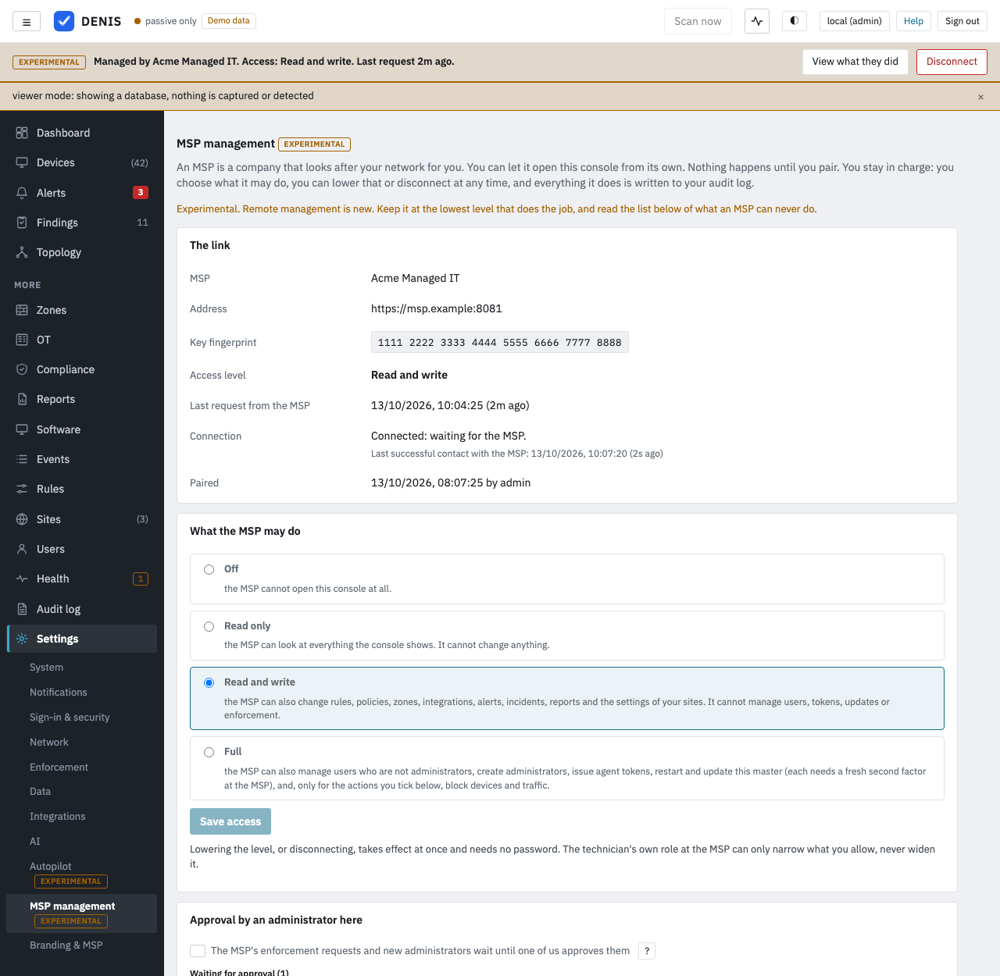
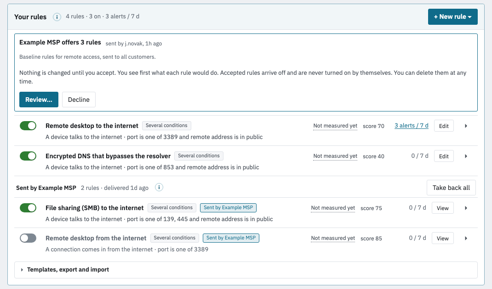
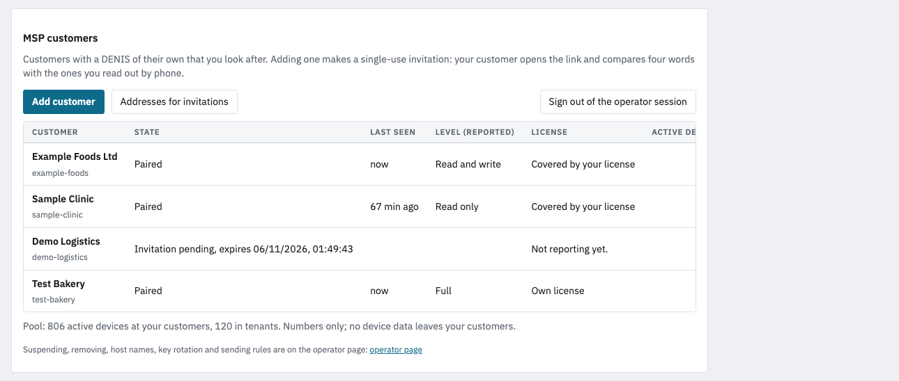
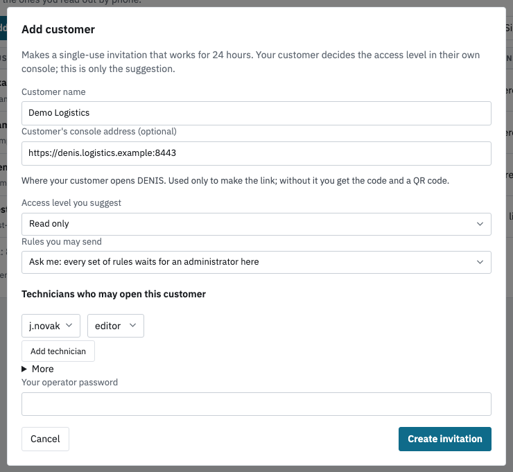
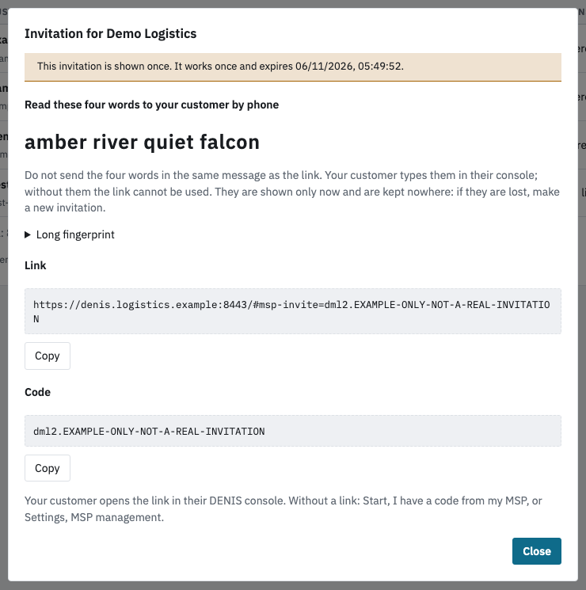

# MSP management

> Remote management of a customer master by its MSP is off until a customer administrator pairs with an MSP, and it is
> built so that the customer stays in charge. Keep it at the lowest level that does the job, and read
> [What an MSP can never do](#what-an-msp-can-never-do).

An MSP (a company that looks after networks for others) runs a master DENIS. Each of its customers runs a master of
its own, with its own agents in its own segments and zones. With MSP management a technician of the MSP opens the
customer's console from the MSP's console and works in it: the same pages, the same settings, the same
lists, as the customer sees them, in the customer's own version.

* **The customer's master is the authority.** It decides what a remote request may do, it keeps its own audit log, and
  it can cut the link at any time.
* **The customer connects out.** The customer's master dials the MSP's ingest address. Nothing listens at the customer,
  so it works behind NAT and firewalls.
* **Nothing is managed until a customer administrator says so.** They paste a link code the MSP gave them, compare the
  MSP's key fingerprint, choose a level and confirm with their password.
* **A customer that is offline cannot be changed.** The MSP still sees the mirror of devices and alerts (`--report-to`,
  read only). Nothing is queued.

## For customers



### Pairing

**With an invitation (4.4).** Your MSP sends you a **link** (or a code that starts with `dml2.`, or a QR code of the link) and
reads you **four words** by phone. Open the link in your DENIS console: it lands on *Settings, MSP management* with the code
already in place and shows the MSP's name and its address. **Type the four words** the MSP read to you (the console shows none),
choose the level (the MSP's suggestion is filled in, you decide), what the MSP may do with rules it sends, type your password
and press *Pair*. The words are a random secret the MSP made for this one invitation; they are in no code, link or record. The code
carries only a commitment to them, so your console can check what you typed against the code: a code that was changed on its
way (another MSP key, another link, another commitment) cannot match the words the real MSP read out, and a leaked code cannot be
claimed by anyone who did not hear them (the MSP allows five wrong tries and then revokes the invitation). The link works **once**, for **24
hours**. Without a link: *Start, I have a code from my MSP*, or paste the code under *Settings, MSP management*. The code is in
the link's fragment (`#join=`), which no server, proxy log or Referer ever sees; the console moves it out of the address bar at
once. The invitation holds only a one-time token: your console's own relay token is handed out when the invitation is used,
not before, and an invitation that was used, revoked or has expired is worth nothing. A sentence that does not
match (wrong words, an expired or used invitation) stops before anything is stored. From a shell:
`DENIS_LINK_CODE=<code> denis msp-link connect --phrase "<the four words, typed>"` (without `--phrase` it only shows who the code
is from and stores nothing; for an invitation the fingerprint alone is not enough).

**With a link code (`dml1.`, as before).**

1. Your MSP gives you a **link code** (it starts with `dml1.`) and tells you its **key fingerprint** by phone or in
   person.
2. In your console open **Settings, MSP management**, paste the code and press *Check the code*. The page shows the MSP's
   name, its address and the key fingerprint **read from the code**.
3. Compare that fingerprint with the one the MSP told you. If they differ, stop: somebody else may have sent you the code.
4. Choose the level (see below) and what the MSP may do with **rules it sends** (*Not allowed*, *Ask me*, the default, or *Take new rules at once; they arrive
   off*; see [Sending rules to customers](#sending-rules-to-customers)), tick that the fingerprints are
   identical, type your password and press *Pair*.

The MSP's key is pinned. From then on every request must be signed with it. The relay token inside the code is stored
sealed with this installation's secret key and is never shown again.

From a shell, without the console: `DENIS_LINK_CODE=<code> denis msp-link connect` prints the fingerprint and stores
nothing; run it again with `--fingerprint "<what you compared>"` to pair (`--level read|configure|full`, `--rule-push off|ask|accept`, `--replace` to pair
again). A running master picks the link up within a few seconds.

A new link starts at **Read and write** (`configure`). Enforcement boxes start **unticked**. Co-approval starts **off**.

### Levels

You choose what the MSP may do. The role the MSP gives a technician on its side can only narrow this, never widen it.

| Level | What the MSP may do |
| --- | --- |
| Off | Nothing. The mirror of devices and alerts (`--report-to`) is not affected. |
| Read only | Look at everything the console shows. Optionally only some of your remote sites. |
| Read and write (`configure`) | Also change rules, policies, zones, integrations, alerts, incidents, reports, retention, notification channels, the settings of your sites and the update mode of your agents. Secrets can be written but never read. |
| Full | Also manage users who are not administrators, **create administrators**, issue agent tokens, **restart and update this master**, and, only for the actions you tick, enforcement. Each of those needs a second-factor proof at the MSP from the last 10 minutes. |

**Enforcement boxes** (block device, block flow, quarantine, switch off port, end sessions) exist at Full only and are
off until you tick them. An MSP with a box ticked can cut devices and traffic off your network. Each action also needs a
connector set up under Settings, Response policy. **Site limit** (Read only only): tick the sites the MSP may see; the
master's own site is hidden while a limit is on.

Lowering the level, ticking nothing, adding a site limit or blocking a technician takes effect at once and needs no
password. **Anything that gives the MSP more asks for your administrator's password in the same request.**

### What an MSP can never do

Remotely, at any level (the request is refused before it runs, whatever the MSP sends):

1. Read or change the link itself: the level, the boxes, the site limit, the blocked technicians, the pairing, the MSP key.
2. Read or change the audit log, shorten its retention, or change where it is sent.
3. Change, disable or delete your own administrators, or reset their passwords, second factors, passkeys or sessions.
   (Creating a new administrator is allowed at Full, is loud, and can wait for your approval.)
4. Sign in as one of your users, remove or set up anybody's authenticator or passkeys, or create API tokens. An account the
   MSP creates at Full, or whose temporary password it reset, belongs to the MSP only for as long as the MSP is
   connected at Full: it is **switched off** (not deleted) and its sessions end the moment you press Disconnect, unlink
   the MSP or lower the level, and it is listed under Settings, MSP management with "Switch back on" (it asks for your password).
5. Change single sign-on or any rule for signing in.
6. Change the TLS certificate, the listen addresses, the allowed hosts, the public address or the capture interfaces.
7. Download, upload or restore backups, export a tenant, erase data or switch demo mode. It may raise how many
   backups are kept, but never lower it (lowering deletes the oldest ones at once).
8. Read stored secrets, or move a secret between installations. That includes pointing an integration at another
   address while keeping its saved key: the AI provider's local address, and a connector's address, must be sent with
   every credential again, or an administrator here does it.
9. Change where this master sends its data (`--report-to`, `--backup-upstream`).
10. Anything served to somebody without a session (shared report links, phone approval links) and the operator pages.
11. Anything that would itself be forwarded over another management channel (one hop only).
12. Ask a device on your network what it is (Network → Equipment → **Add equipment** → *Find out*, new in 4.3). That request
    starts from your network and goes to a device address, so it is made only by one of your own administrators, never
    remotely and never with an API token.

13. Take back the rules it sent. (Your choice about which rules it may send is yours, but a technician with the administrator
    role, through a link at *Read and write* or above, may answer an offer and change that choice for a customer that has no
    administrator of its own, with a fresh second factor for a more permissive one, and it is in your audit log; keep the link at *Read
    only* to keep every decision with your own people. See [Sending rules to customers](#sending-rules-to-customers).)

These stay with you so that you can always see what happened, take the access away and recover.

### Sending rules to customers

An MSP can send **one file of rules** (`denis.rules/1`, the file *Export rules* makes) to several of its customers. The MSP only
sends; **every decision is the customer's** (the one exception is a customer with no administrator of its own: see below).



**What the customer decides** (Settings, MSP management, *Rules from your MSP*). The choice is made **when the link is made**: the
pairing dialog (and `denis msp-link connect --rule-push off|ask|accept`) has a choice, and for a customer paired with an MSP the default is
*Ask me*. Afterwards it is changed by an administrator signed in on the customer's console, or by an MSP technician (see below):

| Choice | What happens |
| --- | --- |
| *Not allowed* (the default) | A push is refused, even as a check. Nothing is stored. |
| *Ask me* | The push waits as an **offer**. An administrator opens it on the Rules page, sees the plan of the import (new, already here, different, in conflict, refused, each with its reason), picks per rule and accepts, or declines. Every accepted rule arrives off. |
| *Take new rules at once; they arrive off* | New rules are taken at once and **arrive off**: the customer turns each on when ready. A rule that would **replace** one, or is in conflict, still waits as an offer: nothing is replaced silently. |

* **A customer without an administrator of its own.** A fully MSP-managed customer has nobody to accept an offer. A technician who
  holds the **administrator** role on that customer at the MSP, through a link at *Read and write* or *Full* (the level the customer
  granted), may **accept or decline an offer for the customer** and acts as its administrator: the audit names
  `msp:<MSP>:<technician>` (`rules.push.offered`, `rules.push.accepted` and `rules.import` with `by_msp_technician`). The same technician
  may change the choice above, and **making it more permissive** (Ask me, or take new rules at once) needs his fresh second factor from the
  last 10 minutes, as the password does for the customer's own administrator; a more careful choice needs nothing. A technician below
  the administrator role, and a link below *Read and write*, can do neither. **Taking back a delivery** stays with the customer's own
  administrators. To keep every decision with your own people, keep the link at *Read only*: at *Read and write* an administrator
  technician can allow the MSP to send rules to a customer.
* **Raising the choice asks for the password.** In the customer's console, changing *Rules from your MSP* to a more permissive choice
  (*Not allowed* to *Ask me* or to *Take new rules at once*, or *Ask me* to *Take new rules at once*) asks for the administrator's password, like raising the access level;
  lowering asks for nothing.
* **The MSP is told.** The MSP's notification channels (through the delivery outbox) get one notice when a push is **delivered**,
  **offered** or **refused**, and one when the customer **accepts**, **declines** or **takes back** rules: counts and names, never a
  rule. The customer's answers travel with the next poll of the management channel (seconds). The customer's administrators get a
  notice (`msp_rules_offer`) when an offer arrives.
* **Their own group.** Delivered rules are shown in a group **"Sent by <MSP>"** inside the card *Your rules* on the Rules page, apart from the customer's own,
  each marked with who sent it (the MSP's name from the pinned link, never from a request). They can be switched on and off, looked at
  and deleted by the customer, but not edited in place. **Take back all** deletes everything of one delivery; the revision history of
  each rule is kept. A delivered rule runs like any rule.
* **Staged rollout.** A delivered rule arrives **off** and is never turned on by itself.
* **No enforcement.** A delivered rule never carries a response or an enforcement action: a file that has one is refused.
* **Fit for every customer.** A rule that names a device or a site by number is refused (numbers differ per customer); a zone is
  matched by its **name** (the zone of that name at the customer; none, or two, is a refusal). The MSP's console checks this before it
  sends anything to anybody; the customer checks again with its own zones and limits.
* **Roles.** The technician needs the **administrator** role on the customer at the MSP (the customer's rule routes are the
  administrator's) and the customer must have granted at least *Read and write*. A real push needs a second-factor proof from the
  last 10 minutes; a check needs the factor and a proof in the session. A customer whose master is not connected is answered
  *not connected*: nothing is queued.
* **Audit.** On the customer, a pushed import is written as `rules.import` by `msp:<MSP>:<technician>` (ids only), an accepted offer by
  the administrator who accepted it, with `push` and `managed_by`; offers, declines and consent changes are `rules.push.offered`,
  `rules.push.declined`, `rules.push.consent`. On the MSP, `msp.rules.push` per customer, with a short hash of the file and never its
  rules.

On the MSP's operator page, below the customers: **Send rules to customers**: choose the file, the customers and an optional note, **Check**
(nothing is sent or changed) and **Send**. **Send** is available only after a **Check** of exactly the file, customers and
note now chosen; a change to any of them asks for a new Check first (4.5). The answer has one line per customer. The same from the API:
`POST /api/operator/msp/rules/push` ([API](api.md)).

### Sending threat lists to customers

New in 4.5. An MSP can send the **definition** of a threat list (see [Threat lists](threat-lists.md)) to chosen customers: where it comes from
(a web address, a TAXII collection or a MISP feed), how it is read, what a match does, how often it is fetched. The list becomes a
**managed list** on the customer: the customer sees it, marked *Sent by <MSP>*, and cannot change its source. The same rule as for rules
holds: the MSP only sends; **every decision is the customer's.**

* **The consent is the one for rules** (*Rules from your MSP*: *Not allowed* by default, *Ask me*, *Take new ones at once*). *Not allowed* refuses a
  push, even as a check. *Ask me* keeps it as an **offer** on Settings, Threat lists, which an administrator accepts or declines (a technician with the
  administrator role may do so for a customer that has no administrator of its own, exactly as for rules, and it is in the audit log). While
  the consent is *Not allowed*, an offer that still waits is not answered over the link; an administrator at the customer still may.
  *Take new ones at once* takes **new** lists at once (switched off); a change of a list the customer has **switched on** waits as an offer
  too, as a replacement of a rule does, so nothing changes in a list in use without the customer.
* **It arrives switched off.** Nothing is fetched until the customer switches the list on. A pushed list never allows an address inside the
  customer's network, never allows plain http, and cannot be set to block by itself: *alert* and *prepare a block for approval* can be sent,
  automatic blocking (Experimental) is the customer's own choice.
* **No credential, ever.** A definition has no field for a key, a token or a password, and one that has a field that looks like one is
  refused (`push_list_credential`) on the MSP's console and again at the customer. A web address with a query or a fragment is refused too,
  because a key in it would travel in clear (`push_list_url_query`). Keys and tokens belong in the credential, never in the address
  or the note: a definition's address and note are stored as they are, not sealed. The customer sets its own credential **by hand** on its Threat lists
  page; it is sealed on that installation, sent only to the list's address and never shown, exported, put in a support bundle or passed back to
  the MSP (the MSP is told only whether one is set). When a later push moves the list to **another server**, the credential that was set for
  the old one is removed and the list is switched off, so a credential entered for one server is never sent to another because an MSP asked.
* **What the customer can still do:** switch it on and off, set or remove the credential, refresh it, delete it. Not change the address, the
  action or the schedule. Deleting a list is the customer's alone: it is not reachable over the management link (the MSP takes back its own
  lists by key).
* **Idempotent.** Sending the same definition again changes nothing (`unchanged`); a changed one updates the list in place and keeps its
  switch, its credential and its entries. A list is matched by the MSP and the **key** the MSP gave it, never by name alone: another MSP's push
  with the same key is refused, and a list the customer made itself with the same name is refused (`push_list_name_taken`).
* **Take it back.** The MSP that sent a list can take it back by its key: the list, its entries and its sealed credential are deleted at the
  customer, and an offer for it that still waits (a key that has only an offer takes the offer back) (also when the consent has been lowered
  meanwhile, because it only reduces what the MSP gave). A later push of the same key replaces a waiting offer. A rule that named the list keeps its
  condition, which then never holds; the rule editor says so. If the customer deletes the list itself, the MSP's record of it goes with it.
* **Tenants.** Nothing is shared between customers: a push reaches only the customers named in the request (1 to 50, each one the technician
  administers), and what it writes lives in that installation's own lists. The MSP holds no entries of a customer.
* **Matching stays at the customer.** The customer's master matches and raises the alerts, which name the list; the MSP sees them in the customer's
  console and through the relay as for any alert.
* **Audit.** On the customer: `threat_list.managed.push` (by `msp:<MSP>:<technician>`: key, list id, result), `.offered`, `.accepted`, `.declined`,
  `.revoke`, `.refused`. On the MSP: `msp.lists.push` and `msp.lists.revoke` per customer, with the key and a hash of the definition, never its address.
* **Roles.** As for rules: the administrator role on the customer at the MSP, a link at *Read and write* or above, a second-factor proof from the last
  10 minutes for a send and a take-back (a check and *What do they hold?* need any proof in the session). A customer that is not connected is
  answered *not connected*: nothing is queued.

On the MSP's operator page, below *Send rules to customers*: **Send a threat list to customers**: describe the list, choose the customers, **Check**,
**Send**, **Take back** or **What do they hold?**. From the API: `POST /api/operator/msp/lists/push`, `/revoke` and `/status` ([API](api.md)).

### Notifications

The MSP's acts are announced to every enabled notification channel at once (a channel's score filter does not hide
them), and written to the audit log as `msp.notified`: an account created, or a password reset, by the MSP; the level,
the boxes or the site limit changed (by either side); a request waiting for your approval; an enforcement request that was
carried out. Every one of them is in the bell and in the audit log. The push to the channels is limited to five per
kind per ten minutes: the ones over the limit go to the bell only, folded into one row per ten minutes ("repeated n
times"), and are counted in the next message that is pushed. An administrator account created by the MSP is always
pushed. If the link is cut while the MSP is creating an account, the account is switched off as soon as it is recorded.

Automatic enforcement that a technician switched on for a policy ends with the link too: it is removed when the MSP is
disconnected, unlinked or lowered below Full, so you have to opt in again yourself.

### Co-approval ("four eyes")

Under *Approval by an administrator here* you can make the MSP's **enforcement requests and requests to create an
administrator** wait until one of your administrators approves them with their password. The MSP's request is answered
`202 awaiting approval`; the queue shows who asked, what and until when (10 minutes). Approving runs the stored request
through your console again, as the MSP's technician, with every check repeated against the level as it is *now*. Denying
throws it away. It is off by default; switching it off asks for your password.

### Seeing and stopping it

* A **banner on every page** says *Managed by <MSP>*, the level and when the MSP last asked, with *View what they did*
  and *Disconnect*. A technician working in your console sees a banner naming themselves and the MSP.
* **What the MSP did** lists the audit entries the MSP caused: its changes (`msp.request`, one per written request,
  with the same request id as the handler's own entries, which carry the user `msp:<MSP>:<technician>`), refusals,
  blocked technicians, approvals, level changes, and one `msp.session.reads` summary per technician per five minutes with
  the number of reads (reads are summarised, not logged one by one).
* **Block this technician** stops one technician's requests. Technicians are identified by the number the MSP gives
  them, and the MSP states that number itself: blocking cannot stop an MSP that lies. Use Disconnect if you do not trust it.
* **DISCONNECT** (any administrator, one click, no password) sets the level to Off. The channel drops within seconds, the
  next request is refused. `denis msp-link off` does the same from a shell and works with the console unreachable.
  Bringing the MSP back needs an administrator's password.
* **Unlink** forgets the MSP completely (its key, the stored token, the blocked list), and the rule offers it sent that
  nobody answered. Pairing with another link does the same for the old link's offers: an offer is only ever shown and
  accepted under the link that sent it.
* `denis run --no-msp-management` (or `DENIS_NO_MSP_MANAGEMENT=1`) switches the whole feature off for the process
  whatever the console says: this master never connects out for it, and a console that is an MSP's never serves customers.
* **Health** warns when a link is on but this node is not the active node of its pair, or when this master has not
  reached the MSP for 10 minutes.

### High availability

Only the leader of a pair dials the MSP and answers its requests; the standby never does. A request in flight during a
failover fails and is retried by the technician. A customer refuses a request signed before it started (the replay
check); a clock that is set back after the start (a box without a real-time clock whose time was corrected late) no
longer makes it refuse fresh requests for the size of the correction.

**Pairing.** An invitation is used up as soon as the MSP accepts it: if the answer is lost on the way, or the link cannot
be saved afterwards, the pairing says so and you need a new invitation from the MSP.

### Licensing

A master that is linked to an MSP needs no license of its own while the MSP's license is valid: Settings, License
shows **Licensed through <MSP>**. Every 15 minutes (and also when the level is Off) your master sends its MSP a number,
how many devices were active in the last 30 days, and gets a signed statement back that it is covered. Nothing about
your devices is sent. If the MSP cannot be reached the statement holds for 14 days. After that, or when you unlink, or
when the MSP ends the coverage, the console becomes a Community edition with a 30-day trial (the device list is not
shortened during it, a banner counts the days), after which the list is capped at 100; detection continues and your
data is kept. If you hold a license of your own, it is used and the MSP does not count your devices. Details:
[Licensing](licensing.md#msp-customers-covered-by-the-msp-license).

## For MSPs

### What you need

* The ingest listener of your master (`--ingest-listen`) reachable by your customers over **HTTPS** (a customer may use
  plain `http://` only with `--report-to-allow-plain-http`, for tests and trusted tunnels). The link code carries its address.
* `--public-url https://denis.msp.example`: the address of your own console, and what passkeys are bound to.
* A **portal domain** with a wildcard certificate and a wildcard DNS record, one address per customer
  (`acme.portal.example`), pointing to your console's listener. See the next section.
* Operators (`denis operator add`) with a **second factor** (an authenticator app or a passkey) for **every** operator who
  opens a customer, viewers included: opening a customer and every request after it need an enrolled factor and a proof in
  the current session.

### Where customer consoles are served: the portal domain

A customer console runs pages served by the customer's own master. If that master is ever taken over, those pages run in
your technician's browser. DENIS therefore recommends serving customer consoles on a **separate domain** from your own
console (`portal.example` next to `denis.example`), with:

* a **wildcard certificate** for `*.portal.example`. DENIS does not obtain certificates. Either give the console a
  certificate whose names include the console's own address and `*.portal.example` (`--tls-cert` and `--tls-key`, or
  *Settings, HTTPS certificate*; the generated local CA covers only the console's own names), or terminate TLS in a
  reverse proxy that holds the wildcard certificate and forwards the original `Host` header (see
  [Deployment](deployment.md#reaching-the-ui-securely-https-is-on-by-default));
* a **wildcard DNS record** `*.portal.example` pointing to that listener;
* the domain set under the operator page, *Portal domain*, or `denis msp portal --domain portal.example`.

A small MSP may use its console's own domain instead. DENIS then asks you to acknowledge the risk
(`denis msp portal --allow-same-domain`, or the checkbox on the operator page) and keeps what protection remains:
host-only `__Host-` cookies tied to the technician's session, a strict content policy and no cookie sharing. DENIS always
refuses a customer address that equals your console's address or lies under it, and refuses one on your console's
registrable domain unless the acknowledgement is set (a heuristic without a public suffix list). What no header can stop on
a shared domain: a hostile customer page may set a cookie for the shared parent domain (cookie tossing), which can sign
a technician out of your console. Use a separate domain if you can.

### Adding a customer

**In the console (4.4).** *Settings, MSP customers* (administrators). It uses the same operator sign-in as the operator page
(name, password; the second factor when a change needs it), so a small *Sign in as MSP operator* panel sits at the top. First
set the address your customers connect to and, if your agent listener uses a private CA, its SHA-256 and the address of this
console, which publishes the certificate at `/tls/ca.pem` (*Addresses for invitations*; they go into every invitation). The
customer's console fetches the certificate from that address after the four words matched and uses it only if its SHA-256 is
exactly the one in the invitation; the pairing and every later connection are then checked against that certificate alone. Then *Add customer*: the name, the customer's own console address (optional: used only
to make the link), the access level you suggest (*Read only* by default), what you may send as rules, and the technicians who may
open the customer. The result is shown once: the **four words** to read to the customer by phone (do not send them with the
link; they are shown only now and kept nowhere, so if they are lost make a new invitation), the **link**, the **QR code** and
the code, valid for **24 hours** and good **once**. Making an invitation changes nothing that already works: a customer that is
already linked keeps its link until the new invitation is used (it asks for *replace*), and an invitation that is never used,
expires or is revoked leaves everything as it was. The customers table shows each
customer's invitation (pending, expired, revoked), whether it is paired and when it was last seen, the level it reported, its
licence (covered, own, not covered) and its active devices (numbers only). *New invitation* revokes a pending one and makes a
new one; *Revoke invitation* ends it at once. The operator page keeps working as before.







From a shell, with the same effect:

```
denis msp customer add acme --name "Acme" --host acme.portal.example --url https://msp.example:9000 --invite
denis msp customer invite acme [--replace] [--address https://denis.acme.example:8443]
```

Both print the four words, the long fingerprint, the code (and a link when `--address` is given).

**The earlier code, still available.** On the operator page (`/operator.html`), as an administrator of the default tenant with a
second factor proven in the last 10 minutes: *Administer your customers, Add a customer*; or from a shell:

```
denis msp customer add acme --name "Acme" --host acme.portal.example --url https://msp.example:9000
```

Both print the **link code** once, and the **key fingerprint**. Give the code to the customer's administrator (it
contains a secret), and **read them the fingerprint by phone or in person**: they compare it before they pair.
`--ca-sha256` names a private CA the customers must trust; the address that publishes it is the saved *Addresses for invitations* setting. If the customer already relays with `--report-to` and you
reuse its relay id, no new code is made (its token is kept); give the management link its own id instead
(`--relay-id acme-link`) so that the relay and the channel each keep their token.

Then give each technician a role on the customer (`denis msp customer grant alex acme editor`, or *Who may open it* on
the operator page): `viewer`, `editor` or `admin`. The role only narrows what the customer granted.

### Your license covers your customers

Every license can act as an MSP license; there is no separate edition. Your customers' masters that are linked to you
are covered by your license (they need none of their own) and their active devices are added to your pool: your own
active devices, your covered customers' reported numbers (numbers only: no device data) and your tenants'. Each
customer's number is on the operator page under *Customers*, with whether it is covered, has a license of its own
(then it is not in your pool) or is not covered. A customer's mirror (`--report-to`) is counted as the larger of the
reported number and the mirror's own count, and is not part of your own list. Over the cap, only your own list is
shortened (never below 100 devices); customers are never affected. An MSP on the Community edition cannot cover
customers. See [Licensing](licensing.md#msp-customers-covered-by-the-msp-license).

### Opening a customer

The technician signs in on your console (`/operator.html`) with password and second factor, sees the customers they may
open (online state, version, the level the customer last reported: display only), and presses **Open**. DENIS hands
the browser a single-use address on the customer's portal host (valid 60 seconds). That address first shows a page that says "You are opening the customer as the technician" and
waits for one click in the same browser (so a link sent to a colleague, or a forged request from another site, signs
nobody in). The click sets a `__Host-` cookie and shows the customer's console. The banner names the technician and the MSP.

If the customer's master is not connected, the technician sees a page saying when it was last connected, with a link to
the mirrored devices and alerts (read only). Nothing is queued.

**Two tabs.** A console tab works in the customer it was opened for. If the technician picks another customer in
another tab, the first tab's next request (a read too) is refused with `409 tenant_switched`: its dialogs close, its
refresh stops and a banner offers to reload it into the customer now picked. Nothing it still had on screen reaches the
other customer. (A client that does not send the tab's customer, such as a script, works as before.)

### Step-up

Admin and Enforce class requests (users, tokens, restart, update, enforcement, new administrators) need a
second-factor proof from the last 10 minutes. When it is stale the customer console shows *Confirm on your MSP console* and
opens your console's step-up page (`/operator.html#stepup=<customer>`) in a window of its own, where the
authenticator-app code or the passkey is checked. Passkeys therefore work: the ceremony runs on your console's own
address, never on a portal address. The proof lives in memory: a restart asks the technician to prove again.

### Keys, suspending, removing

* `denis msp key rotate` (or the operator page) makes a new signing key. Customers follow by themselves within 7 days
  (the old key signs a notice for the new one). `--revoke-old` deletes the old key at once: every customer has to pair
  again with a new code. Use it if the key may have leaked.
* *Suspend* (`denis msp customer suspend acme`) stops the customer's channel and refuses to open it. *Remove*
  forgets it, and with `--revoke-token` ends its mirror too.
* A technician who lost their phone: `denis operator reset-factors <name>`.

### What the MSP sends, and what comes back

The method, the path and query, four headers (`content-type`, `accept`, `accept-language`, `if-none-match`) and the
body, signed with the MSP's link key together with the technician's identity and role and the time of their last
second-factor proof. Browser cookies and `Authorization` headers never cross. What comes back: the status, the body and
at most five headers. `Set-Cookie`, redirects and the customer's own security headers are dropped; the MSP adds its own (a
content policy that lets the page talk only to its own portal address, no framing, no referrer, `nosniff`, same-origin
isolation).

A change that gets no answer within 30 seconds on the customer is answered `504 customer_timeout` with
`may_have_committed: true` and "The change may have been carried out: look before you try again": it may have run, and a
retry is a new request that runs it again. A request whose handler fails on the customer is answered `500
customer_error`; the customer's channel goes on. The same holds for a rule or list push that gets no answer in time.

Limits: 2 MiB of request body, 16 MiB of answer, 40 seconds per request, 32 requests at a time per customer. Per
technician and customer: 20 requests a second sustained, 2 writes a second, and a five minute pause after 30 refusals from
the customer. On the customer: 60 writes and 20 Admin or Enforce requests a minute. Every change (`POST`, `PUT`,
`PATCH`, `DELETE`) and every refused request is written to the MSP's audit log with technician, customer, request id and
status, never bodies or query strings; reads are counted and summarised every five minutes.

## How a request is judged

The customer's own console decides, reading the link settings again for every request (there is no cache, so the kill
switch is the next request). In order: the process switch, the link and its level, the blocked technicians, the class of
the route (every route has one; one that has none is refused), the technician's role, the step-up age for Admin and
Enforce, the ticked boxes for Enforce, the rate limits, the untouchable administrators, co-approval. Then the request runs through the console's
own handlers as the user `msp:<MSP>:<technician>`, under every check a local user is under. A remote request is never
treated as coming from the local machine.

## What is not possible

* A signature proves that the MSP's master asserted a technician's identity, not that a particular person sat at the
  keyboard. Your audit log proves the MSP asked.
* A customer that is offline cannot be changed, and requests are not queued.
* Customer consoles are not nested: an MSP cannot manage a customer that is itself an MSP's remote customer, and a
  reseller chain is not built.
* Large uploads (over 2 MiB) are refused: do them in the customer's own console.
* One MSP per customer, and only the customer's default tenant.
* The design's one-click "Allow management" for a customer that already relays with `--report-to` is not built: such a
  customer pairs with a new link code like any other.

## Versions

The customer serves its own console and runs its own API, so the MSP needs no knowledge of the customer's routes: a newer
MSP and an older 4.1 customer (or the other way round) simply work. Only the channel protocol is versioned (this and the
previous version are understood). A customer older than 4.1 has no management and keeps relaying to the mirror.

## Security notes

* The channel is initiated by the customer, signed by the MSP (Ed25519) with a replay window of two minutes, a nonce
  set, a body hash and a link id that must match. A frame that fails any of these is never executed.
* Every route of the customer's console has a class (Read, Configure, Admin, Enforce or Never); a completeness test
  fails the build when a route has none, and a route without one is refused at run time.
* Sealed secrets never leave the customer: no API returns them.
* If the MSP's master is taken over, an attacker can do, to each customer, what that customer allowed, while it is online
  and within the rate limits, and every act appears in that customer's audit log and banner. The customer can disconnect locally and
  recover, because its administrators, sign-in policy, audit log and backups cannot be touched remotely.
* If a customer's master is taken over, it can lie to the MSP (as it always could) and serve hostile pages to the technician,
  which the separate portal domain, the `__Host-` cookies and the proxy's content policy contain.

See also [Security](security.md#msp-management) and [Deployment](deployment.md#msp-remote-management-of-a-customers-own-master).

## Commands

| Command | Where | What |
| --- | --- | --- |
| `denis msp customer add\|list\|remove\|set-hosts\|suspend\|resume\|grant\|revoke` | MSP | Customers, their addresses and who may open them |
| `denis msp key rotate [--revoke-old]` · `denis msp key show` | MSP | The signing key and the fingerprint customers compare |
| `denis msp portal [--domain D \| --clear] [--allow-same-domain \| --no-same-domain]` | MSP | Where customer consoles are served |
| `denis operator reset-factors <name>` | MSP | Remove an operator's second factors |
| `denis msp-link connect\|off\|status` | customer | Pair from a shell, the kill switch, the state |
| `denis run --no-msp-management` · `DENIS_NO_MSP_MANAGEMENT=1` | either | Switch the feature off for the process |
