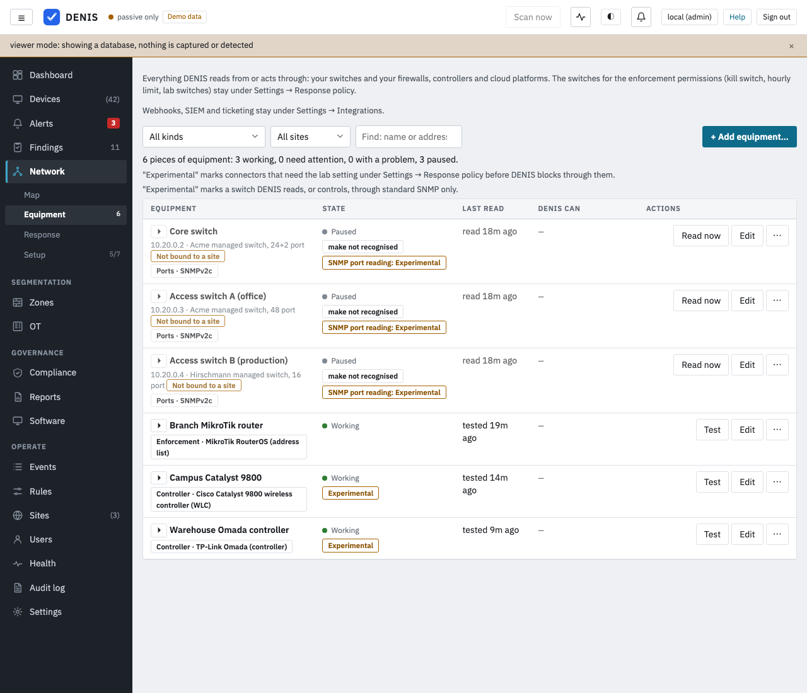
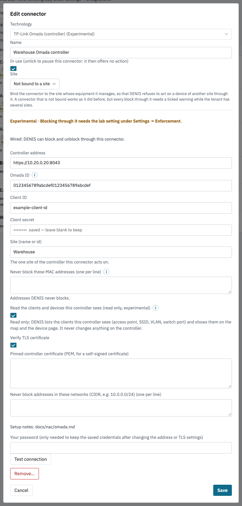

# Enforcement: TP-Link Omada

Controls the clients of one site of a TP-Link Omada SDN controller (the access points, switches and gateways it manages), and reads them for the map.

Status: **Experimental. Not tried on real equipment.** Everything below was built from what TP-Link publishes about the Open API plus the code of other people's integrations, and checked against a fake Omada controller in DENIS's own tests. It has never been run against a real controller. Nothing here is listed as validated on hardware.

Lab use: the client block is allowed only while an administrator has switched on both *Allow Experimental connectors (lab use)* and *Allow experimental enforcement actions* under *Settings → Response policy*. This connector is new in 4.4 and has no older block button. Everything goes through the Respond dialog: a plan you read, a confirmation, a time limit (one hour by default), and a release that DENIS also makes on its own when the time is up. Releasing an action always works.

Besides the connector's own refusals, every action through it is refused for a loopback, unspecified, broadcast or multicast address, for DENIS itself and for the gateway, for anything on the hands-off list and in *Never block these MAC addresses*, and for an address in an open `arp_conflict` alert (unless the administrator ticks a box to accept that), before anything is sent. The connector adds: a device the controller itself manages in the site (an access point, a switch or the gateway) is refused, and so is a client that has the controller's own address or one of DENIS's own addresses.

## Evidence labels

Every claim about TP-Link's interface or equipment on this page carries one of three labels:

* **documented**: checked in a page TP-Link publishes (read 2 November 2026).
* **best guess**: from memory, a community answer or other people's code; not checked in anything TP-Link publishes.
* **verified**: checked on real equipment, with the date. **Nothing in this connector is verified.**

## What DENIS can do on an Omada controller

| Action | What DENIS writes | What it does not do |
|---|---|---|
| **Block device** (`client_block`) | `POST .../clients/{mac}/block` for one client of the configured site (best guess), read back in the controller's list of blocked clients. | It does not block an address, only a MAC. It does not end an open session of a client the controller does not manage. |
| Release | `POST .../clients/{mac}/unblock`, only while the controller still lists the client as blocked. | It never unblocks a client it did not block. |
| Quarantine, block a flow, disable a port, end a session | **Not offered.** | See *What is not offered and why*. |

DENIS names a client by its **MAC address**; an IP address cannot name an Omada client, so a request that names only an address is refused. Text you typed (the reason) is never sent to the controller.

## What is not offered and why

* **End a session / reconnect (Wi-Fi).** Third-party integrations use `POST .../clients/{mac}/reconnect` (best guess). TP-Link's pages that DENIS could check do not document it, so it is not offered.
* **Block a flow.** The controller blocks clients and has gateway firewall rules of its own; DENIS does not write rules on it.
* **Quarantine to another network and disabling a switch port.** The Open API has switch and port calls (best guess), but nothing here was checked, so these are listed as not built.

## Setup on the controller

1. **An Open API app.** In the controller's *Global* view: *Settings → Platform Integration → Open API → Add New App* (documented). Choose **Client** mode, which is meant for system-to-system use without a user signing in (documented). Give the app a role (see *Permissions*). The controller then shows the **Client ID** and **Client Secret** (the secret behind an eye icon), the **Omada ID** and the **Interface Access Address** (documented).
2. **The address.** A software controller answers on port 8043 by default (best guess), for example `https://192.0.2.10:8043`. Open API is not offered for a controller reached through the TP-Link cloud (documented: the option is not shown for an on-premises controller accessed through the cloud). Enter the *Interface Access Address* the controller shows.
3. **In DENIS** (*Network → Equipment → Add a connector → TP-Link Omada*): **Controller address**, **Omada ID**, **Client ID**, **Client secret** (stored sealed as `nac.omada.client_secret`), the **site** (name or id), the MACs that must never be blocked, and the TLS settings below.

## Permissions

The app needs to read sites, devices and clients, and to block and unblock clients. Whether a viewer-level role can do the reads, and which role may block, is **best guess**: a third-party integration reports that a read-only app cannot control devices. If *Test connection* passes but a block is refused with HTTP 403, give the app a role that may manage clients.

## TLS

* **Pinned certificate (recommended).** A software controller usually has a self-signed certificate. Leave *Verify TLS certificate* ticked and paste the controller's certificate (PEM) into *Pinned controller certificate*; it is then trusted only if it is that one.
* **Verification off.** Untick *Verify TLS certificate* for a lab. The connection is encrypted but not authenticated.

Redirects are never followed: the secret travels only to the address in the settings. Changing the address, the TLS settings or the pinned certificate while the saved secret is kept needs your DENIS password (the same rule as for every connector).

## How DENIS signs in

DENIS signs in as the app with the OAuth2 client-credentials flow: `POST /openapi/authorize/token?grant_type=client_credentials` with the JSON body `{omadacId, client_id, client_secret}` (best guess: a TP-Link community answer), and sends the access token in the header `Authorization: AccessToken=<token>` (documented: TP-Link's support article says the prefix must be `AccessToken=`). The answer is an envelope `{errorCode, msg, result}`; `errorCode` 0 is success and `-44106` is "client id or secret invalid" (best guess). The token lives in memory only, is shared by every call of this connector, is renewed when the controller says it has expired (error `-44112`/`-44113` or HTTP 401, best guess), and is never written to the store, the ledger or the audit.

## What DENIS asks the controller

| Call | Why | Label |
|---|---|---|
| `GET /api/info` (no sign-in) | Compare the controller's `omadacId` with the Omada ID in the settings; read its version. A controller that does not answer it is tested without the comparison. | best guess |
| `GET /openapi/v1/{omadacId}/sites` | Find the site by name or id. Two sites of one name are refused. | best guess |
| `GET .../sites/{siteId}/devices` | The managed devices, so DENIS never blocks one. | best guess |
| `POST /openapi/v2/{omadacId}/sites/{siteId}/clients` with `{page, pageSize, scope, filters}` | The v2 client list (a query, not a change): `scope` 0 all clients, 3 blocked clients. DENIS reads up to 10 pages of 1000. | best guess |
| `POST .../clients/{mac}/block`, `.../unblock` | The only changes. The MAC is written the way the controller lists it (`AA-BB-CC-DD-EE-FF`). | best guess |

**The block is checked by reading the list of blocked clients**, because the client list carries no block flag (best guess: a third-party write-up). A controller that has no v2 client list (it answers 404 or error `-1600` in other people's reports) cannot be checked, so DENIS refuses to block through it. A client the controller already blocks is refused (DENIS does not take over a block it did not make), and so is a client the controller does not list.

## Test connection

*Test connection* signs in, compares the Omada ID, finds the site, counts the managed devices and the blocked clients, and **writes nothing**. The only `POST`s it sends are the sign-in and the client list query.

## Reading the clients (optional)

With *Read the clients and devices this controller sees (read only, experimental)* ticked, DENIS lists the site's clients (MAC, address, name, Wi-Fi or wired, SSID, signal, VLAN, access point or switch and port) and managed devices on the map and the device pages, every three minutes, with growing waits after a failure. It never changes anything on the controller; the requests are the sign-in, the `GET`s above and the two list queries. Lists are bounded (5000 clients, 1000 devices, 10 pages) and a list cut by a bound is marked partial. The parent of each managed device (its uplink) comes from the device list's `uplinkDeviceMac` and `uplinkDevicePort` or, when those are absent, from `POST .../devices/uplink-info` with `{deviceMacs}` (best guess); a parent the controller does not name stays unknown. A client's `lastSeen` is read as milliseconds when it is very large and as seconds otherwise (best guess). A controller without the v2 list is read with `GET .../clients` (the online clients; best guess).

## What DENIS records

The ledger row is written before anything changes (`unconfirmed`), the audit entry before the connector is touched, and each request that changes something is a step. The row holds the MAC, the controller address and the site, the undo data holds the site id and the controller's spelling of the MAC. A release or an automatic end unblocks only while the controller still lists the client as blocked; if an administrator unblocked it by hand, DENIS writes nothing and records a skipped step. DENIS creates no object on the controller, so there is nothing to find or clean up as an orphan.

## Removing everything by hand

In the controller, *Clients*: find the client and choose *Unblock* (or remove it from the blocked list).

## Verified and not verified

* **documented**: the Open API exists with a Client mode for system-to-system use; the app is made under *Settings → Platform Integration → Open API*; the controller shows Client ID, Client Secret, Omada ID and Interface Access Address; the `Authorization` header needs the prefix `AccessToken=` (TP-Link support article 109315). The reference with every path and body is served by the controller itself (*Online API Document* in the same menu) and is not on a public page, so **none of the paths could be checked there**.
* **best guess**: everything else above: the token call and its body, the answer fields, the error codes, every path, the v2 client list with `scope`, the MAC spelling, the controller's identity page, the field names of devices and clients, the port 8043, the roles. Sources: a TP-Link community thread on the token call, and the code of two third-party integrations (a Home Assistant integration and an MCP server for Omada), read 2 November 2026.
* **verified**: nothing. No real Omada controller has been used.
* **Verified against a local fake controller over TLS, in the test suite**: the sign-in and its header, one sign-in shared by all calls, a renewed token after expiry (error and HTTP 401), a wrong secret, a redirect from the sign-in that is not followed, the site by name or id, paging, the refusals that must send nothing (a managed device, the controller's own address, a protected MAC, an already blocked client, an unknown client, a controller without the v2 list), the block with its read-back, the release (also when the client was unblocked by hand), a controller that says no, a lost answer after the change, and that the secret is in no path, row or step.

## What hardware would verify it

An Omada controller of any kind (a software controller on a PC, or an OC200/OC300 hardware controller) with one access point (an EAP) and a client on it. Then: *Test connection*; block and release a Wi-Fi client by MAC with traffic running (does the client lose its connection, and how fast); block a wired client behind an Omada switch; check that the list of blocked clients matches; check what a role with fewer permissions can do.

## Limits

* One site per connector. A controller with several sites needs one connector per site.
* A MAC only; no IP address, no flow, no quarantine.
* How fast the controller drops a blocked client, and whether a wired client behind an unmanaged switch is cut off, is not known.
* Clients that do not appear in the controller's client list cannot be blocked.

## Details from the console

The console shows a short line under each field and a short note behind its (i). The full explanation of each field is here.

- **Omada ID**: Shown next to the Open API app on the controller (Settings, Platform Integration, Open API).
- **Site (name or id)**: The one site of the controller this connector acts on.
- **Never block these MAC addresses**: List DENIS itself, your gateway, the controller and any device that must never be cut off. A managed access point, switch or gateway of the site is refused anyway.
- **Read the clients and devices this controller sees**: Read only. On by default for a new connector. A connector made before 4.3 reads clients only after an administrator ticks this.
