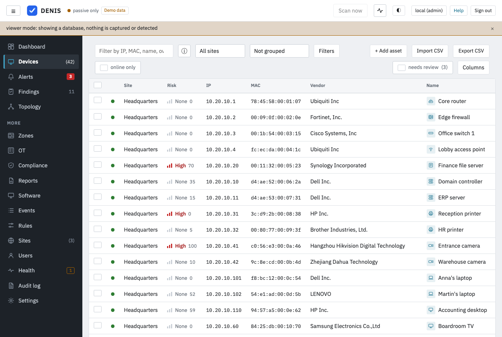
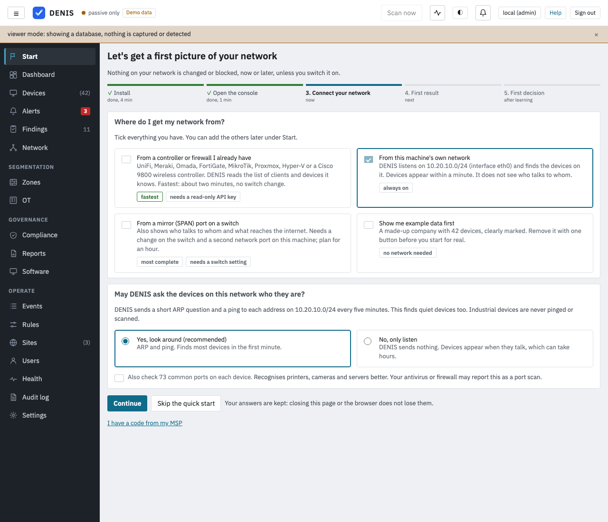
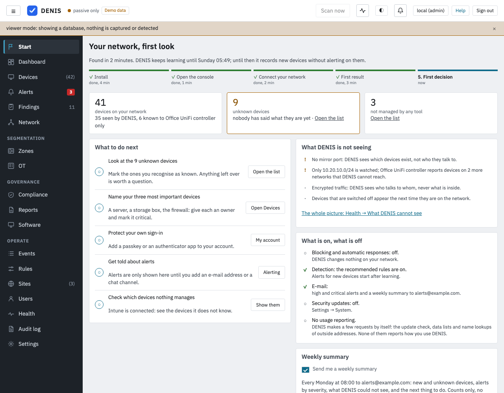
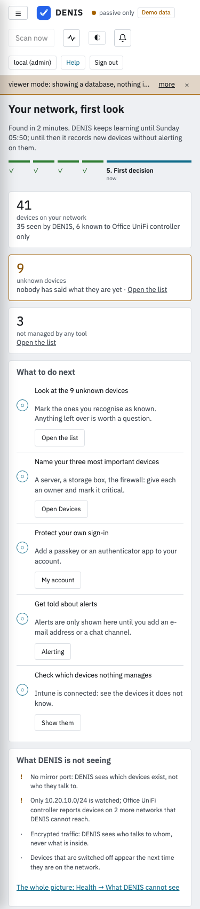
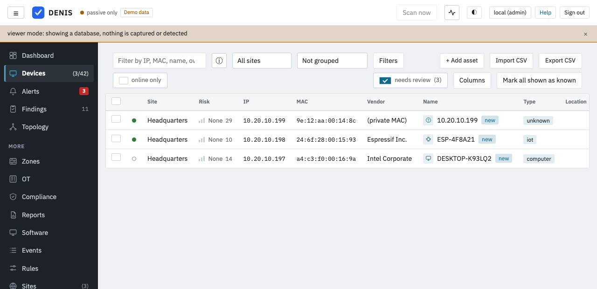

# Quick start

From nothing to a working, useful DENIS in about an hour. Every step says *why*, so you can skip what you do not need.

## 1. What you need

* **macOS or Linux** (Ubuntu 22.04+ recommended for a server). There is no Windows release yet: a `denis.exe`
  can be built from source with the Npcap SDK and has been run on a real Windows 11 machine, but there is no
  installer or service wrapper.
* **Permission to capture packets:**
  * Linux: run as root, or grant it once: `sudo setcap cap_net_raw,cap_net_admin=eip ./denis`
  * macOS: read access to `/dev/bpf*` (Wireshark's *ChmodBPF* does this) or run with `sudo`.
* **Where to put it.** On a normal switched network a machine sees broadcast traffic and its own. That is enough
  to discover devices. To also see who talks to whom, run DENIS on the router/firewall or on a **mirror (SPAN)
  port** ([Concepts › Visibility](concepts.md#visibility-what-can-be-seen-from-where)).
* The pre-built program on Linux needs only the libpcap runtime library (`libpcap0.8`; `libpcap0.8t64` on Ubuntu 24.04),
  which most systems have. Note that a program updated from the console keeps its capture permission only if the
  updater can replace the file in place; run `setcap` again after a manual replacement.
* To build from source: Rust (stable) and libpcap headers (`sudo apt install build-essential libpcap-dev`).

## 2. Get it and start it

**On a Linux server that should run DENIS permanently**, use the installer: it needs no compiler and does everything
(signature check, service, free port, first password): see [Deployment](deployment.md#installing-on-a-linux-server-a-permanent-service).

**To try it on a Mac or Linux machine**, download the program for your platform from the
[Releases](https://github.com/stefanmesaros/denis/releases) page (`denis-aarch64-apple-darwin` for an Apple-silicon Mac,
`denis-x86_64-apple-darwin` for Intel, `denis-x86_64-unknown-linux-gnu` or `denis-aarch64-unknown-linux-gnu` for Linux),
check it against `SHA256SUMS` on that page (`shasum -a 256 denis-…`), and start it:

```bash
chmod +x denis-aarch64-apple-darwin          # your file name
xattr -d com.apple.quarantine denis-aarch64-apple-darwin 2>/dev/null   # macOS: allow a file downloaded in a browser
./denis-aarch64-apple-darwin run
```

(or build it yourself: `cargo build --release`, then `./target/release/denis run`; one file, console and documentation
included.) Only one program can use a port: if **8080 is taken** DENIS says `Address already in use` and stops; start it
with another one, `./denis run --listen 127.0.0.1:9000`, and open that port instead of 8080 below.

The first start creates an administrator and prints a **one-time password**. Copy it now, it is shown only once:

```
  ┌─ FIRST START ──────────────────────────────────────────────┐
  │ Created the administrator account:                          │
  │   username: admin                                           │
  │   password: xxxxxxxxxxxxxxxxxxxx                            │
```

Open **https://localhost:8080** (DENIS uses HTTPS by default; your browser will warn once about the certificate DENIS created: see [Deployment](deployment.md#reaching-the-ui-securely-https-is-on-by-default) to trust it or use your own). Sign in as `admin` and choose your own password (at least 12 characters).
Lost it later? `denis user reset admin` on the same machine prints a new one-time password.

On a new installation the first screen is the **Setup guide**. It is one short path, and the next section describes it. The
**Dashboard** and the **Devices** page fill up within seconds either way.



## 2a. The setup guide: your first look at the network

Since 4.6.0 the quick start (the *Start* page of 4.4) and the setup guide (the checklist that used to open as a window) are
**one page, the setup guide**, with one checklist. It is the first menu entry for an administrator until somebody marks it
done, on a new installation and on one that was updated (where it replaces the window that opened by itself). An
administrator who signs in and has not finished is taken to it, unless the address names another page or *Remind me
later* was pressed in this browser. You can always open it again under *Settings → System → Setup guide → Open the setup guide*.
Old links (`#start`, `#setup`, `#setup-guide`, `#quickstart`) all open it.

On a new installation it starts with five stages: *Install*, *Open the console*, *Connect your network*, *First result* and
*First decision*, each with the minutes it took.



1. **Where do I get my network from?** (new installations only; on an updated one it is behind *Change how DENIS gets
   your network*.) Tick everything you have: a **controller or firewall** DENIS can read (UniFi, Meraki,
   Omada, FortiGate, MikroTik, Proxmox, Hyper-V, a Cisco 9800 wireless controller), the **machine's own network** (always on),
   a **mirror (SPAN) port**, or **example data** (a made-up company, clearly marked). Then answer whether DENIS may ask the
   devices on this network who they are (ARP and ping every five minutes; industrial devices are never pinged). Your
   answers are kept if you close the page.
2. **Read your controller** (if you ticked it). Choose the product, make a read-only key or account as the page says, press
   *Test connection*, then *Save and read*. DENIS only reads the list of clients and devices; it changes nothing on the
   controller, and nothing can block anything from here. Products whose reading has not been checked on real equipment
   are marked *Experimental*. The first read takes a minute or two; the page then shows what was read.
3. **Who should hear from DENIS?** One e-mail address and your mail server. DENIS sends a test e-mail only when you press
   the button, and the password is stored encrypted. You can instead use Slack, Teams or a webhook under *Alerting*.
4. **The checklist.** DENIS judges every step itself from what is really configured; it never takes a click as proof. Each
   step has one sentence, one button and, once it is done, the proof (for example "Capture is running on eth0"). It says
   *Done*, *To do* or *Skipped* in words. An administrator can skip a step (and take the skip back); the skips are kept for
   the whole installation. The **first steps**, in this order, and only those that apply:
   * *Remove the example data* (only while it is loaded).
   * *DENIS is watching your network*: a capture interface is running (not shown on a console that only views a copy).
   * *Your device list*: DENIS has seen at least one real device (example devices never count).
   * *Be told about alerts*: an enabled notification channel (a syslog or SIEM export alone tells nobody).
   * *Read one switch (read only)*, optional: a switch added and read once, with a read-only SNMP community or SNMPv3
     user. The step offers the **traffic and error counters** (*Experimental*, as in *Network → Equipment*): they are read,
     never written, by this DENIS server from the switch's management address, so a switch at a remote site needs a route
     or a VPN to it. Shown only to an administrator of the whole installation.
   * *Turn on traffic and error counters*: only while switches from before 4.6.0 have no decision about counters yet.
   * *Your first investigation*: the first decision (an alert acknowledged, a device marked known or given an owner).

   No step asks for a credential with write rights: a read-only installation can finish the whole guide.
   Under **When you have time** (closed until the first steps are done or skipped): what nothing manages, sign-in
   security, your colleagues, backups and reports, naming your three most important devices, reading a controller and a
   mirror port (both optional), and your branding (optional).
5. **Your network, first look.** Three numbers (devices, unknown devices, devices no management tool knows), what DENIS is
   **not** seeing (for example: without a mirror port it sees which devices exist, not who they talk to), and what is on
   and off (blocking is off, nothing is sent to us).



On a phone the same page is one column, with the cards one under the other:



Press **Mark the setup guide as done** when you are finished; it then leaves the menu and no longer opens by itself (for
everyone). A guide marked done under an earlier version counts as done. The steps keep saying what DENIS sees when you open
it again. A person who is not an administrator who opens the page (for example from the Dashboard of an installation
without devices) sees a short read-only version: the first steps and whether each is done, without numbers or buttons.

**After the guide: the Dashboard's "Needs attention" list (4.6.0).** Near the top of the **Dashboard** is one short list,
at most eight lines with the most important first: open security incidents, a watched switch link that is down, a switch
or a site that cannot be read, a capture interface that is down, a site's reports that are incomplete. Each line says
what happened, where, since when, how DENIS knows, and has the button to the page where you act. When the list is empty
it says what is being watched and what is not (switches read, how many with traffic counters, watched links, sites
reporting), not "all good". Each person sees only the sites they may read. A switch this server cannot read shows as
*Loss of monitoring*: the state of the switch itself is then not known. Switch lines come from
[port health](switches.md#port-health-traffic-errors-and-restarts-experimental-460) (Experimental).

**The weekly summary.** If you turn it on (on Start, or under *Alerting*), DENIS sends one e-mail a week with counts: new
and unknown devices, alerts by severity, what it could not see and the next thing to do. It contains no device addresses.
The link in it opens your console and needs a sign-in. The summary is **in English only**; the console itself is
translated. *Send one now* sends it at once; the day and time are yours to set. The routes behind it are listed in the [API](api.md#all-routes).

## 3. Explore with demo data (optional)

Not on a real network yet, or want to look around first? Sign in as an administrator, open **Settings** → **Data**
→ **Demo data and reset** and press **Load demo data** (or start with `denis demo --db demo.db load`, see the
README). It fills the console with a fictional company (an office, a production hall with PLCs and HMIs, a branch
site): 42 devices, alerts, industrial communications, trends. Every screen has something to look at.

Demo data is clearly marked and never mixed up with your real devices: a banner says it is loaded, the collector and
detectors ignore it, and **Remove demo data** deletes exactly that and nothing else. When you are ready to use DENIS
for real, remove it (and, if you edited things while exploring, use **Erase all data** in the same place to start from
a clean slate; see [Operations](operations.md#demo-data-and-starting-clean-erase-all-data)).

## 4. The first hour: what to set, in this order

The [setup guide](#2a-the-setup-guide-your-first-look-at-the-network) is the short version of this list. The list below is
the same job in more detail.

1. **Look at what was found.** Open **Devices**. Each row has an icon, a risk score, the address, the
   manufacturer and a guessed type and operating system. Click a device to see *why* DENIS thinks so.
2. **Work through the review queue.** Tick **needs review** (top right). Every device nobody has looked at
   is listed. Open the unfamiliar ones; for the rest press **Mark all shown as known**. From now on a new device
   stands out ([details](asset-management.md#the-review-queue)).

   
3. **Describe your important devices.** Open a server, NAS or camera → **Edit asset**: a name, an owner, a
   location, a criticality (*high* for things you cannot lose). Correct a wrong device type; your value wins
   everywhere. Or import a spreadsheet: **Devices CSV** → edit → **Import CSV**.
4. **Get alerts where you will see them.** *Settings → Notifications* → add **Slack**, **Teams**, **e-mail**,
   **PagerDuty** or a **webhook**, press **Test** ([details](alerting.md)).
5. **Let it learn.** For the first 24 hours DENIS *learns*: new devices and destinations are recorded but not
   alerted on (a banner shows the time left). Do not judge the alerts before that is over.
6. **Tune the noise.** *Rules* tab: every detection, with its weight and thresholds. A rule that is too loud for
   you (say new destinations on laptops) can be turned down, not off
   ([details](detection-rules.md)).
7. **Secure the console.** Add a **passkey** or an authenticator app (click your name → *My account*), create one
   named account per person, and require a second step under *Settings → Sign-in & security*. HTTPS is already on
   (a self-signed certificate; trust the DENIS CA or install your own, see
   [Deployment](deployment.md#reaching-the-ui-securely-https-is-on-by-default)).
8. **Look at *Findings* and *Compliance*.** They turn what DENIS knows into a to-do list and into evidence for
   an audit ([tour](tour.md#findings)).

## 5. Options you will use

```bash
denis run --passive-only            # listen only; never send a single packet (if an IDS or endpoint product flags DENIS as a port scan: security-tools.md)
denis run --flows                   # also analyse traffic (who talks to what)
denis run --profile ot              # industrial network: passive and gentle (see OT guide)
denis run --listen 127.0.0.1:9000   # another port
denis run --db /var/lib/denis/denis.db
denis run --public-url https://denis.example.com   # the address people type; enables passkeys over HTTPS
denis run --threat-list bad-ips.txt --flows        # alert on contact with known-bad addresses
denis serve --db copy.db            # look at a database (a backup, a copy) without capturing anything
denis backup /safe/place/denis-backup.db           # verified copy of the database, while running
denis --help                        # everything
```

Reading data without the console: `denis list`, `denis alerts`, `denis report`. The documentation you are reading is also
in the console (the *Help* link), with a search box.

**A second site.** In the console open **Sites** and press **Add agent**: DENIS creates the token and shows the commands to
copy, for Linux (`install.sh --agent`) and for Docker ([Deployment](deployment.md#multiple-sites-agents)). For several agents, or
to avoid copying a token, use **One-line enrolment** next to it: one code, one command, also for cloud-init, Docker, Ansible and systemd.

**Updates.** DENIS offers stable releases only and installs them when an administrator presses the button, after a backup
([Updates](updates.md)). Testers can opt in to pre-releases there.

## 6. Stopping and starting again

Press **Ctrl-C**. DENIS saves everything and exits; the next start continues where it stopped.
To run it as a service, see [Deployment](deployment.md).

## Details from the console

Explanations that used to be printed on the console screens. The console shows a short version behind the small (i) button after the label it explains; "More in the docs" in it leads here.

* A checklist of what a new installation usually needs: your network, sign-in security, notifications, colleagues, backups and your branding. Each item turns green when it is really done.
