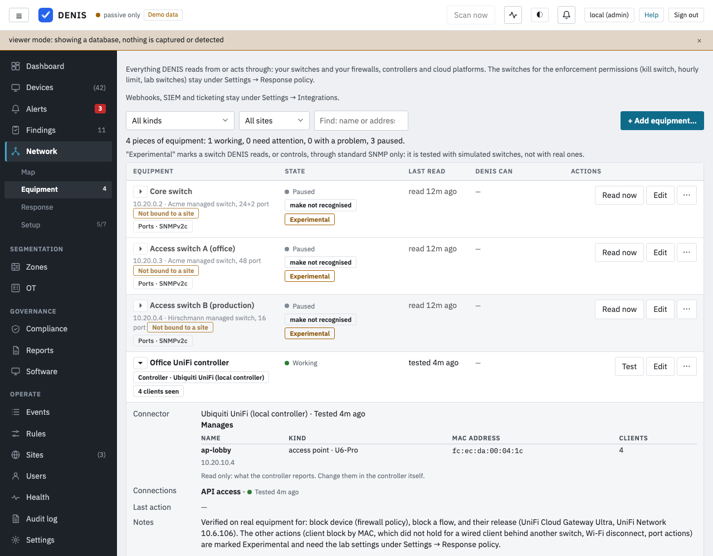
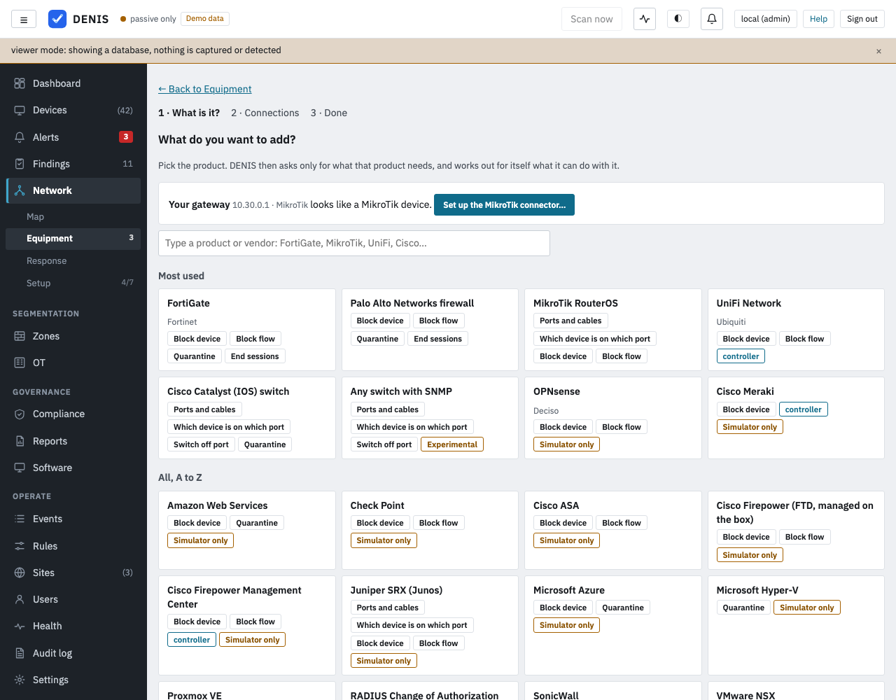

# Switches and the physical topology (SNMP)

*Network* → **Map** is one map: your equipment (switches, firewalls, routers, access points, controllers) with the cables
between them, each marked confirmed, best guess or set by hand (see below), and, when you ask for them, the devices under
each switch port. Click a switch for its ports and what is plugged into each; **Equipment** has the same ports as a grid. They
need your switches to answer SNMP, so you tell DENIS which ones to read.



## What DENIS reads

For every switch you add (*Network* → **Equipment** → **Add equipment…**), DENIS reads, and only reads, every few minutes:

| MIB | What for |
|---|---|
| system (`sysDescr`, `sysName`) | the switch's name and description |
| IF-MIB (`ifName`, else `ifDescr`; `ifAlias`, `ifOperStatus`, `ifAdminStatus`, `ifType`, `ifHighSpeed`) | the ports: name, the label somebody typed, up or down (link), switched on or off (administratively), physical or not, speed |
| LLDP-MIB (`lldpRemTable`, `lldpLocChassisId`) | what each port sees on the other end of the cable: another switch, an access point, a phone: as that device announces itself |
| Q-BRIDGE-MIB (`dot1qTpFdbPort`), else BRIDGE-MIB (`dot1dTpFdbPort`) | the forwarding table: which MAC address was learned on which port |

Where the switch has them, a poll also reads what the port is for: link aggregation (IEEE8023-LAG-MIB
`dot3adAggPortAttachedAggID`, IF-MIB `ifStackStatus`) and CDP neighbours (CISCO-CDP-MIB `cdpCacheTable`), and on **Cisco
IOS** the 802.1Q trunk mode of each port (CISCO-VTP-MIB `vlanTrunkPortDynamicStatus`) and the VLAN list (CISCO-VTP-MIB
`vtpVlanTable`, else the ports' access VLANs). Port control uses these to warn about trunks, aggregation members and
infrastructure (by hand only, with warnings to tick); nothing else draws on them.

With port health on for a switch (Experimental, 4.6.0), the same reading also takes the traffic and error counters of
its ports and the switch's uptime, read only: see [Port health](#port-health-traffic-errors-and-restarts-experimental-460).

A poll only ever reads, always with the read community (SNMPv2c) or the read user (SNMPv3). DENIS sends **one kind of
SET**: `ifAdminStatus` of **one port**, only for a switch you gave a separate **write community** or **write user**, only when an **administrator asks and confirms** with
their password (see [Disabling a port](#disabling-a-port)). A switch without a write community is never written to.
A table a switch does not implement is simply left out; only a switch that does not answer at all is an error, shown on
the switch's line with the reason.

## Any managed switch with standard SNMP (Experimental, 4.3)

A switch that is not Cisco IOS needs no special support to be **read**. DENIS reads the standard tables listed above for
every make, names the make, and says in the switch's detail (*Network* → *Equipment*, open the switch's row) what it
found and what it cannot do with that switch. Nothing in this step writes to a switch.

**The make** comes from `sysObjectID` (the number after `1.3.6.1.4.1.` is the vendor's SNMP enterprise number) and
`sysDescr`, through one table of about 80 lines in the program (`src/snmp_profile/vendors.tsv`): Cisco, HPE and Aruba
(ArubaOS-Switch, ArubaOS-CX), Juniper, MikroTik, Ubiquiti, Netgear, TP-Link, D-Link, Zyxel, Dell, Extreme, Huawei, Fortinet
(FortiSwitch) and a few more. The model is a best guess from the description (or ENTITY-MIB `entPhysicalModelName`) and can be
empty. A switch nobody listed is still read: the detail says "Make not recognised" and goes on with the standard tables.
The make changes no behaviour; it is only shown.

**What is read, and what each table gives:**

| Table | What DENIS gets from it |
|---|---|
| IF-MIB `ifTable` / `ifXTable` | ports: name, link, speed, switched on or off |
| BRIDGE-MIB `dot1dBasePortIfIndex`, `dot1dTpFdbPort` | which interface each bridge port is; the older forwarding table |
| Q-BRIDGE-MIB `dot1qTpFdbPort`, `dot1qVlanFdbId`, `dot1qPvid`, `dot1qVlanStaticName` | who is plugged into which port, in which VLAN; the access VLAN of each port |
| Q-BRIDGE-MIB `dot1qVlanStaticEgressPorts`, `dot1qVlanStaticUntaggedPorts` (else `dot1qVlanCurrentEgressPorts` and `dot1qVlanCurrentUntaggedPorts`) | which VLANs each port is a **tagged** and an **untagged** member of |
| LLDP-MIB | the neighbours each port sees |
| ENTITY-MIB `entPhysicalModelName`, POWER-ETHERNET-MIB | asked once each, only to record whether the switch has them (and a model name) |

**Access and trunk ports.** A port that is tagged in **two or more** VLANs is treated as a trunk (a warning on port actions,
no VLAN move). A port that is only an untagged member, and only when both port lists were read to the end and every bridge
port could be mapped to an interface, is recorded as not a trunk. One tagged VLAN is not enough to call a trunk, because a
phone port looks the same. Everything else stays unknown, as before.

**Limits.** Every request is bounded the same way as the rest of the poll (rows, time and bytes per table; the VLAN port
lists are cut at 1,024 bytes each, 2,000 ports and 4,094 VLANs). A table the switch does not offer is left out and named in the
switch's detail, never an error; a table cut at a limit is shown as incomplete, and a table that is only partly there (for example port
lists that cannot be tied to interfaces because the switch gives no bridge-port map) counts as partial: DENIS then says so and
does not act on those ports. Simple "smart" switches (the D-Link DGS-1100 family is the example) often implement only part of
Q-BRIDGE-MIB, or none of it beyond the interface table.

**Port control on these switches.** Switching a port off uses the standard `ifAdminStatus` write on every make (validated
on a D-Link DGS-1100-08V2). Moving a port to the quarantine VLAN on a switch that is not Cisco IOS goes only through the
**experimental generic SNMP control** (4.3): off by default and switched on per switch by an administrator, only after a
passed write test on a spare port, only on access ports this reading proves (complete VLAN port lists, one untagged VLAN
that is the port's `dot1qPvid`, no tagged one, the device's place read from the switch), with the port lists read back
after the write. See [Port control: SNMP switches](nac/snmp.md#experimental-generic-snmp-control-any-switch-that-is-not-cisco-ios)
for the steps, the write test and how to report what your switch did.

**How to check what your switch answers**, from any machine that may query it (replace the community and address; add `-v3`
options for SNMPv3). If a line prints nothing, DENIS will not get that table either:

```
snmpget  -v2c -c COMMUNITY SWITCH 1.3.6.1.2.1.1.2.0                  # sysObjectID: the make
snmpwalk -v2c -c COMMUNITY SWITCH 1.3.6.1.2.1.31.1.1.1.1             # ifName: the ports
snmpwalk -v2c -c COMMUNITY SWITCH 1.3.6.1.2.1.17.1.4.1.2             # dot1dBasePortIfIndex: bridge port -> interface
snmpwalk -v2c -c COMMUNITY SWITCH 1.3.6.1.2.1.17.7.1.2.2.1.2         # dot1qTpFdbPort: who is plugged in where, with the VLAN
snmpwalk -v2c -c COMMUNITY SWITCH 1.3.6.1.2.1.17.4.3.1.2             # dot1dTpFdbPort: the older table
snmpwalk -v2c -c COMMUNITY SWITCH 1.3.6.1.2.1.17.7.1.4.5.1.1         # dot1qPvid
snmpwalk -v2c -c COMMUNITY SWITCH 1.3.6.1.2.1.17.7.1.4.3.1           # dot1qVlanStatic: names, egress and untagged port lists
snmpwalk -v2c -c COMMUNITY SWITCH 1.0.8802.1.1.2.1.4.1.1.9           # lldpRemSysName: LLDP neighbours
```

The same answers can be saved as a raw dump for a bug report (an administrator's *Read now* with `?raw=1`, see the API page);
it never contains a community.

### What DENIS can read from a switch

After each read, the switch's detail (*Network* → *Equipment*, open the row) lists in plain words what this switch answered
and what it did not, for every make, listed or not. A make nobody listed is read through the standard tables the same way, is
marked **SNMP port reading: Experimental**, and gets no port control. The mark is not shown on a router or firewall that DENIS does not use as a switch, on
equipment that has its own connector, or on the D-Link DGS-1100, whose port off and on is verified. A line is shown only for what the switch really answered:

* **Ports** (IF-MIB): name, link, speed, switched on or off.
* **Who is plugged into which port** (BRIDGE-MIB `dot1dTpFdbPort`, Q-BRIDGE-MIB `dot1qTpFdbPort`; on Cisco IOS one table per VLAN, read with `community@vlan` or the SNMPv3 context `vlan-<id>`), and **the VLAN of each device**.
* **VLANs**: the list and the names (`dot1qVlanStaticName`), and which VLANs each port belongs to, tagged or untagged (`dot1qVlanStaticEgressPorts` / `dot1qVlanStaticUntaggedPorts`, `dot1qPvid`).
* **Neighbours**: LLDP (LLDP-MIB `lldpRemTable`), and CDP on Cisco.
* **Power over Ethernet** (POWER-ETHERNET-MIB): whether the switch answers it. Read only.

When a table is missing, a short reason is shown instead (for example *no forwarding table over SNMP*, *LLDP is off or not
offered*, *the VLAN table answered only in part*). Evidence: `documented` (the table names and OIDs are the standard MIBs, RFC 4188,
RFC 4363, RFC 3621, IEEE 802.1AB); `verified` (2026-10: Cisco Catalyst 2960-X and D-Link DGS-1100-08V2, see below); every other make
`best guess` until a real switch of that make has answered.

### Port join: the port of an access point or switch a controller did not name

A controller (FortiGate, Meraki, Omada, UniFi, Catalyst 9800) often says which switch an access point hangs on but not which
port. When that switch is one that DENIS reads over SNMP, DENIS fills in the port from what the switch itself shows. It uses what
is already read (no extra polling), and only when the answer is certain:

* **By LLDP first:** the switch lists the access point as a neighbour on one port (its chassis ID is the device's MAC address, or
  its system name is the device's name). **Otherwise by the MAC table:** the device's MAC address is learned on exactly one port
  that is a plain access port.
* **Never guessed:** the port stays empty when the MAC address is seen on two ports, only on uplinks or trunks, or not at all; when
  the controller already gave a port; when the link is a Wi-Fi mesh; or when the parent is not a switch DENIS reads (a port of another
  switch would be the wrong box).
* **On the map:** the link shows the port, and the line says *port learned from <switch> by LLDP* (or *by the MAC table*) instead of
  *reported by the controller*. It is a display only; nothing is blocked or changed because of it, and it disappears when the
  switch no longer shows the device. `GET /api/topology/controller-clients` carries it as `infra[].uplink.port`, with
  `uplink.via` set to `learned from <switch> by lldp` or `learned from <switch> by mac table`.
* **Limits:** `best guess`: the MAC address the controller gives for an access point is the one its switch learns. Some access
  points use a different base MAC address on their Ethernet port; then nothing is found and the port stays empty. `verified`: not
  yet on real equipment (tested with recorded fixtures only).

### Verified with

**Not verified on real equipment.** Reading a switch generically is tested with a simulated switch and with recorded answers
only: simulated HPE ProCurve, Juniper EX, MikroTik CRS and D-Link DGS-1100-style switches (including one that implements only
part of Q-BRIDGE-MIB), a hand-built copy of the D-Link DGS-1100-08V2's answers, and hostile answers (garbage, oversized lists,
wrong types). The switch's row therefore carries the **SNMP port reading: Experimental** mark for every make that is not Cisco IOS (except the D-Link DGS-1100, whose reading of the ports is verified, and routers and firewalls DENIS does not use as switches). The real Cisco
Catalyst 2960-X and D-Link DGS-1100-08V2 readings described under [What is verified, and what is not](#what-is-verified-and-what-is-not)
are older and are about the Cisco-specific reading and the ports of that D-Link; the VLAN port lists, the make table and the
trunk rule above have not been seen on any real switch yet. The experimental generic VLAN move and its write test are tested
the same way only (a D-Link DGS-1100-like switch whose port lists follow a `dot1qPvid` write, one whose lists do not, one with
part of Q-BRIDGE-MIB, the recorded DGS-1100-08V2 answers, lost and refused writes, read-only and wrong communities); no model
is validated. Please report what your switch shows.

### TP-Link without a controller (4.4)

TP-Link's small devices (Omada EAP access points in standalone mode, Easy Smart and JetStream switches, Archer routers) have no
REST interface that DENIS knows of, and **DENIS does not invent one**. What it does with them is what it does with any device:
standard SNMP where the device offers it, LLDP, and what it sees on the wire. Every claim on this page is labelled
**documented** (in a page TP-Link publishes, read 2 November 2026), **best guess** (memory, field reports, product names: not
checked) or **verified** (on real equipment, with a date). **Nothing here is verified: no TP-Link switch or access point has been
polled by DENIS.**

| What | Label | Source and detail |
|---|---|---|
| TP-Link's SNMP enterprise number is 11863. | documented | TP-Link FAQ 1330 (CPU and memory objects of the T1600/T2600 switches, `1.3.6.1.4.1.11863.6.4...`). DENIS names a device `TP-Link` from `sysObjectID` under `1.3.6.1.4.1.11863` (`src/snmp_profile/vendors.tsv`). |
| JetStream switches offer SNMP v1/v2c (Maintenance, SNMP), with read-only or read-write communities. | documented | TP-Link FAQ 3282 (VLANs over SNMP on a JetStream switch). SNMP v3 is only mentioned there, with a pointer to the guide. |
| The same FAQ reads the VLANs of a JetStream switch with TP-Link's own MIB files, downloaded per model. | documented | DENIS reads the standard Q-BRIDGE-MIB instead; whether a JetStream model fills it is **best guess**. |
| A standalone EAP has an SNMP page among its management features (EAP225 3.0 and EAP245 3.0 are named). | documented | TP-Link's standalone EAP quick start guide. Which MIBs it answers is **not documented** in what DENIS could check. |
| JetStream models answer the standard IF-MIB, BRIDGE-MIB/Q-BRIDGE-MIB forwarding tables and LLDP-MIB. | best guess | The fixtures in DENIS's tests are built from TP-Link's product names, not captured. DENIS reads whatever table answers and says in the switch's detail which ones did. |
| Easy Smart switches (`TL-SG105E`, `TL-SG108E`, `TL-SG1016DE`, ...) answer little or nothing over SNMP. | best guess | Retail listings and one user report conflict. DENIS reads what answers; a switch that answers only `ifTable` is read as "ports only", with no placement. |
| A standalone EAP is not an SNMP switch; DENIS sees it by passive capture, DHCP and LLDP. | best guess | See below. |
| Writing `ifAdminStatus` (port off) works on any TP-Link model. | **not documented** | No TP-Link page DENIS found says so. Port control through the generic path stays **Experimental** for every TP-Link model. |

**How a TP-Link device is recognised.** Three independent hints, each a vote, none a command: the **make** from `sysObjectID` and
`sysDescr` (the rows for enterprise 11863: `t1600`, `t2600` and `t3700` JetStream, `sg3` JetStream managed, `sg2` JetStream smart,
`sg10` Easy Smart, `eap` standalone access point, `archer` router: the words are **best guess** from product names); the **hardware
address** (the OUI vendor, "TP-LINK TECHNOLOGIES" is a weak "network device" hint, "TP-Link Systems" is the Kasa/Tapo smart-home
business and reads as IoT); and the **host name** the device announces when it takes an address (`EAP245`, `TL-SG3428`,
`Archer_C7`: a model followed by a number, **best guess**). A bare `eap` or `tl-` in a name is not enough.

**An EAP in standalone mode.** Without Omada, DENIS has no client list for it: a standalone EAP lists its clients on its own web
page only (**best guess**; TP-Link documents that the standalone web page manages the access point itself and is not reachable while a controller manages it). DENIS sees the access point as a
device (its address from DHCP or capture, its model from its name), sees the clients as they appear on the wire, and sees its
position when the access point or the switch it hangs on announces LLDP. It cannot list the Wi-Fi clients of that access point,
cannot tell which SSID a client uses, and cannot block or disconnect a client through it. For those, adopt the access point in an
Omada controller and use the [Omada connector](nac/omada.md). If the access point answers SNMP, the standard tables it offers are
read like any switch's; whether it does is **best guess**.

**TP-Link models known to answer / not tried.** *Known to answer:* none. No TP-Link device has been polled; the tests use built
fixtures. *Documented to offer SNMP:* JetStream switches (FAQ 3282: T1600/T2600 named for the CPU and memory objects in FAQ 1330) and standalone EAPs (EAP225 3.0, EAP245 3.0 named in the quick start guide). *Not tried at all:* every model, in particular the
JetStream SG2/SG3/T3700 families, Easy Smart (TL-SG105E, TL-SG108E, TL-SG1016DE and the like), standalone EAPs of every
generation, and Archer routers. A report of what `snmpwalk` shows on one of them (the commands above) is the quickest way to
move a model out of this paragraph.

## Setting it up

For the two switches tested on real equipment there is a step-by-step quick setup, with the switch commands, the DENIS fields, a first test and the common problems: [Cisco Catalyst 2960-X](nac/snmp.md#quick-setup-cisco-catalyst-2960-x) and [D-Link DGS-1100](nac/snmp.md#quick-setup-d-link-dgs-1100). The general steps follow.

1. On the switch, create a **read-only SNMPv3 user** (recommended, see [SNMPv3](#snmpv3)) or a **read-only SNMP v2c
   community**, and allow **only the DENIS server's address** to use it (an access list on the switch). In v2c the
   community travels unencrypted, so give it a long random name and treat it as a password that anybody who can watch
   that link could learn.
2. *Network* → *Equipment* → **+ Add a switch…**: a name, the switch's address (`192.168.1.2`, or `192.168.1.2:1161`
   for another port), the **SNMP version** and the community, or for SNMPv3 the user and its passwords. The community
   and the passwords are stored encrypted, are never shown again (leave them blank when editing to keep them) and never
   appear in the audit log.
3. Press **Read now**. It says how many ports, neighbours and MAC addresses were read, or why not ("no answer from the
   device": check that SNMP is on, the community, and that UDP 161 is reachable from the DENIS server).
4. Open **Network** → *Map* to see the switches and cables, and **Network** → *Equipment* (open the switch's row) for what was read. A device's own panel has a **Place & response** block that says which port it is plugged into. *Network* → *Setup* walks through these steps for several switches and a firewall.



Polling runs from the DENIS collector (not in a `denis serve` viewer). The interval is 5 minutes by default (60 to 3600 seconds).

## Disabling a port

This is one of the actions described on the [Enforcement](enforcement.md) page, which also covers durations, permissions
and the other connectors.

**By default DENIS never blocks anything on its own** (automatic enforcement is a separate, experimental, off-by-default
switch, see [Enforcement](enforcement.md)). A person with the administrator role asks for every block, for one port at a
time. They see exactly what will be cut off before they confirm. They confirm with their password. Every block is
logged, announced on every alerting channel, and listed until someone undoes it.

### Turning it on (twice)

1. *Settings* → **Enforcement**: *Allow administrators to block devices from DENIS* (off by default; this one switch also covers
   the firewall and cloud connectors, see [Zones and policies](segmentation.md#enforcement-connectors)), and the most blocks
   per hour across all administrators (10 by default). Switching it off stops new blocks at once; it does not enable
   ports that are already off, and enabling them from DENIS keeps working.
2. Per switch: *Network* → *Equipment* → the switch → *Edit* → **Allow DENIS to disable ports on this switch**, and enter a
   **write community**. Each switch's line then says *Port control* (or *Port control (off)* while step 1 is off)
   instead of *Read only*. Like the read community it is never shown again, never logged or audited (the audit log
   only says `port_control: true`); leave it blank to keep it, or tick *Remove the write community* to clear it. It
   may be the same as the read community (some inexpensive switches have only one), but then every regular poll sends a
   community that can write, and the form says so.

Recommended on the switch, **not yet verified per vendor**:

* a **separate write community**, limited by an access list to the DENIS server's address;
* where the switch supports SNMP views, a view that allows writing **only `ifAdminStatus`** (`1.3.6.1.2.1.2.2.1.7`);
* ideally, SNMP on a management VLAN.

SNMP v2c sends the write community **unencrypted** each time a port is disabled or enabled: the same caveat as for
reading, but for a credential that can take ports down. SNMPv3 (below) does not have this problem.

### Who can, and how

Only a signed-in **administrator** with the permission to disable ports: never a viewer or editor, never an API token,
never under `--insecure-no-auth`. A port is switched off from the **Respond** menu (a device's panel, or a port of a
switch's port table), through the response dialog and the action API (`POST /api/nac/actions/plan`, then
`/api/nac/actions/apply`). The routes before 4.2 (`POST /api/nac/plan` and `/api/nac/apply`) are retired: they answer
HTTP 410 and point to the action API (one tick there acknowledged every warning, and the apply did not judge the port
again). A port DENIS disabled before 4.2 is still switched on again, and checked, from *Active responses*.

DENIS first **reads the switch again, right now** and shows a plan built from that read: the switch and port, every
device it can name behind the port, how many MAC addresses it cannot name, and every warning and refusal. The plan is
valid for **two minutes** and can be confirmed once, only by whoever asked for it. Confirming needs a **reason** (3 to 200 characters) and your **password** (wrong
answers count against the account's lockout, like restarting DENIS). Right before acting, DENIS reads the port once more
and refuses if that index now carries another port's name (some switches renumber ports after a reboot or a module
change). Then it sends the SET and **reads the port back**:

* **disabled**: the switch reads it as switched off;
* **not confirmed**: the SET or the read-back got no clear answer; the port may or may not be off. Check the switch, or
  use **Check now**;
* **refused**: the switch answered with an error (for example "this community cannot write"); nothing changed.

### What DENIS refuses, whatever you confirm

* cutting yourself off (the self-lockout): the port **DENIS itself** is behind (its own connection, and so the way it
  reaches the switch), the port the **gateway** is behind, the port behind which the **switch being changed** is itself
  reached (its own management address is learned there), the switch's **management port** (`Fa0`/`FastEthernet0`,
  `Gi0/0`, `mgmt0`) by name, and a port marked as a **mirror (SPAN) destination**: switching that off blinds DENIS, it
  would see nothing of the network any more, not even what the action itself does;
* a port that **leads to another switch DENIS reads** (an LLDP neighbour, or that switch's chassis or management address
  learned behind it) or is the port **toward the spanning-tree root**, unless DENIS can show that its own way to the switch
  goes through another port: its own hardware address is learned on another port of this switch, or, when DENIS is in
  another network and the switch does not learn it at all, the gateway's is (and not on this port). Code `denis_path`
  (4.2). DENIS does not read the switch's ARP table, so the gateway DENIS knows stands in for the address the switch
  routes DENIS's traffic through; when DENIS is in the register as itself and is learned on another port, an uplink stays
  possible by hand with its warnings (the D-Link behind the Catalyst, when DENIS is plugged into the Catalyst);
* the port of the **device you are using** for this very request (your session's address belongs to a device behind the
  port: `own_session`);
* a **forwarding table read only in part** (`snapshot_truncated`): a Q-BRIDGE or BRIDGE walk that stopped at a limit, or
  a Cisco switch's per-VLAN tables cut off (the row limit, VLAN contexts that did not answer, or a VLAN not reached that
  no poll has read yet). VLANs not reached that are carried over from the poll that last read them are complete. The
  read right before a port action pages a Cisco switch's
  VLANs like the regular poll (its own *VLANs per poll*, continuing where the last poll stopped);
* a list DENIS cannot read (the register, the address-conflict alerts, the active actions, the confirmed gateways, the
  port marks and the interfaces of a device: `unreadable`): it is never read as empty. The address-conflict alerts are
  asked about the devices behind the port only (its forwarding table, its LLDP neighbours, a device placed by hand):
  an alert DENIS cannot read, or more alerts about one device than one answer holds without one that names it,
  refuses that device's port, not the rest of the switch. When the Respond menu cannot judge a port, it says so
  (`unreadable`) instead of showing it without refusals;
* a device whose identity is in doubt: an open **address-conflict** alert, or its MAC learned on **more than one access
  port** right now (MAC cloning, a man in the middle: the port may be the victim's). Find the right port by hand;
* a device or address on the **hands-off** list, or a protected device behind the port;
* anything but a **physical Ethernet port** (`ifType` 6): no VLAN interfaces, port-channels (`ifType` 161), loopbacks or
  the CPU;
* a device that **changed between the preview and the confirmation**: right before the SET DENIS reads the switch's
  forwarding table once more and stops, with nothing changed and nothing written, if a planned device is no longer on
  the port (unplugged, replaced), is learned somewhere else, or if another device is on the port;
* a switch that gave back **no forwarding table**, or forwarding entries without a bridge-port map: DENIS cannot tell
  what is on the port and will not guess. **Many inexpensive "smart" switches are like this** (the D-Link DGS-1100-08V2
  is one): DENIS reads their ports, but cannot disable any of them;
* a device DENIS **cannot see** on any access port right now;
* a port that is **already switched off** at the switch (so that undoing a block can never switch on a port someone
  shut on purpose), or whose state the switch does not report;
* more than the hourly limit, another action on the same switch in progress, a switch without a write community, or one
  that is not read regularly (DENIS could not notice the port coming back).

Allowed, but only after ticking *I understand this also cuts off the devices listed above*: **several MACs** behind the
port (a desk phone with a PC behind it, a small switch under a desk), an **LLDP neighbour that is not a switch** (an
access point: every wireless client behind it), or **nothing seen** on the port right now.

### Ports that are not plain access ports: by hand only, with warnings to tick

Until 4.2 these were refused. Now an administrator decides, and DENIS warns strongly (owner decision of 19 October
2026). Each one is a **warning of its own that must be ticked in the plan and again when you apply it**, next to the
mandatory reason, your password and the port name typed to confirm. Each warning names the port, says how many MAC
addresses are learned on it and which switches, access points or other equipment are behind it, and what switching it
off cuts:

| Warning (code) | When |
| --- | --- |
| `uplink` | an LLDP neighbour on the port is another switch DENIS reads (only when DENIS is shown to reach the switch through another port; otherwise `denis_path` refuses) |
| `switch_behind` | the chassis MAC or the management address of another switch DENIS reads is learned on the port (the same condition) |
| `trunk` | more MACs behind the port than an access port has (24 by default; an administrator can lower it, 1 to 24, with `trunk_mac_threshold`, never raise it) |
| `trunk_port` | the switch says the port is an **802.1Q trunk** (Cisco IOS), even with one MAC behind it |
| `lag_member` | the port is a member of an **EtherChannel/LAG** (on any switch that reports it) |
| `cdp_neighbour` | a Cisco device announces itself on the port over **CDP** (a switch, an access point, a router, a Cisco IP phone) |
| `class_unknown` | a Cisco IOS port whose trunk mode the switch did not report, unless exactly one device and no neighbour is behind it |
| `behind_port` | any port the one port rule does not call a plain access port (an uplink, a trunk, network equipment learned there, spanning tree, a port marked as unmanaged equipment), with the count and the names of what is behind it |

These ports are **never proposed** by DENIS (the Respond dialog lists them under *By hand only*, with the warning, never as
the recommended choice) and **never acted on by automation or Autopilot**: they never accept a plan that has a warning.
Right before the write DENIS reads the port once more; if it then finds a kind of port the plan you confirmed did not warn
about, it changes nothing and asks you to plan again. The VLAN move stays refused on a trunk and on an aggregation member
(they have no single access VLAN to change), and on any port with more than one device behind it.

LAG membership is read from `dot3adAggPortAttachedAggID` and `ifStackStatus` when the switch has them; a switch that
has neither cannot show that a port is an aggregation member.

### Cisco IOS: one forwarding table per VLAN

Cisco IOS serves the BRIDGE-MIB per VLAN: the community `public@20` shows the table of VLAN 20, a plain `public` only
that of VLAN 1 (and IOS does not serve the Q-BRIDGE tables). When a switch says it is Cisco IOS (`sysObjectID` under
1.3.6.1.4.1.9 and `sysDescr` naming IOS, not NX-OS or an ASA), DENIS lists the VLANs (CISCO-VTP-MIB, else the access
VLANs of the ports) and reads the bridge-port map and the forwarding table once for each, with `<community>@<vlan>`.
It reads at most 64 VLANs per poll (set per switch under *VLANs read per poll*, 2 to 512) and for at most 30 seconds,
stops after two VLANs in a row without an answer (the device does not index by community), and records what it left
out in the switch's detail (Network → Equipment) as an incomplete read; the plain table stays in use whenever the per-VLAN read gives nothing.
**A switch with more VLANs is read across polls:** VLAN 1 is read every time (last, after the others: its plain table
is read anyway, so it never uses up a poll's time before them), and the others in turn, each poll continuing where the
last one stopped (the limit, or the 30 seconds), so every VLAN is read within a few polls. The VLANs a poll does not
reach keep the entries of the poll that last read them, except for a device this poll saw elsewhere (it is shown only
where it is now), and the switch's detail says which VLANs those are. Once every VLAN has been read by some poll, such a
switch's table counts as complete (a note in the switch's detail, not an incomplete read): port actions and a VLAN quarantine are
not refused for it. Until then (the first polls after adding the switch or upgrading) it is an incomplete read. The
per-switch setting in the switch form (`cisco_per_vlan`):
*Automatic* (default), *Always* or *Never*. Other switches are never read this way. Tested on a
Catalyst WS-C2960X-48TS-L (IOS 15.2(7)E4) with SNMPv2c and SNMPv3.

### Cisco IOS: what the switch needs for port actions

* **SNMPv3:** a write user in a group whose write view contains **both** `ifAdminStatus` (`1.3.6.1.2.1.2.2.1.7`) and
  `vmVlan` (`1.3.6.1.4.1.9.9.68.1.2.2.1.2`), see [the SNMPv3 steps](#setting-up-snmpv3-on-a-cisco-ios-switch-catalyst-2960-x).
  With only `ifAdminStatus` in the view, *Disable port* works and *Move port to quarantine VLAN* fails at the switch.
* **SNMPv2c:** the **SNMP write community** in the switch form (*Allow DENIS to disable ports on this switch*), with a
  write view that contains the same two objects. **Without the write community the switch offers no port actions at
  all:** *Disable port* and *Move port to quarantine VLAN* are simply missing from the Respond dialog, without an error.
  If the actions are missing, check the write community first.
* For the quarantine VLAN, also the VLAN itself and the tick *I tested this VLAN* (see
  [the response dialog](#the-response-dialog-and-quarantine-by-vlan-41)).

### Cisco IOS: VLANs that stay silent

Some VLANs give no forwarding table even when everything else works. The usual reasons:

* **The VLAN has no active port.** IOS keeps a forwarding table (and a spanning-tree instance) only for a VLAN that has
  at least one port up in it. A VLAN with no device plugged in, or one that exists only on trunks, answers nothing.
  `show spanning-tree vlan 20` then says that the instance does not exist. This is normal and nothing to fix.
* **The VLAN has no SNMP context for DENIS's user.** With SNMPv3 every VLAN is a context `vlan-<n>`, and the read group
  needs the line `snmp-server group <RO group> v3 priv context vlan- match prefix read <read view>`. Without it every VLAN
  but VLAN 1 is silent. With SNMPv2c the switch must accept `<community>@<vlan>`.

  The line DENIS shows on the switch's card, with a copy button, is the same:

  ```
  snmp-server group <group> v3 priv context vlan- match prefix read <view>
  ```

  **Verified** on a Catalyst 2960-X, IOS 15.2(7)E4, SNMPv3, on 3 November 2026: the groups `DENIS-RO` and `DENIS-RW` had no
  `vlan-` context. After the line was added to them, the per-VLAN reads worked: the reading went from 20 to 29 MAC addresses
  and the VLAN of each device became available. For SNMPv2c the equivalent is that the community is accepted with
  `<community>@<vlan>` (documented, not verified).

What DENIS does then: it reads the rest. The VLANs that answered are used as usual, and the switch's detail names the VLANs
that did not answer. In 4.2.4 a port action is refused only on a port that carries a VLAN DENIS could not read (DENIS
cannot tell what is behind it there); every other port of the switch can be switched off or moved as usual.

### Troubleshooting a Cisco switch

Run the switch commands in the switch's privileged mode. In the examples, VLAN 20 stands for the VLAN in question and
`192.0.2.2` for the switch.

| Text in the switch's detail (Network → Equipment) | Cause | Check | Fix |
|---|---|---|---|
| "VLANs 20, 30 did not answer their per-VLAN read; the others were read." | The VLANs have no port up, or the read user has no context for them | `show vlan brief` (is the VLAN there, which ports), `show interfaces status` (is any of those ports *connected*), `show spanning-tree vlan 20` (does the instance exist) | No port up: nothing to fix, the VLAN is read once a device is in it. Ports up: add the `context vlan- match prefix` line to the read group (SNMPv3) |
| "The switch did not answer the per-VLAN reads (VLANs ...)" | No VLAN context works for this user or community | `show snmp group` (the read group needs a second line with `context vlan-`), `show snmp user` (the user is in that group) | Add `snmp-server group <RO group> v3 priv context vlan- match prefix read <read view>`; for SNMPv2c check that the community is accepted with `@<vlan>` (test below) |
| Disable port and Move port to quarantine VLAN are missing from the Respond dialog | No write user (SNMPv3) or no write community (SNMPv2c) in the switch form | The switch form, *Allow DENIS to disable ports on this switch* | Enter the write user or the write community |
| The quarantine move fails, Disable port works | The write view does not contain `vmVlan` | `show snmp view \| include DENIS` (both `1.3.6.1.2.1.2.2.1.7` and `1.3.6.1.4.1.9.9.68.1.2.2.1.2` must be listed for the write view), `show snmp group` (which view the write group uses) | Add `snmp-server view <write view> 1.3.6.1.4.1.9.9.68.1.2.2.1.2 included` |
| "The switch rejected the authentication ..." | Protocol or password differs between switch and DENIS | `show snmp user` (authentication and privacy protocol of the user) | IOS 15.2: SHA-1 and AES-128 in DENIS; enter the passwords again |
| "No answer from the device" | UDP 161 blocked, access list, wrong user or community, wrong privacy password | `show snmp user`, `show snmp group`, the access list named in them | Allow the DENIS server's address in the access list; check the user and the passwords |
| *Engine ID changed* | The switch was replaced or its SNMP configuration reset | `show snmp engineID` | Confirm the new engine ID on *Network → Equipment* (create the users again if the engine ID was changed on purpose) |

**A test from another machine.** The access list allows only the DENIS server, so run the test there, or add the test
machine's address to the access list for the test and remove it afterwards. The walk reads the forwarding table of VLAN
20 (`dot1dTpFdbPort`); a few lines of output mean the VLAN is readable, no output means it is silent:

```
# SNMPv2c: the read community with @ and the VLAN number
snmpwalk -v2c -c '<read community>@20' 192.0.2.2 1.3.6.1.2.1.17.4.3.1.2
# SNMPv3: the same user, the context vlan-20
snmpwalk -v3 -l authPriv -u denis-ro -a SHA -A '<auth password>' -x AES -X '<privacy password>' -n vlan-20 192.0.2.2 1.3.6.1.2.1.17.4.3.1.2
```

Do not leave the passwords in the shell history: type them at a prompt or clear the history afterwards.

**Verified with:** Cisco Catalyst 2960-X, IOS 15.2, with SNMPv3 `authPriv` (SHA-1 and AES-128) and with SNMPv2c and a
write community. Switching a port off and moving a port to the quarantine VLAN were verified in the owner's lab.
The same two actions, the write test and reading the ports, MAC and VLAN tables were also verified in the Cisco DevNet sandbox on 29 October 2026, on a Catalyst C9300-24UX (IOS XE 17.15.1, SNMPv2c) and on a Catalyst C9200CX-12P-2X2G (IOS XE 26.02.1, SNMPv3). Newer IOS XE images can refuse the older SNMPv2c configuration: use SNMPv3 there (it works through a management VRF). Virtual lab switches that serve no forwarding table over SNMP (Cisco IOL) are read for ports only; DENIS does not move or switch off their ports.

### Undo, drift, and what is announced

* **Enable** (*Network* → *Response* → *Currently blocked by DENIS*, or the port's card in *Equipment*) takes one ordinary confirmation and no password, and
  works while port control is switched off. DENIS only enables ports **it** disabled (its own ledger), after checking the
  index still carries the same port name.
* Removing a switch, or its write community, while ports DENIS disabled are still off asks for confirmation first:
  DENIS can no longer enable them after that; it would have to be done at the switch.
* **Drift**: every regular poll reads `ifAdminStatus`. A port DENIS disabled that is switched on again (`no shutdown` at
  the switch, or the switch restarted) is recorded as *switched on outside DENIS*, logged by `system`, and announced.
  DENIS never disables it again on its own.
* **Restarts**: on many switches a port disabled over SNMP is only off in the running configuration and comes back
  on when the switch restarts, unless someone saves the configuration. **A block by DENIS is not guaranteed to survive a
  switch restart.**
* Every block, enable, *not confirmed* outcome and drift goes to **every enabled alerting channel**, regardless of its
  minimum score and of maintenance mode. While any port is disabled by DENIS, **Health** shows a warning. Everyone who
  can see *Network* sees the list of ports DENIS switched off (who, when); only administrators see the reason and can enable.
* The audit log records `nac.plan.refused`, `nac.disable`, `nac.disable.denied` (wrong password, expired plan, renamed
  port), `nac.restore`, `nac.check`, `nac.drift` and `nac.settings`. Neither community ever appears in them.

### The response dialog and quarantine by VLAN (4.1)

Each switch is also offered in the response dialog (the Respond button), with two actions. The buttons above keep working
as before.

* **Disable port** with a **duration** (the default is one hour; permanent needs an extra tick). When the time is up
  DENIS enables the port again, and a release does the same. It is one action per physical port, you type the port's
  name to confirm, the port is read again right before the change, and a port that someone enabled in the meantime is
  recorded as *removed elsewhere* and not disabled again.
* **Move the port to the quarantine VLAN**. In the switch form, under *Quarantine by VLAN*, enter the
  VLAN you built for quarantine (2 to 4094, not 1002 to 1005) and tick *I tested this VLAN*. Without the tick the switch
  offers no quarantine. DENIS moves **one access port** into it and back (Cisco IOS: `vmVlan`; other switches:
  `dot1qPvid`, which is Experimental); it never creates the VLAN, its DHCP, its gateway or any rule. A device with a static address, and any
  OT device, is simply cut off until the port is restored. Refused, whatever you confirm: a trunk or an EtherChannel
  member (no single access VLAN to change: switch it off by hand instead), the management port, a mirror port, the port of
  the gateway or of DENIS itself, a port with more than one device or a neighbour (a phone, an access point; this covers
  an uplink), a voice VLAN, 802.1X or MAC authentication, a VLAN that does not exist on the switch, and a port that is
  already in it. The optional *bounce* switches the port off and on once so that the device
  asks for an address again; it is off by default. The details, the OIDs and what was not verified are in
  [SNMP port control](nac/snmp.md#the-response-dialog-41-disable-a-port-or-move-it-to-the-quarantine-vlan).

## Switches at several sites

When the tenant has two or more sites (the local capture and one or more agents), the switch form offers
**Site**. A switch bound to a site places only the devices of that site: the same MAC address at two
sites is two devices, each placed on its own site's switch, and a topology change (a moved device, a VLAN
change, a new device on a watched port) is raised on the device of the switch's own site. A new device
found on a watched port is created at the switch's site.

A switch that is **not bound** keeps working as before (it is tenant-wide), but it cannot tell which site's
device a MAC belongs to when devices of two sites share it: nothing is attached to such a MAC (counted in
`denis_topology_ambiguous_mac_total`) instead of guessing. Once any switch is bound, port control (NAC)
asks only the switches bound to the device's own site where it is, and never acts on a device of one site
through a switch of another. When only a switch that is bound to no site sees the device, the response
dialog says so ("Only a switch that is not bound to this device's site sees it"), while the map still draws
the device on that switch (4.5). When you save the list, the
console keeps each switch's binding (the form sends it back): an API client that saves the list must send
`site` too, or it unbinds the switches.

**Two people saving the list (4.5).** `GET /api/switches` answers a `revision`; a `PUT` that quotes it is refused with
409 (`code: stale`, the current `revision`) when the list changed in the meantime, and the console reads the list again,
so an editor opened earlier never removes a switch someone else added. A `PUT` without `revision` is not checked (an older
API client). The audit entry names the switch ids the save added, removed and changed. A stored list that cannot be read
is an error, never an empty list: nothing is forgotten, and the poll loop waits until it can be read again.

## How a device is placed

* A device is drawn on the port where its **MAC address was learned**. If it is learned in several places, the port with the
  **fewest** other MACs behind it wins: an access port beats an uplink.
* A port that leads to **another switch you poll** (LLDP says so), or that has **more than 24 MACs** behind it, is a
  trunk: what it learns is only "somewhere further down", so no device is claimed to be plugged into it. The device shows up
  on its real port once the switch it hangs off is added as well.
* A neighbour that **announces itself by LLDP** (an access point, a phone) is drawn with what it says and matched to the
  register by its chassis MAC.
* MACs on access ports that are **not in the register** are only counted (the map says how many).
* **A table read half-way (4.5).** When a switch stops answering in the middle of a table (busy, packet loss after the
  retries), the table is marked as read only in part (the *Incomplete data* chip), every port action on that switch is
  refused for it, and a device placed from it is not certain. A Q-BRIDGE forwarding table that failed half-way is not
  replaced by BRIDGE-MIB (which many such switches fill only for one VLAN). The poll is still stored.
* **A switch not read for a while (4.5).** When a switch DENIS read recently sees a device, a switch last read more than two
  reads ago (paused, or not answering) does not count for the response dialog; alone, its old reading gives the reason "last
  placed ... minutes ago". The map still draws what the old reading said.
* **Port found by number only (4.5).** When an LLDP announcement names no port DENIS can match by name and the port is found
  only by LLDP's local port number (the ifIndex only on some switches), the device is shown there but never as a placement
  DENIS is sure of (`via: lldp_number`, reason `location_by_number`).
* **Cisco VLANs carried over (4.5).** The entries of a VLAN one poll did not reach are taken over from the previous poll only
  when that poll read the same device (chassis id, name, sysObjectID) and is at most three hours old. Otherwise the VLAN counts
  as not read, and port actions on its ports are refused.
* **A quiet device the switch forgot (4.6.0).** A switch drops a MAC address that sends nothing for its ageing time (often
  five minutes), so a television or a receiver that is on but quiet would lose its port on the map and be drawn under the
  gateway as "unplaced". The map then draws it on the port where it was last really seen, marked *last seen on this port*
  (`via: "remembered"` in `GET /api/topology`), when all of this holds:
  * DENIS itself saw the device on the network in the last 15 minutes (capture, ARP, DHCP or an agent). The memory never
    makes a device present; a device DENIS has not seen in the last 15 minutes is not drawn there.
  * Nothing in the current reading places it: no switch learns it on a port that places devices, and it does not announce
    itself. The switch it was last seen on does not list it on any port now. The current reading always wins.
  * The last sighting is at most 30 minutes old, it is the newest one stored for that MAC, it was on an access port known by
    its number (ifIndex), and that port is still up, its link has not changed since, and it is an access port now.
  * The port is not an uplink. A port that ever learned another switch's or a router's own address (an LLDP link to a
    switch DENIS reads, the spanning-tree root port or a blocked port, a CDP or LLDP neighbour that is network equipment,
    or the address of network equipment in its forwarding table or in the stored history of that port) stays an uplink for
    seven days, also across a failed read. This memory is kept in the program (at most 4,096 ports) and starts again
    after a restart from the stored history. Sightings on such ports are never used.

  A Wi-Fi observation of a controller wins over a remembered port. The remembered place is for the map and the device's
  panel only: the response dialog, port actions, the change log and every rule use the current reading alone. Tested
  against fixtures, not yet on real equipment.
* **One poll of a switch at a time (4.5).** The poll loop, *Read now* and the read before a port action take turns, and a
  reading never replaces a newer one.

### Testing the write credential

A wrong write community or write user is otherwise found out in the middle of an incident. `POST /api/switches/{id}/test-write` (administrators who may act, and only while enforcement is switched on) tests it without changing anything: DENIS picks a physical port that is switched off, or has no link, with no device learned on it, no neighbour and no link to another switch it reads, and that is a plain access port by the same rules as a real action. It reads the port again, sets `ifAdminStatus` to **the value the port already has** and reads it back. If the switch has no such port, DENIS says so and writes nothing; unplug or switch off an unused port, read the switch again and test again. The test is audited (`nac.write_test`), takes the switch's one-at-a-time lock, and follows the same lab-switch rule as a real action for SNMPv3.

### Port roles

Every port in `GET /api/topology` (`switches[].ports[]`) carries `role` and `role_reason`: `uplink` (leads to another switch DENIS reads), `lag`, `trunk`, `management`, `infrastructure` (CDP or LLDP says network equipment is there), `unknown` (a Cisco port whose trunk mode DENIS cannot tell) or `access`. The words come from one function (`topology::port_role`), which reads the same facts port control refuses on, so a port never has one word on the map and another in a refusal. The same answer carries `gateway` (`{asset_id, ip, mac, switch, port, confidence: "likely", evidence[]}`, or `null`): the device DENIS treats as the gateway today (from its own route), and where a switch says it is plugged in.

### The gateway, and how sure DENIS is

DENIS looks for the device that connects your network to the internet from several witnesses, and says how sure it is. It no longer
trusts only the address its own host routes through (wrong on a management VLAN, behind a second router, or on a collector that is not on
your network).

* **What clients are told.** The router that DHCP servers hand to devices (option 3), counted over time. Three sightings and a device
  that holds that address make the gateway **confident**.
* **Who carries the internet traffic.** The device on the other end of the frames to and from public addresses.
* **DENIS's own route.** The 4.1 signal, kept as **likely**.
* **A switch that routes.** A switch DENIS reads that says it routes (`ipForwarding`, `sysServices`) and holds the gateway address is
  shown as the gateway itself, and as the core.
* **A virtual address.** A VRRP, HSRP or GLBP address is one gateway, whatever routers stand behind it.
* **Look-alike.** A device the fingerprint calls a router, when nothing else is known, is **possible**.

When the route and what clients are told point to different devices (a collector on a management VLAN, a provider's box in front of your
own firewall), the sure one is shown first and the other is marked **not sure**, with the reason in words. Two gateways that each serve
their own networks are both shown. Each card has **Why DENIS thinks so**.

An administrator can **Confirm** the gateway, **Change…** it, say **There is more than one…**, or **Re-detect** (forget what was
confirmed by hand). What a person confirmed outranks every inference, is audited, and makes the device hands-off like the gateway the
route names; it only ever adds a refusal. The core switch (the switch the gateway is plugged into, or a layer-3 switch itself) is the
top of the map; an administrator can name another one. Switches seen over LLDP that DENIS does not read are shown as grey boxes with
**Add…** (the form opens with their management address) and **Mark unmanaged** (a hub, a dumb switch).

What DENIS does not do: it does not learn the mask or the VLAN of each DHCP lease (networks are shown as /24 groups), it does not probe
the number of hops, so a second router in front of yours shows only as a disagreement between the route and what clients are told, and
it does not read the default route of a layer-3 switch.

Spanning tree helps with uplinks: the port toward the root bridge and the ports held in blocking are treated as uplinks, so they are
never switched off or moved. A neighbour's management address (LLDP) is kept for the "add it" step.

### The cabling between your equipment (4.2, the map since 4.3)

*Network* → *Map* draws your switches, firewalls, routers and access points with the cables between them, the
internet side on top (the gateway, then what is behind it). It is where you check the cabling: DENIS shows its best estimate first, you
correct it once at setup, and later it just shows. Every cable says how DENIS knows it, in words and by the line pattern (never by
colour alone):

* **confirmed** (solid): the equipment announces it itself, over LLDP or CDP, on a port with one neighbour, and DENIS can
  tell which equipment it is: by an address of its chassis that DENIS knows for that equipment, or, for a switch DENIS reads,
  because that switch announces this one back. From 4.6.2 a neighbour that is matched only by the name or the management
  address it sends is a **best guess** (medium: one frame can carry any name or address), does not mark the port as a
  link between switches and does not keep the forwarding tables from placing that equipment. Names and addresses are
  matched on the announcing switch's own site only, a name that two switches of one site share matches neither, and each
  site has its own network boxes on the layer 3 view (two branches that both use 192.168.1.0/24 are two networks).
* **best guess** (dashed, with how sure: high, medium, low): from the forwarding tables. A port that carries only one device's own
  addresses is that device's cable (high). A switch DENIS reads whose own address is learned on a shared port is guessed to be behind it
  (medium); other equipment seen only there is guessed to be behind that switch, port not known (low). A switch that reads no forwarding
  table of its own (the D-Link DGS-1100) is placed from the other switches' view. Two or more neighbours announcing on one port are
  relayed by equipment in between, so they are not called cabled there.
* **set by hand** (dotted): a cable an administrator drew, or a port marked as leading to unmanaged equipment. The mark
  holds when it spells the port differently from the switch (`Gi1/0/5` for `GigabitEthernet1/0/5`): what is learned on
  the port is drawn behind the mark's box (from 4.6.2; before, it was lost from the map).

A firewall that DENIS also reads as a switch, or whose interfaces are one device in the register, is one box. Where DENIS is not sure it
says so under **Where DENIS is not sure** and offers the choices (*Yes, that is right*, *Choose the cable myself…*, *A switch or
access point DENIS does not read*, *A shared desk switch or hub*); it never presents a guess as fact.

**Correcting a cable** (administrators): press **Add cable…** on the map (or drag from the dot under a box), click the first device, click
the second one; a dialog in the middle of the map, *Which ports are connected?*, asks for the two ports (from the switch's list) and a
note, and you press *Confirm cable* (Esc or *Cancel* removes the cable again). Setup step 5, *Cables DENIS is not sure about*, sends you to the map
and back. A cable drawn by hand always wins over every guess between the same equipment or on the same port, is saved for every
administrator, survives a restart, is written to the audit log with the old and the new value, and is undone with **Remove cable**
on the cable's panel. When the equipment itself announces
something else, the cable you drew is used and the map shows the conflict. A switch port with a cable drawn by hand is never treated as a
plain access port for port actions (more warnings, never fewer). Since 4.5 a cable keeps the port's ifIndex too: when the
port is renamed later (a stack member renumbered), the port now at that index is not an access port either.

Since 4.5 every change of the cables, the port marks (unmanaged, mirror), the confirmed gateways, the core switch and the
tiers is one read-change-write step: two administrators changing different items both keep their change, and a stored
list that cannot be read refuses the change (500) instead of saving an empty list over everything.

Setup (Network → Network setup, step 5, *Cables DENIS is not sure about*) asks its questions from them and lists *Networks and firewalls* (which firewall routes which
network, and whether DENIS also sees it is that network's gateway). The API is `GET /api/topology/relations`, `POST /api/topology/links`
and `DELETE /api/topology/links/{id}` (see the API reference).

### Manual port placement (Experimental)

Some switches cannot say which MAC address is on which port. The **D-Link DGS-1100-08V2** (firmware 1.00.015) is one: over SNMP it exposes only the system group and `ifTable`/`ifXTable`. It answers neither BRIDGE-MIB, Q-BRIDGE-MIB (no forwarding table, no VLAN objects) nor LLDP, although writing `ifAdminStatus` works. That is a limit of the model, not of DENIS. DENIS then refuses every port action on it ("no forwarding table"), which is correct and used to leave the administrator stuck.

An administrator can say "this device is on port N" instead:

* **Where.** On the device's panel, in *Place & response*, **Place it manually…** (a switch, a port from the list of plain access ports that have a link, shown with their role, and a note). The panel then shows **placed by hand** with who made it and when it ends, and **Change**, **Confirm again** and **Clear**. *Network → Equipment* shows **Placed by hand…** (in the row's **⋯** menu and its detail) on a switch without a forwarding table, with the list of its placements (confirm again, clear). The API is `GET/PUT /api/switches/{id}/manual-ports` and `DELETE …/{entry}`; setting one needs an administrator who may act, and every change is audited (`nac.manual_port.set`, `nac.manual_port.clear`).
* **Only where DENIS has no better word.** A placement is refused when the switch reports a forwarding table (it is never overridden; if one appears later the placement is ignored), when the switch was not read lately, when the port is not a plain access port with a link and nothing announcing itself (not an uplink, trunk, link aggregation, management port, or a port with an LLDP or CDP neighbour), when the device is DENIS itself, the gateway, a DNS or directory server or hands-off, or when a switch that knows better says the device is elsewhere. Two devices on one port need the administrator to say that sharing it is meant.
* **What it allows.** Only switching the port **off**. A VLAN move is refused for such a port (it needs what the switch says about the port's VLAN). In the plan the refusal "no forwarding table" becomes **one warning that must be ticked** ("{who} placed a device on this port by hand on {date}. DENIS cannot verify what is on this port."), the typed port name stays, and the placed device counts in "what this cuts off", so DENIS itself, the gateway and hands-off devices are refused as for any port.
* **How long it holds.** 30 days (the end is shown; one click confirms it again), and not past a change of the port's link: DENIS reads `ifLastChange` and refuses a placement made before the link last changed, or when the switch does not say. It is refused when the port has no link, and when DENIS itself is behind the switch (another switch learns DENIS on a port that leads to it), because then any port could be the way to DENIS. It is **Experimental**: it needs the second lab switch like every new action, and the kill switch, the hourly limit and the password as always.
* **Right before the write.** The switch is read again; the link, the neighbours, the age and the link change are judged again, and `ifAdminStatus` is read and read back as for every port action. There is no forwarding table to compare, so the usual "the same devices are still behind the port" comparison is replaced by those checks.

What DENIS cannot know here: that the device is really on that port. The warning says so, and so does the audit row. "The only known path to DENIS" is judged only from what other switches report.

## Watching ports and VLANs, and what DENIS notices

DENIS keeps a bounded history of where each MAC has been seen (per switch, port and VLAN) and a change log, and a
change is only believed when **two consecutive polls agree**, so one flaky read never raises anything. A port or VLAN can
be **watched** (*Watch* on the port's card in *Network* → *Equipment*; administrators only, up to 64 of each, ports by ifIndex so it is
offered only for switches that answered a bridge-port map). Four detection rules read this, see
[Detection rules](detection-rules.md): `port_move`, `new_on_port` (watched ports and VLANs only), `vlan_change` and
`fingerprint_changed` (which needs no switch at all). Port-level configuration changes (PVID, admin state changed by
someone else, neighbours coming and going) are logged and shown in the drawer but do not alert.
The history can be browsed: `GET /api/topology/changes` and `GET /api/assets/{id}/locations` ([API](api.md)).

## Port health: traffic, errors and restarts (Experimental, 4.6.0)

With port health on for a switch, DENIS also reads how busy each port is, whether it counts errors, and whether the
switch restarted; it keeps a short history per port, and it tells you when a link you chose goes down or when it cannot
read the switch any more. It is **Experimental**: it has been tested against a stand-in switch only, not yet against a
real one (see [What is verified, and what is not](#what-is-verified-and-what-is-not)). In this version that means:

* **Off for a switch that was there before the update**, until an administrator turns it on. Its row in *Network* →
  *Equipment* says "Off. DENIS reads the ports of this switch but not how busy they are." with **Turn on**. A card above
  the table (*Traffic and errors*, administrators of the whole installation only) offers **Turn on for all**, **Choose…**
  and **Leave them off** for every switch nobody decided for yet, and the [setup guide](quickstart.md#2a-the-setup-guide-your-first-look-at-the-network)
  shows the step *Turn on traffic and error counters* while there is one. *Leave them off* is a decision too: those
  switches leave the card, and each can be turned on later in its row.
* **On for a switch added later**: the tick *Read traffic and error counters (read only)* is already set in the add
  form. Untick it to leave the counters off for that switch.
* **Read only.** DENIS sends only read requests (`GET`, `GETNEXT`, `GETBULK`) with the read community or the read user;
  nothing is written to the switch for this and the write credential is never used.
* **About 30 more read requests per reading** (best guess: it depends on the number of ports and on how many rows the
  switch puts in one answer), to the switch's management address only, inside the normal reading and with its own time
  limit of 5 seconds.
* **Read by this DENIS server**, from the management network, never by the agent of a remote site. A switch at a remote
  site is read only if this server has a route or a VPN to its management address (and a firewall in between lets UDP
  port 161 through from this server). The console says "Read from this DENIS server" on every switch and, for a switch
  bound to a remote site, "This server needs a route or a VPN to the switch's management address."
* **History of 8 days** of samples by default (1 to 30) and, since 4.6.0, hourly figures for up to a year, see
  [History and its size](#history-and-its-size).
* **The thresholds are fixed in this version** and are not settings: errors in 3 of the last 4 good readings, use at or
  above 90 % of the link speed in 3 of 4 (the mark ends when all 4 are below 80 %), a watched link down on 2 readings in a
  row, a switch that cannot be read after 3 scheduled failed readings in a row; see also the processor, memory, PoE and
  link-change rows below.

### What is read

Standard IF-MIB over SNMP v2c and v3 (RFC 2863), with the switch's uptime (RFC 3418, and RFC 2790 where the switch has
it). The identifiers are those of the MIB texts (documented); which ones a given model really offers is not known until
a real switch is read.

| Object | What for |
|---|---|
| `ifHCInOctets`, `ifHCOutOctets` (64 bit) | bytes in and out of each port: the traffic. Used whenever the switch has them |
| `ifInOctets`, `ifOutOctets` (32 bit) | the same, only when the switch gives no 64-bit counter at all |
| `ifInErrors`, `ifOutErrors`, `ifInDiscards`, `ifOutDiscards` | errors and discards in and out |
| `ifCounterDiscontinuityTime` | the switch's own mark that a port's counters started again |
| `sysUpTime`, `hrSystemUptime` | the time of the reading on the switch's clock, and whether the switch restarted |

Since 4.6.0 a reading also asks for the switch's processor, memory and Power over Ethernet figures, and for the link-change
evidence of each port ([Device figures](#device-figures-processor-memory-running-time-460), [Power over
Ethernet](#power-over-ethernet-460), [A link that keeps changing](#a-link-that-keeps-changing-460)); and, for a Cisco
switch with the watch switched on, three configuration time stamps ([Configuration changes](config-changes.md)).

The port list itself (name, label, link, switched on or off, type, speed) is the one every reading already takes
([What DENIS reads](#what-denis-reads)); nothing is read twice. The counters are read only when a port's last measurement
is about 4 minutes old (see *One path for every reading*), so a **Read now** right after a scheduled reading sends no counter request.

**32-bit counters.** A 32-bit byte counter starts again at zero after 4 GiB, and DENIS cannot see how often that
happened between two readings. It trusts such a counter only while the time between two readings is under half of
what the port needs at full speed to count to the top. At the default interval of 5 minutes that holds for a 10 Mbit/s
port only; a faster port with 32-bit counters only reads "Not offered by this switch" (worked out from the rule in the
code, documented). Most managed switches have the 64-bit counters (best guess).

### What a port shows

The open row of a switch lists its interfaces in four groups: **Ports** (the physical ones), **Link aggregations**,
**VLAN interfaces** and **Other interfaces** (bridge, tunnel, loopback and every type DENIS does not know). Ports and link
aggregations keep a history; VLAN and other interfaces show their current reading only. A port without a label on the
switch shows its name only (no empty brackets). *Show as a table* gives the same as a table with sortable columns.

**Link speed and measured traffic are two different things**, and the console never puts them in one column without a
label: the **link speed** is what the port can carry (2.5 Gbit/s reads "2.5 Gbit/s"; "unknown" when the switch does not
say, or gives only the 32-bit maximum, which by RFC 2863 means "faster than this"); **traffic in** and **traffic out**
are the average measured between two readings, and **use** is the higher of the two as a share of the link speed (not
known when the speed is not known). Errors and discards are the counts between the two readings.

A click on a port opens its card: the current values (under "Now", or "Last known values (not current)"), the charts
**Last 24 hours** and **Last 7 days**, the changes DENIS saw on the port (link up and down, switched on and off, speed),
the devices plugged in (a quiet device the map only remembers on this port is listed apart, under **Last seen here**:
the switch does not list it now, and the port-off control above it acts on what is plugged in now), and **Tell me when
this link goes down**.

### When a value is not known

DENIS never shows a zero it did not measure. Each port's reading is in one of these states, in words, never by colour
alone (the API's `state` in brackets):

| The console says | It means |
|---|---|
| a number (`current`) | the newest two readings gave a good measurement |
| Measuring: needs two readings (`measuring`) | the first reading after switching on, after a break, or of a new port: a rate needs two |
| Not known: the switch restarted or its counters started again (`unknown`, `reset`) | the uptime went back, or the port's own discontinuity mark moved; the next reading is good again |
| Not known: the port list of the switch changed (`unknown`, `renumbered`) | the switch gave this port number to another port (another name or type) |
| Not known: the reading was not plausible (`unknown`, `implausible`) | more traffic than the port can carry, the two clocks disagree, or no time passed: DENIS does not show it |
| Not known: too long since the reading before (`unknown`, `gap`) | more than three intervals (at least an hour) between the two readings, so an average would hide too much |
| Partly read (`partial`) | the switch answered only part of the byte counters |
| Not offered by this switch (`unsupported`) | no byte counters, or only 32-bit ones that are too small for this port |
| Skipped (`skipped`) | DENIS left the counters out of this reading (they took longer than 5 seconds), or the reading was not allowed |
| Last known *time* (`stale`) | no newer measurement for more than two sample spacings and a minute (a sample spacing is the interval, or the interval plus 4 minutes when the interval is shorter than 4 minutes: counters are measured at most every 4 minutes); the number shown is old and labelled so. A port without link whose counters did not move counts as measured at every reading. A measurement dated more than two intervals (at least 10 minutes) ahead of the server's clock is stale too (see *When the server's clock is stepped back*) |
| Could not be read from this server (`failed`) | the last attempt to read the switch failed; the last known numbers are shown apart, with their time |
| Counters are off for this switch (`off`) | port health is off for this switch |

A failed reading says "DENIS could not read switch … from this server". It never says that the switch, or the devices
behind it, are down: this server got no answer, and that is all it knows.

**Gaps in a chart.** A stretch of a chart without a good measurement is drawn hatched as a gap, never as zero, and the
list *Gaps in this chart* under the chart (and the tooltip) gives the reason in words (the switch restarted or its
counters started again, the port list changed, not plausible, too long since the reading before, partly read, skipped,
not offered, measuring) and the time of the last valid measurement before it. A port that had no link is a measured
zero, not a gap ("No link"). A stretch of more than three chart steps in which the switch was not read at all is
"Loss of monitoring: the switch was not read from this server". The 24-hour chart has steps of 5 minutes, the 7-day chart
of 35 minutes.

### Watching a link

On a port's card, an administrator of the whole installation ticks **Tell me when this link goes down** (at most 64 links
per switch; physical ports and link aggregations, uplinks included). DENIS then says when the link is down on two
readings in a row, and again when it is up on two readings in a row ("Recovered after …"). A port someone switched off
is not a fault: an open notice for it is withdrawn without a "recovered". The watch is kept by the port's number and its
name: when the switch gives the port another number (after a restart or a module change) and exactly one port has the
old name, the watch moves there; when none or several have it, the link is not judged until it is ticked again. While
the switch cannot be read, its watched links are "not known", not down. The ports and VLANs watched for *moves* (above)
are a separate list.

### The events, and what they are not

Three events go through the bell and your channels, the same way as a capture interface that goes down: **a watched
link is down**, **a switch restarted** (once per restart, only when the uptime went back and the evidence is strong, see
below) and **a switch cannot be read from this server** (after three scheduled failed readings in a row; it closes with
the first good reading). The two marks, **errors** and **busy**, are shown in Equipment and on the Dashboard and go to
the bell only, for editors and administrators. The numbers and the full table are in [Port health
conditions](#port-health-conditions-460).

They are **notices**, category *Infrastructure*: never an alert, never an incident, never the start of a detection rule,
a rule response, a block suggestion or an Autopilot proposal, and never a reason to change anything on a switch. Who
sees which notice and what goes to the channels (each channel's minimum, maintenance mode, PagerDuty resolve) is in
[how a switch is read, and what is announced](#port-health-how-a-switch-is-read-and-what-is-announced-460).

### On the Dashboard and the Health page

The Dashboard's **Needs attention** list shows what needs a person: open security incidents, a watched link that is
down, a switch or a site that cannot be read, a capture interface that is down, a site's reports that are incomplete,
and the port marks. The items are in groups, always in this order: security incidents, faults, monitoring, data gaps
and notes (a site's incomplete reports are a data gap, a switch this server cannot read is monitoring). At most three
lines per group and seven in all are shown; **Show all** under a group opens the rest of it. Each line says the
severity, what happened, its state, since when, and **Open**; a click on the line shows its details: where, since when,
how DENIS knows ("Read over SNMP from this DENIS server", the last attempt and the last valid reading) and the next
step. A switch this server cannot read is **Loss of monitoring**: the state of the switch itself is not known, and the port conditions of that
switch are folded into that one line. An empty list says what is being watched and what is not (switches read, how
many with counters, watched links, sites reporting), not "all good". Each person sees only the sites they may read. The
answer behind it is [`GET /api/attention`](api.md#needs-attention).

An open security incident always comes first, whatever its priority, and inside each group the items go by severity:
a flood of operational items (fifty links down, sixty checks that fail) never pushes an incident out of the list. Why: an
incident is a person or a program acting on your network, and the operational items around it are often its
consequence or its noise; an incident marked "review" is still one a person has to look at. The conditions of a switch
that is paused, or whose port health is off, are not listed: such a switch is "Not monitored". When the list of service
checks cannot be read, one line says so instead of showing no check at all.

The **Health** page has a table **Switch readings**: per switch the last reading, the last good one, how late the readings
are, failures in a row, what happened to the counters and the last 24 hours in numbers, with warnings when a switch cannot
be read, when readings are late, when counters are skipped or not offered, and when a policy does not allow a reading
([Operations](operations.md#health-warnings-that-point-at-data-you-cannot-see)).

### Device figures: processor, memory, running time (4.6.0)

With port health on, a reading also asks for the switch's own figures (read only, in the same reading, in a phase of its
own with a 3-second limit that lies inside the time the counters already had, one retry per request, and at most 256 rows
of any one table). Which of these a given switch offers is **best guess**: the identifiers are those of the MIB texts
(documented), and nothing has been read from a real switch.

| Figure | Asked in this order | Object |
|---|---|---|
| Processor load | only of a switch DENIS recognises as Cisco: `cpmCPUTotal5minRev` (CISCO-PROCESS-MIB, `1.3.6.1.4.1.9.9.109.1.1.1.1.8`); then `hrProcessorLoad` (HOST-RESOURCES-MIB, mean over the processors); then `100 - ssCpuIdle` (UCD-SNMP-MIB) | percent |
| Memory use | only of a Cisco switch: pool 1, "Processor", of CISCO-MEMORY-POOL-MIB (`ciscoMemoryPoolUsed` and `Free`; on IOS XE it may describe only one process's pool, best guess); then the `hrStorageRam` rows of `hrStorageTable`; then `memTotalReal` and `memAvailReal` (UCD-SNMP-MIB) | percent of the total |
| Running time | `sysUpTime` and `hrSystemUptime`, which every reading already took | shown as a figure since 4.6.0 |

The console shows the figure with the source that answered (`GET /api/switches/{id}/device-health` names it under
`sources`). A figure the switch does not offer is "Not offered by this switch" and nothing is judged. A figure that
could not be read this time (the time ran out, the switch went silent) is "not known": an open mark goes grey and a clear
one stays clear. Neither is ever shown as 0 %, and neither says the switch is down.

**Reading a table raises the switch's processor load** (documented by Cisco for large SNMP tables; best guess for other
makes), so a figure taken during a reading includes DENIS's own reading. That is why the 5-minute figure is preferred and
why `cpu_high` is a **mark** (bell only, never a message to a channel): the processor at or above 90 % in 3 of the last 4
readings that knew it, ending when all 4 are below 80 %. `mem_high` is the same with 90 % and 85 %. The thresholds are
fixed in 4.6.0.

### Power over Ethernet (4.6.0)

If the switch offers POWER-ETHERNET-MIB (RFC 3621, documented; which models implement it is best guess), a reading also
asks for each PoE group's power, status, consumption and usage threshold and, only when there is a group, each PoE port's
detection status and class.

* **State and class, not watts.** The standard MIB has no figure for the power of one port, so DENIS shows a PoE port's
  state (disabled, searching, delivering power, fault, test, other fault) and class, and says so (documented).
* **`poe_fault`** (a mark, bell only): a port reports a fault while its power is switched on, in 2 readings in a row.
  **`poe_budget`** (a mark, bell only): the supply reports a fault, or its use is at or above the switch's own threshold
  (90 % of its power when it gives none) in 3 of the last 4 readings.
* **Which port is it?** RFC 3621 does not say how a PoE port (group and number) relates to an interface. DENIS maps one
  only when exactly one physical interface's name ends in `/<port>` within that module, or when the switch has one group
  and as many PoE ports as physical ports; otherwise the PoE port is listed by its own number and not mapped. Every
  answer says how it was mapped (`name` or `position`), and it is **best guess** (verified only against a stand-in).
* A switch with no PoE answers "not offered", not an error. `GET /api/switches/{id}/poe` answers `200` with
  `"offered": false`.

### A link that keeps changing (4.6.0)

A reading records a **link change** for a port when its link state differs from the reading before, or when its own
"last change" time moved while the switch did not restart (both columns are IF-MIB, RFC 2863, documented). The raw numbers
of the switch's clock are compared, so a restart or a wrapped uptime counter is "no evidence", never a change (verified).
A link that bounced three times between two readings is **one** recorded change, which is all a reading can see.

* The port's card shows the **number of link changes in the last 24 hours**.
* For a link you watch, the condition **`flapping`** opens at 3 recorded changes in 60 minutes and closes when 60 minutes
  pass without one (bell and channels). Before 4.6.0 a link that bounced between readings opened nothing; whether the
  count matches what a person would call flapping on a real switch is best guess.

### History and its size

Two kinds of history are kept.

* **Samples**, the traffic and error numbers of each reading and the record of each reading: **8 days** by default, 1 to
  30, pruned every hour by their own period (independent of the period for events and alerts). The period is
  `port_history_days`, set under *Data retention* in the console or through `PUT /api/retention`.
* **Hourly figures** (4.6.0), for a long history that does not cost a row per port and reading: `port_hourly` and
  `switch_hourly` hold one row per port and hour (traffic, errors, how many seconds were good or not known, link changes,
  and the highest use) and one per switch and hour (processor, memory, PoE). They are kept `port_rollup_days` (30 to 400,
  90 by default; set the same way, see [Operations](operations.md#retention)) and at most 5,000,000
  rows, the oldest hour first.

An hour is rolled up once it is at least two hours old (more with a long reading interval), at most 48 hours per switch
and per pass, so a long stop catches up over several passes. An hour in which a port has no reading writes no row for that
port: a chart shows a hole there, never a guessed "down". **Raw samples are removed only for hours already rolled up**, so
a roll-up that fails or falls behind loses nothing that the settings keep (verified). The roll-up spreads a reading that
straddles an hour exactly as a chart does, so a chart from hours equals a chart from samples over the same range up to
rounding (verified).

A port's chart and a switch's figures chart offer **24 hours, 7 days, 30 days, 90 days and a year**
(`?range=24h|7d|30d|90d|1y`), at most 300 buckets. The answer says where the data came from (`source`: `samples`,
`hourly` or `mixed`) and from when data exists (`kept_from`); a range longer than what is kept is drawn from `kept_from`
on, not padded.

**Size** (best guess, not measured): with 50 switches of 48 ports read every 5 minutes, 8 days of samples are about 200 to
400 MB more in the database. The hourly figures of one 48-port switch with every port active are 48 x 24 = 1,152 rows a
day, about 104,000 in 90 days (arithmetic). A switch removed from the list takes its rows with it; the rows of a port the
switch no longer lists go when its history has aged out. *Erase all data* deletes them too.

### Port health conditions (4.6.0)

With health on for a switch, DENIS keeps these kinds of condition for it. Each reading of the switch is judged as bad,
good, neither, not known, or nothing to judge, and the condition moves by the table below (it is generated from the
code). A reading that failed is "not known" for every port: an open fault stays and greys, a clear port opens nothing,
and the switch itself is only "cannot be read from this server" after three scheduled failures in a row. DENIS never
says that a switch, or a device behind it, is down because a reading failed. A port that someone switched off is
"nothing to judge": an open fault on it is withdrawn without a "recovered" message. So is an `errors` or `busy` mark on
a port whose link is no longer up (an unplugged cable): a port without link has no traffic to judge, and leaving the
mark "not known" would grey it, and the whole switch, for as long as the port stays unplugged. Tested against a stand-in switch
only.

<!-- port-conditions:begin -->

| Condition | About | Bad when | Good when | Bad readings in a row to open (B) | Good readings in a row to close (G) | Channels |
|---|---|---|---|---|---|---|
| `unreadable` | a switch | a scheduled reading failed | a reading succeeded | 3 | 1 | bell and channels |
| `link_down` | a watched link | the link is down, not present or lower layer down while the port is switched on | the link is up | 2 | 2 | bell and channels |
| `errors` | a port with a history | errors in or out in at least 3 of the last 4 good samples | no error in the last 4 good samples | 1 | 1 | bell only |
| `busy` | a port with a history and a known speed | use at or above 90 % in at least 3 of the last 4 good samples | use below 80 % in the last 4 good samples | 1 | 1 | bell only |
| `flapping` | a watched link | 3 or more recorded link changes in the last 60 minutes | no link change in the last 60 minutes | 1 | 1 | bell and channels |
| `cpu_high` | a switch that offers its processor load | processor at or above 90 % in at least 3 of the last 4 readings that knew it | below 80 % in the last 4 readings that knew it | 1 | 1 | bell only |
| `mem_high` | a switch that offers its memory use | memory use at or above 90 % in at least 3 of the last 4 readings that knew it | below 85 % in the last 4 readings that knew it | 1 | 1 | bell only |
| `poe_fault` | a PoE port | the port reports a fault while its power is switched on | the port delivers power, searches or is disabled | 2 | 2 | bell only |
| `poe_budget` | a switch that offers its PoE supply | the supply is faulty, or its use is at or above the switch's own threshold (else 90 % of its power) in at least 3 of the last 4 readings | below that in the last 4 readings | 1 | 1 | bell only |

| From | Bad | Good | Neither | Not known | Nothing to judge |
|---|---|---|---|---|---|
| clear | `pending` n=1; at n = B: `open`, **opened** | clear | clear | clear | clear |
| `pending` | `pending` n+1; at n = B: `open`, **opened** | clear | `pending` | clear | clear |
| `open` | `open` | `recovering` n=1; at n = G: clear, **recovered** | `open` | `unknown` | clear, **withdrawn** |
| `recovering` | `open` (no new event) | `recovering` n+1; at n = G: clear, **recovered** | `recovering` | `unknown` | clear, **withdrawn** |
| `unknown` | `open` (no new event) | `recovering` n=1; at n = G: clear, **recovered** | `unknown` | `unknown` | clear, **withdrawn** |

<!-- port-conditions:end -->

### Port health: how a switch is read, and what is announced (4.6.0)

Tested against a stand-in switch only; no real switch has been read with it yet.

**One path for every reading.** The schedule and **Read now** read a switch the same way, one after the other (one
lock per switch, which the re-read before a port action waits on too). With health on, the traffic and error counters
are read inside the same reading, right after the port list, with their own time limit of 5 seconds; when that runs
out the counters are "skipped" for that reading and the rest of the switch is read as always. Counters are read only
when a port's last measurement is about 4 minutes old (3 minutes 30 seconds: one tick of the loop of slack, since the
measurement is taken a moment after the reading starts), so a **Read now** right after a scheduled reading (or a poll
interval of 60 seconds) adds no second measurement: the next reading measures the whole span. A whole reading may take
at most the interval and never more than 2 minutes; a switch that stops answering half-way is cut there, the tables it
did not reach are marked incomplete (the reading is "read with a table cut short"), and the next switch is read on
time. Only a cut of the port names themselves leaves a watched link "not known"; a cut alias, speed or status table
does not. DENIS only reads
(`GET`, `GETNEXT`, `GETBULK`) with the read community or the read user; the write credential is never used for this.

**Every attempt is recorded.** Each reading writes one row of its outcome: read, no answer from this server, refused
or another error, not allowed by the tenant's outbound policy (at most one such row per interval), or read with a
table cut short; and what became of the counters (read, partly, skipped, not offered by the switch, not due yet, off).
Health and the switch's port card read these rows. They are written for every switch, with health on or off.

**When readings fail.** A switch that failed three readings in a row is read every second interval until a reading
succeeds (a successful **Read now** puts it back on the normal schedule at once). "Cannot be read" opens after three
**scheduled** failures in a row; a failed **Read now** never opens it (someone trying a wrong password by hand), a
successful one closes it. The notice says what this server saw: "DENIS could not read switch … from this server". It
never says that the switch, or a device behind it, is down or offline.

**The state of a switch** (Health, Network -> Equipment, the map, a device's page) is judged from its newest attempt.
A switch whose newest attempt was not allowed by the tenant's outbound policy is *Not known* (reason `not_allowed`:
nothing was asked), never *Healthy*. After a failed attempt that has not yet made it "cannot be read" (fewer than three
in a row), the switch keeps its last state as of the last reading that read it, and that state goes stale on its own
when no reading succeeds for three intervals and two minutes. A condition kind this version does not know (written by
a newer version) is *Not known*, never left out. Health's "not allowed" warning stays while the refused rows keep
coming (also when the switch is tried every second interval after failures), and a switch that is not allowed is not
listed as "could not be read N times".

**When the server's clock is stepped back.** DENIS stamps every reading with this server's clock. When that clock was
ahead and is then corrected (NTP fixing a wrong hardware clock, a virtual machine restored from a snapshot), the stored
stamps lie in the future. A stamp more than two intervals, and at least 10 minutes, ahead of the clock is taken as such
a step: scheduled readings and **Read now** go on as if the last reading were not there, the snapshot of the switch is
saved again, the counters are due, new rows are stamped with the corrected time, and a state judged from such a stamp
reads *Not known* (stale) until a new reading arrives. Why: otherwise nothing would be read, and a stopped job would
still show *Healthy*, for as long as the clock had been ahead. A small correction (a few seconds) is not a step. The
future rows stay in the history until real time passes them, so a chart can end in a short gap there.

**`--passive-only` and the OT profile.** A switch you added is read whatever these say, counters included: it is one
address you entered, read with the read credential only, not a probe of the network. If an installation must send
nothing at all, do not add switches to it. The per-network probing overrides (no port scan, no ping) do not apply to
SNMP to a configured switch either. A tenant's outbound policy does: an address outside it is not read.

**High availability.** Only the active node reads switches; a node that loses its lease while a switch answers writes
nothing of that reading.

**What is announced.** The conditions above become notices in the bell, category **Infrastructure**, and go to the
channels through the usual path (each channel's minimum, maintenance mode, the cap; a PagerDuty incident is resolved
when the condition ends):

| Notice | Who sees it | Channels |
|---|---|---|
| Switch {switch} cannot be read from this server, and "can be read again" | everyone who may read the switch's site | yes (`warn`) |
| Link {port} of {switch} is down, and "is up again" | everyone who may read the switch's site | yes (`high`) |
| Switch {switch} restarted (the uptime went back and most counters started again) | everyone who may read the switch's site | yes (`warn`) |
| Port {port} of {switch} has errors / is busy, and their end | editors and administrators | bell only |

A condition with nothing left to judge (health switched off, the switch paused or removed, the link no longer
watched, the port switched off) closes its notice without a message of its own. Each condition keeps one notice while
it lasts, whatever the port is renamed to (the key is the switch id and the port number). If DENIS stops between
recording a change and raising its notice, the notice is raised at the next pass of the switch loop (within 30
seconds); a notice raised twice is one row in the bell.

**Never an action.** These are notices, not alerts and not incidents: no detection rule, no rule response, no block
suggestion and no Autopilot proposal starts from them, and nothing is ever changed on a switch because of them.

**The change log** (*Changes* on the switch, `GET /api/topology/changes`) also records a port's link going up or down
between two scheduled readings (`port_link`), a restart of the switch (`switch_restart`), a restart of its SNMP agent
only (`snmp_restart`, no notice) and the 497-day wrap of its uptime (`uptime_wrap`).

**History.** Samples and reading rows are kept 8 days by default (1 to 30 days, `port_history_days` of
`PUT /api/retention` or the console's *Data retention* page) and pruned every hour; the rows of a
port the switch no longer lists go when its history is gone ([History and its size](#history-and-its-size)).

## What is verified, and what is not

The SNMP client (BER encoding and decoding, GET, GETBULK and GETNEXT walks) is tested against byte sequences worked out
from the specifications, against hostile and corrupted answers (it never panics; every length is bounded), and against
two independent stand-in switches (one written in Rust for the tests, one in JavaScript for the browser test).
It has been tried against **two real switches: a Cisco Catalyst WS-C2960X-48TS-L** (IOS 15.2(7)E4, SNMPv2c and SNMPv3 with SHA-1 and AES-128; reading, port control, the quarantine VLAN move, LLDP placement; see [SNMP port control](nac/snmp.md#quick-setup-cisco-catalyst-2960-x)) **and a D-Link DGS-1100-08V2** (2026-10-01). The D-Link answers IF-MIB (names only
in `ifDescr`, "port1" to "port8"; `ifType`, `ifAdminStatus`, `ifOperStatus`), but **no forwarding table, no bridge-port
map and no LLDP**, so DENIS lists its ports and cannot place any device on them. It answers larger GETBULK requests with
`tooBig` (DENIS now asks for fewer rows per answer), and a GET for several variables, one of which it lacks, with only
that one (DENIS now matches answers by OID and asks again for the rest). Vendors differ (VLAN-specific communities on
some Cisco models, LLDP local port numbering, bridge-port to interface maps), so read the map critically at first and
please report a switch that shows something wrong.

Port control on the D-Link (one empty port, by hand, with DENIS's own connector code): a SET of `ifAdminStatus` with
the write community was accepted and read back as off; the port came back on with a SET back to on; a SET with the
**read** community got **no answer** (silence, not an error status) and changed nothing; a port switched on from outside
DENIS (`snmpset`) was noticed by the next poll as drift. A plan through the console is refused on every port of this
switch ("no forwarding table"), as it should be. The uplink refusal was seen on the Catalyst 2960-X, which has a forwarding table (since 4.2 an uplink is a warning to tick by hand instead; that was not tried on the switch yet). **Not verified yet:** whether a block
survives a switch restart (with and without saving the configuration), and the self-lockout refusal on real hardware;
those are tested only against the stand-in switches.

The 4.1 response dialog for switches (expiry, one action per port, drift read back by the reconcile job) and **quarantine
by VLAN** were tested on the **Catalyst 2960-X** (`vmVlan`, the VLAN checks, extend, release, the uplink refusal) with SNMPv2c
and SNMPv3, and otherwise against the stand-in switch. Not tried on any real switch: a Q-BRIDGE `dot1qPvid` write alone
moving a port on a switch that is not Cisco, and what the bounce does to a real device. That is why quarantine by VLAN on
a switch that is not Cisco is labelled experimental.

**Port health (4.6.0)** has been tested against the stand-in switch only: the counters, the samples, the "not due yet"
rule, a watched link going down and up, a switch that stops answering, a restart, and the high-availability checks. No
real switch has been read with it yet, so which counters a given model offers, how often it updates them and how it
reports a restart are not known.

The additions of 4.6.0 (processor, memory, PoE, link changes and the hourly roll-up) have been tested the same way, against the
stand-in switch only: a switch that offers none of them (all "not offered", the reading still succeeds), a switch that stops
answering inside the extra phase (the reading and its samples are still written), three link bounces between readings
opening one `flapping`, a 64 GiB memory figure without overflow, the roll-up equal to the samples, and a roll-up that fails
losing nothing. **Not verified:** which real model offers which processor, memory or PoE object and with what numbers
(Cisco, Hewlett Packard Enterprise, D-Link, TP-Link and others differ); whether `cpmCPUTotal5minRev` and the memory pool
describe the whole switch on IOS XE and on a stack; the PoE-port-to-interface mapping on any real switch; and how much
extra load the extra reads put on a small switch.

What the four states of a monitored switch, check or configuration mean is in [Operations](operations.md#what-the-four-states-mean).

## SNMPv3

A switch can be read, and its ports controlled, with **SNMPv3** instead of SNMPv2c. Choose the **SNMP version** in the
switch form. A switch set to SNMPv3 is **never** queried with SNMPv2c: there is no fallback, and an answer with a weaker
security level than the request is dropped.

**What is supported** (the User-based Security Model, RFC 3414):

| | Supported |
|---|---|
| Security levels | `authPriv` (signed and encrypted, **recommended**), `authNoPriv` (signed only), `noAuthNoPriv` (nothing, for an isolated lab only) |
| Authentication | HMAC-SHA-1 (RFC 3414) and HMAC-SHA-2: SHA-224, **SHA-256**, SHA-384, **SHA-512** (RFC 7860) |
| Privacy | **AES-128** (RFC 3826); AES-192 and AES-256 are offered but **experimental** (vendors derive these keys in different ways, DENIS uses the method of net-snmp) |
| Not supported | **DES** privacy and **MD5** authentication (both retired), traps and informs (DENIS only polls) |
| Requests | GET, GETNEXT, GETBULK and the one SET of port control, with bounded retries, timeouts and message sizes |

**Recommended:** `authPriv`, SHA-256 or SHA-512, AES-128, passwords of 8 to 128 characters (use long ones). Use the
strongest protocols the switch offers: the **Catalyst 2960-X on IOS 15.2 offers only SHA-1 and AES-128**, so pick
SHA-1 and AES-128 for it; that is still far better than SNMPv2c.

**Two users, as with the two communities.** The **read user** is used for every poll and needs read access only. The
**write user** is used only when an administrator disables or enables a port (see [Disabling a port](#disabling-a-port));
give it write access to `ifAdminStatus` only (on a Cisco switch also `vmVlan` for the quarantine VLAN, see below), and
keep it a different user, so that polling never carries write rights.
Leave the write user's name empty and DENIS stays read-only on that switch. Port control over SNMPv3 is validated on the
Catalyst 2960-X (SHA-1, AES-128) and, since 4.2, needs no *Allow experimental actions (lab use)*, like SNMPv2c; other
switch models stay untested. The same rules as for the communities apply
to the passwords: they are stored encrypted with the installation's secret key, never returned by the API or shown
again, never logged or audited, left out of backups (the restore asks for them again), and a blank password on save
keeps the stored one **only while the switch's address and the user name stay the same**. After a change of address or
user, enter the passwords again.

**How it works.** DENIS first asks the switch for its **engine ID** (an unauthenticated request every SNMPv3 agent
answers), turns each password into a key for that engine (RFC 3414 appendix A.2: the password is hashed over 1 MiB, the
result is kept in memory so a poll does not repeat it), and then signs and encrypts each request. The switch checks
the message against its own clock: a message more than 150 seconds off, or from before a reboot, is refused with a
`notInTimeWindows` report, which is signed, so DENIS takes the switch's boot count and time from it and asks again
(at most twice). A wrong password, an unknown user or a level the user is not allowed shows up as a plain sentence in the
switch's line ("The switch rejected the authentication. The authentication protocol is the most likely cause ..."; a plain
"SHA" on a switch means SHA-1, not SHA-256, so check the protocol first and the password second). A switch
that does not answer at all says "no answer from the device". A wrong **privacy** password is often silence, because
many agents simply drop what they cannot decrypt.

**The engine ID is pinned (4.1.2).** Since the first request is unauthenticated, someone on the path could answer it
for another switch. So the first poll whose answer is authenticated pins the switch's engine ID, and port control is
sent only to that engine (a switch added before 4.1.2 is pinned at its next poll). If the switch later answers with
another engine ID (it was replaced or its SNMP configuration reset, or someone answers for it), polls go on, the
switch's line on *Network → Equipment* is marked *engine ID changed* and its detail shows both IDs, and disabling or enabling a port is refused until an
administrator presses **Confirm the new engine ID**. Changing the switch's address drops the pin. Give each switch its
own write user password: a key localised for one switch then never works on another.

**Cisco per-VLAN reading.** With SNMPv2c a Cisco IOS switch gives each VLAN's forwarding table through
`community@vlan`. With SNMPv3 DENIS reads the SNMP **context** `vlan-<n>` instead, with the same user and keys. The
group on the switch must be allowed to use these contexts (see the Cisco steps below).

### Setting up SNMPv3 on a Cisco IOS switch (Catalyst 2960-X)

Example for a DENIS server at `192.0.2.10`. Replace the group, user and password names. Do the read user first and
press **Read now** before adding the write user.

```
ip access-list standard DENIS-SNMP
 permit 192.0.2.10
!
snmp-server view DENIS-READ iso included
! write view: ifAdminStatus (switch a port off and on) and vmVlan (move a port to the quarantine VLAN)
snmp-server view DENIS-WRITE 1.3.6.1.2.1.2.2.1.7 included
snmp-server view DENIS-WRITE 1.3.6.1.4.1.9.9.68.1.2.2.1.2 included
!
! read group: read-only, authentication and encryption required, also for the per-VLAN contexts
snmp-server group DENIS-RO v3 priv read DENIS-READ access DENIS-SNMP
snmp-server group DENIS-RO v3 priv context vlan- match prefix read DENIS-READ access DENIS-SNMP
! write group: may write only what the write view contains
snmp-server group DENIS-RW v3 priv read DENIS-READ write DENIS-WRITE access DENIS-SNMP
!
snmp-server user denis-ro DENIS-RO v3 auth sha <auth password> priv aes 128 <privacy password> access DENIS-SNMP
snmp-server user denis-rw DENIS-RW v3 auth sha <auth password> priv aes 128 <privacy password> access DENIS-SNMP
```

Then in DENIS: *Network* → *Equipment* → add or edit the switch → **SNMP version: SNMPv3** → user `denis-ro`,
level `authPriv`, authentication **SHA-1**, privacy **AES-128**, and the two passwords. For port control, open *Allow
DENIS to disable ports on this switch* and enter `denis-rw` and its passwords.

**The write view needs both lines.** `1.3.6.1.2.1.2.2.1.7` (`ifAdminStatus`) is what *Disable port* writes;
`1.3.6.1.4.1.9.9.68.1.2.2.1.2` (`vmVlan`, CISCO-VLAN-MEMBERSHIP-MIB `vmMembershipEntry.2`) is what *Move port to
quarantine VLAN* writes. A write view with only `ifAdminStatus` lets DENIS switch ports off, and every quarantine move
fails at the switch. Leave out the second line only if you will never use the quarantine VLAN. `show snmp view | include
DENIS` shows what each view contains. The second context line of the read group (`context vlan- match prefix`) is what
lets the read user read the forwarding table of each VLAN; without it only VLAN 1 is read.

Notes: the user lines are not shown in `show running-config` (the keys are kept in a form tied to the switch's SNMP
engine ID, so changing `snmp-server engineID` invalidates them: create the users again). `show snmp user` lists them.
The per-VLAN context lines are the part to check on your IOS version; if the forwarding table of VLANs other than 1 stays
empty, that is the first thing to look at. DENIS never saves the switch's configuration. This was set up and read on a
Catalyst WS-C2960X-48TS-L with IOS 15.2(7)E4; the full quick setup, with the write view for the quarantine VLAN, is in
[SNMP port control](nac/snmp.md#quick-setup-cisco-catalyst-2960-x).

### Setting up SNMPv3 on another switch

The names differ, the pieces are the same:

1. Create a **read-only SNMPv3 user** with security level **authPriv**, authentication SHA-256 or SHA-512 (SHA-1 if
   that is all there is), privacy AES-128, and passwords of at least 8 characters.
2. Give it a read view of at least the system, interfaces (IF-MIB), LLDP, BRIDGE-MIB and Q-BRIDGE-MIB trees (or the whole
   `iso` tree).
3. Allow only the DENIS server's address to use it (an access list or management ACL, where the switch has one).
4. For port control, create a **second user** mapped to a group with **write** access to `ifAdminStatus`
   (`1.3.6.1.2.1.2.2.1.7`) only. The quarantine VLAN move on a switch that is not Cisco writes `dot1qPvid`
   (`1.3.6.1.2.1.17.7.1.4.5.1.1`), which then belongs in the write view too.
5. Enter both in DENIS as above, press **Read now**, and check that the ports and MAC addresses show up.

If the switch offers only DES or MD5, DENIS cannot use SNMPv3 with it: use SNMPv2c on a management network.

**Verification.** SNMPv3 was checked against RFC test vectors, against a second, independent SNMP implementation
(net-snmp, with SHA-1 and AES-128) and against stand-in switches (every level and protocol, wrong passwords, a skewed
clock, a replayed message, a downgrade attempt), and then on a real **Catalyst 2960-X** (IOS 15.2(7)E4, SHA-1 and
AES-128, `authPriv`). It has not been tried on another make, so treat the first reads from another switch as a test.

**Not supported yet (SNMPv2c only):** none of this changes for SNMPv2c switches; they work exactly as before.

## Details from the console

Explanations that used to be printed on the console screens. The console shows a short version behind the small (i) button after the label it explains; "More in the docs" in it leads here.

* Curved lines show which gateway a device sits behind, not who talks to whom: a single collector cannot see ordinary device-to-device traffic. Dashed arrows are real conversations DENIS decoded for industrial (OT) protocols, shown on sites of up to 60 devices. Dotted arcs group devices of one type. Colour is the risk level; faded nodes were not seen recently; a red dot marks unacknowledged alerts. Drag to pan; Ctrl or ⌘ + scroll (or pinch) to zoom.
