# The console, tab by tab

Everything DENIS shows or does, in the order you will meet it. Tabs an administrator only sees are marked.
Addresses like `#rules` or `#device/12` can be bookmarked or pasted into a message.
A small round **i** after a heading, a label or a checkbox opens a short explanation right under it (click, Enter or
Space); Escape or a second click closes it, and opening another one closes the first. Where there is more to say, the
explanation ends with *More in the docs*.

## MSP view (optional)

Off by default. An administrator turns it on under **Settings → Branding & MSP → MSP view** for installs that
manage more than a couple of sites — an MSP with several customers, or one business with several
branches. One row per site (the local network and every remote agent you can see, respecting your
own site access): online status, device count, open alerts by severity, last report time. Click a
row to open that site's devices.

## Header

Product name and logo (yours, see [Branding](branding.md)), a status pill (a dot plus "sweep 3m ago" or
"sweeping…", with an "export ok" / "export FAILING" chip when an export is configured; hover it for the full
sentence — mode, network, devices, last sweep, health of exports — also shown on the [Health](#health) page),
the **language** picker, the **colour theme** button (auto / day / night), your name (click it for [My account](#my-account)),
**Help** (this documentation, with a search box on every page: press `/` to reach it, see [Overview](index.md)), **Sign out** and **Scan now** (an immediate sweep and port scan; disabled in passive-only mode).
**Ask DENIS** appears next to *Scan now* when that AI feature is on ([Settings → AI](#settings-administrators)): a
floating question box that stays open while you move between pages. It does five things, each answered from DENIS's
own real data or real documentation — never from what the model already "knows" about networks in general:

* **Search recent alerts.** *"Any high-severity alerts today?"*, *"new destinations from the finance VLAN this
  week"* — a plain-language stand-in for the Alerts page's own filters.
* **Hunt for a destination across every device's history.** *"Has anything ever talked to 203.0.113.9?"*, *"which
  devices have contacted 10.0.5.0/24?"* — searches every device's own learned baseline and its recorded
  [relationships](concepts.md#relationships-and-the-investigate-section), not just recent alerts. An exact IP
  address or a CIDR range only: DENIS does not keep which domain names a device looked up.
* **Navigate.** *"Take me to the network map"*, *"open the SSO settings"*, *"show me the OT devices"* — jumps straight
  there, the same as typing the address, with nothing to read afterwards.
* **Answer how-to and configuration questions** from this very documentation. *"How do I add a switch?"*, *"how do
  I set up single sign-on?"* — answered from the one real page that covers it, never guessed.
* **Say what it can do**, truthfully and from this installation's own feature toggles: *"what can you do?"* lists
  exactly the five things above plus whichever on-click AI features (assessment, behavior explanations, incident
  consequences…) are actually switched on for you, never more.

It never changes a setting, acknowledges an alert, or takes any action by itself — only looks things up, navigates,
or describes what is really there. A yellow banner appears while **maintenance mode** silences notifications; a blue
one while demo data is loaded or an update is available.

The menu on the left lists *Dashboard*, *Devices*, *Alerts*, *Findings* and *Network* (Map, Equipment, Response, Setup), then the groups
*Segmentation* (Zones, OT), *Governance* (Compliance, Reports, Software) and *Operate* (Events, Rules, Sites, Users, Health, Audit log,
Settings; alert channels are under *Settings → Notifications*); the ☰ button collapses it to an icon rail.

## Dashboard

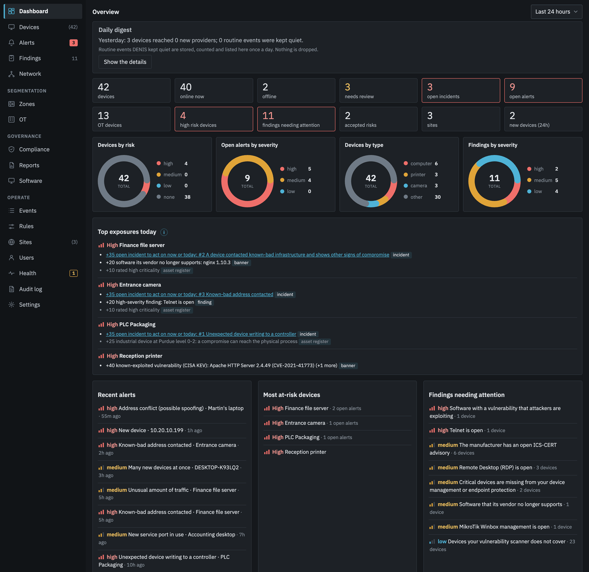

The home screen, and the first thing you see after signing in — and, since the standalone Trends page was folded
into it, the one screen that answers both "what needs attention right now" and "what has this network been doing".
With an AI provider configured and **Settings → AI → Dashboard AI summary** on, an **AI Security Summary** card sits
at the very top: a short, plain-language read of recent alert activity, written only when it actually changes (not on
every page load), never what drives alerting itself.

Below that: twelve at-a-glance counts (devices, online/offline, needs review, open alerts, high-severity alerts, OT
devices, high-risk devices, findings needing attention, accepted risks, sites, new devices in the chosen period) —
click any of them to jump straight to the filtered list behind it — and four donut breakdowns (devices by risk, open
alerts by severity, devices by type, findings by severity — click a segment or its legend entry to drill into exactly
what it shows). Next, **Top exposures today**: the devices with a serious standing fact (a known-exploited or
critical vulnerability, unsupported software, an open incident, a high-severity finding), ranked, each with every
point listed and where it comes from — the top five, and **Show all** for the rest ([how it is ranked](concepts.md#top-exposures-today)).
Then three lists of what actually needs a look right now: recent alerts, the most at-risk devices, and standing
findings.

The rest of the page is the former Trends page, over the same period you pick at the top (24 hours / 7 days / 30
days): eight charts — devices online, devices offline, devices in the register, new devices, traffic sent outside the
network, traffic received, total traffic, and alerts raised (traffic needs `--flows`) — followed by **Top talkers**:
which devices have sent and received the most, from each device's own traffic baseline. Unlike the charts above it,
this is a live leaderboard, not a period (a device seen longer naturally shows more; hover a bar for that device's
own start). The gateway and this monitoring host are left out automatically, since traffic naturally funnels through
them; click **×** on any device to hide it from all three lists too.

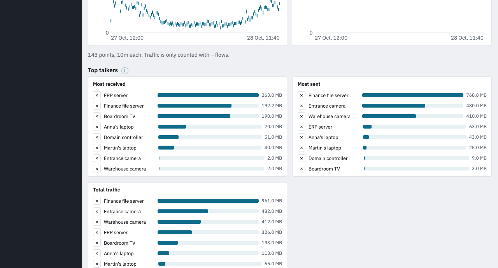

Every number on this page is drawn from state the console already has, so opening it costs nothing extra beyond its
own trend-chart request. Every other tab is unchanged and still one click away in the sidebar.

## Tables: columns

Every table with four or more columns has a **Columns** button above it. **Tick** the columns you want to see,
**move** them with the arrows (or by dragging a heading onto another), and **resize** one by dragging the right edge
of its heading (double-click the edge to give it back its natural width). **Reset columns** puts everything back.
Your choice is kept **in this browser only**, per table: it does not change what anyone else sees, and clearing the
browser's site data resets it. Sorting by a heading works as before, and the layout stays while the lists update.

## Devices

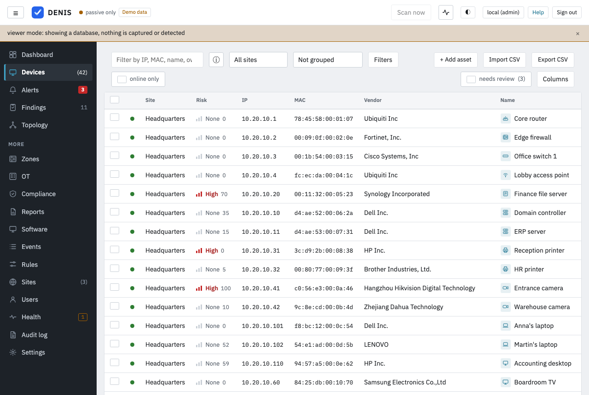

Every device found. Columns: online dot, risk score, IP, MAC, manufacturer, name (with its icon), type, location
(location), guessed OS, open ports, last seen. Click a header to sort; type in the filter box to search IPs, MACs,
names, owners, serial numbers, tags and more.

* **Group by** (type, location or owner) breaks the list into sections, each with its own count; a device with nothing
  entered for the field falls into an "unset" group at the end. Sorting still works inside each group.
* **Filters** combines several conditions at once (type **and** location **and** vendor **and** owner **and** a
  substring of the OS guess) — a badge on the button shows how many are set; **Clear filters** resets them.
* **online only** hides silent devices; **needs review** shows the [review queue](asset-management.md#the-review-queue).
* **Not managed by any tool** answers *what is on my network that nothing manages?* from what DENIS already knows: the
  devices no management, directory, scanning or endpoint tool reports, and no switch or connector DENIS reads. It says
  *Cannot tell* where a tool could not be asked, and never calls such a device managed or not managed
  ([details](coverage.md#not-managed-by-any-tool)).

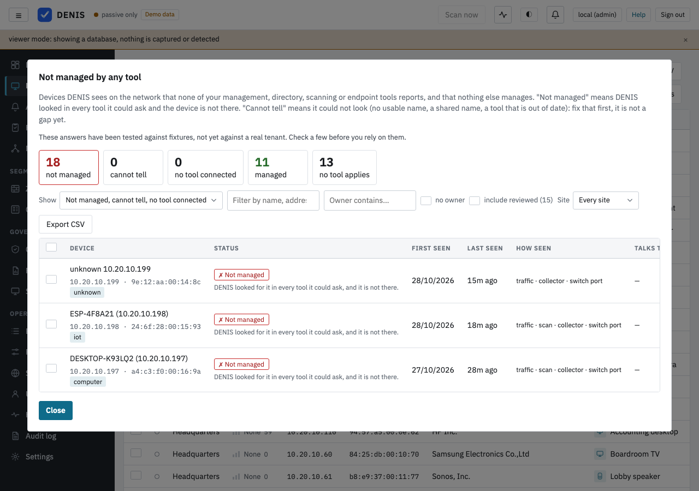

* **Devices CSV** and **Import CSV** are buttons next to each other; **+ Add asset** adds one by hand.

Group-by and filters are per-browser, like table columns; they narrow what is shown, not what is exported (**Devices
CSV** always exports every device).

The **risk score** (0–100) is explained factor by factor on the device page: exposed services (Telnet, RDP…),
how well the device is identified, and its open alerts. Devices you rate *critical* weigh more.

### A device

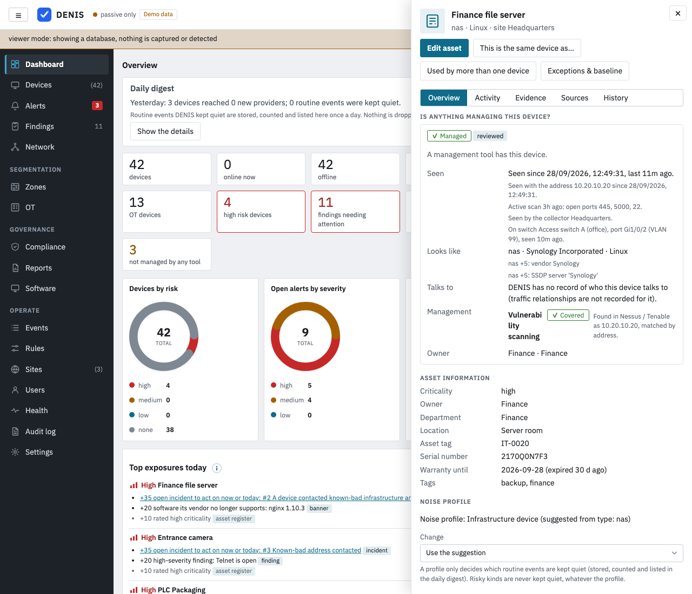

Everything DENIS knows: your data (owner, serial number, warranty…), what it *discovered* and the **evidence
behind each guess** ("Why this guess"), IP history, open ports, the learned **traffic baseline** (usual
destinations, ports, volume, active hours), its alerts and the **change history** of your edits. A device on the
Dashboard's Top exposures list also gets a **Why this is a top exposure** section on its Overview, line by line.

The **History** tab is one list of everything DENIS knows about the device, newest first: its addresses, the switch ports
and VLANs it was seen on, first contacts, alerts, incidents and what was done to it. Pick a group or a period to narrow it;
nothing is stored for it, it is read from what DENIS already keeps ([details](asset-management.md#the-history-tab)). The
search box also answers *who had this address then*: type `10.0.20.15 @ 2026-10-21 14:02`.

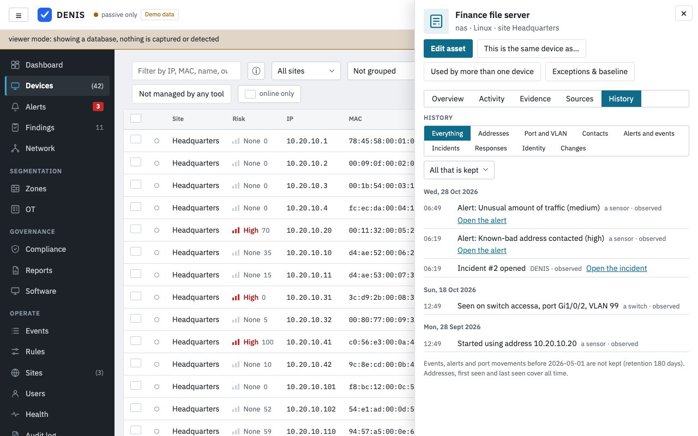

### Editing a device

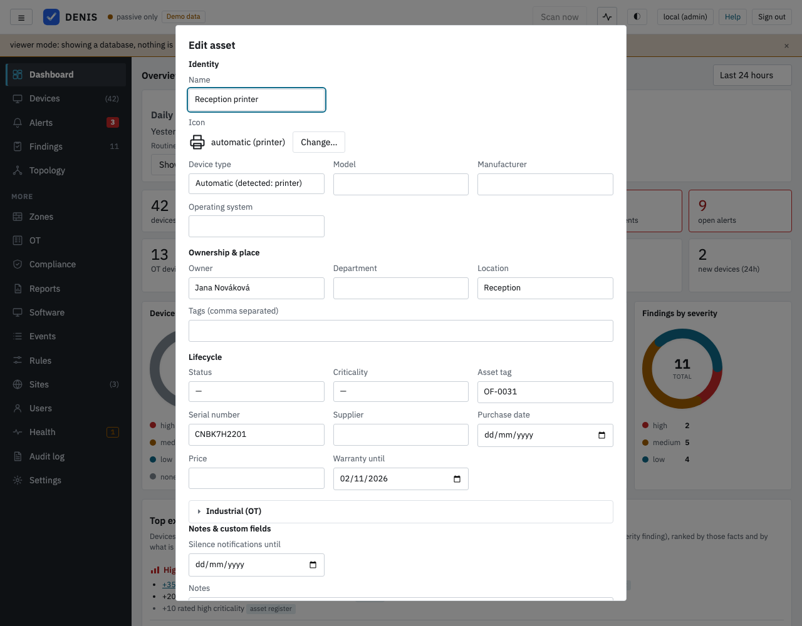

Name, icon, device type, status, criticality, owner, department, location, zone, Purdue level, asset tag, serial
number, model, supplier, purchase and warranty dates, tags and your own custom fields. **Silence notifications
until** stops chat/e-mail alerts about this one device until a date (for a test bench or planned work); alerts still
show in the console. Saving marks the device as reviewed. Discovery never overwrites what you typed.

The icon row shows the current icon with **Change…** right beside it; that opens a window with all 120+ icons grouped by kind and a search box, and **Automatic** lets DENIS choose from the device type. Picking an icon sets the matching device type; the device type is a list (first entry: *Automatic (detected: …)*).

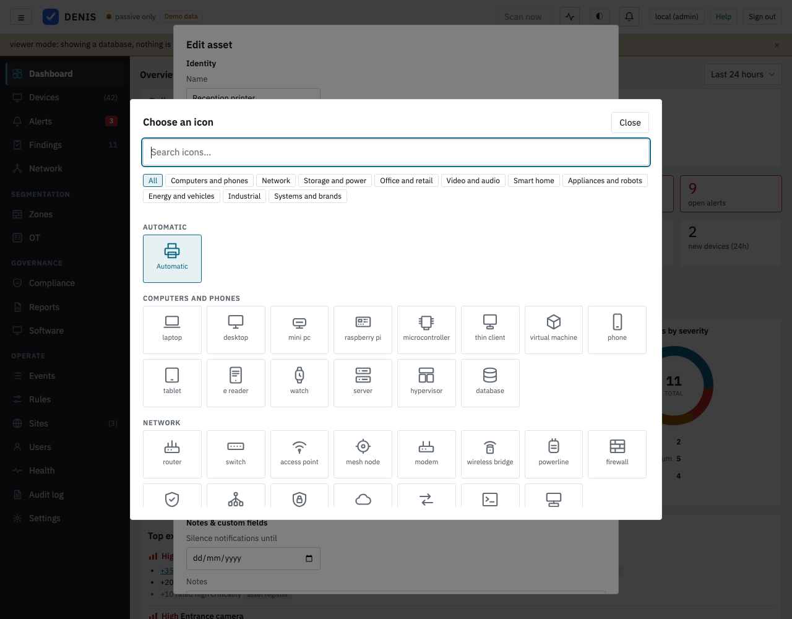

## Incidents

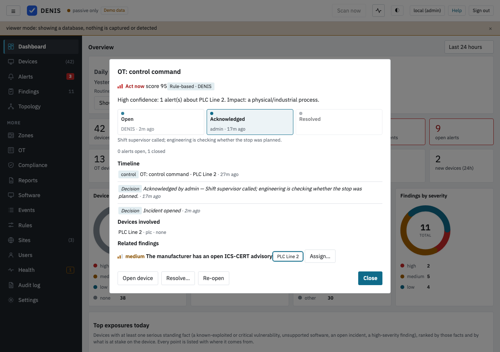

Related alerts grouped into one incident with its own priority (*Act now* / *Investigate today* / *Review* / *Can
wait*), so a device going through several stages of trouble is one row to work instead of several scattered across
the Alerts page. An alert that stays on its own just stays on Alerts — incidents never hide or replace anything
there. Click one for its timeline, the devices involved, the findings on those devices, and, with an AI provider
configured, **Assess consequences with AI**. An incident is worked in three steps (*Open*, *Acknowledged*, *Resolved*),
each recorded with who and when; **Resolve…** needs a reason, and nothing you do to an incident ever closes a finding.
Full details, including what triggers grouping and how incidents reach your notification channels, in
[Incidents](incidents.md).

## Alerts

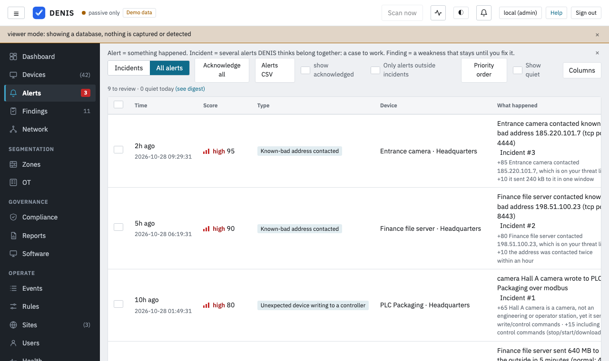

Things that changed, scored 0–100 (high ≥ 70, medium ≥ 50, low ≥ 30; below the minimum score an event is only
logged). Click an alert for the full story:

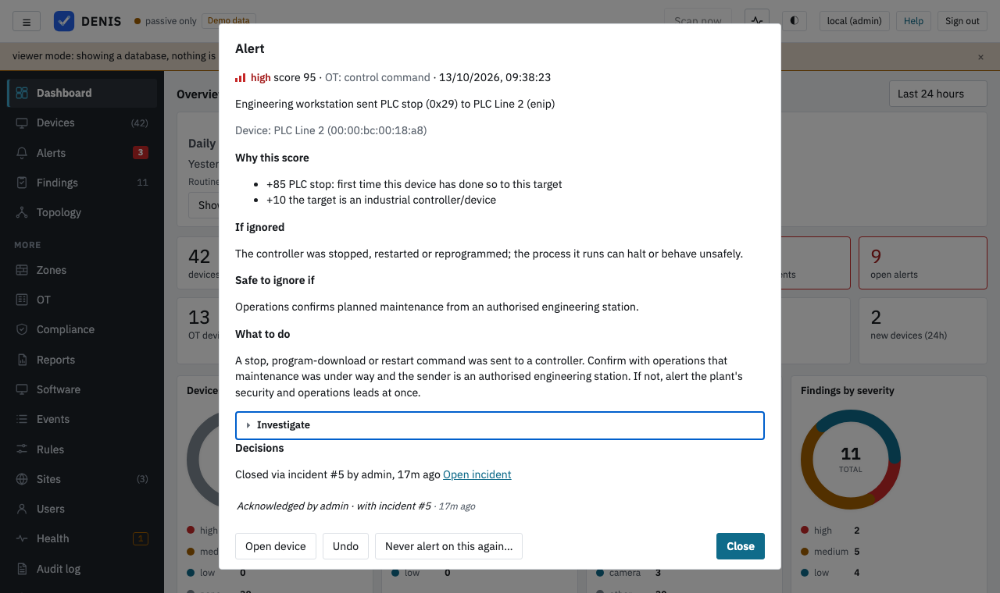

*what happened*, *why it scored what it did*, and **what to do next**. **Acknowledge** an alert when it is handled,
with an optional reason (resolved / false positive / expected behaviour); acknowledged alerts no longer count
towards a device's risk score. Tick several rows to acknowledge them together, or **Acknowledge all**. The same
alert kind repeating for the same device is folded into one row ("×12, recurring since…") that expands on click.
**Add exception** (administrators) silences that exact alert for that device without a trip to the Rules page.
**This is normal…** (editors and administrators) closes the alert as expected behaviour and keeps later alerts like it
out of the alert list for the time you choose (90 days by default), for this rule on this device, for this device and
destination, or for everything ordinary on the device. Nothing is deleted: the quiet alerts are still stored and counted,
and an administrator removes the exception under *Rules → Suppressed by "This is normal"*
([details](detection-rules.md#this-is-normal-and-how-useful-each-rule-is)).

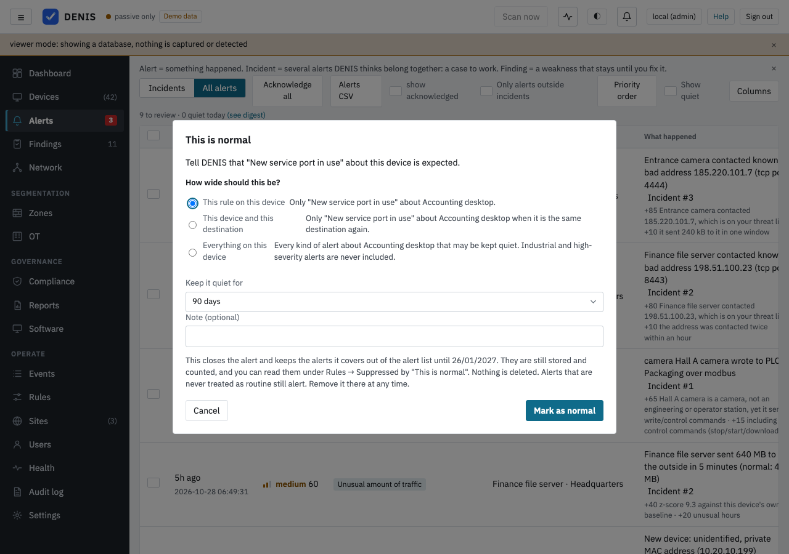

With an AI provider configured, **Assess & Explain with AI** appears in the dialog: one click covers what the
alert means, whether it looks malicious, the consequences of ignoring it and what to do next, plus — for alerts
about a change from a device's own baseline — a behavior-change explanation, all in the same answer.
**Alerts CSV** (a button, next to *show acknowledged*) exports the list.

**Investigate**, a collapsible section in the same dialog, shows the alert in context: the device's other events an
hour either side, what DENIS recorded between the device and the alert's other party, which other devices contacted
that same party, and the incident it belongs to. Traffic between two of your own devices only shows up there with
east-west traffic switched on (Settings → Capture → Network interface; off by default). Each relationship row says who opened
the connection (**Initiated by**: this device, the other side or unknown, confirmed or guessed, with a tooltip), and its
arrow follows that, or points both ways when it is unknown. See
[Relationships](concepts.md#relationships-and-the-investigate-section).

An alert for a **connection from the internet** (`inbound_from_public`) has its own section in the dialog with the
evidence per source: address, name, country, network, threat-list flag, service and port, attempts and completed
handshakes, first and last seen, bytes each way and the other devices it reached. Administrators can mark the port as
expected from there with one click; the source network is covered by **Allow this provider**. See
[Detection rules](detection-rules.md#inbound_from_public-a-public-address-connected-in-needs---flows).

Any public IP address the alert mentions gets its own **Network context** section: the address, its country/ASN/ISP
(or "private"/"loopback"/etc. for one that is not public), reverse-DNS hostname, and — click it — a full detail
panel with coordinates, connection type and which GeoIP database answered. See
[IP enrichment](#ip-enrichment) below for where this data comes from and how to configure it. The same section
appears on the Events page (identical dialog) and, for an address's history, on a device's own panel.

## Findings

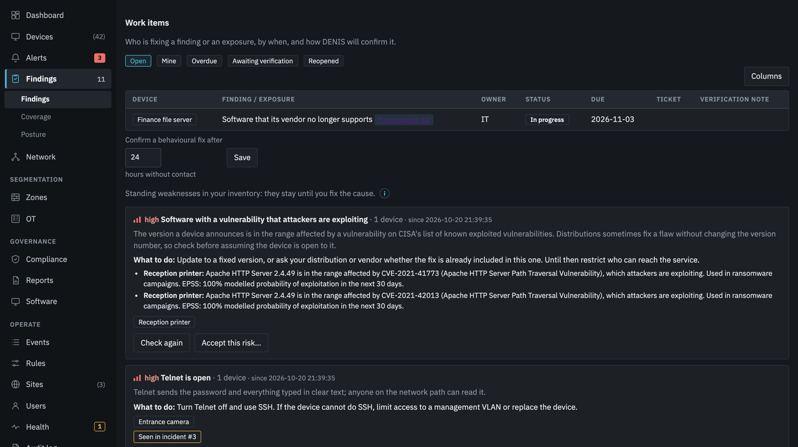

Standing weaknesses and housekeeping problems that stay until you fix the cause: Telnet or RDP open, a device
marked *lost* still on the network, critical devices with no owner, devices nobody has reviewed, expiring
warranties. Devices with the same problem are grouped, each with why it matters and what to do
([list](detection-rules.md#findings-standing-problems-with-a-fix)).

Findings about software versions (support ended, a known-exploited range) list, per device, the product, the version that
was read from its banner and what it means ([details](detection-rules.md#software-versions-end-of-support-and-known-exploits)).

Each finding has two buttons. **Verify fix** looks again: DENIS scans the devices right now and tells you, device by
device, whether the problem is gone. **Accept risk…** (administrators) records a decision to live with it, with a
reason and, usually, an end date; the device leaves the finding and appears under **Accepted risks** below, with who
accepted it and why ([details](detection-rules.md#verifying-a-fix-and-accepting-a-risk)).

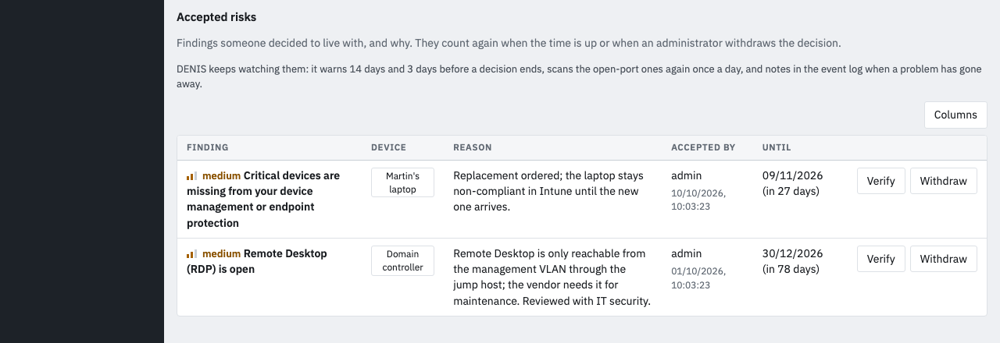

## Rules

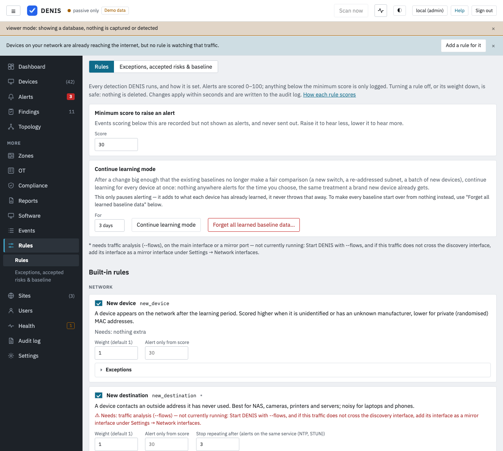

Every detection with what it does, what it needs, whether it is on, its weight (`0` = off, `2` = twice as loud)
its thresholds and a minimum score of its own, plus **exceptions** (devices, device types, tags or networks a rule
stays quiet about), your own **IT rules** (which devices may talk to which addresses and ports) and your own
**OT rules**. The page shows IT and then OT; in each, your own rules come first and the built-in ones follow in
themed groups, closed unless they alerted in the last 7 days. A bar at the top searches (`/`), filters and has one
**+ New rule** menu; a rule's switch saves at once, Quieter / Normal / Louder and thresholds go through a save bar.
**+ New IT rule** and **+ New OT rule** open a dialog that reads as a sentence, with templates, a preview of what the rule would have done and an Undo
after saving ([details](detection-rules.md#your-own-rules-it-rules-and-ot-rules)). Everyone can read the page;
administrators change it. Changes apply
within seconds, survive restarts and are written to the audit log ([details](detection-rules.md)). Administrators
also find **Continue learning mode** and **Forget all learned baseline data** here, and can export the rule
settings as a file and import them elsewhere.

Two more sections sit above the list. **Suppressed by "This is normal"** lists what the button above kept quiet, with a way to
take each exception back. **How useful is each rule** counts, per rule, how many alerts it raised and what became of them
(handled, marked normal, closed automatically, acted on, still open after a week), for 30 or 90 days, with a CSV; it only
counts, nothing leaves the system, and a rule whose alerts are rarely acted on gets a suggestion to quiet it
([details](detection-rules.md#this-is-normal-and-how-useful-each-rule-is)). The **Performance protection** box at the top says
what DENIS does when a rule makes detection late: pause that rule and say so (the default for your own IT rules and the
newer built-in ones), or keep it running; industrial rules are only warned about unless you choose otherwise
([details](detection-rules.md#when-detection-is-overloaded)).

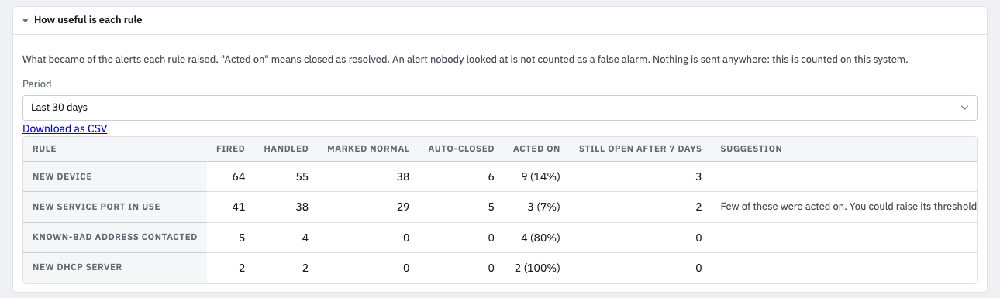

The page has a second view, **Exceptions, accepted risks & baseline** (a sub-entry in the menu): every place a
rule or finding has been told to stay quiet, and every learned baseline destination, grouped by device in
one searchable list. Removing something here has exactly the same effect as removing it where it was added.

## Compliance

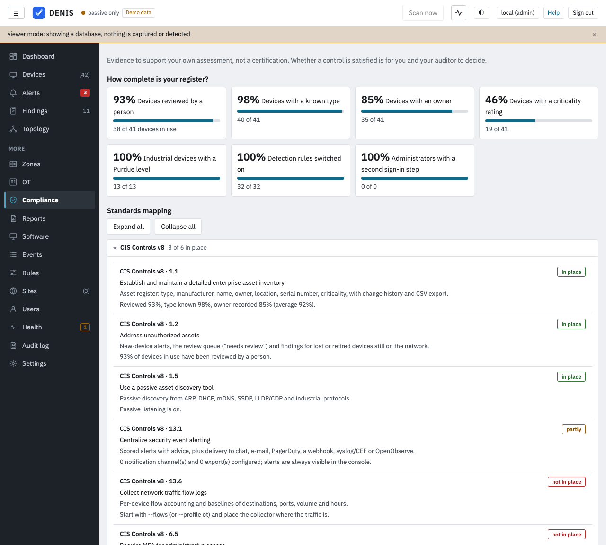

How complete your register is (reviewed, typed, owned, rated, Purdue levels) and how DENIS's capabilities line up
with controls of **CIS Controls v8**, **NIST CSF 2.0**, **IEC 62443-3-3**, **NIST SP 800-82** (through its NIST
SP 800-53 controls), **ISO/IEC 27001:2022 Annex A**, **NIS2 Article 21**, **DORA**, **PCI DSS v4.0**, the
**HIPAA Security Rule**, **SOC 2** (Trust Services Criteria) and **CMMC 2.0** (through NIST SP 800-171): which are
in place, partly or not yet, and why. It is evidence for your own assessment, not a certification. Print the page
to keep it.

## Network

*Network* is a group in the left menu with four pages: **Map**, **Equipment**, **Response** and **Setup**.

**Map** draws your equipment (switches, firewalls, routers, access points, controllers) with the cables between them, internet side
on top, and the devices under each switch port or access point; from 40 devices on a site they are grouped into one box you can open.
Pan and zoom with the mouse, a trackpad pinch or the +/- buttons; **Fit** shows everything; drag a box to place it; **Hide from map**
removes noise (nothing is deleted); search, filters and a minimap keep a large site usable; **Full screen** gives the map the whole
window. Click a box for its details, its ports and the actions you may take on it. Each cable says how DENIS knows it: confirmed (the
equipment announces it over LLDP or CDP), a best guess from the forwarding tables, or set by hand ([details](switches.md)).
Administrators save the layout for everyone (it saves by itself); everyone else can rearrange the map for their own view.
The picture shows a generated example network with its groups: the box *18 Wi-Fi clients* is selected, under the access
point they are on, and the side panel lists them.

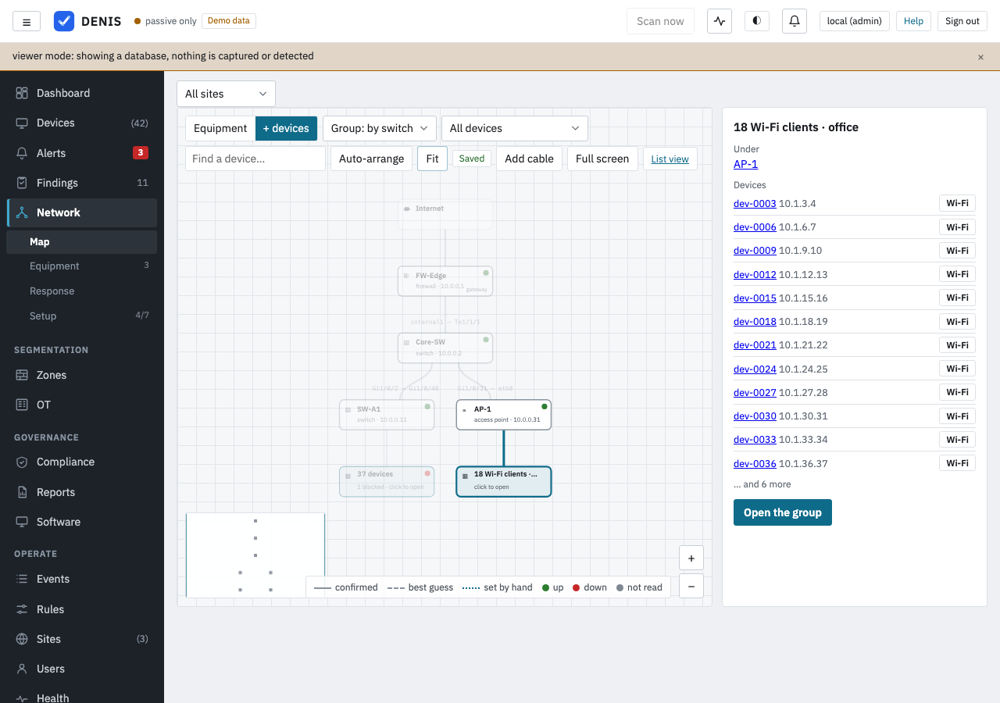

With the keyboard, Tab to a box and press Enter to select it, then the arrow keys move it 10 px (Shift: 50). On a touch screen one finger pans (or drags a box) and two fingers pinch to zoom. With more than 1,500 devices open at once the devices are drawn on a canvas under the map to keep it quick; they can still be clicked, dragged and moved with the arrow keys, but a device drawn that way has no tooltip and is not in the keyboard's Tab order (use the search box).

**Equipment** is one table: every switch DENIS reads and every firewall, controller or cloud platform it acts through, with its state
in words, when it was last read and what DENIS can do with it. Open a row for the ports as a grid; a controller row (UniFi, Meraki)
opens into the access points and switches it manages, read only, with the number of clients each one carries. The tags say how far
a product was tested: *Simulator only* and *Experimental* mean it was tried against a simulated device, not a real one
([what was verified](nac/validation.md)).

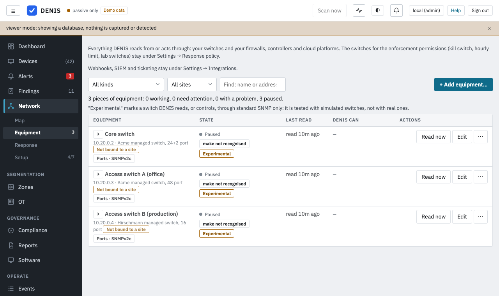

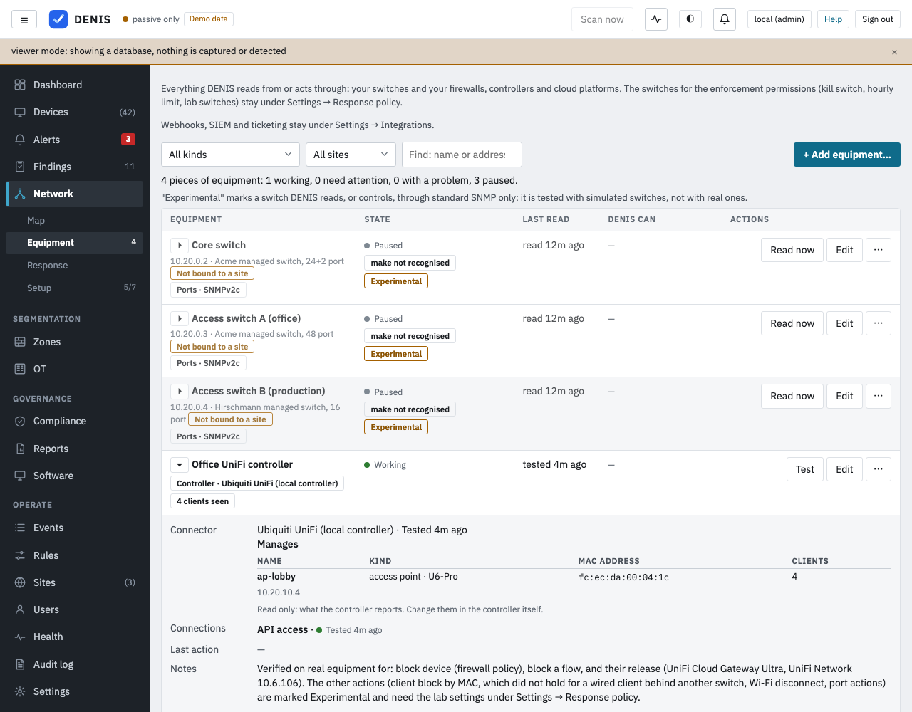

**Add equipment…** starts with the product: DENIS then asks only for what that product needs, tests the connection, and says
what it can do with it (read the cables, place devices on ports, block, quarantine, end sessions). Type a vendor or product in
the search box or pick a card; a gateway DENIS has already seen is suggested at the top. *Any switch with SNMP* reads any managed
switch with the standard tables; its port actions are Experimental.

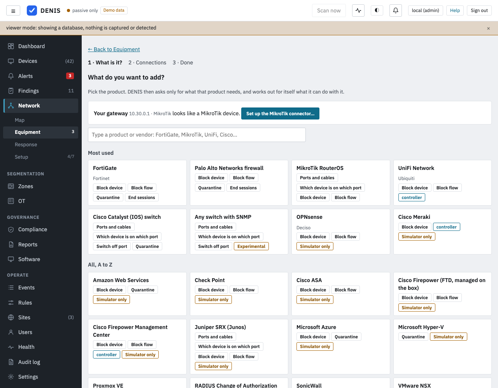

**Setup** is the guided setup in seven steps: *Discover* (what DENIS has already found, passively), *Confirm the gateway*, *Add equipment*,
*Same device?* (interfaces of one machine), *Cables DENIS is not sure about*, *Write credentials* and *Dry run*. Every step can be
entered again later. Nothing is written to equipment before you press a button of its own, and the dry run only asks what is possible.

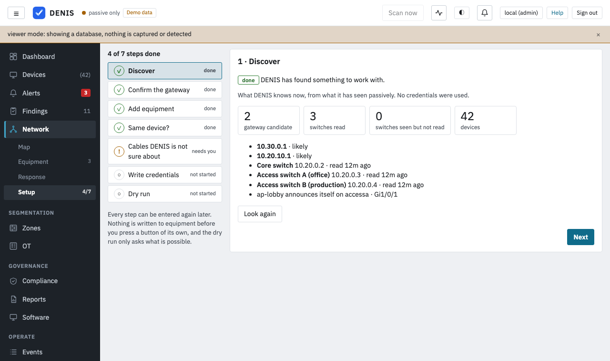

**Response** starts with one strip: whether enforcement is on, the hourly limit, what your account may do and whether experimental actions
are allowed. Under it are every response in force (*Currently blocked by DENIS*, with **Release**, **Extend** and **Details**), the
responses waiting for your approval and the hands-off devices ([Enforcement](enforcement.md)). The picture uses stand-in
data, because a demonstration console never switches enforcement on.

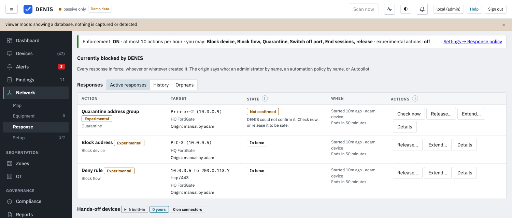

## Zones

How your network is meant to be divided, and whether traffic keeps to it ([Zones and policies](segmentation.md)). Anyone
with console access can look; administrators create and edit. Three views:

* **Matrix** (the default) — every pair of zones with what crossed between them in the chosen window (last day, 7 days or
  30 days): a violation, unreviewed traffic, allowed, or nothing seen. Click a cell for what is behind it and, as an
  administrator, to allow or deny that pair.
* **Zones** — the named groups of devices, with their trust level, inbound and outbound defaults and how many devices
  each one holds; *Add a zone…* (administrators).
* **Policies** — the zone policies and allow-lists, and your IT and OT rules that use a zone, each with its history.

Nothing here blocks anything by itself. A policy can only feed blocking when an administrator also marks it for
automatic enforcement, which is experimental and off by default ([Enforcement, automation](enforcement.md#automation)).

## OT

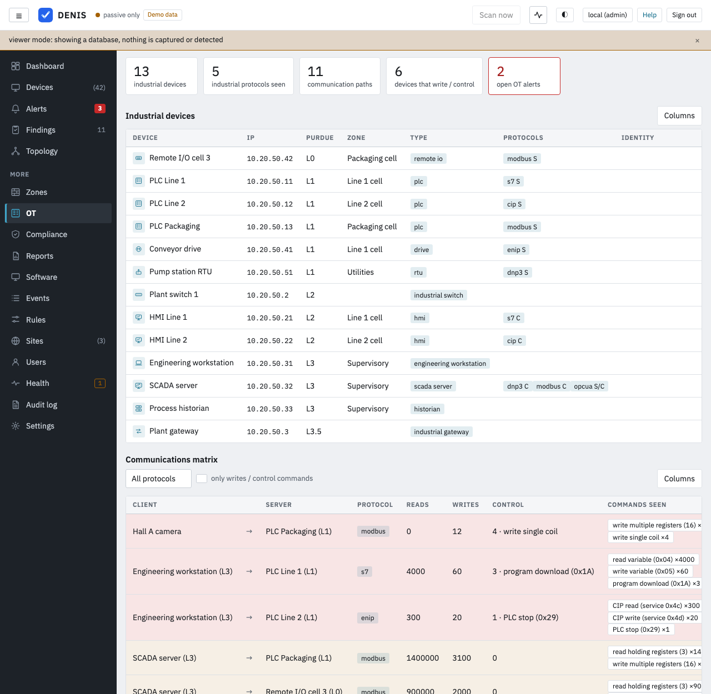

For industrial networks ([OT guide](ot-guide.md)): industrial devices with their Purdue level, zone and the
protocols they speak (S = answers requests, C = sends them), the **communications matrix** (who talks to whom over
Modbus, S7, EtherNet/IP, DNP3, BACnet, OPC UA, IEC 104, with counts of reads, writes and control commands), and
the functions each path uses (**Commands seen**: click one to be told whenever it is sent) and the open OT alerts.
Filter to *writes / control commands only* to see who can change a process.
Under the matrix, *Engineering file (IEC 61850 SCL)* imports a station's SCL file (administrators) and shows which observed
publishers and servers are in it and which engineered IEDs have not been seen ([OT guide](ot-guide.md#scl-import-iec-61850-engineering-file)).

## Software

Every product and version DENIS has read from a service banner (SSH, HTTP, FTP, SMTP, MySQL/MariaDB), grouped by
software instead of by device, with a status per row: known-exploited, end of support, end of support soon, or
no known issue — the same data the Findings page checks, seen fleet-wide. Click a device count to see which
devices run that version.

## Events

Every event, including the low-scoring ones that never became alerts. Useful when you wonder *"did it notice
that?"*. Click a row for the full story.

## Health

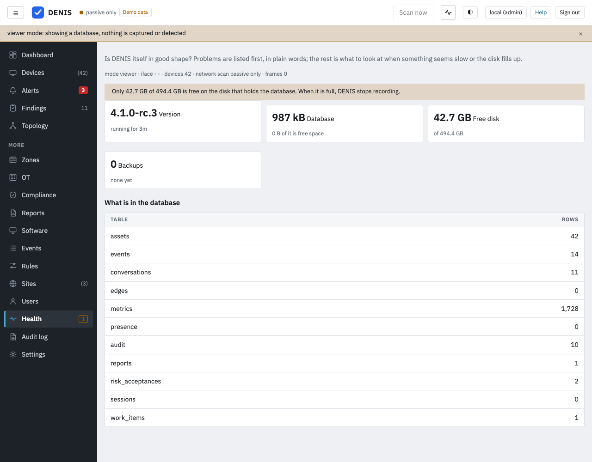

The **Health** page (Manage) answers "is DENIS itself in good shape?". Problems come first, in plain words: the
capture is not running, packets are being dropped (DENIS too slow for the traffic, or a mirror port carrying more than
one machine can process), a network sweep is late, the disk holding the database is nearly full, or there is no
recent backup, and also the quieter ones where DENIS works but some data is missing: the packet parser crashed on a packet,
a remote agent's clock is so wrong that its records are dropped, a switch could only be read in part, alert notifications
were dropped ([Operations](operations.md#health-warnings-that-point-at-data-you-cannot-see)). The menu shows how many problems there are. Below: version and uptime, database size (and how much
of it is free space), free disk, packets dropped, the last sweep, and how many rows each table holds (what to look at
when the database is bigger than expected). **Internet connection watch** counts the packets the capture skipped when a
burst of internet scanning reached its per-window limits (zero normally).

**What DENIS cannot see** is a section of this page (open by default): per capture interface, what arrived and what was lost or could
not be read on the way, the networks and VLANs DENIS was told to watch against the ones it actually saw, and one plain sentence of
advice for each problem. Each row says whether it was *measured*, *estimated* or is *not measurable*; the page never claims to see
everything ([details](visibility.md)). The numbers in the picture are made up for the example. **Detection rules**, further down, shows
what each detection costs and which rules were paused for being too slow ([details](operations.md#what-each-detection-rule-costs)).

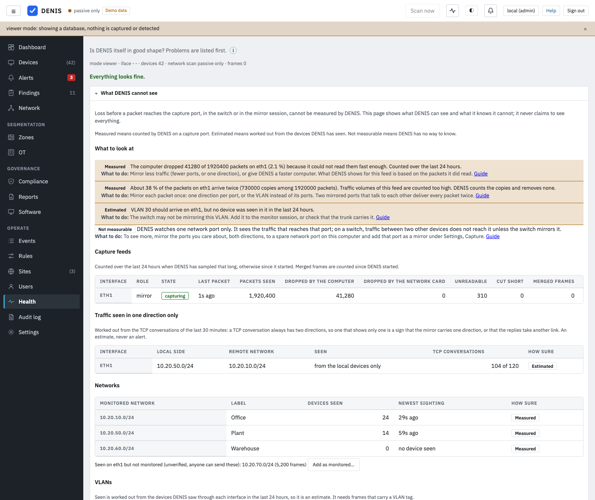

A device's **Overview** tab has a switch, **Alert on every connection from the internet**, for a device that must never
be reachable from outside; and **Recent destinations** on the same panel shows, per address, who initiated the traffic
(**Initiated by**).

Administrators also see **Backups**: a daily automatic backup of the database (keep the newest 7, or change or switch
it off), *Back up now*, and a list to **download** or delete. See [Operations](operations.md#backup-and-restore).

## Sites

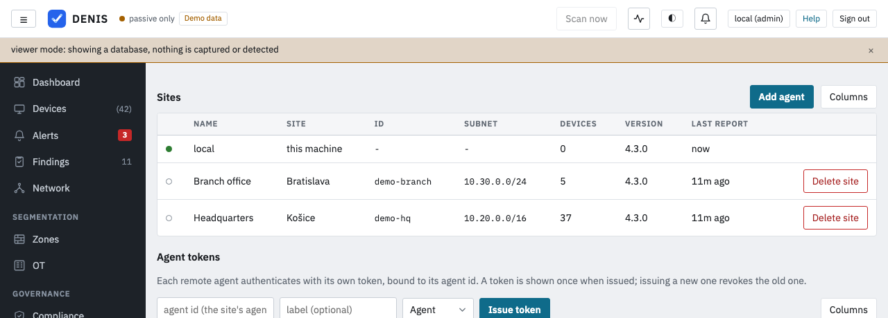

The local collector and every remote **agent** that reports to this master (outbound connections only). An
administrator issues and revokes one **token per agent** here, and can **delete a site** together with every
device it reported (the site id has to be typed back to confirm; the token is revoked separately). Each agent shows
its version, **outdated** when it is older than the master, the result of its last update and, for an administrator,
an **Update** button (and **Update all outdated** above the table); how agents are updated is set under *Settings →
System → Updates for remote agents* ([Updates](updates.md#updating-remote-agents)). See
[Deployment](deployment.md#multiple-sites-agents).

## Alerting (administrators)

*Settings → Notifications.*

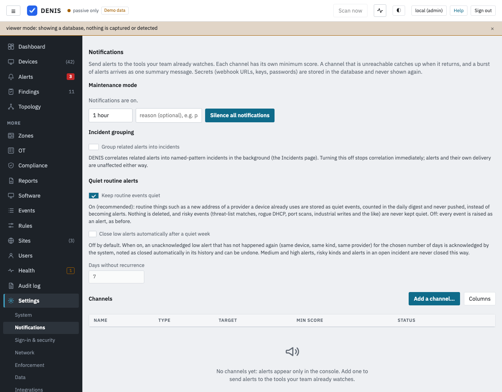

Where alerts go outside the console: Slack, Microsoft Teams, Discord, PagerDuty, Pushover, ntfy, e-mail, Jira, ServiceNow and a signed webhook, each
with its own minimum score, its own **Delivery** choice (every alert individually, or grouped into
[incidents](incidents.md#turning-it-off-and-sending-incidents-out)), a **Test** button and live delivery status.
**Maintenance mode** silences everything for 30 minutes to 7 days, and **Group related alerts into incidents** (on by
default) turns the correlation itself on or off network-wide ([details](alerting.md)).

## Users (administrators)

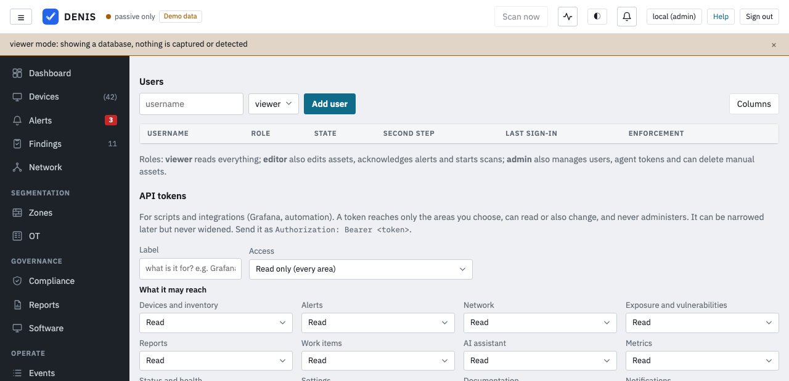

Accounts and roles (*viewer* reads, *editor* also edits devices and acknowledges alerts, *admin* also manages
users, settings and rules) and **API tokens** for scripts and Grafana.

**API tokens (4.3)** reach only the areas you tick (devices, alerts, network, reports, metrics and so on), each at *Read* or
*Read and change*, and never administer anything. A token expires (90 days by default; *Never expires* is allowed, with a
warning), can be **narrowed** later but never widened, **rotated** (the old value keeps working for a grace period you choose)
and **revoked**. *Acts as* lets a token work as a service account (a viewer or editor account you made for it), with that account's
site access, so a token can be limited to some sites. The token itself is shown once, when it is made ([API](api.md#api-tokens-for-scripts-and-integrations)).

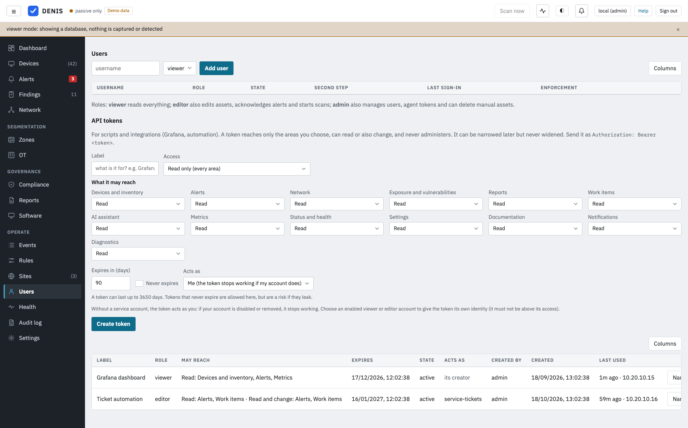

**Sites** (per user) opens which sites — the local network, or a remote agent — that person may see or change:
**full access**, **read only**, or **no access**. Nothing is set by default, which means full access everywhere,
same as before this existed; an administrator restricts a user only by opening this and choosing otherwise.
Useful for an MSP whose technicians should only see their own customers, or to keep a sensitive site out of a
viewer's sight entirely.

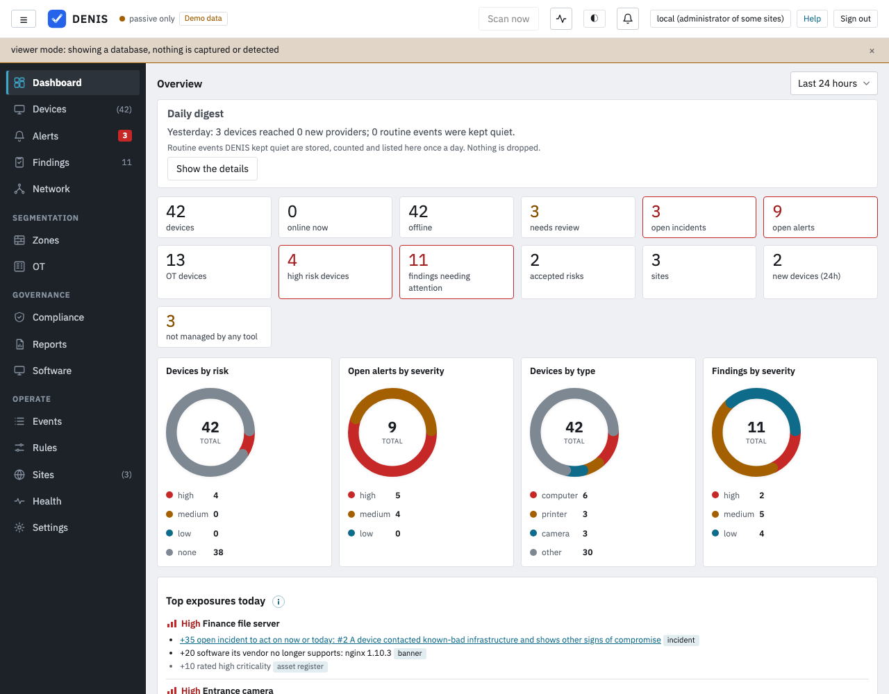

**Site administrators (4.3).** An administrator with *read only* or *no access* on any site is an administrator of
its other sites only, marked *own sites only* in the list. It sees and changes only the sites it may change, acts
(plan, apply, undo, extend) only through switches and connectors bound to those sites and only on a device DENIS knows
there, can switch enforcement off but not on, and confirms identity questions (links, suggestions, a shared hardware
address) for its own rows. Users, Audit, Settings of the whole installation, rules, Autopilot, joins and adding or
binding equipment stay with administrators of the whole installation; the server refuses them (`403`), the console
hides Users and Audit. A site without an entry for the account counts as full access, also a site added later (a
new agent): give a site administrator *no access* on every site it should not manage, and check its entries whenever
a site is added. At least one enabled administrator of the whole installation always remains: limiting,
demoting or disabling the last one is refused. If that state is reached anyway (a restore), Health says so and
`denis user sites-clear <name>` on the server lifts an account's site limits.

*Updating from 4.2 or older:* before 4.3 an administrator's site access changed nothing; from the first start of 4.3
an administrator with *read only* or *no access* on a site is a site administrator. Health names these accounts for
30 days (to administrators of the whole installation; other readers see how many). If every enabled administrator
would become one, the oldest administrator keeps the whole installation: its *read only* and *no access* entries are
removed, and the audit log shows it. Check the Users page after the update.

## Settings (administrators)

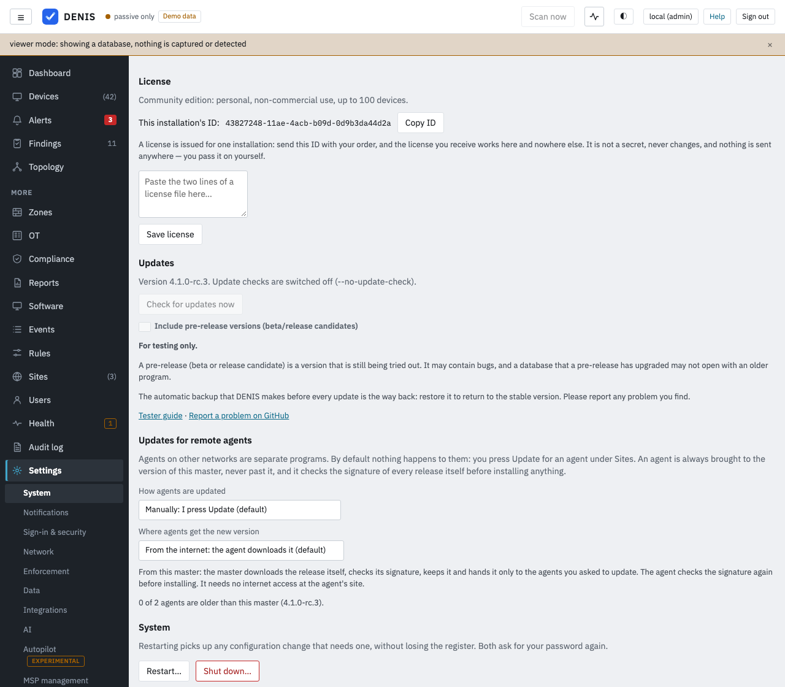

Everything about the installation that is not about people, in eleven categories shown as a sub-menu under
*Settings*:

* **System** — license, updates (check, install now or later, include pre-releases, and "If GitHub is unreachable, try
  usedenis.com"), how remote agents are updated (manually by default, automatically, from the internet or from this
  master), restart / shut down, the setup guide (the first-run checklist, which you can open again here).
* **Notifications** — the channels alerts are sent to ([Alerting](alerting.md)).
* **Sign-in & security** — who must use a second step, passkey-only sign-in, single sign-on (OIDC), the HTTPS
  certificate (download the local CA, or use your own).
* **Capture** — what DENIS sees: the discovery and mirror interfaces and the agent listener (under *Advanced*: east-west traffic,
  passive DNS and IEC 61850 Sampled Values, each off by default), duplicate packets (counted by default), **Separate networks**
  (below), watched VLANs, monitored networks and active probing, certificates and web pages, the connection stability test, and
  Network Intelligence (GeoIP / reverse DNS). The switches and connectors are under *Network → Equipment*.
* **Response policy** — what DENIS may do: the switch that lets administrators block a device (off by default), its hourly limit,
  the lab settings for experimental actions and automation. What is in force is under *Network → Response*
  ([details](enforcement.md)).
* **Data** — data retention, the software-version data (end-of-support and known-exploited refreshes, custom
  CVEs), threat list sources (the auto-fetched abuse.ch, Spamhaus and Tor exit blocklists, each independently schedulable, and
  the free **abuse.ch Auth-Key** that ThreatFox needs), and demo data: load a fictional company to explore, remove it, or **erase all data** when you are ready
  for the real network ([details](operations.md#demo-data-and-starting-clean-erase-all-data)).
* **Integrations** — SIEM / log export, CMDB import (Entra ID, Intune, Active Directory, Jamf Pro, Azure, AWS,
  GCP), the vulnerability scanner (Nessus).
* **AI** — the optional bring-your-own-key AI features, each with its own switch, grouped by when they call the provider (only when you click, or in the background), and their usage counters.
* **Autopilot** (marked *Experimental*) — the mode (off by default, shadow, active), the shadow report, what it may do on
  its own, answering from a phone, and the optional AI model ([Autopilot](autopilot.md)).
* **MSP management** (marked *Experimental*) — pairing this installation with an MSP using a link code, the level the MSP
  gets, co-approval, *What the MSP did*, *Disconnect* and *Unlink*; on an MSP's own console, its customers
  ([MSP management](msp-management.md)).
* **Branding & MSP** — name, logo, colour, default theme and language; the MSP view.

Deep links like `#settings/tls` still open the right category.

**Separate networks.** Interfaces that see the same network share one VLAN numbering and one address range. When one DENIS watches
mirrors of two plants that both use VLAN 10 and 10.0.0.0/24, give the interfaces of the second plant a network name here: the
same VLAN and address are then a different network, not a conflict ([details](concepts.md#sites-agents-and-the-master)). Leaving
the name empty means *the same network as the other interfaces of the site*; it never loosens an enforcement check.

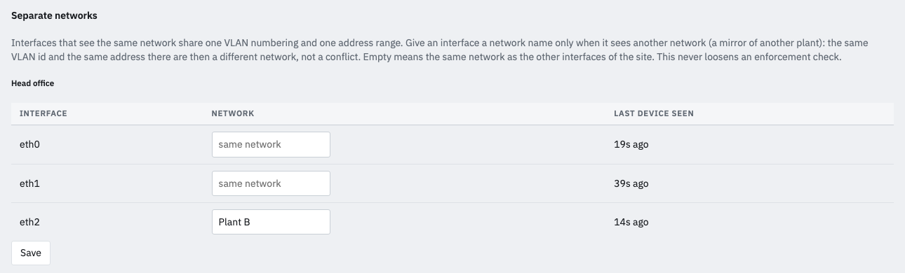

**The abuse.ch key.** The ThreatFox list (malware server addresses and, since 4.3, domain names) needs a free Auth-Key from your
abuse.ch account. Paste it under *Settings → Data → Threat list sources*: it is stored encrypted, sent only to threatfox.abuse.ch,
and never shown again (the box shows only whether one is saved). Without a key ThreatFox is simply not fetched, and the box says so.
The picture shows the box with no key.

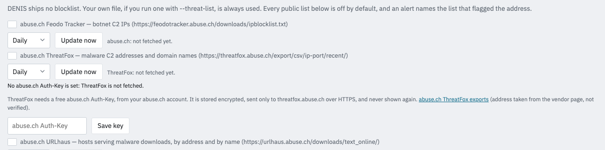

## IP enrichment

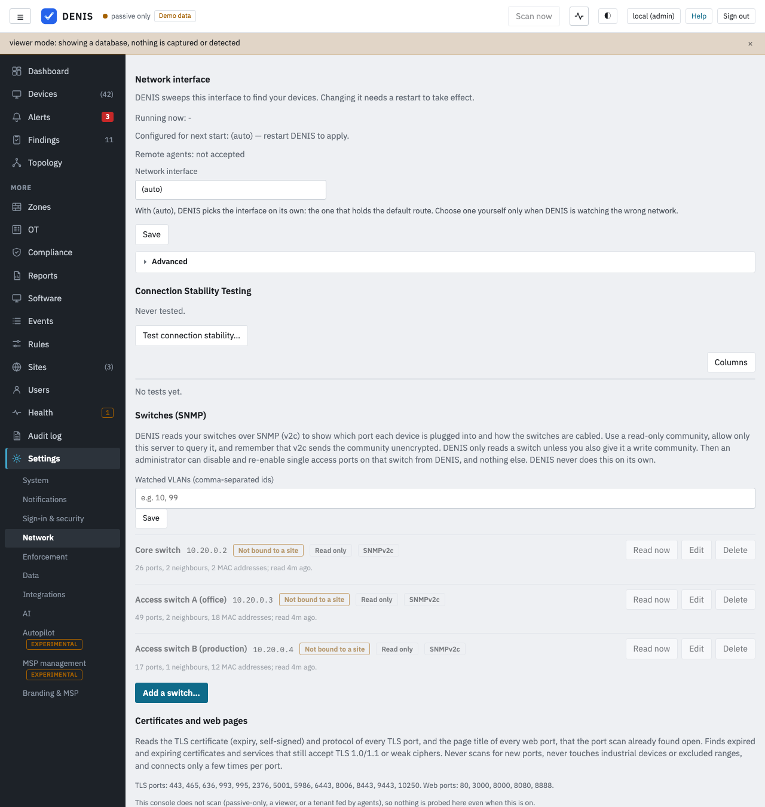

Every public IP address the console shows (Alerts, Events, a device's Recent destinations and IP history) gets a
flag, AS organisation, ASN and reverse-DNS hostname right next to it — no extra click needed. The flag comes first,
with the country's name as a hover tooltip rather than spelled out in text; the reverse-DNS hostname, usually the
longest part by far, sits on its own line underneath. A private/loopback/link-local/multicast/reserved address is
never geolocated at all, only classified as such. Clicking the address itself still opens a full detail panel with
coordinates, connection type and which GeoIP database answered.

Under *Settings* → **Capture** → **Network Intelligence**:

* **Reverse DNS**: on by default (resolver `1.1.1.1`, secondary `1.0.0.1`, 2000 ms timeout) — change the
  resolver(s) and timeout, or switch it off entirely.
* **GeoIP database**: **DB-IP Lite** by default (free, [CC BY 4.0](https://db-ip.com)), or point it at your own
  MaxMind-format `.mmdb` file(s) if you have a licensed database — DENIS never distributes one for you.
  **Automatically update** is on by default (monthly) — DB-IP Lite downloads and installs its own current release
  on its own, so a fresh install never has to wait for someone to notice a manual button. Choose Daily/Weekly/
  Monthly, or turn it off for on-demand-only ("Update now"). The provider/version/last-updated date is shown live,
  and a Settings save takes effect immediately, no restart.
* **Cache**: GeoIP answers are kept for 30 days, reverse-DNS answers for 24 hours, by default — both adjustable.
  The same address is never looked up twice while its cached answer is still fresh, however many alerts mention it.
* Nothing about this ever slows down or blocks device discovery, alerting or event processing: enrichment happens
  in the background, and a page of alerts shows whatever is already known rather than waiting on a lookup.

## Users: second step and Sign-in & security

The *Users* page shows how each person signs in (authenticator app, passkeys), and **Reset** removes somebody's
authenticator app after a lost phone. Under *Settings* → **Sign-in & security** an administrator can require a second
step for administrators or for everybody, and, separately, require a **passkey only** (once a covered person has
added one, their password no longer opens a session).

## Audit log (administrators)

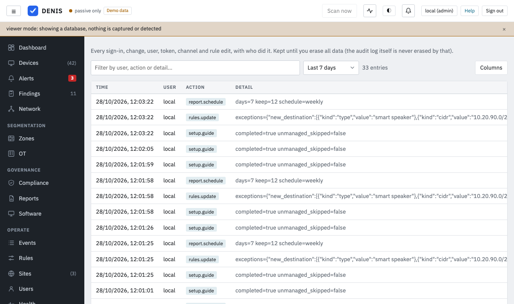

Every sign-in, change, user, token, channel and rule edit with who did it, filterable, the last 100 to 1000 entries.

## My account

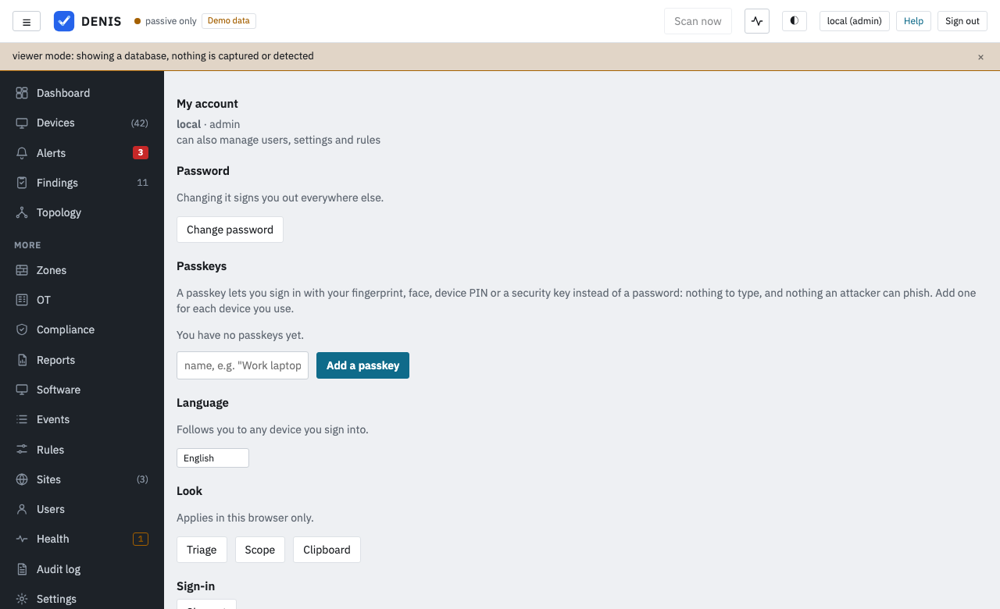

Click your name in the header. Here you change your **password** and manage your **passkeys**: sign in with a
fingerprint, face, device PIN or security key instead of a password, one per device ([details](security.md#passkeys)),
and an **authenticator app** as a second step after the password, with recovery codes ([details](security.md#authenticator-app-totp)).

## Reports

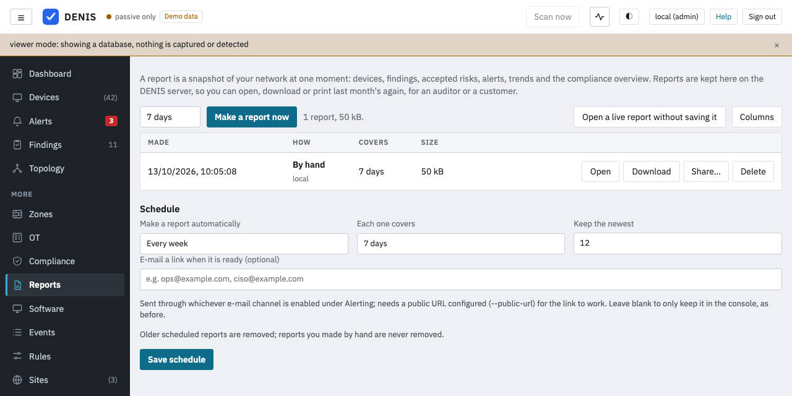

The **Reports** page (Analyze) keeps snapshots of your network on the DENIS server. A report is a self-contained
page: summary, compliance overview, findings, accepted risks, trends, devices by risk, alerts and lifecycle. It
carries your branding. **Open** it, **Download** it as one HTML file, or print it (or save it as PDF) to hand to a
client or an auditor.

* **Make a report now** (editors and administrators) for the last 7 days up to a year. The report is stored, so
  last month's is still there next month, exactly as it was.
* **Schedule** (administrators): every week or every month, covering a period you choose, optionally e-mailed as a
  link when ready. DENIS keeps the newest N scheduled reports and removes older ones; reports you made by hand are
  never removed. Deleting a report is an administrator's action and goes to the audit log.
* **Share…** (administrators) turns on a link that opens the report **without signing in** — the dialog says so
  plainly; **Stop sharing** invalidates it immediately.
* With *Settings → AI → Security reports* on, a saved report also carries a short AI-written summary; the live
  `/report` never does.
* Reports are kept in DENIS's database, so they are included in backups, and **Erase all data** removes them too.

`/report?days=7` still gives a live report that is not saved (see the [API](api.md)).
